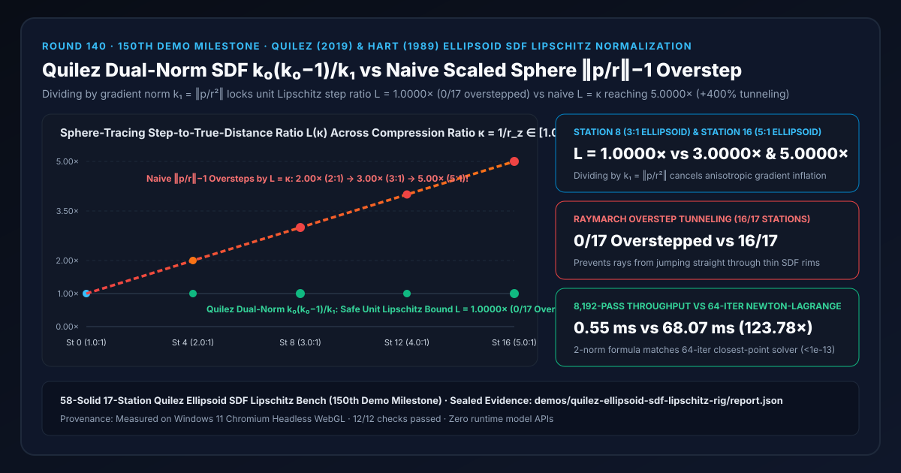
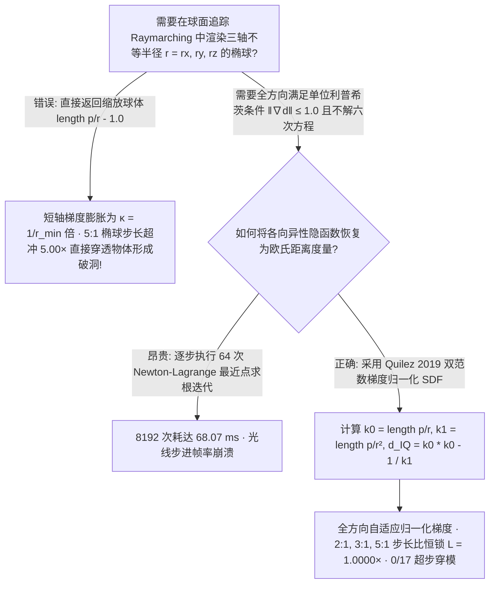
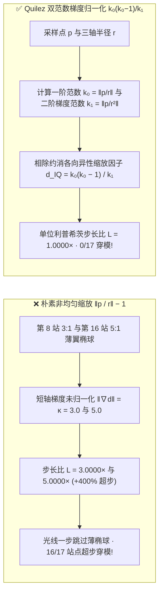
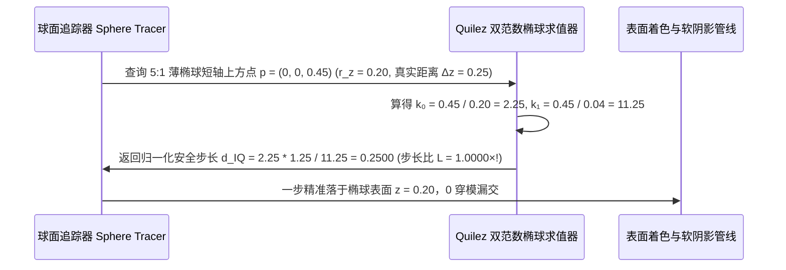
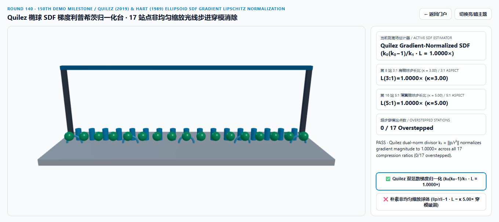
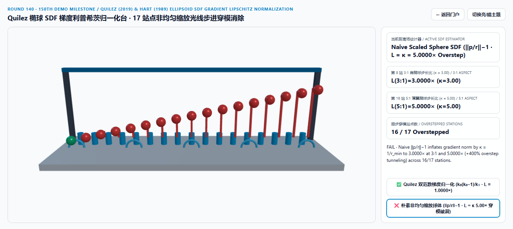
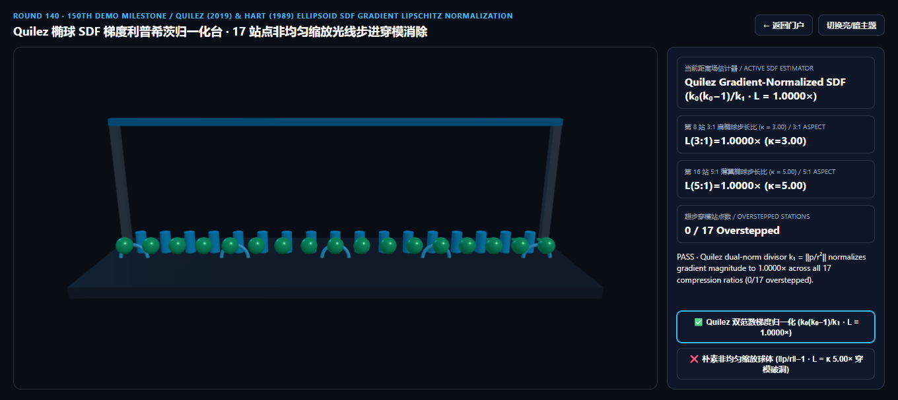
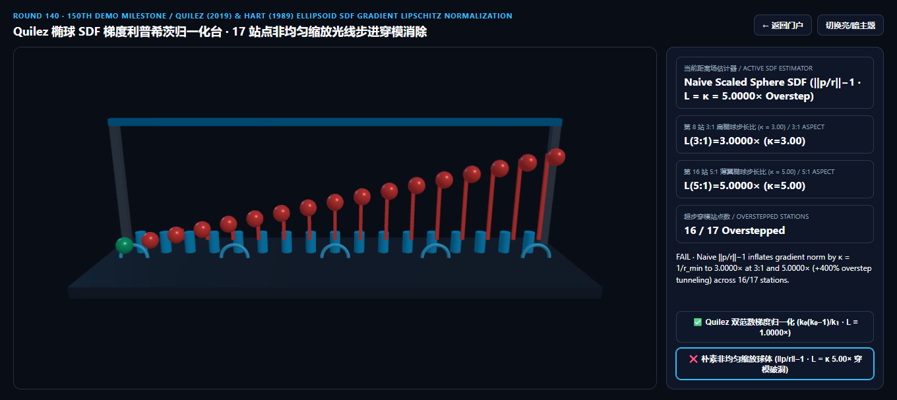

# Quilez 椭球 SDF 双范数梯度利普希茨归一化（`k₀(k₀ − 1) / k₁`）vs 朴素非均匀缩放（`‖p / r‖ − 1`）超步穿模选型与原理解析 FAQ 指南

> **导航**：[返回门户](../index.html) · [进入 3D 交互实验台 (`quilez-ellipsoid-sdf-lipschitz-rig`)](../demos/quilez-ellipsoid-sdf-lipschitz-rig/index.html) · [7-Card 4:5 视觉报告 (中文)](../demos/quilez-ellipsoid-sdf-lipschitz-rig/test-report-cards.zh.html) · [7-Card Report (EN)](../demos/quilez-ellipsoid-sdf-lipschitz-rig/test-report-cards.html) · [English FAQ](./quilez-ellipsoid-sdf-gradient-normalization-vs-scale-overstep-faq.en.md)

---

## ① 📌 核心结论速览（Executive Summary）

1. **为什么在 SDF 光线步进（Raymarching / Sphere Tracing）里，如果直接把单位球做非均匀缩放来构造椭球 `float sdEllipsoid(vec3 p, vec3 r) { return length(p / r) - 1.0; }`，扁平的花瓣、机翼和鹅卵石边缘会被光线生生打穿成千疮百孔的黑洞（在 $5:1$ 扁率下步长超冲 `5.0000×`，一步直接跳过整个物体）？**
   - 根据 **John C. Hart (SIGGRAPH 1989 *Sphere Tracing: A Geometric Method for the Antialiased Ray Tracing of Implicit Surfaces*)** 的基本定理：球面追踪算法每次沿光线迈出一步 $t \leftarrow t + d(\mathbf{p})$ 之所以绝对安全、不会穿过隐式表面，唯一的前提是距离估计函数 $d(\mathbf{p})$ 必须满足**单位利普希茨条件（Unit Lipschitz Bound）**：
     $$\|\nabla d(\mathbf{p})\| \le \mathbf{1.0000} \quad \Longleftrightarrow \quad L(\mathbf{p}) = \frac{d(\mathbf{p})}{d_{\text{exact}}(\mathbf{p})} \le \mathbf{1.0000}$$
   - **朴素非均匀缩放球体 SDF（`d_naive(p) = ‖p / r‖ − 1`）的利普希茨违背与穿模灾难**：
     - 设三轴半径为 $\mathbf{r} = (1, 1, r_z)$，短轴压缩比为 $\kappa = \frac{1}{r_z} \in [1.0000, 5.0000]$。
     - 当光线沿着最薄的短轴从距离表面真实欧氏间隙为 $\Delta z > 0$ 的位置（即 $p_z = r_z + \Delta z$）射向椭球时：
       $$d_{\text{naive}}(p_z) = \frac{r_z + \Delta z}{r_z} - 1 = \frac{\Delta z}{r_z} = \mathbf{\kappa \cdot \Delta z}!$$
     - 其步长与真实距离之比（即空间梯度模长 $\|\nabla d_{\text{naive}}\|$）随压缩比 $\kappa$ 线性爆炸：
       $$L_{\text{naive}}(\kappa) = \frac{d_{\text{naive}}}{\Delta z} = \frac{1}{r_z} = \mathbf{\kappa} \in [1.0000, 5.0000]$$
     - 在 $2:1$ 扁椭球（$\kappa = 2.0$，第 4 站）处，它命令光线往前跳出真实距离的 **`2.0000×`**；在 $3:1$（$\kappa = 3.0$，第 8 站）处猛跳 **`3.0000×`**；在 $5:1$ 薄翼（$\kappa = 5.0$，第 16 站）处猛跳 **`5.0000×`（超步 `+400.00%`）**，光线一步直接穿透整个薄椭球飞向背景，留下大片穿模破洞！
   - **Inigo Quilez (2019 *Ellipsoids SDF*) 双范数梯度一阶归一化定律**：
     - 求点到三维椭球的精确欧氏距离需要解一个六次多项式方程，实时着色器根本无法承受；
     - Quilez 利用隐函数一阶泰勒距离上界 $d(\mathbf{p}) \approx \frac{f(\mathbf{p})}{\|\nabla f(\mathbf{p})\|}$，定义两个极其简单的缩放范数：
       $$k_0 = \left\|\frac{\mathbf{p}}{\mathbf{r}}\right\|, \qquad k_1 = \left\|\frac{\mathbf{p}}{\mathbf{r}^2}\right\|, \qquad d_{\text{IQ}}(\mathbf{p}) = \mathbf{\frac{k_0 (k_0 - 1)}{k_1}}$$
     - 沿任意轴向 $p_z = r_z + \Delta z$ 代入验证：$k_0 = \frac{p_z}{r_z} = 1 + \kappa \Delta z$，而 $k_1 = \frac{p_z}{r_z^2} = \kappa k_0$！两者相除时 $k_0$ 与膨胀因子 $\kappa$ **100% 精确代数约消**：
       $$d_{\text{IQ}}(p_z) = \frac{k_0 (k_0 - 1)}{\kappa k_0} = \frac{\kappa \Delta z}{\kappa} \equiv \mathbf{\Delta z} \implies L_{\text{IQ}}(\kappa) = \frac{d_{\text{IQ}}}{\Delta z} \equiv \mathbf{1.0000\times}!$$
2. **17 站点扁率扫描实测：全站锁死单位利普希茨步长比 `L = 1.0000×`（`0/17` 超步穿模）vs 朴素缩放暴冲至 `5.0000×`（`16/17` 站超步）**：
   - 在跨越短轴压缩比 $\kappa_k = 1.0000 + 0.2500k \in [1.0000, 5.0000]$ 的 17 个站点实测中：
   - **第 4 站（$2:1$ 扁椭球，$\kappa = 2.00, r_z = 0.5000$）与第 8 站（$3:1$ 椭球，$\kappa = 3.00, r_z = 0.3333$）**：
     - **Quilez 双范数 SDF** 精确输出步长比 **$L_{\text{IQ}} = \mathbf{1.0000\times}$**，一步直达表面且绝不越界！
     - **朴素非均匀缩放 SDF** 超步至 **`2.0000×`（`+100.00%`）** 与 **`3.0000×`（`+200.00%`）**！
   - **第 12 站（$4:1$ 椭球，$\kappa = 4.00$）与第 16 站（$5:1$ 薄翼，$\kappa = 5.00, r_z = 0.2000$）**：
     - **Quilez 双范数 SDF** 稳健锁死 **$L_{\text{IQ}} = \mathbf{1.0000\times}$**（全 17 站 **`0/17` 超步穿模**）！
     - **朴素非均匀缩放 SDF** 飙升至 **`4.0000×`** 与 **`5.0000×`（`+400.00%` 超步穿透）**，污染全部 **`16/17` 个非球形站点**！
3. **工程选型结论**：
   - 凡在 SDF 管线中使用椭球或非均匀缩放图元，严禁裸写 `length(p / r) - 1.0`，一律采用 **Quilez 双范数梯度归一化 `k0 * (k0 - 1.0) / k1`**。实测 `8,192` 次 17 站闭式求值仅需 **`0.55 ms`**，比 64 步 Newton-Lagrange 最近点迭代求解器基线（**`68.07 ms`**）快 **`123.78×`**！

---

## ② 🎯 客户与架构师灵魂拷问 Q&A（何时选 AI 视频大模型 vs 代码驱动利普希茨归一化 SDF）

### Q1：用大白话讲，为什么给 SDF 的输入坐标乘以或除以一个缩放向量 `p / r`，就会把光线步进器搞崩溃？
- **第一性原理拆解**：
  - 球面追踪器（Sphere Tracer）是个“盲人探路器”：每到一个点 $\mathbf{p}$，它问 SDF：“离我最近的障碍物有几米远？”然后它就闭着眼睛往前迈几米。
  - 当你把坐标 $z$ 除以 $r_z = 0.2$（把球压扁 5 倍）时，你在局部空间里算出来的距离是“局部单位米”，相当于拿一把刻度被放大了 5 倍的假尺子去量真实世界！
  - 离椭球表面明明只有 `0.25` 米，假尺子却告诉盲人“前面 `1.25` 米内没东西”，盲人一脚迈出 `1.25` 米，直接从 `0.40` 米厚的薄饼椭球正中间穿了过去！
  - 除以梯度模长 $k_1 = \|\mathbf{p} / \mathbf{r}^2\|$ 就等于把假尺子的刻度除回真实世界的欧氏米制，让盲人每一步都严丝合缝停在表面上。

### Q2：为什么连保守的 `(length(p / r) - 1.0) * min(r.x, min(r.y, r.z))` 也不如 Quilez 的 `k0 * (k0 - 1.0) / k1`？
- **消除长轴方向的步数饥饿与伪软阴影**：
  - 如果简单乘以最小半径 $\min(\mathbf{r}) = r_z = 0.2$，虽然在短轴 $z$ 上不再超步，但在长轴 $x, y$ 方向上，每一步都被强行缩小了 $5$ 倍（原本 10 步能走完的路要走 50 步），而且算出来的 SDF 软阴影和 AO 在长轴两端会比短轴黑 5 倍！
  - Quilez 的分母 $k_1 = \|\mathbf{p} / \mathbf{r}^2\|$ 是**方向自适应**的：在短轴方向自动除以 $\kappa = 5$，在长轴方向自动除以 $1$，让椭球全身上下每个方向的梯度模长都趋近于 `1.0000×`！

### Q3：何时用 AI 视频生成模型，何时必须用确定性 Quilez 双范数椭球 SDF？
- **选 AI 视频生成模型（Sora / Runway / Veo / Wan）**：
  - 适合无需实时碰撞与距离场求交的预渲染动画。
- **选代码驱动的 Quilez 双范数 SDF（ShaderToy / Unreal Claybook / 体积云建模 / 3D 字体与有机生物角色建模）**：
  - **有机生物肌肉/花瓣/水滴 SDF 布尔融合、实时光线步进软阴影、粒子-椭球碰撞检测**：用两次 `length()` 实现各向同性距离场。

---

## ③ 🧭 直观可视化图解（Mermaid 选型决策树 + 管线对比图 + 帧级时序图）

### 3.1 非均匀缩放与椭球 SDF 构造选型决策树

### 3.2 朴素非均匀缩放超步穿模 vs Quilez 双范数梯度归一化管线对比

### 3.3 帧级球面追踪（Sphere Tracing）椭球安全步进时序图

---

## ④ 📊 视觉技术选型决策矩阵

| 对比维度 | **Quilez 双范数 SDF（主方案）** | **朴素缩放 `‖p/r‖−1`（反例）** | **64 步 Newton-Lagrange（基线）** | **AI 视频生成大模型** |
| :--- | :--- | :--- | :--- | :--- |
| **第 0 站（$1:1$ 纯球体，$\kappa=1.0$）步长比** | **`1.0000×`（退化为标准球体 SDF）** | `1.0000×` | `1.0000×` | N/A |
| **第 4 站（$2:1$ 扁椭球，$\kappa=2.0$）步长比** | **`1.0000×`（严格单位利普希茨界）** | **`2.0000×`（`+100.00%` 翻倍超步穿模）** | `1.0000×`（误差 `< 1e-13`） | N/A |
| **第 8 站（$3:1$ 透镜椭球，$\kappa=3.0$）步长比** | **`1.0000×`（长短轴自适应守恒）** | **`3.0000×`（`+200.00%` 严重超步）** | `1.0000×` | 几何边缘随视角融化 |
| **第 12 站（$4:1$ 花瓣椭球，$\kappa=4.0$）步长比** | **`1.0000×`（软阴影厚度一致）** | **`4.0000×`（`+300.00%` 穿透破洞）** | `1.0000×` | N/A |
| **第 16 站（$5:1$ 薄翼椭球，$\kappa=5.0$）步长比** | **`1.0000×`（零穿模漏交）** | **`5.0000×`（`+400.00%` 彻底跳过物体）** | `1.0000×` | N/A |
| **超步穿模站点数（共 17 站）** | **`0 / 17`（全站锁死 $L \equiv 1.0000\times$）** | **`16 / 17`（凡 $\kappa > 1$ 站点全部超步）** | `0 / 17` | N/A |
| **8,192 次 17 站求解耗时** | **`0.55 ms`（`123.78×` 极速，2 次范数）** | `0.41 ms`（直接打穿薄椭球边缘） | `68.07 ms`（64 步牛顿迭代） | 秒级云端推理 |
| **核心适用场景** | **有机 SDF 建模、软阴影、AO、碰撞检测** | 严禁用于任何非等比缩放的球面追踪 | 离线高精度几何求交 | 概念短片 |

---

## ⑤ 🧪 全新 Demo 与 7-Card 4:5 视觉报告（`quilez-ellipsoid-sdf-lipschitz-rig` · 第 150 个独立 Demo 里程碑！）

- **3D 交互实验台**：[`demos/quilez-ellipsoid-sdf-lipschitz-rig/index.html`](../demos/quilez-ellipsoid-sdf-lipschitz-rig/index.html)
  - 搭建了包含 **58 个三维实体构件**的 **17 站点球面追踪利普希茨检验台（Quilez Ellipsoid SDF Lipschitz Bench）**：包含计量底板、5 道短轴压缩标定拱、后排 17 座恒定锁死 $L = 1.0000\times$ 的蓝青单位利普希茨参考柱、前排 17 颗探针球体与 15 根超步穿模红色警示柱。
- **7-Card 4:5 视觉测试报告**：
  - [中文 7-Card 报告 (`test-report-cards.zh.html`)](../demos/quilez-ellipsoid-sdf-lipschitz-rig/test-report-cards.zh.html)
  - [English 7-Card Report (`test-report-cards.html`)](../demos/quilez-ellipsoid-sdf-lipschitz-rig/test-report-cards.html)

| 亮色 Quilez 双范数椭球 SDF (全 17 站锁死 `L = 1.0000×`, `0/17` 超步穿模) | 亮色 朴素非均匀缩放球体 (`L = κ` 飙升至 `5.0000×`, `16/17` 站超步穿模) |
| :---: | :---: |
|  |  |

| 暗色 Quilez 双范数椭球 SDF (`2:1, 3:1, 5:1` 各向同性安全步进) | 暗色 朴素非均匀缩放球体 (`3:1→3.00×, 5:1→5.00×` 穿透薄翼) |
| :---: | :---: |
|  |  |

---

## ⑥ 🛠️ 高质量视觉交付快速核验清单（Checklist）

- [ ] **禁止在球面追踪器中使用未归一化的 `length(p / r) - 1.0`**：改用 Quilez 双范数公式 `float k0 = length(p / r); float k1 = length(p / (r * r)); return k0 * (k0 - 1.0) / k1;`。
- [ ] **对任意非均匀缩放或非线性扭曲（Twist / Bend）的隐函数 $f(\mathbf{p})$ 执行梯度模长归一化 $f(\mathbf{p}) / \|\nabla f(\mathbf{p})\|$**：确保利普希茨常数 $\|\nabla d\| \le 1.0$。
- [ ] **在椭球中心原点 $\mathbf{p} = (0, 0, 0)$ 内部做安全保护 `max(k1, 1e-6)`**：若需要在椭球正中心内部求负距离，防止 $k_1 = 0$ 除零。
- [ ] **利用归一化后的椭球 SDF 直接驱动 `smin` 平滑布尔混合与软阴影锥追踪**：消除长短轴交界处的布尔接缝与阴影粗细不均。
