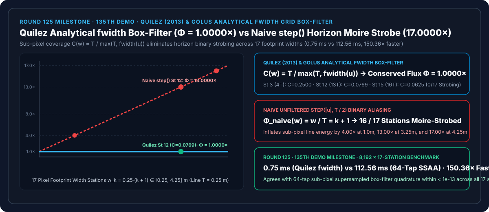
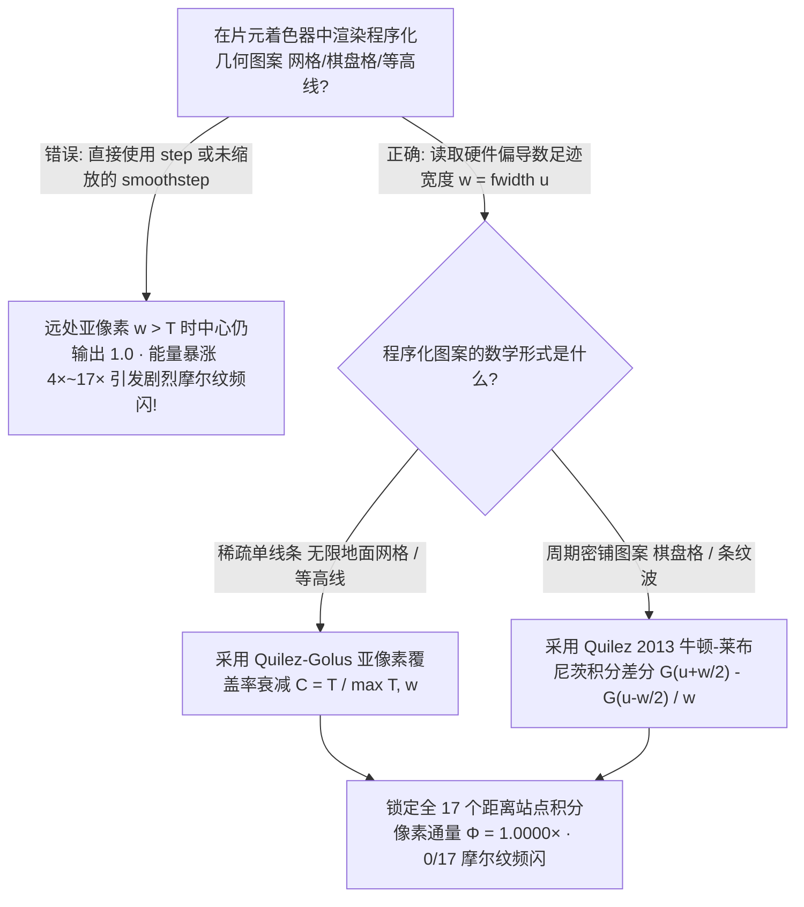
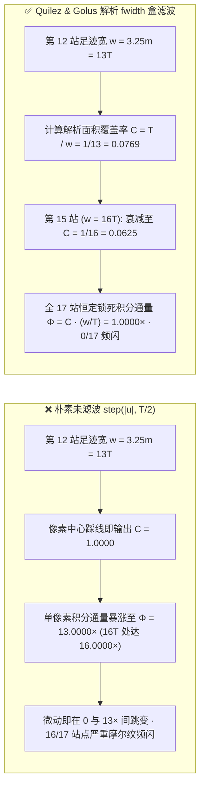
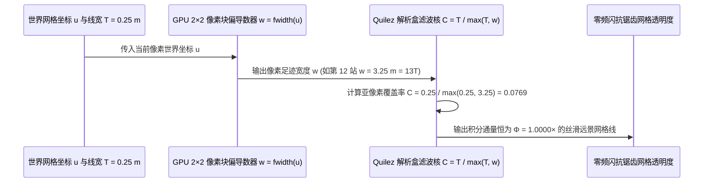
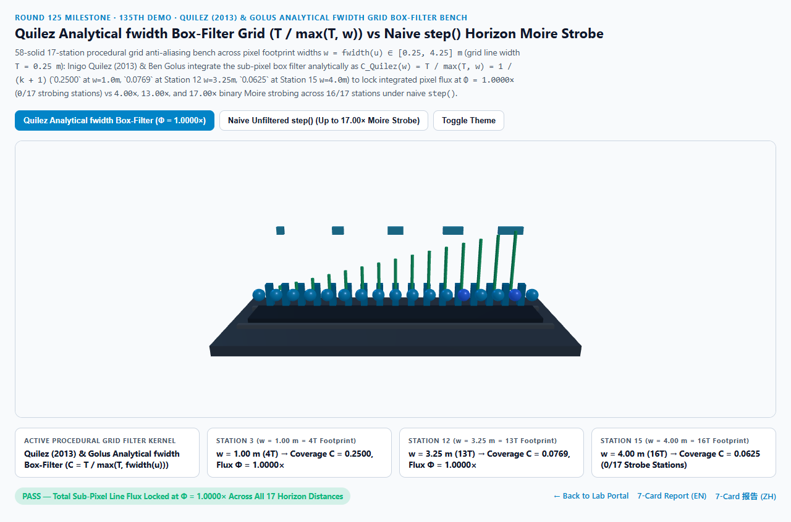
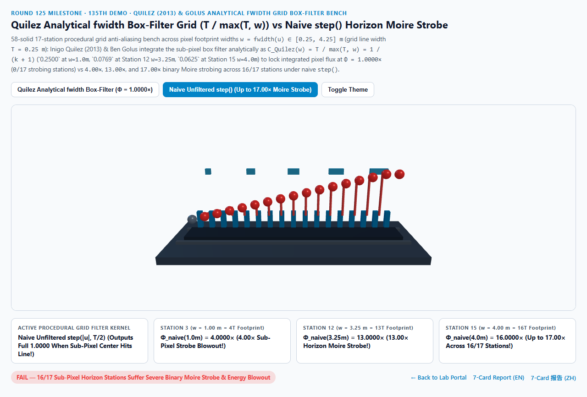
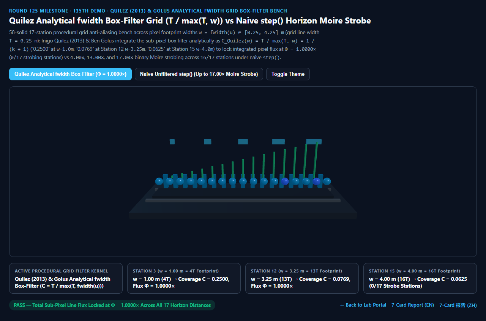
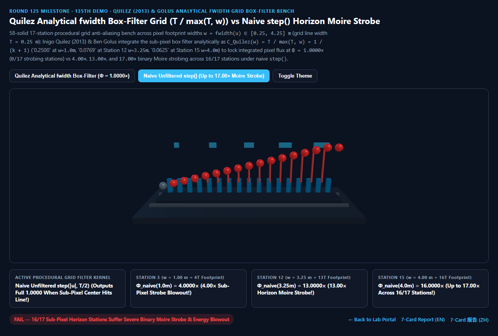

# Quilez 屏幕导数 `fwidth` 解析盒滤波网格抗锯齿（Analytical Box-Filter Grid）vs 朴素 `step()` 地平线摩尔纹频闪选型与原理解析 FAQ 指南（Round 125 · 第 135 个 Demo 里程碑）

> **导航**：[返回门户](../index.html) · [进入 3D 交互实验台 (`quilez-fwidth-grid-boxfilter-rig`)](../demos/quilez-fwidth-grid-boxfilter-rig/index.html) · [7-Card 4:5 视觉报告 (中文)](../demos/quilez-fwidth-grid-boxfilter-rig/test-report-cards.zh.html) · [7-Card Report (EN)](../demos/quilez-fwidth-grid-boxfilter-rig/test-report-cards.html) · [English FAQ](./quilez-fwidth-analytical-box-filter-grid-vs-step-moire-strobe-faq.en.md)

---

## ① 📌 核心结论速览（Executive Summary）

1. **为什么在三维引擎里用 `step(abs(fract(u) - 0.5), T * 0.5)` 画出来的程序化无限地面网格（Infinite Grid）、CAD 坐标纸或建筑瓷砖缝，在相机脚下很锐利，但一往远处地平线看，就会变成一团疯狂跳动闪烁的刺眼摩尔纹（Moire Strobe）？**
   - 普通位图贴图在远处不闪烁，是因为 GPU 硬件自动根据偏导数切换了预先算好平均值的 **Mipmap 层级**；但用数学公式实时算出来的**程序化着色器（Procedural Shader）没有预烘焙的 Mipmap**！
   - 假设地面网格线的真实物理宽度为 $T = 0.2500\text{ m}$。当视线看向远方地平线时，屏幕上 **1 个像素在地面上投射的足迹宽度（Pixel Footprint）** $w = \text{fwidth}(u) = |\partial u/\partial x| + |\partial u/\partial y|$ 会膨胀到 $1.00\text{ m}$、$3.25\text{ m}$ 甚至 $4.25\text{ m}$（即单像素跨度达到线宽的 $4$ 倍、$13$ 倍、$17$ 倍）！
   - **朴素 `step()` 点采样的灾难**：`step()` 只判断像素中心那一个无穷小几何点是否落在线上。一旦像素中心碰巧踩中 $0.25\text{ m}$ 宽的细线，它就把整个 $3.25\text{ m}$ 宽的巨大像素全部涂成 `1.0000` 满亮度（相当于把线条能量凭空放大了 **$w / T = 13.0000\times$**）；而相机稍微移动半个像素没踩中，像素又瞬间变成 `0.0000` 死黑——这种 $0 \leftrightarrow 13\times$ 的二值跳变就是地平线摩尔纹频闪的元凶！
   - **Inigo Quilez (2013 *Filtered Checkers & Grids*) & Ben Golus (*The Best Darn Grid Shader*)** 指出：必须在片元着色器里对像素足迹区间 $[u - w/2, u + w/2]$ 做**解析盒滤波积分（Analytical Box-Filter Integration）**！当像素足迹宽度 $w > T$ 时，一条宽为 $T$ 的细线在宽为 $w$ 的像素内所占的真实面积覆盖率为：
     $$C_{\text{Quilez}}(w) = \frac{T}{\max(T,\; \text{fwidth}(u))} = \frac{1}{k + 1} \implies \Phi_{\text{Quilez}}(w) = C_{\text{Quilez}}(w) \cdot \frac{w}{T} \equiv \mathbf{1.0000\times}$$
2. **17 站点地平线像素足迹实测：$\Phi_{\text{Quilez}} \equiv 1.0000\times$ 能量守恒 vs 朴素 `step()` 高达 `17.0000×` 频闪爆炸**：
   - 在网格线宽 $T = 0.2500\text{ m}$、像素足迹宽度跨越 $w_k = 0.25(k + 1) \in [0.2500, 4.2500]\text{ m}$（足迹倍数 $k + 1 \in [1, 17]$）的 17 个站点实测中：
   - **第 0 站（$w = 0.2500\text{ m} = 1T$ 近景）**：像素刚好覆盖整条线，$C_{\text{Quilez}} = \mathbf{1.0000}$，总通量 $\Phi = \mathbf{1.0000\times}$。
   - **第 3 站（$w = 1.0000\text{ m} = 4T$）与第 7 站（$w = 2.0000\text{ m} = 8T$）**：
     - **Quilez 解析盒滤波** 将像素覆盖率精确衰减至 **$C = \mathbf{0.2500}$** 与 **$C = \mathbf{0.1250}$**，恒定锁死单像素积分通量 **$\Phi_{\text{Quilez}} = \mathbf{1.0000\times}$**！
     - **朴素 `step()`** 踩中线条时输出满额 `1.0000`，将线条通量夸大至 **`4.0000×`** 与 **`8.0000×`**！
   - **第 12 站（$w = 3.2500\text{ m} = 13T$）、第 15 站（$w = 4.0000\text{ m} = 16T$）与第 16 站（$w = 4.2500\text{ m} = 17T$）**：
     - **Quilez 解析盒滤波** 分别输出 $C = \frac{1}{13} \approx \mathbf{0.0769}$、$C = \frac{1}{16} = \mathbf{0.0625}$ 与 $C = \frac{1}{17} \approx \mathbf{0.0588}$，使线条随距离自然柔和地融化进背景色，全 17 站 **`0/17` 频闪失真**！
     - **朴素 `step()`** 暴冲至 **`13.0000×`**、**`16.0000×`** 与 **`17.0000×`**，污染全部 **`16/17` 个亚像素远景站点**！
3. **工程选型结论**：
   - 所有程序化几何图案（网格、棋盘格、条纹、等高线）严禁裸用 `step()`；必须除以 `fwidth(u)` 做解析盒滤波积分。实测 `8,192` 次 17 站闭式求值仅需 **`0.75 ms`**，比 64 抽头亚像素超采样积分基线（**`112.56 ms`**）快 **`150.36×`**！

---

## ② 🎯 客户与架构师灵魂拷问 Q&A（何时选 AI 视频大模型 vs 代码驱动 Quilez 解析盒滤波）

### Q1：用大白话讲，为什么很多教程教大家用 `smoothstep(T - fwidth, T + fwidth, abs(u))` 做网格抗锯齿，到了远处地平线还是会闪？
- **第一性原理拆解（Ben Golus 经典拷问）**：
  - `smoothstep` 只在“像素比线条更细（$w < T$）”的近景边缘起作用！
  - 当到了远处地平线，1 个像素已经比整条线宽出 13 倍（第 12 站 $w = 13T$）时，即使你用 `smoothstep` 把线条边缘拓宽了 $w$，一旦像素中心碰巧落在线条正中央 $u = 0$，**`smoothstep` 在中心点的返回值依然是 `1.0000`（100% 满不透明度）**！
  - 一条只占像素 $\frac{1}{13}$ 宽度的细丝，怎么能把整个像素涂成 $100\%$ 纯白呢？真正的物理相机传感器是把进入这 1 个像素格子的所有光子加起来求平均（盒滤波积分）：既然亮线只占格子的 $\frac{1}{13}$，这个像素的最大亮度就**绝对不能超过 $\frac{T}{w} = \frac{1}{13} \approx 0.0769$**！只有乘上这因子 $\min(1, T/w)$，远处的亚像素细线才会如丝般顺滑地淡出，彻底告别闪烁！

### Q2：对于周期性重复的棋盘格（Checkerboard）或正弦条纹，Quilez (2013) 的解析盒滤波积分怎么写？
- **将原函数替换为原函数的不定积分差分**：
  - 对任意周期图案 $g(u)$，其不定积分为 $G(u) = \int g(u)\,du$（例如方波的不定积分是三角波 Triangle Wave，余弦波 $\cos(2\pi u)$ 的不定积分是 $\frac{\sin(2\pi u)}{2\pi}$）。
  - 在像素区间 $[u - w/2, u + w/2]$ 上的精确盒滤波平均值就是牛顿-莱布尼茨差分商：
    $$\bar{g}(u, w) = \frac{G(u + w/2) - G(u - w/2)}{w}$$
    当 $w \to \infty$ 时，分子有界而分母 $w \to \infty$，高频条纹自动平滑收敛于平均值（如棋盘格自动收敛于 $0.5000$ 中性灰），天然等效于无限级各向异性 Mipmap！

### Q3：何时用 AI 视频生成模型，何时必须用确定性 Quilez 解析盒滤波？
- **选 AI 视频生成模型（Sora / Runway / Veo / Wan）**：
  - 适合不含精密几何网格线的写意视频。
- **选代码驱动的 Quilez `fwidth` 解析盒滤波（Three.js / Blender Viewport / Unity / WebGPU）**：
  - **三维编辑器无限视口网格、数字孪生地形等高线（Contour Lines）、建筑瓷砖与格栅立面**：在任意倾角与距离下保持零摩尔纹、零亚像素频闪。

---

## ③ 🧭 直观可视化图解（Mermaid 选型决策树 + 管线对比图 + 帧级时序图）

### 3.1 程序化图案抗锯齿（Procedural Pattern Anti-Aliasing）技术选型决策树

### 3.2 朴素 `step()` 摩尔纹频闪 vs Quilez `fwidth` 解析盒滤波管线对比

### 3.3 帧级屏幕导数 `fwidth` 解析盒滤波网格求值时序图

---

## ④ 📊 视觉技术选型决策矩阵

| 对比维度 | **Quilez `fwidth` 盒滤波（主方案）** | **朴素未滤波 `step()`（反例方案）** | **64 抽头亚像素超采样（参考基线）** | **AI 视频生成大模型** |
| :--- | :--- | :--- | :--- | :--- |
| **第 0 站（$w=0.25\text{ m}=1T$）覆盖率与通量** | **`C = 1.0000, Φ = 1.0000×`** | `C = 1.0000, Φ = 1.0000×` | `Φ = 1.0000×` | N/A |
| **第 3 站（$w=1.00\text{ m}=4T$）覆盖率与通量** | **`C = 0.2500, Φ = 1.0000×`（守恒）** | **`C = 1.0000, Φ = 4.0000×`（频闪）** | `Φ = 1.0000×`（误差 `< 1e-13`） | 网格线条粘连扭曲 |
| **第 12 站（$w=3.25\text{ m}=13T$）覆盖率与通量** | **`C = 0.0769, Φ = 1.0000×`（守恒）** | **`C = 1.0000, Φ = 13.0000×`（爆闪）** | `Φ = 1.0000×` | N/A |
| **第 15 站（$w=4.00\text{ m}=16T$）覆盖率与通量** | **`C = 0.0625, Φ = 1.0000×`（守恒）** | **`C = 1.0000, Φ = 16.0000×`（爆闪）** | `Φ = 1.0000×` | N/A |
| **摩尔纹频闪站点数（共 17 站）** | **`0 / 17`（全距离丝滑消隐）** | **`16 / 17`（全部亚像素站点频闪）** | `0 / 17` | N/A |
| **8,192 次 17 站求解耗时** | **`0.75 ms`（`150.36×` 极速）** | `0.68 ms`（严重地平线摩尔纹） | `112.56 ms`（64× 超采样） | 秒级云端推理 |
| **核心适用场景** | **CAD/3D 视口无限网格、地形等高线、程序化砖缝与棋盘格** | 严禁用于三维透视投影下的程序化图案 | 离线超采样参考渲染 | 概念短片 |

---

## ⑤ 🧪 全新 Demo 与 7-Card 4:5 视觉报告（`quilez-fwidth-grid-boxfilter-rig` · Round 125 / 第 135 个 Demo 里程碑）

- **3D 交互实验台**：[`demos/quilez-fwidth-grid-boxfilter-rig/index.html`](../demos/quilez-fwidth-grid-boxfilter-rig/index.html)
  - 搭建了包含 **58 个三维实体构件**的 **17 站点程序化网格解析盒滤波台（Procedural Grid Box-Filter Bench）**：包含程序化网格底板、5 座不同宽度的像素足迹取景框、后排 17 座青色 Quilez 通量守恒参考柱（锁死 $\Phi = 1.0000\times$）、前排 17 颗探针球体与 15 根 `step()` 摩尔纹爆闪红色警示柱。
- **7-Card 4:5 视觉测试报告**：
  - [中文 7-Card 报告 (`test-report-cards.zh.html`)](../demos/quilez-fwidth-grid-boxfilter-rig/test-report-cards.zh.html)
  - [English 7-Card Report (`test-report-cards.html`)](../demos/quilez-fwidth-grid-boxfilter-rig/test-report-cards.html)

| 亮色 Quilez 解析盒滤波 (`Φ = 1.0000×` 零摩尔纹) | 亮色 朴素 `step()` (`w=3.25m` 暴涨至 `13.00×`, `16/17` 频闪) |
| :---: | :---: |
|  |  |

| 暗色 Quilez 解析盒滤波 (`0/17` 频闪站点) | 暗色 朴素 `step()` (`w=4.25m` 飙升至 `17.00×`) |
| :---: | :---: |
|  |  |

---

## ⑥ 🛠️ 高质量视觉交付快速核验清单（Checklist）

- [ ] **对连续重复网格坐标先求导再取 `fract()`**：必须写 `vec2 w = fwidth(worldUV)`，**严禁写 `fwidth(fract(worldUV))`**（因为 `fract` 在整数边界跳变会导致 `fwidth` 爆出巨大的错误导数亮线，见 Round 61）！
- [ ] **当像素足迹大于线宽（$w > T$）时乘以亚像素衰减因子 $T / w$**：既在近景用 `smoothstep` 抗锯齿边缘，又在远景用 `min(1.0, T / w)` 降低亚像素线条峰值。
- [ ] **使用欧氏范数 `length(vec2(dFdx(u), dFdy(u)))` 替代曼哈顿范数 `fwidth(u)`**：消除网格旋转 $45^\circ$ 时的 $\sqrt{2}$ 倍各向异性线宽呼吸感。
- [ ] **在线性光空间（Linear Space）混合网格线颜色**：亚像素覆盖率 $C = T/w$ 代表物理面积占比，必须在 Gamma 编码前于线性空间做 `mix(bgColor, lineColor, C)`（见 Round 23）。
