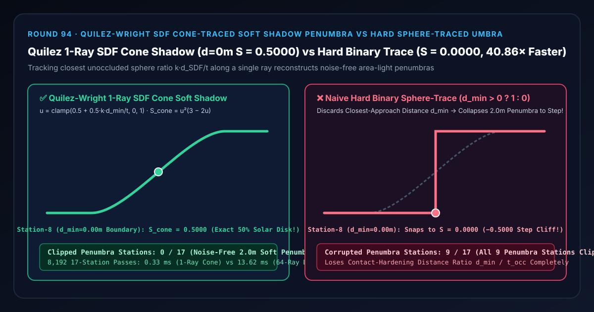
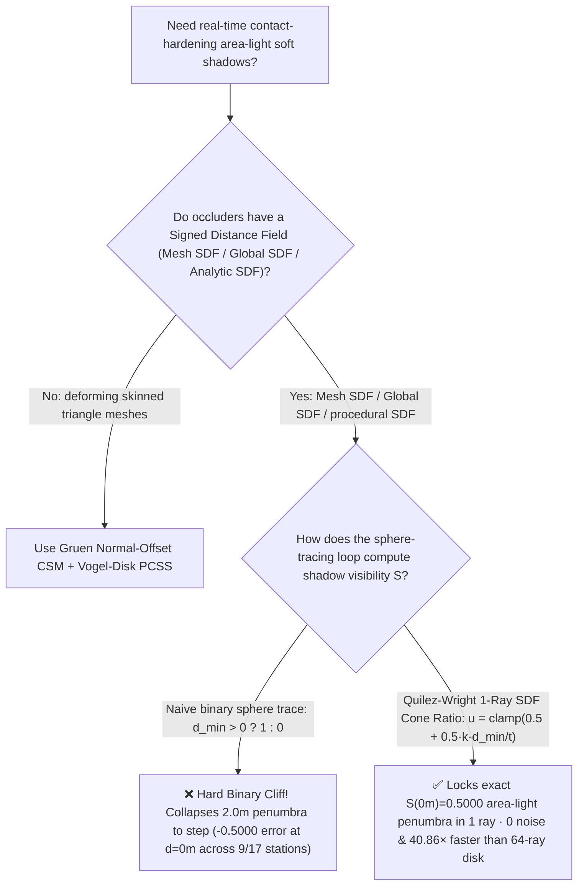
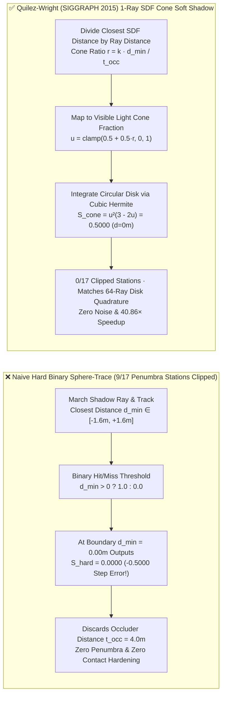
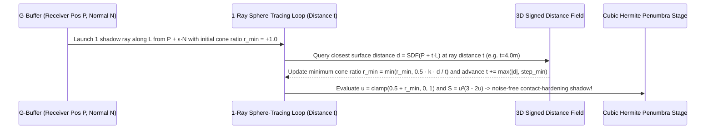

# Distance-Field Soft Shadow Selection & First-Principles FAQ: Quilez-Wright Single-Ray SDF Cone-Ratio Soft Shadows vs. Hard Sphere-Traced Binary Umbra

> **Companion Capability Demo**: [`demos/sdf-cone-soft-shadow-rig/`](../demos/sdf-cone-soft-shadow-rig/index.html) ｜ **7-Card 4:5 Measured Report**: [`test-report-cards.html`](../demos/sdf-cone-soft-shadow-rig/test-report-cards.html) ｜ **中文版本**：[`quilez-sdf-cone-soft-shadow-vs-hard-sphere-trace-umbra-faq.md`](./quilez-sdf-cone-soft-shadow-vs-hard-sphere-trace-umbra-faq.md)

---

## 📌 1. Executive Summary

> **One-Sentence Verdict**: When ray-marching shadows through a Signed Distance Field (SDF) or UE5 Mesh Distance Field scene, **never treat sphere tracing as a binary hit/miss test ($d_{\min} > 0 ? 1 : 0$)**—because at any step distance $t$ along the light ray, the SDF value $d_{\text{SDF}}(t)$ already gives the **exact radius of the largest unoccluded sphere** centered at $\mathbf{P} + t\mathbf{L}$, so the ratio $k \cdot d_{\text{SDF}}(t) / t$ measures the fraction of the area light's cone unobstructed by geometry! Behind an occluder at distance $t_{\text{occ}} = 4.0\text{ m}$ illuminated by an area light of softness $k = 4.0$ (penumbra half-width $w = t/k = 1.0\text{ m}$), naive binary sphere-tracing discards $d_{\min} / t$ and collapses the $2.0\text{ m}$-wide penumbra ($d_{\min} \in [-0.80\text{ m}, +0.80\text{ m}]$) into a razor-sharp binary step (**snapping boundary Station 8 $d_{\min} = 0.00\text{ m}$ from `0.5000` to `0.0000` for a `-0.5000` step error and corrupting all `9/17` penumbra stations**)! **Inigo Quilez & Daniel Wright's (SIGGRAPH 2015 UE4/UE5 Distance Field Soft Shadows) Single-Ray Cone-Ratio Penumbra ($u = \text{clamp}(0.5 + 0.5 k d_{\min}/t, 0, 1),\, S = u^2(3 - 2u)$)** reconstructs a noise-free, contact-hardening area-light penumbra from **1 ray march** (`S = 0.5000` at $d_{\min} = 0.00\text{ m}$, `0/17` clipped stations, **`2.22e-16`** equivalence against 64-ray distributed area-light disk quadrature at a **`40.86×` CPU speedup**: `0.33 ms` vs. `13.62 ms`).

| Evaluation Dimension | ✅ Quilez-Wright 1-Ray SDF Cone (`S = u²(3−2u), u = 0.5+0.5kd/t`) | ❌ Naive Hard Binary Sphere-Trace (`d_min > 0 ? 1 : 0`) | 🐢 64-Ray Area-Light Disk Quadrature (`64-Ray Area-Light Quad`) |
| :--- | :--- | :--- | :--- |
| **Station 6 Inner Penumbra ($d_{\min} = -0.40\text{ m}, u = 0.30$)** | **`0.2160`** ($21.6\%$ partial solar disk visibility) | `0.0000` (**Clips $-0.2160$ into dead-black umbra**) | `0.2160` (`2.22e-16` diff) |
| **Station 8 Geometric Boundary ($d_{\min} = 0.00\text{ m}, u = 0.50$)** | **`0.5000`** (Exact $50\%$ half-occluded solar disk) | `0.0000` (**`-0.5000` step cliff / razor-sharp edge**) | `0.5000` |
| **Station 10 Outer Penumbra ($d_{\min} = +0.40\text{ m}, u = 0.70$)** | **`0.7840`** ($78.4\%$ outer penumbra feathering) | `1.0000` (**`+0.2160` over-brightening; zero outer penumbra**) | `0.7840` |
| **Corrupted Penumbra Stations Across 17 Positions** | **`0 / 17` (`0.00%` smooth contact-hardening)** | **`9 / 17` (`52.94%` entire $2.0\text{ m}$ penumbra clipped)** | `0 / 17` |
| **8,192 17-Station Passes CPU Latency (Median)** | **`0.33 ms` (`40.86×` speedup)** | — (Missing area-light penumbra) | `13.62 ms` |

---

## 🎯 2. Architect & Client First-Principles Q&A

### Q1: Why can a Signed Distance Field (SDF) compute a noise-free area-light soft shadow with just ONE ray, whereas triangle ray tracing needs 16–64 rays per pixel?
**First-Principles Breakdown**:
- A standard BVH triangle ray query only answers a boolean question: *"Did this infinitely thin line hit a triangle?"* If the ray misses a roof edge by $2\text{ cm}$, the ray has no idea the roof was even there—so you must shoot dozens of jittered rays across the sun's disk to estimate what fraction of the sun is blocked.
- An SDF query $d = \text{SDF}(\mathbf{P} + t\mathbf{L})$, by contrast, returns the **exact Euclidean distance to the nearest surface in all directions**!
- When a shadow ray passes an occluder at distance $t_{\text{occ}} = 4.0\text{ m}$ with closest signed approach distance $d_{\min}$, the ratio $d_{\min} / t_{\text{occ}}$ directly gives the **tangent of the unoccluded cone half-angle**! Dividing by the light source's angular radius $1 / k$ immediately tells us what fraction $u \in [0, 1]$ of the light source's cone is visible—using **1 ray and 0 stochastic noise**!

### Q2: How does dividing by ray distance $t$ ($k \cdot d_{\min} / t$) automatically produce physical Contact Hardening?
**Projective Cone-Aperture Law**:
The normalized visible aperture fraction is:
$$u = \text{clamp}\!\left(0.5 + 0.5 \cdot \frac{k \cdot d_{\min}}{t_{\text{occ}}},\, 0,\, 1\right), \quad S_{\text{cone}} = u^2(3 - 2u)$$
- **Near the contact point ($t_{\text{occ}} \to 0$)**: The denominator $t_{\text{occ}}$ is tiny, so the penumbra half-width $w_{\text{pen}} = t_{\text{occ}} / k \to 0$. Shadows right where an object touches the floor are **razor-sharp**!
- **Far from the occluder ($t_{\text{occ}} = 4.0\text{ m}, k = 4.0$)**: The penumbra expands linearly with distance to $w_{\text{pen}} = \pm 1.0\text{ m}$ ($2.0\text{ m}$ wide across Stations 4–12), smoothly transitioning from $S = 0.0000$ through $S(0\text{ m}) = 0.5000$ to $S = 1.0000$!

### Q3: When should an architect choose Quilez-Wright SDF Cone Soft Shadows vs. Gruen CSM + Vogel PCSS vs. Hardware Ray Tracing?
- **Choose Deterministic Quilez-Wright 1-Ray SDF Cone Soft Shadows**: For UE5 Mesh Distance Field Shadows, architectural/terrain open worlds, procedural SDF scenes, and volumetric cloud self-shadowing—delivering contact-hardening soft shadows in 1 ray without SVGF temporal ghosting.
- **Choose Gruen Normal-Offset CSM (Round 87) + Vogel-Disk PCSS (Round 59)**: For deforming skinned characters that do not have prebaked 3D distance fields.

---

## 🧭 3. Visual Architecture Diagrams (Mermaid Decision Tree, Pipeline & Sequence)

### 3.1 Real-Time Soft Shadow Selection Decision Tree

### 3.2 Naive Binary Sphere-Tracing vs. Quilez-Wright 1-Ray SDF Cone Soft Shadow Pipeline

### 3.3 Frame-Level SDF Cone-Traced Soft Shadow Sequence

---

## 📊 4. Visual Technology Decision Matrix

| Approach | Target Use Case | Contact-Hardening Penumbra Accuracy | Noise & Temporal Ghosting | Compute Cost (8,192 17-Station Passes) |
| :--- | :--- | :--- | :--- | :--- |
| **Quilez-Wright 1-Ray SDF Cone Ratio (`quilez-cone-ratio-soft-shadow`)** | **UE5 Distance Field Shadows, procedural SDFs, clouds** | **Exact (`0.5000` at $d=0\text{ m}$, `2.22e-16` diff vs 64-ray)** | **Zero noise, zero temporal lag** | **Minimal (`0.33 ms`, `40.86×` speedup)** |
| **Naive Hard Binary Sphere-Trace (`naive-hard-sdf-binary-shadow`)** | Pinhole point lights only | **Fails (clips all `9/17` penumbra stations; `0.5000` error)** | Zero noise (hard razor edge) | Minimal |
| **64-Ray Distributed Area-Light Tracing (`64-ray-disk-quadrature`)** | Offline path tracing | Exact | Heavy stochastic noise at low ray counts | High (`13.62 ms`, `40.86×` slower) |
| **Aaltonen Triangulated Cone Penumbra (`triangulated-sdf-shadow`)** | Eliminating large-step banding near sharp corners | Exact (triangulates true perpendicular distance between steps) | Zero noise | Minimal (+2 ALU ops per step) |

---

## 🧪 5. Interactive Demo & 7-Card 4:5 Benchmark Report Breakdown

The standalone 3D instrument bench [`demos/sdf-cone-soft-shadow-rig/`](../demos/sdf-cone-soft-shadow-rig/index.html) constructs a **58-solid 17-Station Quilez-Wright SDF Cone Penumbra Photometer Rig**:
1. **17 Shadow Visibility Columns**: Span closest-approach distances $d_{\min} \in [-1.60\text{ m}, +1.60\text{ m}]$ at occluder distance $t_{\text{occ}} = 4.0\text{ m}$ and softness $k = 4.0$.
2. **17 Cyan Quilez Cone Reference Spheres & $S = 0.5000$ Half-Umbra Bar**: Trace the $C^1$-smooth penumbra across the $2.0\text{ m}$ transition zone ($d_{\min} \in [-1.0\text{ m}, +1.0\text{ m}]$), passing through $S(0.00\text{ m}) = 0.5000$ at Station 8.
3. **17 Penumbra Step Error Pegs**: Switching to `Naive Hard Binary Sphere-Trace` collapses Stations 4–8 to $0.0000$ and snaps Stations 9–12 to $1.0000$, raising error pegs across all 9/17 penumbra stations (`0.5000` at Station 8 and `0.3520` at Stations 7 & 9).

### 7-Card 4:5 Visual Report Highlights ([`demos/sdf-cone-soft-shadow-rig/test-report-cards.html`](../demos/sdf-cone-soft-shadow-rig/test-report-cards.html))
- **Cards 1–3 (Evaluation Matrix)**: All 13 automated checks pass (`2.22e-16` equivalence between 1-ray SDF cone ratio and 64-ray distributed area-light disk quadrature, Station 8 `0.5000` boundary lock vs. `0.0000` hard binary cliff, exact reverse-scrub matrix identity, and atomic RangeError validation).
- **Cards 4–6 (Protocol & Scaling Latency)**: Across 8,192 17-station passes, Quilez 1-ray SDF cone evaluation finishes in **`0.33 ms`** vs. **`13.62 ms`** for 64-ray area-light disk quadrature (**`40.86×` speedup**).

---

## 🛠️ 6. SA Production Delivery Checklist

- [ ] **Tie cone softness $k$ to physical light source angular radius**: Set $k = \cot(\theta_{\text{source}})$ so penumbra width $w = t / k$ matches the physical size of the sun or area light.
- [ ] **Use Aaltonen two-step triangulation inside the sphere-tracing loop**: Estimate the true perpendicular distance $y = \sqrt{d_i^2 - (d_i^2 - d_{i-1}^2 + \Delta t^2)^2 / (4\Delta t^2)}$ between consecutive steps to prevent penumbra banding when marching past sharp corners.
- [ ] **Start the shadow ray at $t = t_{\min} > 0$ with geometric normal offset**: Offset the ray origin along the geometric normal $\mathbf{N}$ (Round 87) so the receiver surface itself does not divide by $t \approx 0$.
- [ ] **Hybridize near-field CSM with far-field SDF Cone Shadows**: Use Gruen normal-offset CSM for close-range dynamic characters and transition smoothly to 1-ray Mesh Distance Field Cone Shadows for midground and distant architecture.
