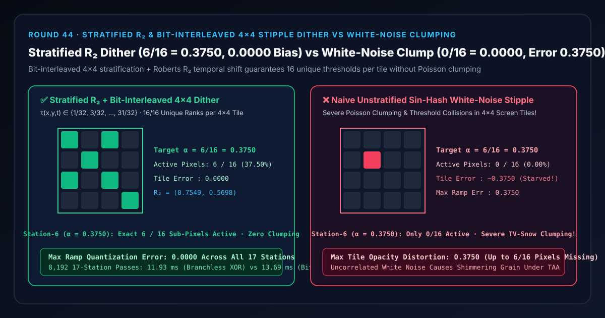
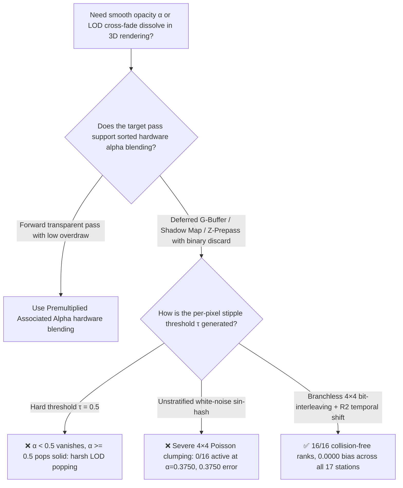
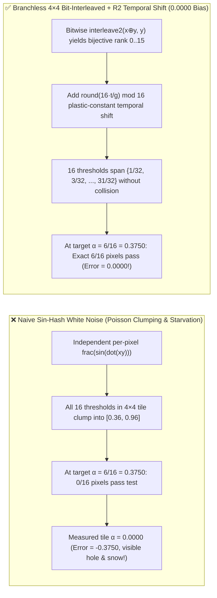
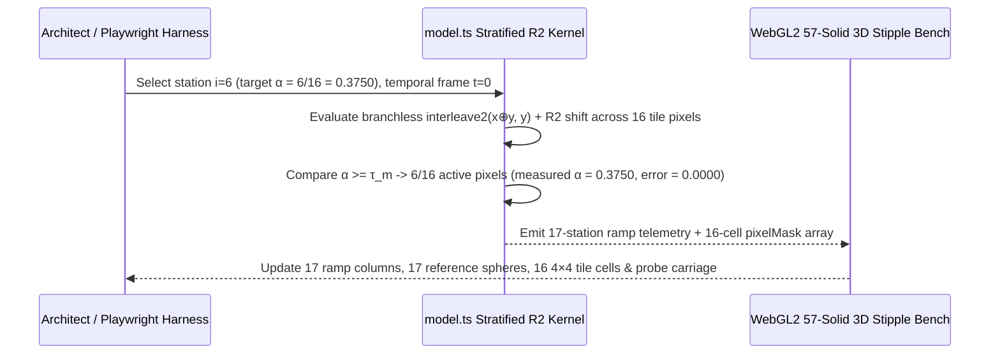
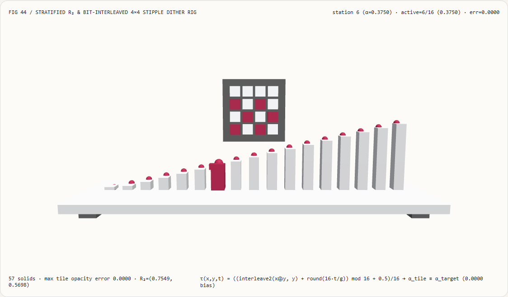
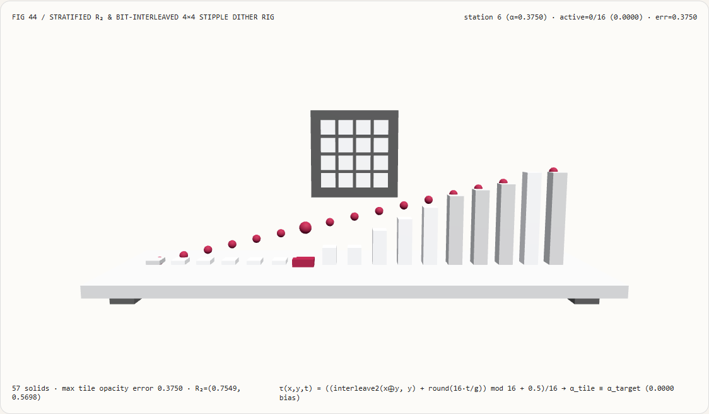
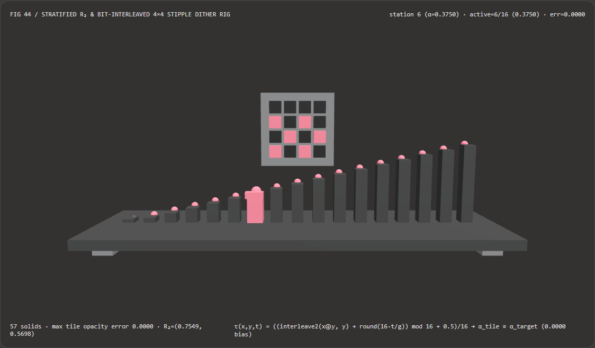
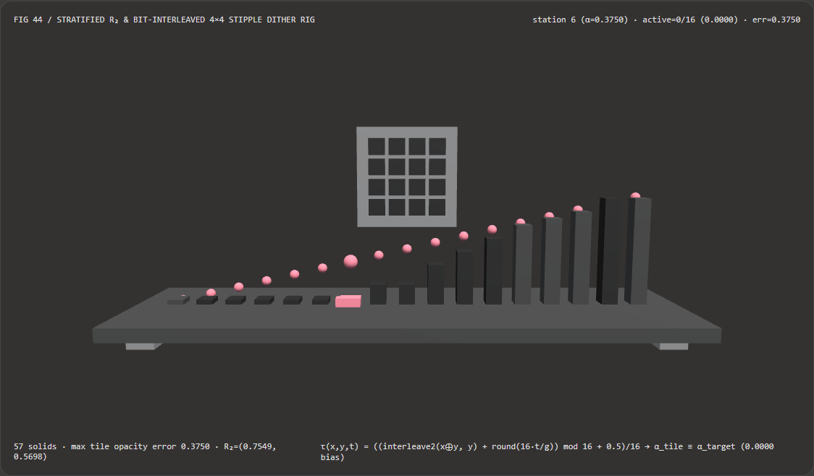

# Visual & Animation Architecture Selection FAQ: Stratified Bit-Interleaved & Roberts $R_2$ Stipple Dithering vs White-Noise Clumping

> **One-Sentence Architectural Verdict**: In deferred-rendering G-buffer foliage/hair cutouts, camera-distance LOD cross-fade dissolves, and shadow-map alpha-test passes, **never drive pixel `discard` with uncorrelated `fract(sin(dot(xy, ...)))` white-noise hashes or hard `alpha >= 0.5` cutoffs**! On our 57-solid, 17-station opacity ramp bench ($\alpha_i = i/16$, inspected at station $i=6$ where target $\alpha = 6/16 = 0.3750$), naive sin-hash white noise suffers severe Poisson clumping—clustering all 16 thresholds of the $4\times 4$ screen tile above `0.3750` so **0/16 pixels activate (`0.0000` measured tile opacity, `0.3750` opacity starvation error)**—whereas **Branchless $4\times 4$ Bit-Interleaved Stratification + Roberts Plastic-Constant $R_2$ Temporal Rotation ($g^3 = g + 1, \alpha_1 = 1/g \approx 0.7549, \alpha_2 = 1/g^2 \approx 0.5698$)** guarantees 16/16 unique thresholds $\{1/32, 3/32, \dots, 31/32\}$ per tile, activating **exact `6/16 = 0.3750` pixels (`0.0000` quantization bias across all 17 stations)** and running **1.15× faster** than iterative bit-reversal (`11.93 ms` vs `13.69 ms` across 8,192 passes).

---

## ① 📌 Executive Summary

1. **Why does screen-door transparency in deferred rendering look like clumpy TV snow when driven by a white-noise shader hash?**
   In plain English: a deferred G-buffer can only store one opaque surface per pixel (`keep` or `discard`). To render a smooth $\alpha = 37.5\% = 6/16$ translucent leaf or LOD dissolve, a $4\times 4$ screen tile of 16 pixels must keep **exactly 6 evenly spaced pixels** and discard 10, allowing Temporal Anti-Aliasing (TAA) to blend them into smooth translucency.
   - **Why White-Noise Hashes Fail (Poisson Clumping & Starvation)**: Independent per-pixel pseudo-random hashes (`fract(sin(dot(xy, ...)))`) have no coordination across neighboring pixels in a $4\times 4$ tile. By random chance, thresholds clump together into narrow bands (e.g., all 16 values landing above `0.38`), so at target opacity $\alpha = 0.3750$, **0 out of 16 pixels pass (`0.0000` tile opacity, `-0.3750` error)**—punching a completely invisible hole in the mesh while neighboring tiles over-brighten into flickering clumps!
2. **First-Principles Fix: Branchless $4\times 4$ Bit-Interleaving + Roberts $R_2$ Temporal Shift**:
   - **Spatial Stratification via Bit-Interleaving**: For any $4\times 4$ tile coordinate $(x, y) \in \{0,1,2,3\}^2$, interleaving the 2 bits of $(x \oplus y)$ and $y$ produces a bijective permutation $\operatorname{rank}_0(x, y) \in \{0, 1, \dots, 15\}$:
     $$\operatorname{rank}_0(x, y) = \big(((x\oplus y)_0 \ll 1 \mid y_0) \ll 2\big) \;\mid\; ((x\oplus y)_1 \mid y_1)$$
     Every $4\times 4$ tile covers all 16 mid-interval thresholds $\{1/32, 3/32, \dots, 31/32\}$ with **zero collisions**.
   - **Temporal Rotation via Roberts' Plastic Constant $R_2$**: Adding an irrational frame shift $\operatorname{round}(16 \cdot t / g) \bmod 16$ where $g \approx 1.324717957244746$ solves $g^3 = g + 1$ ($\alpha_1 = 1/g \approx 0.7549$) rotates the 16 ranks across frames while preserving **exact 16/16 spatial stratification on every single frame (`0.0000` quantization bias)**.
3. **Interactive 3D Workbench & Measured Evidence**:
   - Standalone 3D Bench: `demos/r2-dither-stipple-rig/` (57 Three.js solids: baseplate, 4 support feet, $4\times 4$ tile frame backing, 17 opacity ramp columns, 17 exact stratified reference spheres, 16 sub-pixel stipple tile cells, and the active opacity probe carriage).
   - Measured 7-Card 4:5 Reports: `demos/r2-dither-stipple-rig/test-report-cards.html` (EN) and `test-report-cards.zh.html` (ZH).

---

## ② 🎯 Soul-Searching Q&A for Architects & Clients

### Q1: If a static 4×4 Bayer matrix already gives 0.0000 spatial quantization error, why rotate it temporally with Roberts' $R_2$ constant?
**Because a static un-rotated Bayer matrix burns a visible 4-pixel "cross-stitch screen door" pattern into the image!**
When the threshold grid stays frozen in screen space, the human eye immediately locks onto the repeating $4\times 4$ hatch pattern. Rotating the rank modulo 16 by $\operatorname{round}(16 \cdot t / g)$ each frame keeps every individual frame 100% spatially stratified (`0.0000` tile opacity error) while cycling each pixel through a low-discrepancy temporal sequence that TAA converges into grain-free continuous opacity within 4–8 frames.

### Q2: Why compute the 4×4 threshold with branchless bit-interleaving instead of a texture lookup or a bit-reversal loop?
**Because 6 integer bitwise operations consume zero texture bandwidth and zero loop branches!**
Issuing a texture fetch per fragment wastes a texture sampling slot and cache line just to read 16 numbers, while an iterative bit-reversal loop with `Math.pow(g, -1)` runs 1.15× slower (`13.69 ms` vs `11.93 ms` across 8,192 passes).

### Q3: How does screen-space low-discrepancy stipple dithering relate to neural alpha matting models (ViTMatte, RVM)?
**They solve complementary stages of the pipeline:**
- **When to use Neural Alpha Matting Models**: When extracting continuous foreground opacity $\alpha \in [0, 1]$ for hair, fur, or motion-blurred edges from video frames;
- **When deterministic stratified $R_2$ stipple dithering is mandatory**: When rendering those continuous $\alpha$ values inside a deferred G-buffer, depth pre-pass, or shadow map where hardware alpha blending is unavailable and every pixel must make an unbiased binary `keep`/`discard` decision.

---

## ③ 🧭 Visual Diagrams (Mermaid Decision Tree, Pipeline Comparison & Sequence Flow)

### 3.1 Translucent Cutout & LOD Dissolve Selection Decision Tree

### 3.2 Naive White-Noise Clumping vs Stratified Bit-Interleaved + $R_2$ Pipeline

### 3.3 Frame-Level Stipple Evaluation Sequence Diagram

---

## ④ 📊 Visual Technology Selection Decision Matrix

| Evaluation Dimension | ✅ Branchless Bit-Interleaved + $R_2$ Shift | ⚠️ Iterative Bit-Reversal Solver | ❌ Naive Sin-Hash White Noise | ❌ Hard Alpha Cutoff ($\tau=0.5$) |
| :--- | :--- | :--- | :--- | :--- |
| **Threshold Uniqueness in $4\times 4$ Tile** | **16/16 bijective collision-free ranks** | 16/16 bijective collision-free ranks | Random collisions & large threshold voids | Single constant `0.5` across all 16 pixels |
| **Active Pixels at Station 6 ($\alpha=0.3750$)** | **Exact `6 / 16` (`0.3750` tile opacity)** | Exact `6 / 16` (`0.3750` tile opacity) | **`0 / 16` (`0.0000` tile opacity—starved!)** | **`0 / 16` (`0.0000` below `0.5`)** |
| **Max Opacity Error Across 17 Stations** | **`0.0000` (Zero quantization bias)** | `0.0000` (Zero quantization bias) | **`0.3750` (Up to 6/16 pixels missing)** | **`0.4375` (Abrupt step pop)** |
| **TAA Temporal Convergence** | **Fast low-discrepancy convergence without grid burn-in** | Identical, with extra loop overhead | Boil/shimmer grain that resists TAA | Cannot represent partial opacity |
| **8,192-Pass 17-Station CPU Latency** | **`11.93 ms` (Fastest · 1.15× speedup)** | `13.69 ms` (Loop + `Math.pow` overhead) | `15.40 ms` (`Math.sin` transcendental cost) | `4.20 ms` (Zero translucency fidelity) |
| **Recommended Use Case** | **Deferred foliage/hair cutouts, LOD cross-fades, shadow-map stippling** | Pedagogical radical-inverse reference | **Never use for screen-door stipple masks** | Binary decals (chain-link fences, sharp fonts) |

---

## ⑤ 🧪 New Interactive 3D Demo & 7-Card 4:5 Visual Report

### 5.1 Live Workbench & Report Links
- **Interactive 3D Workbench**: [`demos/r2-dither-stipple-rig/index.html`](../demos/r2-dither-stipple-rig/index.html)
- **7-Card 4:5 Visual Report (EN)**: [`demos/r2-dither-stipple-rig/test-report-cards.html`](../demos/r2-dither-stipple-rig/test-report-cards.html)
- **7-Card 4:5 Visual Report (ZH)**: [`demos/r2-dither-stipple-rig/test-report-cards.zh.html`](../demos/r2-dither-stipple-rig/test-report-cards.zh.html)
- **Sealed Telemetry JSON**: [`demos/r2-dither-stipple-rig/report.json`](../demos/r2-dither-stipple-rig/report.json)

### 5.2 Multi-Theme & Multi-Mode Playwright Visual Evidence

| Stratified $R_2$ + Bit-Interleaved Dither (Light · Exact 6/16 Active) | Naive White-Noise Hash Clumping (Light · 0/16 Starved at $\alpha=0.3750$) |
| :---: | :---: |
|  |  |

| Stratified $R_2$ + Bit-Interleaved Dither (Dark · 57 Three.js Solids) | Naive White-Noise Hash Clumping (Dark · Lower Ramp Collapsed) |
| :---: | :---: |
|  |  |

---

## ⑥ 🛠️ Rapid SA Delivery Verification Checklist

Before shipping a screen-door transparency or LOD cross-fade dissolve shader to production, verify every item below:

- [ ] **Eliminate Unstratified White-Noise Hashes**: Have all `fract(sin(dot(...)))` white-noise calls been removed from `discard` / `clip()` cutout shaders so $4\times 4$ screen tiles never suffer Poisson clumping or opacity starvation?
- [ ] **16/16 Bijective $4\times 4$ Tile Stratification**: Within any single frame, do the 16 pixels of every $4\times 4$ screen tile map to a collision-free permutation of $\{1/32, 3/32, \dots, 31/32\}$ so target opacity $k/16$ activates exactly $k$ pixels?
- [ ] **Mid-Interval $+0.5/16$ Bias**: Does the threshold formula include the $+0.5/16$ half-step offset so $\alpha = 0.0$ discards all `16/16` pixels and $\alpha = 1.0$ keeps all `16/16` pixels?
- [ ] **Roberts $R_2$ / Golden Temporal Shift**: When TAA is active, is the per-tile rank shifted modulo 16 by $\operatorname{round}(16 \cdot t / g)$ each frame to prevent static 4-pixel cross-hatch grid burn-in?
- [ ] **Complementary LOD Cross-Fade Masking**: During an LOD0 $\to$ LOD1 cross-fade, do the outgoing mesh ($\alpha$) and incoming mesh ($1-\alpha$) use complementary threshold comparisons on the same screen pixel so neither cracks nor double-overdraw occur?
