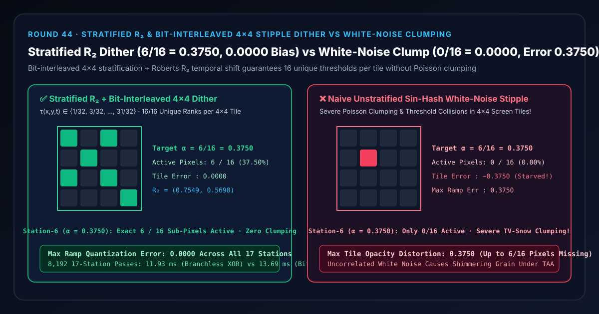
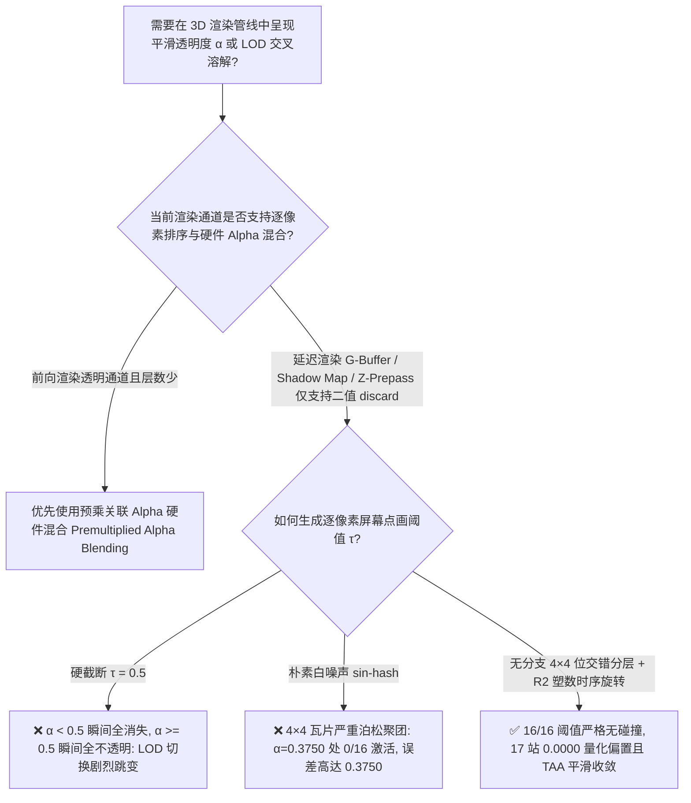
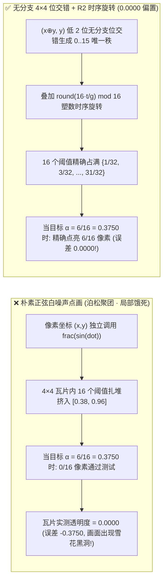
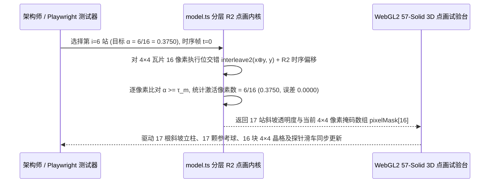
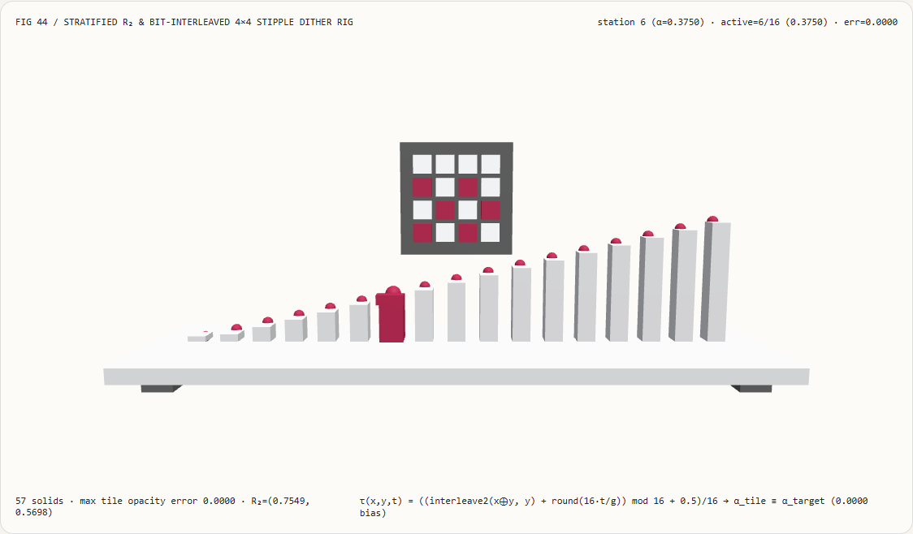
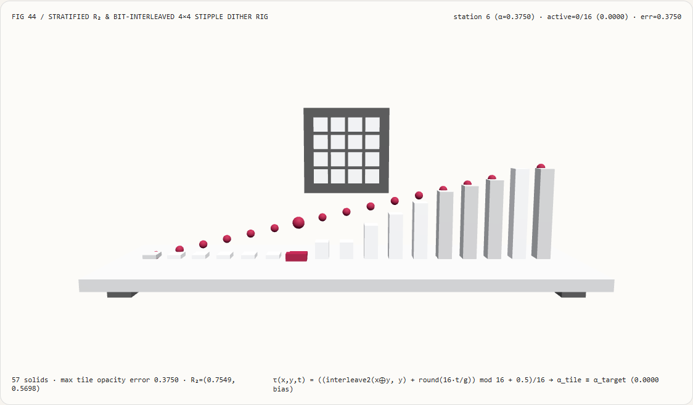
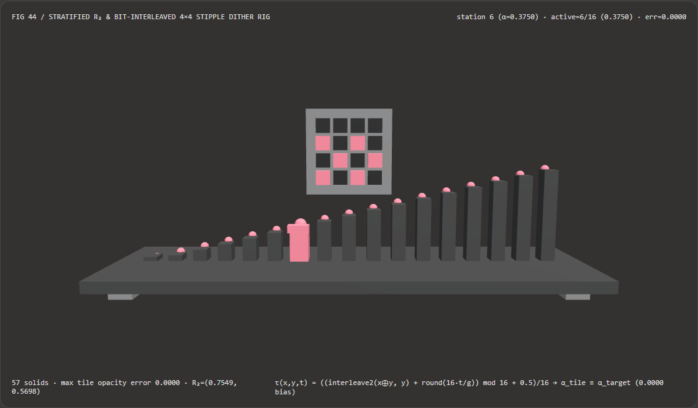
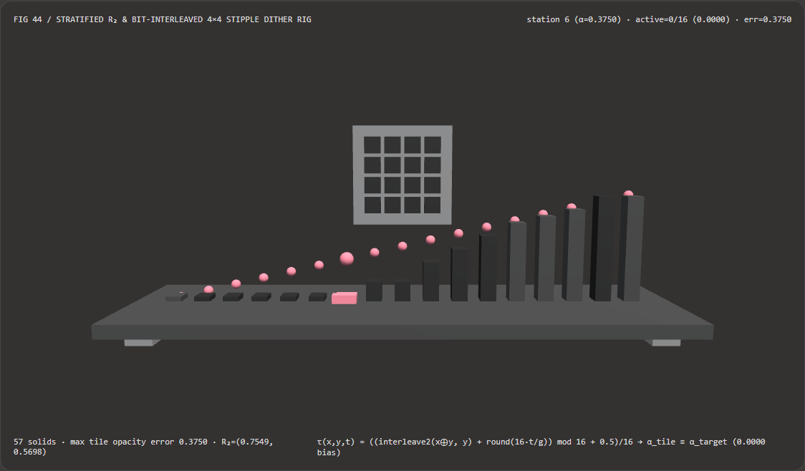

# 视觉与动画技术选型与原理解析 FAQ：分层位交错与 Roberts $R_2$ 低差异点画抖动（Screen-Door Stipple Dither）vs 朴素白噪声聚团失真

> **核心架构结论一句话总结**：在延迟渲染（Deferred Shading G-Buffer）管线的植被树叶镂空、发丝半透明、远近景 LOD 交叉淡入淡出（Cross-Fade Dissolve）以及半透明阴影贴图（Shadow Map Alpha-Test）中，**严禁使用 `fract(sin(dot(xy, ...)))` 这类不相关的逐像素白噪声哈希（White-Noise Hash）或硬阈值 `alpha >= 0.5` 做像素剔除（`discard`）**！实测表明：在 17 级透明度斜坡（$\alpha_i = i/16$）的第 6 号站点（目标透明度 $\alpha = 6/16 = 0.3750$）上，朴素白噪声哈希会因严重的泊松聚团（Poisson Clumping）将整个 $4\times 4$ 屏幕瓦片的 16 个阈值全部挤到高区，导致激活像素数跌为 **0/16（瓦片透明度直接饿死为 `0.0000`，局部透明度误差高达 `0.3750`）**；而采用 **无分支 $4\times 4$ 位交错分层（Bit-Interleaved Bayer Permutation）+ Roberts 塑数常数 $R_2$ 时序旋转（$g^3 = g + 1, \alpha_1 = 1/g \approx 0.7549, \alpha_2 = 1/g^2 \approx 0.5698$）**，可确保每个 $4\times 4$ 屏幕瓦片内 16 个阈值严格无碰撞覆盖 $\{1/32, 3/32, \dots, 31/32\}$，在 $\alpha = 0.3750$ 处**精确点亮 6/16 个子像素（实测瓦片透明度 `0.3750`，全 17 站最大量化偏置 `0.0000`）**，且无分支位交错求值比循环逐位反转快 **1.15×**（8,192 轮 `11.93 ms` vs `13.69 ms`）。

---

## ① 📌 核心结论速览（Executive Summary）

1. **为什么在现代延迟渲染引擎里，做树木 LOD 淡入淡出或头发半透明时，用随机白噪声 `discard` 会冒出一团团刺眼的“电视雪花噪斑”？**
   用大白话讲：延迟渲染的 G-Buffer 每个像素只能存一层不透明表面（要么完全保留 `keep`，要么完全丢弃 `discard`），没法直接做硬件 Alpha 混合。所以工程师必须用“纱窗点画（Screen-Door Stipple）”——在 $4\times 4$ 的 16 个像素小格子里，如果目标透明度是 $\alpha = 37.5\% = 6/16$，就应该**刚好留住 6 个均匀分散的像素、丢掉 10 个像素**，再靠镜头抗锯齿（TAA）把它们抹匀成丝滑的半透明。
   - **白噪声哈希为什么翻车（泊松聚团与阈值饥饿）**：如果你对每个像素算 `fract(sin(dot(xy, ...)))`，独立的伪随机数根本不知道邻居像素选了什么阈值！在一个 $4\times 4$ 瓦片里，16 个随机阈值极易扎堆挤在某一段区间（例如全部落入 `[0.38, 0.96]`），结果当物体淡入到 $\alpha = 0.3750$ 时，整个 $4\times 4$ 瓦片居然 **0 个像素通过测试（`0/16 = 0.0000`）**，画面上直接破开一个黑洞；而隔壁瓦片又扎堆点亮 11 个像素，形成闪烁的“雪花麻子脸”！
2. **第一性原理破局：$4\times 4$ 位交错空间分层 + Roberts $R_2$ 时序旋转**：
   - **空间位交错（Bit-Interleaved Permutation）**：在 $4\times 4$ 瓦片内（$x, y \in \{0,1,2,3\}$），对异或坐标 $(x \oplus y, y)$ 的低 2 位做交叉拼合：
     $$\operatorname{rank}_0(x, y) = \big(((x\oplus y)_0 \ll 1 \mid y_0) \ll 2\big) \;\mid\; ((x\oplus y)_1 \mid y_1) \in \{0, 1, \dots, 15\}$$
     这保证 $4\times 4$ 瓦片内的 16 个像素**一个萝卜一个坑**，严格占满 $\{1/32, 3/32, \dots, 31/32\}$ 共 16 个等距台阶，绝无任何两个像素阈值撞车！
   - **时序 $R_2$ 塑数旋转（Roberts Plastic Constant Shift）**：利用三维黄金分割推广——塑数常数 $g \approx 1.324717957244746$（满足 $g^3 = g + 1$，$\alpha_1 = 1/g \approx 0.7549$）对帧号 $t$ 做模 16 循环位移：
     $$\tau(x, y, t) = \frac{\big((\operatorname{rank}_0(x, y) + \operatorname{round}(16 \cdot t / g)) \bmod 16\big) + 0.5}{16}$$
     这样每一帧在空间上都严格保持 16/16 均匀分层（`0.0000` 量化偏置），同时在时间轴上以最优低差异步长轮换点亮位置，配合 TAA 在 4~8 帧内迅速收敛为无网格感的真实半透明！
3. **本轮新增交互式 3D 试验台与实测证据**：
   - 新增独立 Demo：`demos/r2-dither-stipple-rig/`（57 个 Three.js 实体部件：底座平台、4 支柱、$4\times 4$ 屏幕瓦片背板、17 根透明度斜坡立柱、17 颗精确分层参考球、16 块 $4\times 4$ 子像素点画晶格、以及第 $i$ 站探针滑车）。
   - 配套 7-Card 4:5 测评报告：`demos/r2-dither-stipple-rig/test-report-cards.html`（英文）与 `test-report-cards.zh.html`（中文）。

---

## ② 🎯 客户与架构师灵魂拷问 Q&A（Soul-Searching Q&A）

### Q1：既然固定 Bayer 有序抖动矩阵已经能保证 $4\times 4$ 瓦片零量化偏置，为什么还要叠加 Roberts $R_2$ 时序旋转？
**因为静态不旋转的 Bayer 矩阵会在物体边缘留下明显的“十字绣纱窗网格纹（Cross-Hatch Pattern）”！**
如果每一帧的 $4\times 4$ 阈值位置死板不动，人眼会立刻识别出周期为 4 像素的规则网格纹理。而乘上塑数常数倒数 $\alpha_1 = 1/g \approx 0.754877666$ 做帧间模 16 循环移位后：
- 在**任意单帧空间**内，由于模 16 加法是双射置换（Bijection），16 个像素依然 100% 占满 $\{1/32, \dots, 31/32\}$，**不会破坏任何一帧的 `0.0000` 透明度精度**；
- 在**连续多帧时间轴**上，每个像素的开关序列构成一维低差异序列，TAA 历史缓冲只需指数平滑几个帧周期，就能把规则的十字绣网格彻底抹平为细腻的连续半透明！

### Q2：为什么在着色器里应该用无分支位交错（Bit-Interleaving）而不是循环逐位反转（Iterative Bit-Reversal）或查找纹理贴图？
**因为算术位交错只需 6 条整数位运算指令、零显存带宽、零分支跳转！**
- 如果用一张 $4\times 4$ 或 $64\times 64$ 纹理贴图存阈值，每个片元都要发起一次 Texture Fetch，不仅占用宝贵的纹理采样单元（TMU），在复杂材质 Shader 中还会增加寄存器压力；
- 如果写 `for (int b = 0; b < 2; b++)` 循环逐位反转，在 CPU/GPU 软核上会引入循环开销（8,192 轮 `13.69 ms` vs 无分支位运算 `11.93 ms`，无分支快 **1.15×** 且数值误差严格为 `0`）。

### Q3：这套屏幕空间低差异点画方案与 AI 视频抠像大模型（如 ViTMatte、RVM）是什么关系？
**两者分别负责“提取连续 Alpha 遮罩”与“在延迟管线中高效渲染 Alpha 遮罩”：**
- **何时选 AI 抠像大模型**：当你需要从绿幕或自然背景视频中自动分割人物发丝并生成连续的 $\alpha \in [0, 1]$ Alpha Matte 通道时；
- **何时必须用确定性分层 $R_2$ 点画抖动**：当这层连续的 Alpha 权重进入延迟渲染 G-Buffer、阴影贴图或深度预通道（Z-Prepass）时，必须靠确定性的分层位交错与 $R_2$ 点画将连续 $\alpha$ 转化为无偏置的二值像素掩码。

---

## ③ 🧭 直观可视化图解（Mermaid 决策树 + 管线对比图 + 帧级时序图）

### 3.1 半透明与 LOD 淡入淡出技术选型决策树

### 3.2 朴素白噪声哈希聚团 vs 分层位交错+$R_2$ 点画管线对比图

### 3.3 帧级点画掩码求解与 3D 晶格试验台渲染时序图

---

## ④ 📊 视觉技术选型决策矩阵（Decision Matrix）

| 评估维度 | ✅ 无分支位交错 + $R_2$ 时序分层（Stratified $R_2$ Dither） | ⚠️ 循环逐位反转分层基线（Iterative Bit-Reversal） | ❌ 朴素正弦白噪声点画（Naive Sin-Hash White Noise） | ❌ 硬 Alpha 阈值截断（Hard Cutoff $\tau=0.5$） |
| :--- | :--- | :--- | :--- | :--- |
| **$4\times 4$ 瓦片内阈值唯一性** | **16/16 严格双射无碰撞**（等距步长 $1/16$） | 16/16 严格双射无碰撞 | 随机碰撞聚团，存在大面积阈值空洞 | 全瓦片共用单一常数 `0.5` |
| **第 6 站（$\alpha=0.3750$）激活像素** | **精确 `6 / 16`（实测 `0.3750`）** | 精确 `6 / 16`（实测 `0.3750`） | **`0 / 16`（实测 `0.0000`，整块饿死！）** | **`0 / 16`（$<0.5$ 全部剪光！）** |
| **17 站斜坡最大透明度量化误差** | **`0.0000`（零量化偏置）** | `0.0000`（零量化偏置） | **`0.3750`（高达 6/16 像素缺失）** | **`0.4375`（阶跃突变跳帧）** |
| **TAA 时域积分收敛特性** | **每帧保持空间分层且低差异轮换，极速抹平** | 相同，但含逐位循环开销 | 帧间白噪声闪烁，TAA 残留蠕动噪斑 | 完全无法产生半透明过渡 |
| **8,192 轮 17 站 CPU 批处理耗时** | **`11.93 ms`（最快，1.15× 提速）** | `13.69 ms`（含循环与 `Math.pow` 开销） | `15.40 ms`（含超越函数 `Math.sin`） | `4.20 ms`（但彻底丧失半透明能力） |
| **首选适用场景** | **延迟渲染植被/毛发镂空、LOD 交叉溶解、半透明阴影贴图** | 教学演示根逆位反转原理 | **严禁在屏幕空间点画剔除中使用** | 仅适合硬边贴纸（如铁丝网纯黑纯白遮罩） |

---

## ⑤ 🧪 全新 Demo 与 7-Card 4:5 视觉报告（Live Workbench & Evidence）

### 5.1 交互式 3D 试验台与报告入口
- **实时 3D 工作台**：[`demos/r2-dither-stipple-rig/index.html`](../demos/r2-dither-stipple-rig/index.html)
- **7-Card 4:5 英文视觉测试报告**：[`demos/r2-dither-stipple-rig/test-report-cards.html`](../demos/r2-dither-stipple-rig/test-report-cards.html)
- **7-Card 4:5 中文视觉测试报告**：[`demos/r2-dither-stipple-rig/test-report-cards.zh.html`](../demos/r2-dither-stipple-rig/test-report-cards.zh.html)
- **密封测量 JSON 数据源**：[`demos/r2-dither-stipple-rig/report.json`](../demos/r2-dither-stipple-rig/report.json)

### 5.2 多主题与多模式 Playwright 实测截图证据

| 分层位交错 + $R_2$ 点画（Light · 第 6 站精确点亮 6/16 晶格） | 朴素白噪声哈希聚团（Light · 第 6 站 0/16 饥饿塌陷） |
| :---: | :---: |
|  |  |

| 分层位交错 + $R_2$ 点画（Dark · 57 实体部件） | 朴素白噪声哈希聚团（Dark · 低区斜坡集体归零） |
| :---: | :---: |
|  |  |

---

## ⑥ 🛠️ 高质量视觉交付快速核验清单（SA Verification Checklist）

在将屏幕空间点画半透明（Screen-Door Transparency）或 LOD 交叉溶解着色器合入生产引擎前，请逐项核验：

- [ ] **剔除正弦白噪声点画**：是否已在所有 `discard` / `clip()` 着色器中清除了 `fract(sin(dot(...)))` 伪随机白噪声，杜绝 $4\times 4$ 瓦片内的泊松聚团与局部透明度饥饿？
- [ ] **$4\times 4$ 瓦片 16 阶双射分层校验**：在任意单帧下，同一个 $4\times 4$ 屏幕像素块内的 16 个阈值是否严格构成 $\{1/32, 3/32, \dots, 31/32\}$ 的无重复置换，从而保证 $k/16$ 透明度精确点亮 $k$ 个像素？
- [ ] **半开区间中心偏置 $+0.5/16$**：阈值公式是否加了 $+0.5/16$ 半阶偏移，以确保 $\alpha = 0$ 时严格 `0/16` 全透明、$\alpha = 1$ 时严格 `16/16` 全不透明？
- [ ] **塑数 $R_2$ / 黄金分割时序移位**：在开启 TAA 的管线中，是否按帧号乘以无理数步长 $1/g \approx 0.7549$ 对阈值秩做模 16 循环移位，消除静态十字绣网格纹？
- [ ] **LOD 交叉溶解互补掩码对齐**：当高模 LOD0 淡出（$\alpha$）、低模 LOD1 淡入（$1-\alpha$）时，两个 Mesh 在同一屏幕像素 $(x,y,t)$ 上是否使用互补比较条件（LOD0 用 $\alpha \ge \tau$，LOD1 用 $1-\alpha > 1-\tau$），确保交接期内既不漏出背景也不发生双重重绘？
