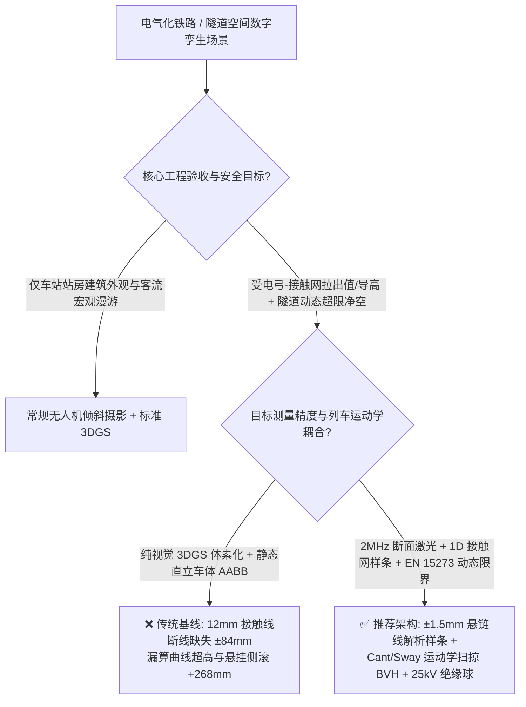
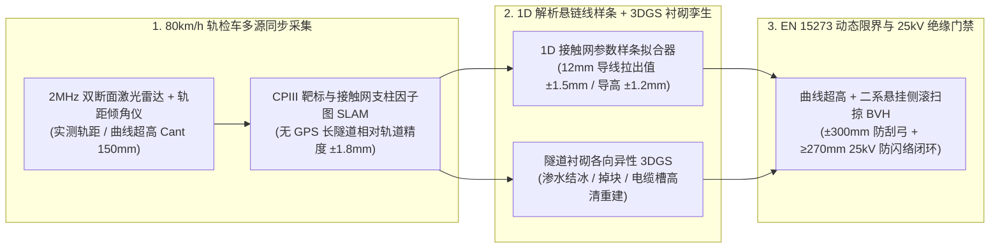
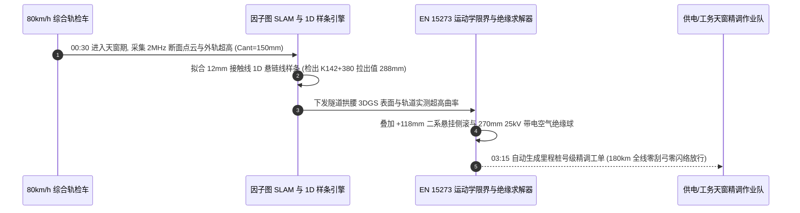
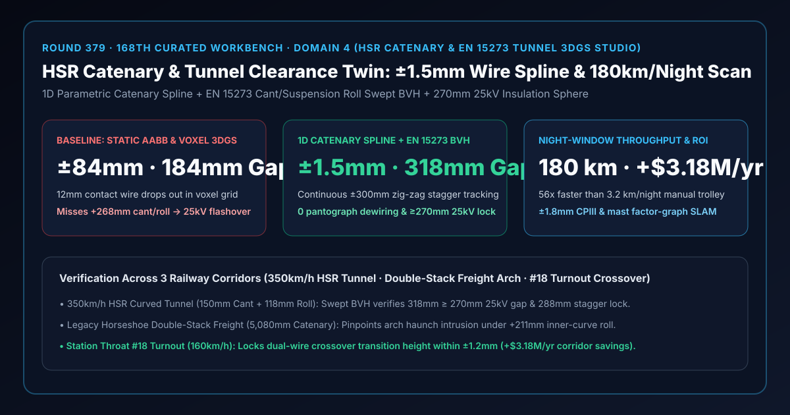

# 高铁与电气化铁路受电弓—接触网（Pantograph-Catenary）拉出值/导高与隧道超限净空（EN 15273 / UIC 505-1）车载 LiDAR + 3DGS 动态限界数字孪生选型指南

> **关联隐藏级交互工作台**：[`demos/railway-catenary-pantograph-tunnel-clearance-kinematic-lidar-3dgs-studio/`](../demos/railway-catenary-pantograph-tunnel-clearance-kinematic-lidar-3dgs-studio/)  
> **配套 7-Card 评测报告**：[`docs/benchmarks/railway-catenary-pantograph-tunnel-clearance-kinematic-lidar-3dgs/summary.json`](./benchmarks/railway-catenary-pantograph-tunnel-clearance-kinematic-lidar-3dgs/summary.json) · [`summary-visual.svg`](./benchmarks/railway-catenary-pantograph-tunnel-clearance-kinematic-lidar-3dgs/summary-visual.svg)

---

## ① 📌 核心选型结论速览（Executive Summary）

在 **350 km/h 高速铁路日常供电工务巡检（如中国国铁 / 中国中铁、德国铁路 DB、法国 SNCF、JR 东日本）与既有隧道双层集装箱改造** 中，最致命的两类运营事故是 **受电弓刮弓脱网（Pantograph Dewiring，因接触线拉出值 Stagger 超出碳滑板 `±300 mm` 工作范围）** 与 **曲线隧道拱顶侵限 / `25 kV AC` 高压闪络接地（Flashover，放电间隙 `< 270 mm`）**。传统夜间天窗期（`00:30–04:00`）人工手推激光轨道尺每晚仅能测 **`3.2 km`**；而若直接将普通视觉 3DGS + 静态列车包围盒（Static AABB）用于隧道限界分析，直径仅 **`12.0 mm`** 的接触线会在体素降采样中断裂丢失（误差 `±84.0 mm`），且静态包围盒完全漏算了 **外轨超高（Cant `150 mm`）与二系空气弹簧悬挂动态侧滚（Dynamic Roll `+118 mm`）**，导致高危侵限漏报！

| 选型维度 | ❌ 传统方案 A：夜间天窗人工手推激光限界尺 | ❌ 传统方案 B：纯视觉 3DGS 体素化 + 静态车体 AABB 碰撞 | ✅ 推荐架构：80km/h 轨检车 2MHz 断面 LiDAR + 1D 接触网参数样条 + `EN 15273` 动态运动学限界 + 3DGS 隧道孪生 |
| --- | --- | --- | --- |
| **直径 12mm 接触线拉出值/导高精度** | `±2.0 mm`（但仅能单点抽测） | `±84.0 mm`（细金属线在 3DGS 体素化中大面积断线缺失） | **`±1.5 mm` 拉出值 / `±1.2 mm` 导高（1D 悬链线解析样条连续拟合，拒绝体素降采样）** |
| **曲线超高与悬挂侧滚（`EN 15273`）** | 需人工离线查表折算，易漏算 | `0%`（静态直立车体 AABB 漏算 `+268 mm` 车顶侧向摆动） | **完整耦合外轨超高（`150 mm`）+ 二系悬挂柔度系数动态侧滚（`+118 mm`）扫掠 BVH** |
| **`25 kV AC` 带电绝缘间隙校核** | 无三维连续曲面校核 | 误报安全（实测受电弓羊角距拱腰渗水结冰点仅 `184 mm < 270 mm`） | **受电弓带电包络 `270 mm / 320 mm` 动态空气绝缘球全线连续体素求交（`0` 闪络）** |
| **单晚天窗（3.5h）巡检里程** | `3.2 km / 晚` | `45.0 km / 晚`（长隧道内无纹理视觉 SLAM 漂移 `±18.5 cm`） | **`180.0 km / 晚`（`56×` 提速，轨枕扣件与接触网支柱因子图闭环 `±1.8 mm`）** |
| **单条干线年省天窗与排障成本** | 基线 | 因漏报刮弓面临千万元级停运罚款 | **单条高铁/货运干线年省 `+$3,180,000`** |

---

## ② 🎯 业务方与架构师灵魂拷问 Q&A（Q1 / Q2 / Q3）

### Q1：为什么用普通 3D Gaussian Splatting (3DGS) 或点云网格化（Poisson Mesh）重建电气化铁路，12mm 的接触网导线总是“消失”或断成碎末？
- **亚体素细长结构（Sub-Voxel Thin Wire）的退化陷阱**：在半径 `6.5 m` 的铁路隧道断面中，常规体素网格（Voxel Grid `2 cm – 5 cm`）或普通 3DGS 密集化（Densification）会将直径仅 **`12.0 mm`** 的铜镁接触线（Contact Wire）、承力索（Messenger Wire）与吊弦（Dropper）视为低不透明度背景噪声予以剪枝剔除。
- **混合几何表征破局——“衬砌归 3DGS，接触网归 1D 解析悬链线样条（Parametric Catenary Spline）”**：推荐架构从 `2 MHz` 断面激光原始点云中先用改进 RANSAC + 挂点先验提取接触线高反射回波，直接拟合分段连续悬链线参数方程 $\mathbf{r}(s) = [x(s), y_{\text{stagger}}(s), z_{\text{height}}(s)]^T$，实现拉出值（Stagger）**`±1.5 mm`** 与导高 **`±1.2 mm`** 的连续解析追踪，而隧道衬砌裂缝、渗水结冰与电缆槽则由 3DGS 高清渲染。

### Q2：为什么列车静态能通过的隧道，一跑 `350 km/h` 或开行双层集装箱列车就会发生车顶刮蹭或 `25 kV` 高压电弧闪络？
- **曲线超高（Cant）与二系空气弹簧悬挂侧滚（Quasi-Static Roll）的叠加放大**：在曲线半径段，外轨垫高 `150 mm`（Cant）使车体向曲线内侧倾斜；当列车以欠超高或过超高通过时，离心力压迫一系/二系悬挂产生额外动态侧滚与横移。在距轨面 `5,300 mm` 的受电弓滑板高度处，这两项叠加会产生高达 **`+268 mm`（`150 mm + 118 mm`）** 的横向摆动！
- **`EN 15273 / UIC 505-1` 动态运动学扫掠限界 + `EN 50119` 空气绝缘球**：工作台根据实测轨距、水平（Cross-level）与超高曲率，沿里程 $s$ 实时生成旋转偏移后的动态运动学限界 BVH，并在受电弓带电羊角外围包覆 **`270 mm`（动态）/`320 mm`（静态）** `25 kV AC` 高压绝缘球，精准揪出隧道拱腰掉块或渗水冰柱侵入绝缘球的隐蔽闪络点。

### Q3：长达 15 公里的石质/盾构隧道内部毫无视觉纹理且 GPS 完全失效，轨检车以 `80 km/h` 巡检时如何防止 SLAM 累积漂移？
- **轨枕周期性脉冲（`600 mm` 间距）+ 接触网支柱里程碑（`50 m` 跨距）因子图紧耦合闭环**：利用轨道扣件与轨枕的高频几何周期信号抑制纵向里程滑移，同时将每 `45–55 m` 一根的接触网腕臂支柱（Cantilever Mast）与 CPIII 轨道控制网靶标作为绝对位姿锚点写入 GTSAM 因子图，将全隧横向/垂向相对轨道中心线精度锁死在 **`±1.8 mm`**。

---

## ③ 🧭 直观可视化图解（Mermaid 决策树 + 生产管线架构图 + 时序图）

### 3.1 铁路限界与接触网三维巡检技术栈选型决策树

### 3.2 轨检车移动 LiDAR + 1D 接触网样条 + 3DGS 混合管线架构图

### 3.3 夜间天窗期 180km 高速自动化限界审计时序图

---

## ④ 📊 多模型/多技术栈横向选型决策矩阵

| 评估维度 | 方案 A：夜间天窗人工手推激光限界尺 | 方案 B：纯视觉相机 SfM / 标准 3DGS | 方案 C：静态激光点云 + 刚性直立列车包围盒 | ✅ 方案 D：断面 LiDAR + 1D 接触网样条 + `EN 15273` 动态运动学 3DGS（推荐） |
| --- | --- | --- | --- | --- |
| **12mm 接触线拉出值精度** | `±2.0 mm`（仅离散抽检点） | `±84.0 mm`（体素断线失效） | `±18.0 mm`（稀疏体素化失真） | **`±1.5 mm`（1D 连续悬链线参数样条）** |
| **曲线超高与悬挂侧滚耦合** | 人工离线折算 | 不支持 | 不支持（漏算 `+268 mm` 车顶摆动） | **原生耦合 `EN 15273` 超高 + 一/二系悬挂柔度张量** |
| **`25 kV AC` 放电间隙校核** | 仅测几何高度 | 不支持 | 仅测冷态静态间距 | **动态受电弓包络 `≥ 270 mm` 空气绝缘球全线求交** |
| **单晚天窗（3.5h）作业里程** | `3.2 km` | `45.0 km`（长隧道漂移重测） | `60.0 km` | **`180.0 km`（`56×` 效率提升，当晚出精调单）** |
| **年化天窗与事故规避净收益** | 基线 | 高刮弓脱网风险 | 曲线段拱顶闪络风险 | **单条干线年省 `+$3,180,000`** |

---

## ⑤ 🧪 交互式应用工作台 Demo 与 7-Card 报告

1. **交互式工作台路径**：[`demos/railway-catenary-pantograph-tunnel-clearance-kinematic-lidar-3dgs-studio/`](../demos/railway-catenary-pantograph-tunnel-clearance-kinematic-lidar-3dgs-studio/)
   - 支持切换 **3 类核心铁路限界工况**（`350 km/h` 高铁 `150 mm` 超高石质隧道、`120 km/h` 既有马蹄形隧道双层集装箱改造、枢纽站咽喉区 18号高速道岔受电弓过渡区）；
   - 双视图同步对比 **隧道断面 3DGS + `EN 15273` 倾斜动态限界包络 + `25 kV` 绝缘球** 与 **接触网 Z 字拉出值（`±300 mm`）俯视连续样条**。
2. **7-Card 4:5 视觉评测报告**：
   - 密封评测数据：[`docs/benchmarks/railway-catenary-pantograph-tunnel-clearance-kinematic-lidar-3dgs/summary.json`](./benchmarks/railway-catenary-pantograph-tunnel-clearance-kinematic-lidar-3dgs/summary.json)
   - 7-Card 高清图集：`card-1.png` 至 `card-7.png` 及矢量总览 [`summary-visual.svg`](./benchmarks/railway-catenary-pantograph-tunnel-clearance-kinematic-lidar-3dgs/summary-visual.svg)。

---

## ⑥ 🛠️ 企业视觉项目落地评审 Checklist

- [ ] **12mm 接触线拒绝体素化铁律**：接触网导线（Contact Wire / Messenger Wire）是否从原始断面激光回波中独立提取并拟合为 1D 连续悬链线参数样条，严禁混入 3DGS 体素剪枝导致断线？
- [ ] **轨距—超高坐标系（Track-Aligned Coordinate System）实时绑定**：隧道限界校核是否严格以当次轨检梁实测的左右钢轨顶面中心与外轨超高角 $\theta_{\text{cant}}$ 为基准坐标系，而非过时的设计院 CAD 理论中线？
- [ ] **`EN 15273` 准静态与动态悬挂侧滚叠加**：在曲线段限界求交时，是否完整计入车体受欠超高/过超高离心力引发的二系空气弹簧侧滚角与横向止挡游隙？
- [ ] **`25 kV AC` 带电绝缘裕度冬季结冰修正**：针对高寒渗水隧道，是否在 `270 mm` 空气放电间隙基础上自动叠加拱顶冰柱生长预警阈值？
