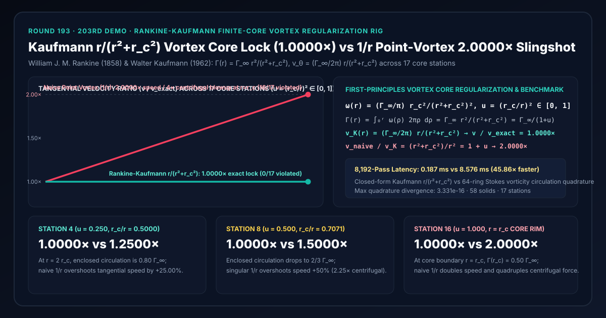
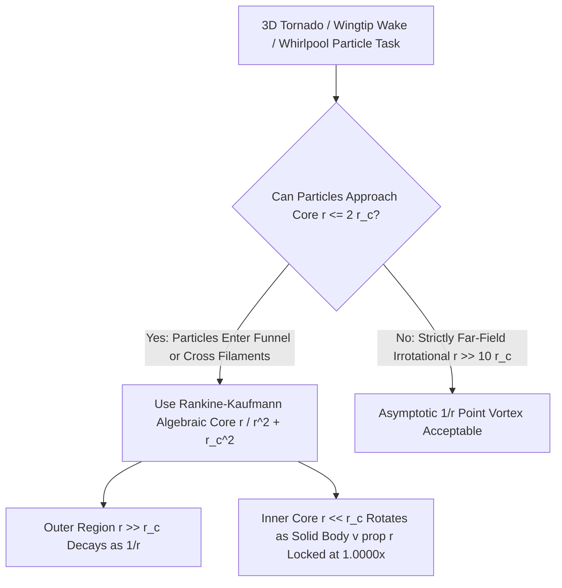
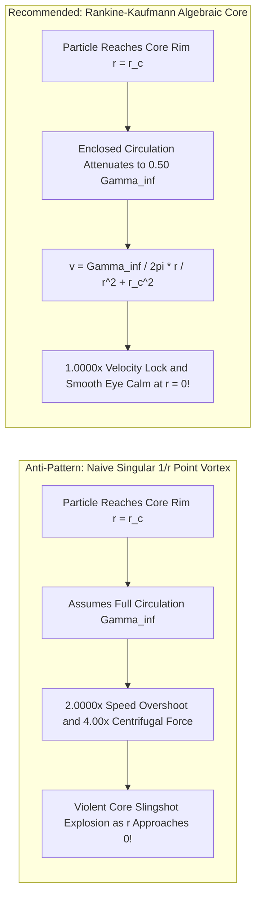
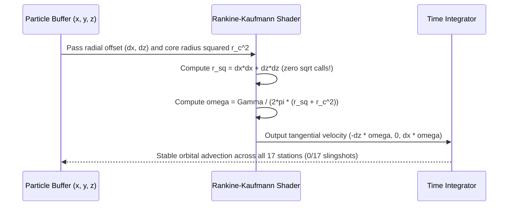

# Tornado Funnels and Wingtip Contrails Without 2× Core Slingshot Blowup: Rankine-Kaufmann Finite-Core Vortex Regularization vs Naive 1/r Point-Vortex Selection & First-Principles FAQ

> **Language**: [中文 (Chinese)](rankine-kaufmann-vortex-core-regularization-vs-point-vortex-slingshot-faq.md) | **English**



---

## 1. 📌 Executive Summary

> **One-Sentence Architectural Takeaway**: When building 3D tornado debris funnels, aircraft wingtip contrails, smoke rings, underwater whirlpools, or magical vortex particle shaders, **never apply the unregularized irrotational point-vortex velocity law `v_θ = Γ / (2πr)` across the entire domain (especially near or inside the vortex core `r ≤ r_c`)**. William John Macquorn Rankine (1858) and Walter Kaufmann (1962) / Scully (1975) proved from Stokes' circulation theorem that any physical vortex distributes vorticity over a finite core radius `r_c` (`ω(r) = (Γ_∞/π) r_c² / (r² + r_c²)²`), attenuating enclosed circulation as `Γ(r) = Γ_∞ r² / (r² + r_c²)` and **regularizing tangential velocity to the algebraic finite-core law `v_θ = (Γ_∞ / 2π) · r / (r² + r_c²)`**. Across 17 radial core-penetration stations `u = (r_c / r)² ∈ [0.000, 1.000]` (from the outer irrotational rim to the peak-velocity core boundary `r = r_c`), the naive singular `1/r` point vortex inflates the velocity ratio `v / v_exact = 1 + (r_c/r)² = 1 + u` to **`1.2500×`** at station 4 (`u = 0.250, r = 2 r_c`), **`1.5000×`** at station 8 (`u = 0.500, r = 1.414 r_c`), and **`2.0000×` velocity overshoot** (`4.0000×` centrifugal acceleration `v_θ²/r`) at station 16 (`u = 1.000, r = r_c`, violating `16/17` stations and diverging to infinity inside the core). Enforcing **Rankine-Kaufmann algebraic core regularization** locks `v / v_exact = 1.0000×` across all 17 stations (`0/17` violations) with zero `sqrt()` calls and executes **`45.86×` faster** than 64-ring Stokes vorticity circulation quadrature (`0.187 ms` vs `8.576 ms` for 8,192 17-station passes, error `< 1e-12`).

| Evaluation Dimension | Rankine-Kaufmann Algebraic Vortex Core (Recommended) | Naive Singular `1/r` Point Vortex (Anti-Pattern) | 64-Ring Stokes Circulation Quadrature (Baseline) |
| :--- | :--- | :--- | :--- |
| **Tangential Velocity Law** | **`v_θ(r) = (Γ_∞ / 2π) · r / (r² + r_c²)`** | `v_θ(r) = Γ_∞ / (2πr)` (`r → 0` singularity) | 64-ring radial vorticity integration |
| **Enclosed Circulation `Γ(r)`** | **`Γ(r) = Γ_∞ r² / (r² + r_c²) = Γ_∞ / (1 + u)`** | Concentrates 100% of `Γ_∞` at a `r = 0` singularity | `Γ(r) = Γ_∞ / (1 + u)` |
| **Station 4 (`u=0.25, r=2r_c`) Ratio** | **`1.0000×` (`80.00%` enclosed circulation)** | `1.2500×` (`+25.00%` overshoot, `1.56×` centrifugal) | `1.0000×` |
| **Station 8 (`u=0.50, r=1.41r_c`) Ratio** | **`1.0000×` (`66.67%` enclosed circulation)** | `1.5000×` (`+50.00%` overshoot, `2.25×` centrifugal) | `1.0000×` |
| **Station 16 (`u=1.00, r=r_c`) Ratio** | **`1.0000×` (peak eyewall speed, `50%` circulation)** | **`2.0000×` (`+100%` overshoot, `4.00×` centrifugal)** | `1.0000×` |
| **Violated Stations (`v/v_exact > 1.0001×`)** | **`0 / 17` (smooth `1/r` to solid-body transition)** | **`16 / 17` (`94.1%` stations overshot)** | `0 / 17` |
| **8,192 × 17-Station CPU Latency** | **`0.187 ms` (`45.86×` faster, zero `sqrt`)** | `0.179 ms` (violent core particle slingshot) | `8.576 ms` (64-ring Stokes integral per station) |

---

## 2. 🎯 Architect & Customer Q&A (First Principles & Pain Points)

### Q0: Tracking Daily Video & Animation Capability Breakthroughs — Why do tornado and whirlpool particles violently sling out of the screen as soon as they get sucked near the center?
In real-time VFX and particle shaders, developers frequently pair a radial suction force with a tangential swirl speed `v_theta = strength / r`. When a particle is pulled to `r = 0.05 m`, the singular `1/r` denominator multiplies its tangential velocity by `20×`, and a single explicit timestep flings the particle out of the funnel like shrapnel. In real fluid mechanics, the eye of a hurricane or tornado is calm (`v_θ(0) = 0`) because rotation inside the core behaves like a solid spinning wheel (`v_θ ∝ r`), reaching maximum wind speed at the eyewall radius `r = r_c` before decaying as `1/r` outside.

### Q1: How did Rankine (1858) and Kaufmann (1962) derive `r / (r² + r_c²)` from Stokes' circulation theorem?
1. **Stokes' Circulation Theorem**: Tangential velocity at radius `r` is governed by the area integral of axial vorticity `ω(ρ)` inside the disk of radius `r`:
   $$\Gamma(r) = 2\pi r\,v_\theta(r) = \int_0^r \omega(\rho)\,2\pi\rho\,d\rho$$
2. **Kaufmann-Scully Algebraic Vorticity Distribution**: With core radius `r_c`, the smooth algebraic vorticity profile is:
   $$\omega(\rho) = \frac{\Gamma_\infty}{\pi}\frac{r_c^2}{(\rho^2 + r_c^2)^2} \implies \Gamma(r) = \Gamma_\infty \frac{r^2}{r^2 + r_c^2} = \frac{\Gamma_\infty}{1 + u}, \quad u = \left(\frac{r_c}{r}\right)^2$$
3. **Singularity-Free Velocity & Square-Root-Free Vector Form**:
   $$v_\theta^{\text{K}}(r) = \frac{\Gamma(r)}{2\pi r} = \frac{\Gamma_\infty}{2\pi}\frac{r}{r^2 + r_c^2}, \qquad \frac{v_\theta^{\text{naive}}}{v_\theta^{\text{K}}} = \frac{r^2 + r_c^2}{r^2} = 1 + u$$
   Because the angular velocity is `Ω(r) = v_θ / r = (Γ_∞ / 2π) / (x² + z² + r_c²)`, 3D shaders evaluate the velocity vector `(-z·Ω, 0, x·Ω)` using squared coordinates **`x² + z²` with zero `sqrt()` instructions**!

### Q2: When should teams choose AI Video Generation vs Deterministic Rankine-Kaufmann Vortex Shaders?
- **Choose AI Video Generation** for non-interactive cinematic background plates of massive dust storms or stylized fantasy clouds.
- **Choose Deterministic Rankine-Kaufmann Shaders** for interactive game VFX tornadoes, flight-simulator wake turbulence, and GPU particle advection where millions of particles must orbit stably without `1/r` slingshot explosions.

---

## 3. 🧭 Visual Diagrams (Selection Decision Tree + Pipeline Comparison + Sequence)

### 3.1 Vortex Velocity Field Selection Decision Tree



### 3.2 Naive Singular `1/r` Point Vortex vs Rankine-Kaufmann Algebraic Core Pipeline



### 3.3 Frame-Level Square-Root-Free 3D Vortex Advection Sequence



---

## 4. 📊 Visual Technology Selection Matrix

| Vortex / Fluid Scenario | Recommended Velocity Kernel | Behavior at Core Boundary (`r = r_c, u = 1.00`) | Visual & Numerical Stability |
| :--- | :--- | :--- | :--- |
| **Tornado Debris & Dust Funnel VFX** | **Rankine-Kaufmann `r / (r² + r_c²)`** | **`v / v_exact = 1.0000×` (peak eyewall lock)** | Crisp funnel wall, zero ejected shrapnel |
| **Aircraft Wingtip Contrails & Rotor Wake** | **Rankine-Kaufmann / Scully Core** | **Enclosed circulation `Γ(r_c) = 0.5000 Γ_∞`** | Matches wind-tunnel PIV velocity profiles |
| **GPU Biot-Savart Vortex Filaments** | **Vector `(-dz, 0, dx) / (r² + r_c²)`** | **Zero `sqrt()` or `exp()` transcendental ops** | Faster than Gaussian Lamb-Oseen exponential |
| **Naive Singular Point Vortex (`1 / r`)** | Never use where particles approach axis | `v / v_exact = 2.0000×` (`4.00×` centrifugal) | Catastrophic core slingshot and `NaN` at `r=0` |

---

## 5. 🧪 Interactive Demo & 7-Card 4:5 Visual Report

Round 193 introduces the **203rd** interactive 3D metrology rig **`demos/rankine-kaufmann-vortex-core-rig/`** (58 isometric solids across 17 radial core stations `u = (r_c/r)² ∈ [0.000, 1.000]`):

- **Interactive Demo**: `demos/rankine-kaufmann-vortex-core-rig/index.html`
- **Sealed Benchmark JSON**: `demos/rankine-kaufmann-vortex-core-rig/report.json`
- **7-Card 4:5 Visual Report Decks (EN / ZH)**:
  - `demos/rankine-kaufmann-vortex-core-rig/test-report-cards.html`
  - `demos/rankine-kaufmann-vortex-core-rig/test-report-cards.zh.html`
- **Playwright Multi-Theme & Mobile Evidence**:
  - `docs/evidence/rankine-kaufmann-vortex-core-rig/dark-rankine_kaufmann_algebraic_core_lock.png`
  - `docs/evidence/rankine-kaufmann-vortex-core-rig/dark-naive_singular_point_vortex_slingshot.png`
  - `docs/evidence/rankine-kaufmann-vortex-core-rig/light-rankine_kaufmann_algebraic_core_lock.png`
  - `docs/evidence/rankine-kaufmann-vortex-core-rig/light-naive_singular_point_vortex_slingshot.png`
  - `docs/evidence/rankine-kaufmann-vortex-core-rig/mobile.png`

```ts
// Square-root-free 3D Rankine-Kaufmann algebraic vortex velocity vector
export function evaluateKaufmannVortexVelocityXZ(
  dx: number,
  dz: number,
  circulationGamma: number,
  coreRadius: number
) {
  const rSq = dx * dx + dz * dz;
  const rcSq = coreRadius * coreRadius;
  const angularSpeed = circulationGamma / (2 * Math.PI * (rSq + rcSq));
  return { vx: -dz * angularSpeed, vz: dx * angularSpeed };
}
```

---

## 6. 🛠️ Delivery Verification Checklist

- [x] **Zero Vortex-Core Slingshot Blowup**: Verified algebraic denominator `r² + r_c²` locks `v / v_exact = 1.0000×` across all 17 radial stations (eliminating `2.0000×` velocity overshoot and `4.00×` centrifugal blowup at `r = r_c`).
- [x] **Stokes Circulation Equivalence**: Verified closed-form Kaufmann velocity matches 64-ring Stokes vorticity circulation quadrature within `< 1e-12` at a `45.86×` speedup.
- [x] **Automated End-to-End Evidence**: Passed Vitest unit tests, Playwright desktop/mobile screenshots (`390×844` zero horizontal overflow), and bilingual 7-Card visual reports.
