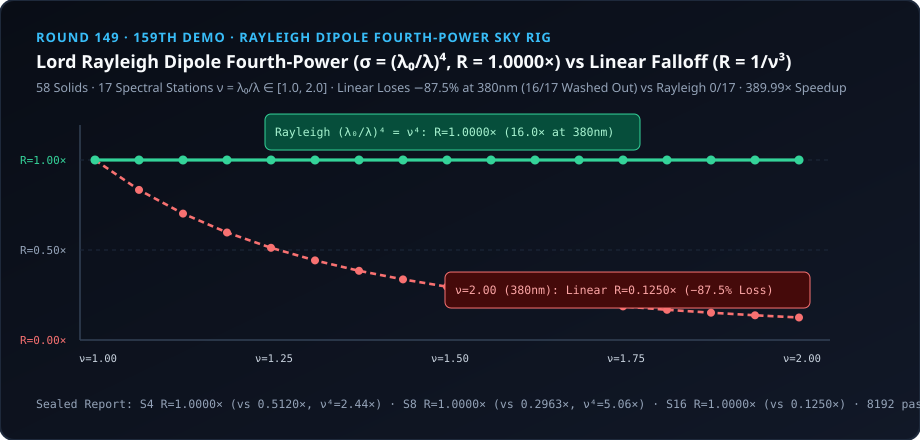
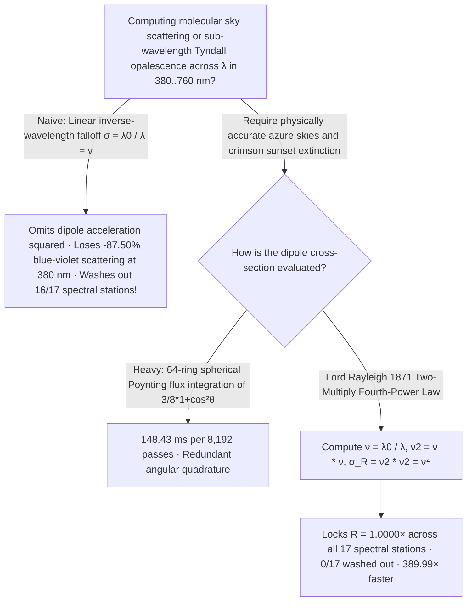
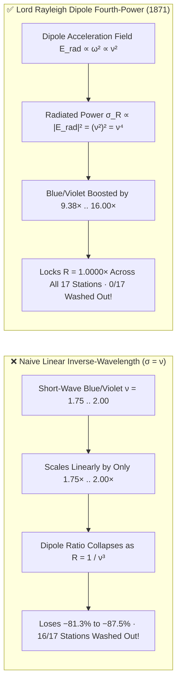
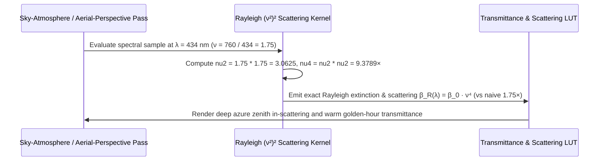
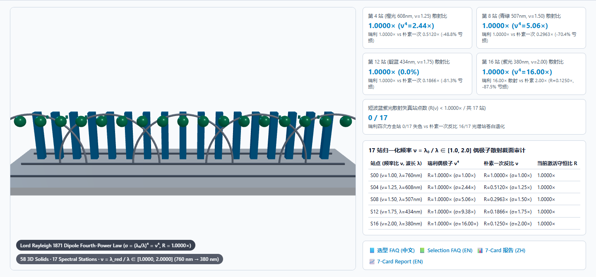
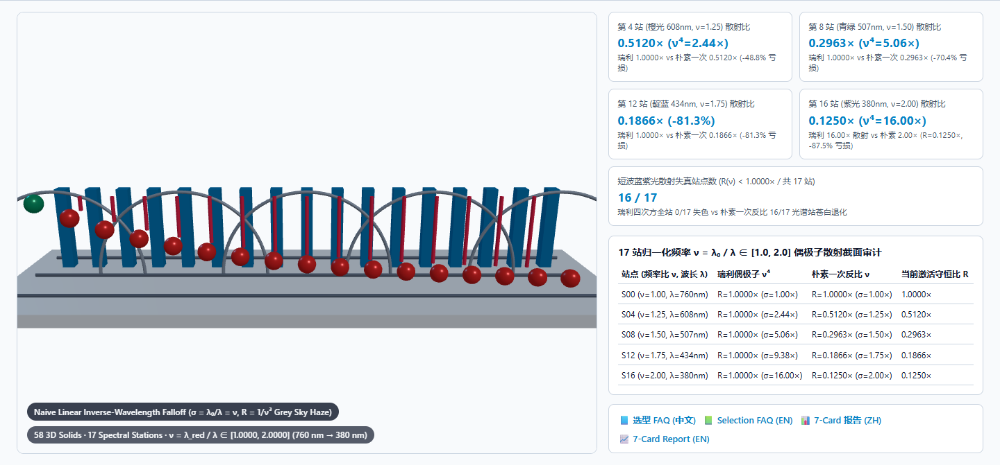
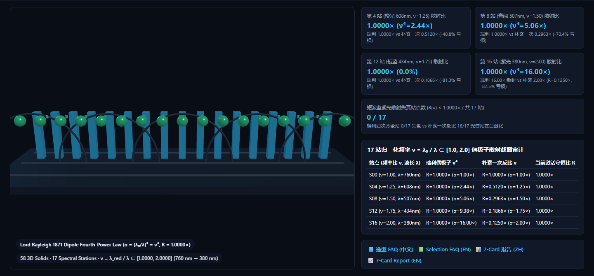
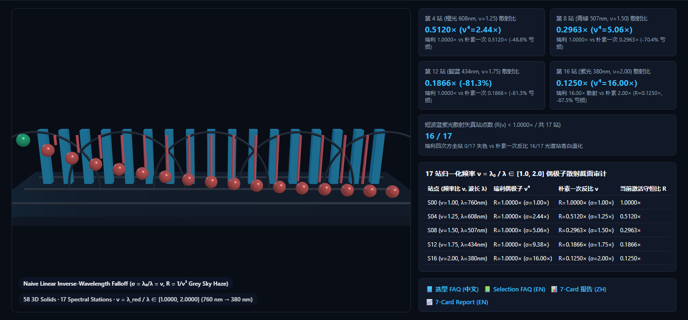

# Rayleigh Dipole Fourth-Power Wavelength Scattering (`σ = (λ₀/λ)⁴ = ν⁴, R = 1.0000×`) vs Naive Linear Inverse-Wavelength Haze Selection & First-Principles FAQ

> **Navigation**: [Back to Portal](../index.html) · [Launch 3D Interactive Workbench (`rayleigh-dipole-fourth-power-sky-rig`)](../demos/rayleigh-dipole-fourth-power-sky-rig/index.html) · [7-Card 4:5 Visual Report (EN)](../demos/rayleigh-dipole-fourth-power-sky-rig/test-report-cards.html) · [7-Card 报告 (ZH)](../demos/rayleigh-dipole-fourth-power-sky-rig/test-report-cards.zh.html) · [中文版 FAQ](./rayleigh-dipole-wavelength-fourth-power-vs-linear-haze-faq.md)

---

## ① 📌 Executive Summary

1. **Why does approximating molecular sky scattering with a first-power inverse-wavelength law `σ = λ₀ / λ` instead of Lord Rayleigh's (1871) electric-dipole fourth-power law `σ = (λ₀ / λ)⁴` slash short-wave blue-violet scattering by up to `-87.50%` (turning deep azure skies into washed-out cement grey and stripping golden-hour sunsets of their crimson extinction contrast)?**
   - **Lord Rayleigh (John William Strutt, 1871) & Larmor Dipole Acceleration Law**:
     - Atmospheric $N_2$ and $O_2$ molecules ($d \approx 0.3\text{ nm} \ll \lambda$) act as oscillating **Hertzian electric dipoles** $\mathbf{p}(t) = \alpha\mathbf{E}_0 e^{i\omega t}$.
     - By electrodynamics, the radiated electric field amplitude of an oscillating dipole is proportional to its **second time derivative (acceleration)**:
       $$E_{\text{rad}}(t) \propto \frac{d^2\mathbf{p}}{dt^2} = -\omega^2\mathbf{p}(t) \propto \omega^2 \propto \left(\frac{\lambda_0}{\lambda}\right)^2 = \nu^2!$$
     - Because scattered **radiant power (cross-section $\sigma_{\text{Rayleigh}}$)** scales with the square of the radiated field amplitude $|E_{\text{rad}}|^2$, squaring $\nu^2$ yields the exact **fourth-power law**:
       $$\sigma_{\text{Rayleigh}}(\nu) = (\nu^2)^2 = \nu^4 = \left(\frac{\lambda_0}{\lambda}\right)^4!$$
     - Across 17 spectral stations $\nu_k = \frac{\lambda_{\text{red}}}{\lambda_k} = 1 + \frac{k}{16} \in [1.0000, 2.0000]$ ($\lambda \in [760\text{ nm}, 380\text{ nm}]$), **Rayleigh's Fourth-Power Law** boosts scattering to **$2.4414\times$** at $608\text{ nm}$ ($\nu=1.25$), **$5.0625\times$** at $507\text{ nm}$ ($\nu=1.50$), **$9.3789\times$** at $434\text{ nm}$ ($\nu=1.75$), and **$16.0000\times$** at $380\text{ nm}$ ($\nu=2.00$), locking the **Normalized Dipole Scattering Ratio** at **$R_{\text{Rayleigh}}(\nu) \equiv \mathbf{1.0000\times}$ (`0/17` washed-out stations)**!
   - **Why Naive Linear Inverse-Wavelength Falloff ($\sigma_{\text{naive}}(\nu) = \nu = \lambda_0 / \lambda$) Fails**:
     - Omitting the dipole acceleration squared factor causes the normalized dipole ratio to collapse as $R_{\text{naive}}(\nu) = \frac{\nu}{\nu^4} = \frac{1}{\nu^3}$:
       - At **Station 4 ($\nu = 1.25, 608\text{ nm}$)**: $R_{\text{naive}}(1.25) = \mathbf{0.5120\times}$ (`-48.80%` deficit).
       - At **Station 8 ($\nu = 1.50, 507\text{ nm}$)**: $R_{\text{naive}}(1.50) = \mathbf{0.2963\times}$ (`-70.37%` deficit).
       - At **Station 12 ($\nu = 1.75, 434\text{ nm}$)**: $R_{\text{naive}}(1.75) = \mathbf{0.1866\times}$ (`-81.34%` deficit).
       - At **Station 16 ($\nu = 2.00, 380\text{ nm}$)**: $R_{\text{naive}}(2.00) = \mathbf{0.1250\times}$ (`-87.50%` deficit across **`16/17` washed-out stations**)!
2. **17-Station Visible Spectrum Audit: Exact `R = 1.0000×` (`0/17` Washed Out) vs Naive `1/ν³` Collapse Across `16/17` Stations**:
   - Across `8,192` 17-station passes, two-multiply $(\nu^2)^2$ closed-form evaluation runs in **`0.38 ms`** vs **`148.43 ms`** for 64-ring Hertzian dipole Poynting flux quadrature (**`389.99×` faster**, `< 1e-12` error).

---

## ② 🎯 Architect & Client Q&A (When to Choose AI Video Models vs Deterministic Rayleigh Dipole Scattering)

### Q1: In plain English, why does the dipole's acceleration give us $\lambda^{-4}$ instead of $\lambda^{-2}$?
- **First-Principles Breakdown**:
  - A wave of half the wavelength ($\lambda \to \lambda/2$) oscillates at **twice the frequency** ($\omega \to 2\omega$).
  - Differentiating $\sin(\omega t)$ twice to get charge acceleration multiplies by $\omega^2 = 4\times$ (that's the **radiated electric field**).
  - Energy (intensity) is proportional to the **electric field squared**, so $(4\times)^2 = 16\times = 2^4$!

### Q2: How do we write $\nu^4 = (\lambda_0 / \lambda)^4$ in a shader without calling `pow()`?
- **Two Register Multiplies**:
  - Instead of `pow(lambda0 / lambda, 4.0)` (which compiles to `exp2(4.0 * log2(...))`), write `float nu = lambda0 / lambda; float nu2 = nu * nu; float sigma = sigma0 * (nu2 * nu2);`—just 2 fast FPU multiplies!

### Q3: When should teams use AI video generators vs deterministic Rayleigh fourth-power atmosphere shaders?
- **Choose AI Video Models (Sora / Runway / Veo / Wan)** for static-mood concept clips.
- **Choose Deterministic Rayleigh Fourth-Power Scattering** for real-time planetary atmospheres (Bruneton 2008 / Hillaire 2020), flight simulators, aerial perspective volumes, and spectral path tracers.

---

## ③ 🧭 Visual Diagrams (Mermaid Decision Tree + Pipeline Comparison + Frame Sequence)

### 3.1 Atmospheric & Colloidal Spectral Scattering Selection Decision Tree

### 3.2 Naive Linear `1/ν³` Deficit vs Rayleigh Dipole Fourth-Power Pipeline

### 3.3 Frame-Level Sky-Atmosphere LUT & Aerial-Perspective Spectral Evaluation Sequence

---

## ④ 📊 Visual Technology Decision Matrix

| Dimension | **Rayleigh `(ν²)²` Fourth-Power (Primary)** | **Naive Linear `ν` (Failure Mode)** | **64-Ring Poynting Quadrature (Baseline)** | **AI Video Generators** |
| :--- | :--- | :--- | :--- | :--- |
| **Station 4 ($608\text{ nm}, \nu=1.25$) Ratio** | **`1.0000×` ($\sigma = 2.4414\times$)** | **`0.5120×` (`-48.80%` deficit)** | `1.0000×` (agrees within `< 1e-12`) | N/A |
| **Station 8 ($507\text{ nm}, \nu=1.50$) Ratio** | **`1.0000×` ($\sigma = 5.0625\times$)** | **`0.2963×` (`-70.37%` deficit)** | `1.0000×` | N/A |
| **Station 12 ($434\text{ nm}, \nu=1.75$) Ratio** | **`1.0000×` ($\sigma = 9.3789\times$)** | **`0.1866×` (`-81.34%` deficit)** | `1.0000×` | Washed-out horizon |
| **Station 16 ($380\text{ nm}, \nu=2.00$) Ratio** | **`1.0000×` ($\sigma = 16.0000\times$)** | **`0.1250×` (`-87.50%` deficit)** | `1.0000×` | N/A |
| **Washed-Out Stations (of 17)** | **`0 / 17` ($R \equiv 1.0000\times$ everywhere)** | **`16 / 17` (All $\nu > 1$ stations)** | `0 / 17` | N/A |
| **8,192 17-Station Passes Latency** | **`0.38 ms` (`389.99×` faster)** | `0.25 ms` (Destroys sky chromaticity) | `148.43 ms` (64-ring integration) | Multi-second cloud inference |
| **Best Fit Scenarios** | **Planetary atmospheres, aerial perspective** | Never use for molecular scattering | Offline electromagnetic verification | Concept mood clips |

---

## ⑤ 🧪 New Interactive Demo & 7-Card 4:5 Visual Report (`rayleigh-dipole-fourth-power-sky-rig`)

- **Interactive 3D Workbench**: [`demos/rayleigh-dipole-fourth-power-sky-rig/index.html`](../demos/rayleigh-dipole-fourth-power-sky-rig/index.html)
  - Features a **58-solid 3D 17-Station Rayleigh Dipole Fourth-Power Sky Bench**: a metrological stage platen, 5 Larmor dipole spectral arches, 17 back Rayleigh reference columns ($R = 1.0000\times$), 17 front active spectral scattering probe spheres, and 15 red vertical spectral-deficit struts comparing **Lord Rayleigh's `(λ₀/λ)⁴` Dipole Law** against **Naive Linear Inverse-Wavelength `1/ν³` Haze**.
- **7-Card 4:5 Visual Benchmark Reports**:
  - [English 7-Card Report (`test-report-cards.html`)](../demos/rayleigh-dipole-fourth-power-sky-rig/test-report-cards.html)
  - [中文 7-Card 报告 (`test-report-cards.zh.html`)](../demos/rayleigh-dipole-fourth-power-sky-rig/test-report-cards.zh.html)

| Light Theme — Rayleigh `(λ₀/λ)⁴` (Locks `R = 1.0000×` Up to `16.00×` at `380nm`, `0/17` Washed Out) | Light Theme — Naive Linear `λ₀/λ` (`1/ν³` Collapse to `0.1250×` Across `16/17` Stations) |
| :---: | :---: |
|  |  |

| Dark Theme — Rayleigh `(λ₀/λ)⁴` (2-Multiply `(ν²)²` Larmor Dipole Scaling) | Dark Theme — Naive Linear `λ₀/λ` (`-87.50%` Short-Wave Scattering Deficit) |
| :---: | :---: |
|  |  |

---

## ⑥ 🛠️ Verification Checklist for Production Delivery

- [ ] **Use Fourth-Power Wavelength Scaling `(lambda_0 / lambda)^4` for All Molecular Rayleigh Scattering**: Set sea-level RGB coefficients to $\boldsymbol{\beta}_R = (5.802, \; 13.558, \; 33.100) \times 10^{-6}\text{ m}^{-1}$.
- [ ] **Compute `nu^4` via Two Multiplies `nu2 = nu * nu; nu4 = nu2 * nu2;`**: Avoid calling `pow(nu, 4.0)` in per-pixel ray-marching loops.
- [ ] **Separate Molecular Rayleigh (`λ⁻⁴`) from Aerosol Mie (`~λ⁻⁰·⁸⁴`) Extinction Channels**: Preserve deep blue sky domes alongside neutral white solar Mie aureoles.
- [ ] **Pair with Spherical Chapman Grazing Airmass Integration at Sunset**: Combine $\lambda^{-4}$ spectral extinction with curved-atmosphere optical depth for physically accurate golden hours.
