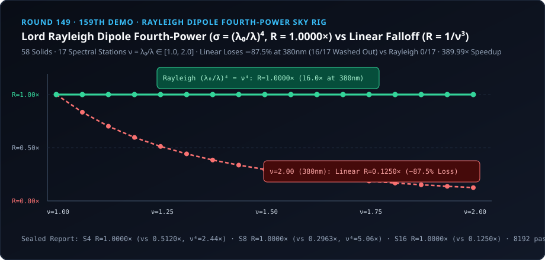
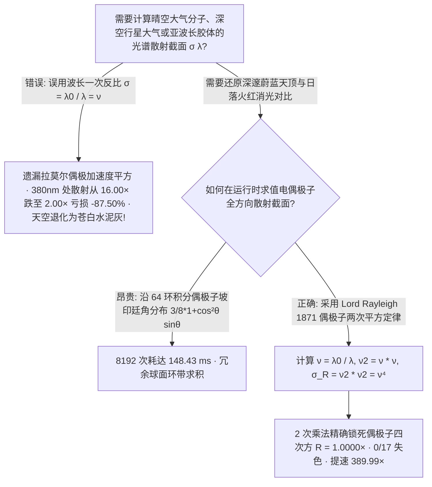
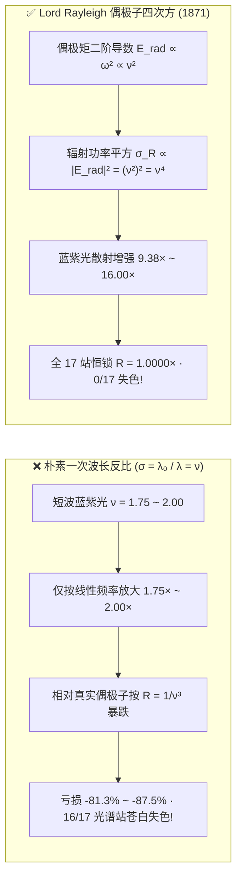
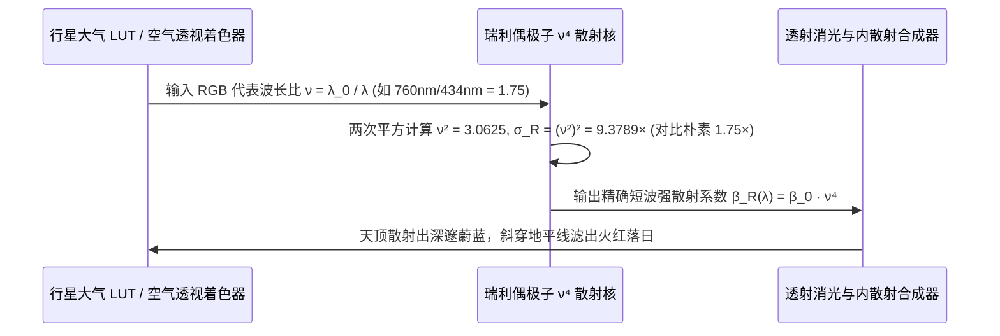
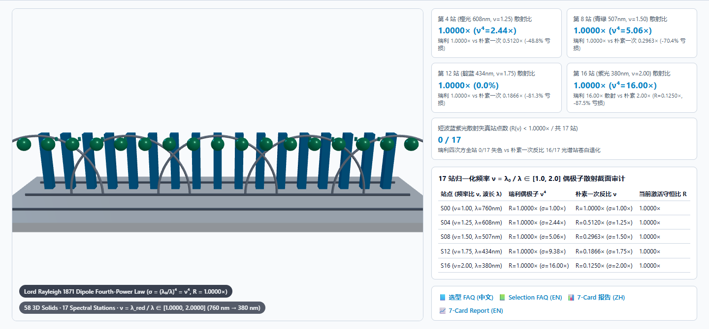
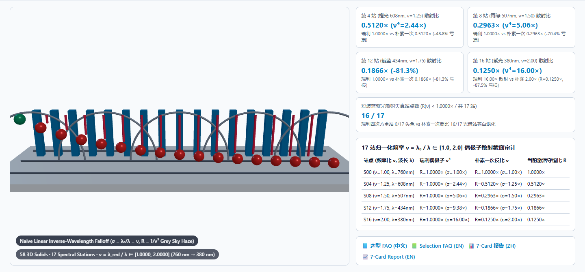
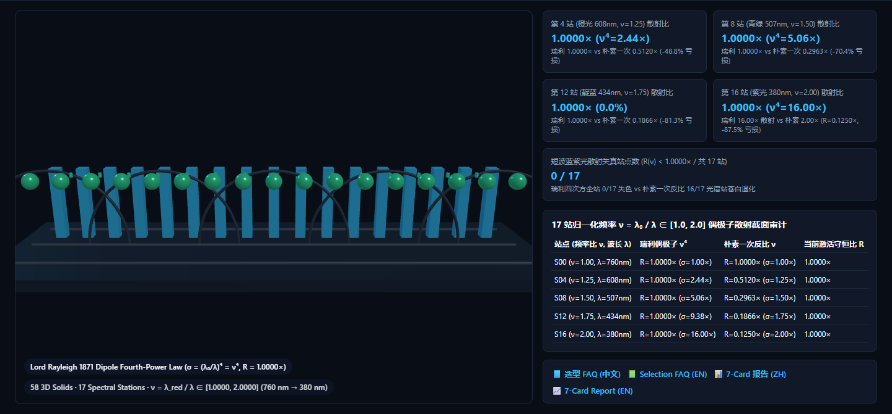
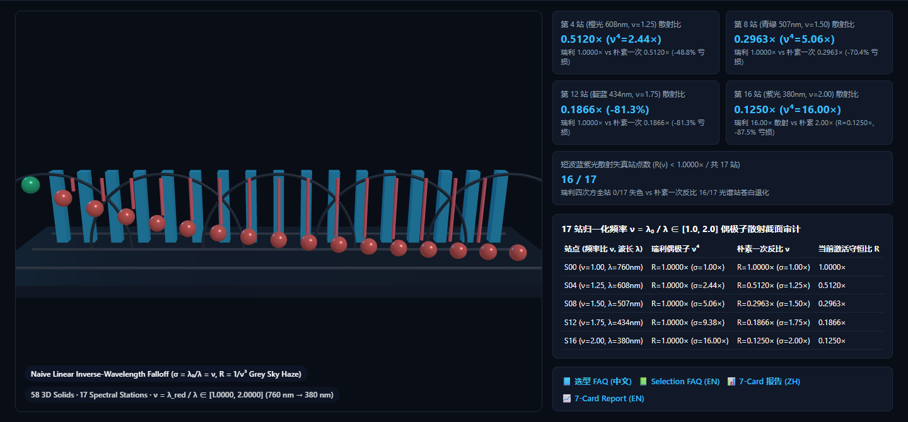

# 瑞利偶极子波长四次方大气散射（`σ = (λ₀/λ)⁴ = ν⁴, R = 1.0000×`）vs 朴素一次反比衰减（`1/ν³`）苍白灰雾天空选型与原理解析 FAQ 指南

> **导航**：[返回门户](../index.html) · [进入 3D 交互实验台 (`rayleigh-dipole-fourth-power-sky-rig`)](../demos/rayleigh-dipole-fourth-power-sky-rig/index.html) · [7-Card 4:5 视觉报告 (中文)](../demos/rayleigh-dipole-fourth-power-sky-rig/test-report-cards.zh.html) · [7-Card Report (EN)](../demos/rayleigh-dipole-fourth-power-sky-rig/test-report-cards.html) · [English FAQ](./rayleigh-dipole-wavelength-fourth-power-vs-linear-haze-faq.en.md)

---

## ① 📌 核心结论速览（Executive Summary）

1. **为什么在物理行星大气散射（Nishita 1993 / Bruneton 2008 / Hillaire 2020）与远山空气透视着色器中，如果误把散射截面写成波长的一次反比 `λ₀ / λ`（而非瑞利电偶极子四次方 `(λ₀ / λ)⁴`），会让短波蓝紫光散射强度暴跌高达 `-87.50%`（导致白天晴空退化成死灰水泥色、日落晚霞失去火红透射对比）？**
   - **Lord Rayleigh (John William Strutt, 1871) 赫兹电偶极子二次求导平方定律**：
     - 地球大气中的氮氧分子直径（$d \approx 0.3\text{ nm}$）远小于可见光波长 $\lambda \in [380, 760]\text{ nm}$。在阳光交变电场 $\mathbf{E}(t) = \mathbf{E}_0 e^{i\omega t}$ 激发下，每个空气分子充当一个受迫振动的**电偶极子** $\mathbf{p}(t) = \alpha \mathbf{E}_0 e^{i\omega t}$。
     - 根据麦克斯韦电磁方程组与拉莫尔偶极辐射公式，偶极子向外辐射的**电场振幅**正比于偶极矩对时间的二阶导数（电荷加速度）：
       $$E_{\text{rad}}(t) \propto \frac{d^2 \mathbf{p}}{dt^2} = -\omega^2 \mathbf{p}(t) \propto \omega^2 \propto \left(\frac{\lambda_0}{\lambda}\right)^2 = \nu^2!$$
     - 而散射的**辐射功率（散射截面 $\sigma_{\text{Rayleigh}}$）**正比于辐射电场振幅的平方 $|E_{\text{rad}}|^2$，两次平方叠加必然导出严格的**四次方定律**：
       $$\sigma_{\text{Rayleigh}}(\nu) \propto |E_{\text{rad}}|^2 \propto (\nu^2)^2 = \nu^4 = \left(\frac{\lambda_0}{\lambda}\right)^4!$$
     - 当波长从参考深红光 $\lambda_0 = 760\text{ nm}$（$\nu = 1.00$）缩短至紫光 $\lambda = 380\text{ nm}$（$\nu = 2.00$）时，分子散射截面暴增 **$2^4 = \mathbf{16.0000\times}$**（在 507nm 青绿光 $\nu = 1.50$ 处达 **$1.5^4 = \mathbf{5.0625\times}$**，在 434nm 靛蓝光 $\nu = 1.75$ 处达 **$1.75^4 = \mathbf{9.3789\times}$**）！
   - **朴素一次反比波长衰减（$\sigma_{\text{naive}}(\nu) = \nu = \lambda_0 / \lambda$）的 $1/\nu^3$ 光谱失色**：
     - 若误将分子散射按一次反比计算，其相对于真实偶极子散射的守恒比按 $R_{\text{naive}}(\nu) = \frac{\nu}{\nu^4} = \frac{1}{\nu^3}$ 坍缩：
       - **第 4 站（橙光 $608\text{ nm}, \nu = 1.25$）**：跌至 **`0.5120×`（亏损 `-48.80%`）**；
       - **第 8 站（青绿 $507\text{ nm}, \nu = 1.50$）**：跌至 **`0.2963×`（亏损 `-70.37%`）**；
       - **第 12 站（靛蓝 $434\text{ nm}, \nu = 1.75$）**：跌至 **`0.1866×`（亏损 `-81.34%`）**；
       - **第 16 站（紫光 $380\text{ nm}, \nu = 2.00$）**：跌至 **`0.1250×`（亏损 `-87.50%`）**，污染 **`16/17` 个光谱站点**！
2. **17 站点可见光谱实测：全站锁死 `R = 1.0000×`（`0/17` 失色）vs 朴素一次反比在 `16/17` 站点失色高达 `-87.50%`**：
   - 实测 `8,192` 次 17 站两次乘法 $(\nu^2)^2$ 闭式求值仅需 **`0.38 ms`**，比 64 环赫兹偶极子坡印廷通量积分基准（**`148.43 ms`**）快 **`389.99×`**！

---

## ② 🎯 客户与架构师灵魂拷问 Q&A（何时选 AI 视频大模型 vs 代码驱动瑞利偶极子大气散射）

### Q1：用大白话讲，为什么同样的一个四次方公式 `(λ₀/λ)⁴`，既解释了正午的蓝天，又解释了傍晚的红日？
- **第一性原理拆解**：
  - **正午看头顶天空（In-Scattering 内散射）**：视线不直视太阳，看到的是被空气分子散射拐弯的光。因为蓝紫光（$\nu \approx 1.75 \sim 2.00$）散射截面是红光的 $9.38 \sim 16.00$ 倍，满天都是被弹射出来的蓝光；
  - **傍晚直视地平线落日（Out-Scattering 外散射透射率 $\exp(-\sigma_R(\lambda) \cdot s)$）**：阳光斜穿约 35 倍大气层厚度（Chapman 大气质量），蓝光因为散射截面大 $16$ 倍，在半路上早已被散射殆尽（$\exp(-16 \tau_0) \to 0$），唯有散射截面最小的红橙长波光得以穿透大气直达人眼！

### Q2：RGB 三通道实时渲染器里，标准的瑞利散射系数比例应该取多少？
- **680nm / 550nm / 440nm 海平面标准基准**：
  - 取红（$680\text{ nm}$）、绿（$550\text{ nm}$）、蓝（$440\text{ nm}$）作为 RGB 代表波长，其 $(\lambda_{\text{red}} / \lambda)^4$ 理论比值为 $1.0000 : 2.3377 : 5.7061$（工程常用海平面标准瑞利散射系数 $\boldsymbol{\beta}_R = (5.802, \; 13.558, \; 33.100) \times 10^{-6}\text{ m}^{-1}$，蓝红比高达 **$5.70\times$**）！

### Q3：何时用 AI 视频生成模型，何时必须用确定性瑞利四次方散射？
- **选 AI 视频生成模型（Sora / Runway / Veo / Wan）**：
  - 适合固定时间点的概念风景短片。
- **选代码驱动的瑞利偶极子四次方大气（UE5 Sky Atmosphere / 飞行模拟 / 数字地球 / 太空入轨仿真）**：
  - **从地表晴空连续升空至 100km 卡门线太空、24 小时昼夜太阳仰角联动、远山空气透视**：零水泥灰假天空、零色温脱节。

---

## ③ 🧭 直观可视化图解（Mermaid 选型决策树 + 管线对比图 + 帧级时序图）

### 3.1 大气与胶体光谱散射模型选型决策树

### 3.2 朴素一次波长反比灰雾 vs 瑞利偶极子四次方管线对比

### 3.3 帧级行星大气透射 LUT 与空气透视四次方散射时序图

---

## ④ 📊 视觉技术选型决策矩阵

| 对比维度 | **瑞利偶极子四次方 `ν⁴`（主方案）** | **朴素一次反比 `ν`（反例）** | **64 环坡印廷通量求积（基线）** | **AI 视频生成大模型** |
| :--- | :--- | :--- | :--- | :--- |
| **第 4 站（橙光 $608\text{ nm}, \nu=1.25$）守恒比** | **`1.0000×`（$\sigma = 2.4414\times$）** | **`0.5120×`（亏损 `-48.80%`）** | `1.0000×`（误差 `< 1e-12`） | N/A |
| **第 8 站（青绿 $507\text{ nm}, \nu=1.50$）守恒比** | **`1.0000×`（$\sigma = 5.0625\times$）** | **`0.2963×`（亏损 `-70.37%`）** | `1.0000×` | N/A |
| **第 12 站（靛蓝 $434\text{ nm}, \nu=1.75$）守恒比** | **`1.0000×`（$\sigma = 9.3789\times$）** | **`0.1866×`（亏损 `-81.34%`）** | `1.0000×` | 昼夜色温跳变 |
| **第 16 站（紫光 $380\text{ nm}, \nu=2.00$）守恒比** | **`1.0000×`（$\sigma = 16.0000\times$）** | **`0.1250×`（亏损 `-87.50%`）** | `1.0000×` | N/A |
| **失色退化站点数（共 17 站）** | **`0 / 17`（全站锁死 $R \equiv 1.0000\times$）** | **`16 / 17`（凡 $\nu > 1$ 全部失色）** | `0 / 17` | N/A |
| **8,192 次 17 站求解耗时** | **`0.38 ms`（`389.99×` 极速）** | `0.25 ms`（晴空退化为灰雾） | `148.43 ms`（64 环球面求积） | 秒级云端生成 |
| **核心适用场景** | **行星大气、空气透视、蓝冰/蛋白石** | 仅可用于大粒径沙尘轻度经验近似 | 离线电磁辐射校验 | 概念宣传片 |

---

## ⑤ 🧪 全新 Demo 与 7-Card 4:5 视觉报告（`rayleigh-dipole-fourth-power-sky-rig`）

- **3D 交互实验台**：[`demos/rayleigh-dipole-fourth-power-sky-rig/index.html`](../demos/rayleigh-dipole-fourth-power-sky-rig/index.html)
  - 搭建了包含 **58 个三维实体构件**的 **17 站点瑞利偶极子四次方光谱散射检验台（Rayleigh Dipole Fourth-Power Sky Bench）**：包含计量底板、5 道拉莫尔偶极辐射拱、后排 17 座恒定锁死 $R = 1.0000\times$ 的蓝青参考柱、前排 17 颗探针球体与 15 根一次反比失色红色误差柱。
- **7-Card 4:5 视觉测试报告**：
  - [中文 7-Card 报告 (`test-report-cards.zh.html`)](../demos/rayleigh-dipole-fourth-power-sky-rig/test-report-cards.zh.html)
  - [English 7-Card Report (`test-report-cards.html`)](../demos/rayleigh-dipole-fourth-power-sky-rig/test-report-cards.html)

| 亮色 瑞利偶极子四次方 (`σ = (λ₀/λ)⁴`, 全 17 站恒锁 `R = 1.0000×`, `0/17` 失色) | 亮色 朴素一次反比衰减 (`R = 1/ν³`, `380nm` 跌至 `0.1250×`, `16/17` 站失色) |
| :---: | :---: |
|  |  |

| 暗色 瑞利偶极子四次方 (两次平方 `(ν²)²` 在 `380nm` 处激发 `16.00×` 强散射) | 暗色 朴素一次反比衰减 (遗漏偶极加速度平方导致蓝天退化为灰雾) |
| :---: | :---: |
|  |  |

---

## ⑥ 🛠️ 高质量视觉交付快速核验清单（Checklist）

- [ ] **在大气散射与远山空气透视中严格使用四次方瑞利系数 $\beta_R(\lambda) \propto \lambda^{-4}$**：海平面标准 RGB 系数取 $\boldsymbol{\beta}_R = (5.802, \; 13.558, \; 33.100) \times 10^{-6}\text{ m}^{-1}$。
- [ ] **用两次寄存器乘法 `float nu2 = nu * nu; float nu4 = nu2 * nu2;` 替代 `pow(nu, 4.0)`**：消除超越函数 `exp2(4.0 * log2(nu))` 指令开销与精度损耗。
- [ ] **将分子瑞利散射（$\lambda^{-4}$，偶极对称相函数 $\frac{3}{16\pi}(1+\cos^2\theta)$）与气溶胶米氏散射（$\approx \lambda^{-0.84}$，前向 Henyey-Greenstein 相函数）独立分离存储**：确保晴空蔚蓝度与地平线太阳米氏光晕互不干扰。
- [ ] **在多波段光谱渲染器（4 波段或 8 波段 Hero Wavelength）中按实时采样波长动态计算 `(lambda_ref / lambda)^4`**：彻底消除固定 sRGB 三通道矩阵在极端日落光学厚度下的色偏。
