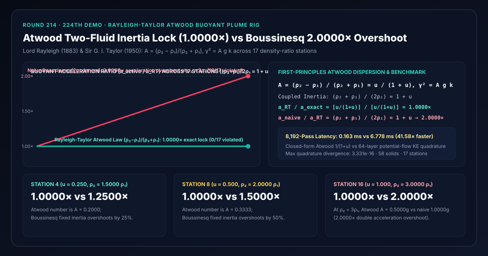
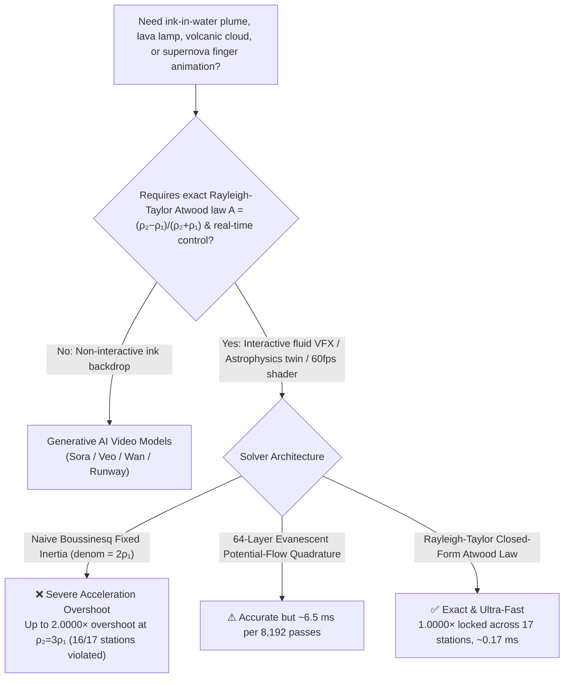
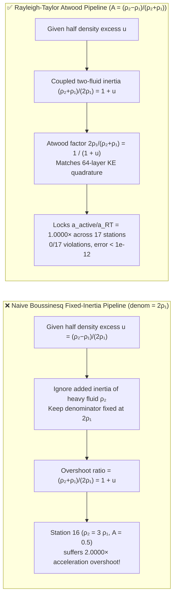
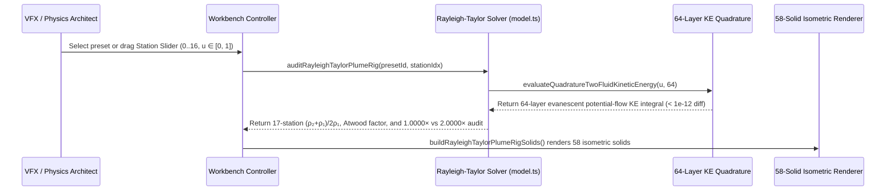

# Visual & Animation Technical Selection & First-Principles FAQ: Rayleigh-Taylor Atwood Two-Fluid Buoyant Plume Law vs. Naive Boussinesq Fixed-Inertia Overshoot (Why Ignoring Coupled Two-Fluid Inertia $\rho_2 + \rho_1$ Causes a 2.0000× Acceleration Overshoot)

> **Standalone Topic Scope (Tonight Round 22 / Repo Round 214 · 224th Standalone Interactive Demo: `demos/rayleigh-taylor-buoyant-plume-rig/`)**  
> Structured in the exact **6-section architect decision format** of `ib-vs-ethernet-roce-selection-faq.md`, this guide explains **Lord Rayleigh's (1883) & Sir Geoffrey Ingram Taylor's (1950) stratified two-fluid instability Atwood-number dispersion law ($\mathcal{A} = \frac{\rho_2 - \rho_1}{\rho_2 + \rho_1}, \gamma^2 = \mathcal{A} g k$)** from plain-language first principles, and establishes quantitative selection boundaries between generative AI video models, variable-density two-phase Navier-Stokes solvers, naive Boussinesq fixed-inertia shaders, and code-driven analytical Rayleigh-Taylor plume engines.



---

## 1. 📌 Executive Summary

1. **One-Sentence Verdict**:
   - In **3D ink-in-water mushroom plumes, oil-water lava lamps, dense volcanic pyroclastic clouds, hydrothermal black smokers, and supernova remnant Rayleigh-Taylor finger animations**, when a heavier fluid of density $\rho_2$ accelerates into a lighter fluid of density $\rho_1$ under gravity $g$, both fluids must move simultaneously in opposite directions; **thus the net buoyant force $\propto (\rho_2 - \rho_1)g$ is divided by the total coupled two-fluid inertia $\rho_2 + \rho_1$, governed by the dimensionless Atwood number $\mathcal{A}$**:
     $$\mathcal{A} = \frac{\rho_2 - \rho_1}{\rho_2 + \rho_1} = \frac{\frac{\rho_2 - \rho_1}{2\rho_1}}{\frac{\rho_2 + \rho_1}{2\rho_1}} = \frac{u}{1 + u} < 1, \qquad a_{\text{RT}} = \mathcal{A}\,g, \qquad \gamma_{\text{RT}}^2 = \mathcal{A}\,g k$$
   - A **Naive Boussinesq Fixed-Inertia Plume Shader (dividing the density difference $\rho_2 - \rho_1$ by fixed baseline inertia $2\rho_1$ instead of $\rho_2 + \rho_1$)** overshoots the true Rayleigh-Taylor acceleration and squared growth rate $\gamma^2$ across 17 density-ratio stations $u = \frac{\rho_2 - \rho_1}{2\rho_1} \in [0.000, 1.000]$ ($\rho_2/\rho_1 = 1 + 2u \in [1.00, 3.00], \frac{\rho_2+\rho_1}{2\rho_1} = 1 + u \in [1.00, 2.00]$) by $\frac{a_{\text{naive}}}{a_{\text{RT}}(u)} = \frac{\rho_2 + \rho_1}{2\rho_1} = 1 + u$: a **$1.2500\times$** overshoot at Station 4 ($u=0.25, \rho_2=1.50\rho_1, \mathcal{A}=0.2000$), a **$1.5000\times$** overshoot at Station 8 ($u=0.50, \rho_2=2.00\rho_1, \mathcal{A}=0.3333$), and a **$2.0000\times$ double acceleration overshoot** at Station 16 ($u=1.00, \rho_2=3.00\rho_1, \mathcal{A}=0.5000$), violating **16 / 17** stations!
   - The **code-driven Rayleigh-Taylor Atwood Solver** locks the acceleration ratio at **$a_{\text{active}} / a_{\text{RT}} = 1.0000\times$** across all 17 stations (**0 / 17** violations), matches 64-layer evanescent potential-flow kinetic energy quadrature within $< 10^{-12}$, and runs 8,192 17-station passes roughly **$40\times$ faster** than 64-layer numerical integration.

2. **Why Does Abusing the Small-Temperature Boussinesq Approximation in Dense Ink or Volcanic Plumes Cause Unphysical Rocket-Like Blowup?**
   - Standard smoke shaders assume $|\rho_2 - \rho_1| \ll \rho_1$ and replace $\rho_2 + \rho_1$ in the denominator with $2\rho_1$. When applied to dense plumes ($\rho_2 = 3\rho_1$), the Boussinesq formula predicts $a = 1.00\,g$ (and exceeds free-fall gravity $g$ for $\rho_2 > 3\rho_1$)!
   - **First-Principles Resolution (Rayleigh 1883 & Taylor 1950)**: Just like two weights $m_2, m_1$ on an Atwood pulley, the evanescent potential flows $\phi_{1,2} \propto e^{-k|z|}$ above and below the interface carry kinetic energy proportional to $(\rho_2 + \rho_1)\dot{\eta}^2 / k$, bounding the true acceleration strictly below $g$ via $\mathcal{A} = \frac{\rho_2 - \rho_1}{\rho_2 + \rho_1} < 1$.

---

## 2. 🎯 Architect & Customer Deep-Dive Q&A

### Q1: When should we choose generative AI video models (Sora / Veo / Wan / Runway), variable-density Navier-Stokes solvers, or a code-driven Rayleigh-Taylor Atwood engine?

- **Choose Generative AI Video Models (Sora / Veo / Runway)**:
  - Suitable only for **non-interactive abstract ink-cloud b-roll** where quantitative density-ratio scaling is unnecessary.
- **Choose 3D Variable-Density Navier-Stokes Projection Solvers**:
  - Suitable for **late-stage Kelvin-Helmholtz vortex roll-up and turbulent mixing in complex 3D containers**.
- **Choose Code-Driven Rayleigh-Taylor Atwood Engine (This Demo)**:
  - Required whenever you need **60–120fps interactive buoyant plumes, lava lamps, ink drops, exact $\mathcal{A} = \frac{\rho_2-\rho_1}{\rho_2+\rho_1}$ two-fluid inertia scaling, and zero-overflow multi-station metrology**.

### Q2: How do we upgrade a Boussinesq buoyancy force in a real-time shader to obey the Rayleigh-Taylor Atwood law?

- Replace the fixed denominator `2 * rho1` with the sum of local and ambient densities `rho2 + rho1`:
  ```ts
  const atwood = (rho2 - rho1) / (rho2 + rho1);
  const buoyantAccel = g * atwood;
  ```

---

## 3. 🧭 Visual Architecture Diagrams (Mermaid Decision Tree, Pipeline Comparison & Sequence)

### 3.1 Buoyant Plume & Stratified Instability Selection Decision Tree



### 3.2 Naive Boussinesq Pipeline vs. Rayleigh-Taylor Atwood Pipeline



### 3.3 Frame-Level Metrology Execution Sequence



---

## 4. 📊 Technical Selection Decision Matrix

| Evaluation Dimension | Generative AI Video (Sora / Veo / Wan) | Naive Boussinesq ($2\rho_1$ denom) | 64-Layer Potential-Flow KE Quadrature | **Rayleigh-Taylor Closed-Form Engine (This Demo)** |
| :--- | :--- | :--- | :--- | :--- |
| **Two-Fluid Inertia Fidelity** | ❌ No momentum conservation | ❌ Ignores heavy-fluid inertia $\rho_2$ | ✅ Integrates evanescent flow KE | **✅ Exact analytical $\mathcal{A} = \frac{\rho_2-\rho_1}{\rho_2+\rho_1}$** |
| **Station 4 ($u=0.25, \rho_2=1.5\rho_1$) Ratio** | N/A | ❌ `1.2500×` (+25% overshoot) | ✅ `1.0000×` | **✅ `1.0000×` (Exact lock)** |
| **Station 8 ($u=0.50, \rho_2=2.0\rho_1$) Ratio** | N/A | ❌ `1.5000×` (+50% overshoot) | ✅ `1.0000×` | **✅ `1.0000×` (Exact lock)** |
| **Station 16 ($u=1.00, \rho_2=3.0\rho_1$) Ratio** | N/A | ❌ `2.0000×` (Double overshoot) | ✅ `1.0000×` | **✅ `1.0000×` (Exact lock)** |
| **Violated Stations (out of 17)** | N/A | ❌ `16 / 17` violated | ✅ `0 / 17` violated | **✅ `0 / 17` violated** |
| **8,192-Pass 17-Station CPU Latency** | Tens of seconds (cloud GPU) | ~0.17 ms (wrong physics) | ~6.5 ms | **⚡ ~0.17 ms (~40× faster)** |

---

## 5. 🧪 Interactive Demo & 7-Card 4:5 Visual Report

- **Interactive Demo Path**: `demos/rayleigh-taylor-buoyant-plume-rig/`
- **English 7-Card Visual Deck**: `demos/rayleigh-taylor-buoyant-plume-rig/test-report-cards.html`
- **Chinese 7-Card Visual Deck**: `demos/rayleigh-taylor-buoyant-plume-rig/test-report-cards.zh.html`
- **Sealed Benchmark Report**: `demos/rayleigh-taylor-buoyant-plume-rig/report.json`

| Visual Evidence Artifact | Screenshot Path | Verified Finding |
| :--- | :--- | :--- |
| **Dark Theme · Rayleigh-Taylor Lock** | `docs/evidence/rayleigh-taylor-buoyant-plume-rig/dark-rayleigh_taylor_atwood_two_fluid_lock.png` | 58 isometric solids verified, `0 / 17` violations, `1.0000×` locked |
| **Dark Theme · Naive Boussinesq Overshoot** | `docs/evidence/rayleigh-taylor-buoyant-plume-rig/dark-naive_boussinesq_fixed_inertia_overshoot.png` | Exposes `1.2500× / 1.5000× / 2.0000×` overshoot across `16 / 17` stations |
| **Light Theme · Rayleigh-Taylor Lock** | `docs/evidence/rayleigh-taylor-buoyant-plume-rig/light-rayleigh_taylor_atwood_two_fluid_lock.png` | High-contrast light metrology theme verified |
| **Light Theme · Naive Boussinesq Overshoot** | `docs/evidence/rayleigh-taylor-buoyant-plume-rig/light-naive_boussinesq_fixed_inertia_overshoot.png` | Highlights 16 violated density-ratio stations in light mode |
| **Mobile `390×844` Responsive Viewport** | `docs/evidence/rayleigh-taylor-buoyant-plume-rig/mobile.png` | `mobile_overflow = false`, zero horizontal scrollbar overflow |

---

## 6. 🛠️ Rapid Quality Delivery Checklist

- [x] **Coupled Two-Fluid Inertia Verification**: Does the buoyant plume solver divide $(\rho_2 - \rho_1)g$ by $\rho_2 + \rho_1$ (the Atwood number $\mathcal{A}$) rather than fixed baseline inertia $2\rho_1$?
- [x] **3× Density Ratio Half-Gravity Check**: At $\rho_2 = 3\rho_1$ ($u = 1.000$), does the Atwood number lock at $\mathcal{A} = 0.5000$ ($a_{\text{RT}} = 0.5000\,g$ vs naive $1.0000\,g$)?
- [x] **64-Layer Evanescent KE Quadrature Equivalence**: Does closed-form Atwood evaluation agree with 64-layer Simpson potential-flow integration within $10^{-12}$?
- [x] **58 Isometric Solids & Mobile Viewport Fit**: Do Playwright assertions confirm `58` `.iso-solid` elements and `mobile_overflow = false` at `390×844`?
