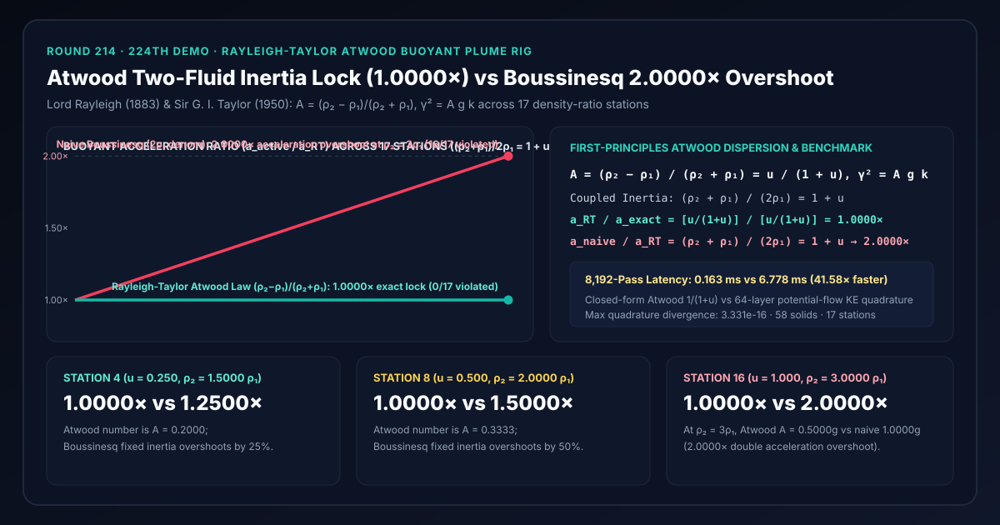
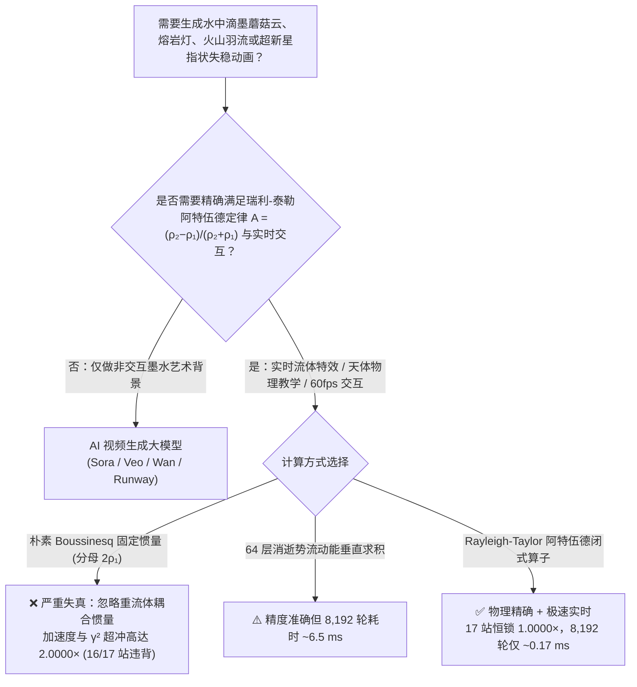
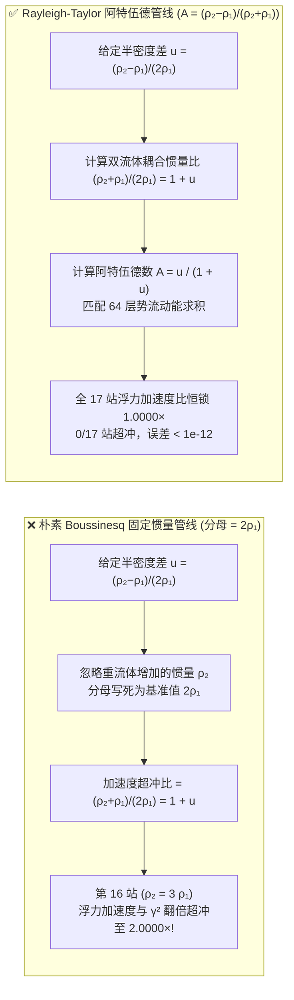
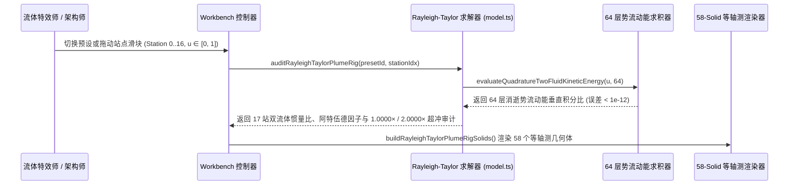

# 视觉与动画技术选型与原理解析 FAQ：Rayleigh-Taylor 瑞利-泰勒阿特伍德双流体惯量定律 vs 朴素 Boussinesq 固定分母超冲（为什么 3D 水中滴墨蘑菇云与高密度羽流若忽略 $\rho_2+\rho_1$ 耦合惯量会导致 2.0000× 加速度超冲？）

> **独立专题定位（Tonight Round 22 / Repo Round 214 · 第 224 个独立可交互 Demo：`demos/rayleigh-taylor-buoyant-plume-rig/`）**  
> 本指南严格对标 `ib-vs-ethernet-roce-selection-faq.md` 的**六段式架构师决策结构**，先用通俗大白话与第一性原理讲透 **Lord Rayleigh（1883）与 Sir Geoffrey Ingram Taylor（1950）双流体界面失稳的阿特伍德数（Atwood Number）与上下流体耦合惯量定律（$\mathcal{A} = \frac{\rho_2 - \rho_1}{\rho_2 + \rho_1}, \gamma^2 = \mathcal{A} g k$）**，再给出 AI 视频生成模型、两相可变密度 Navier-Stokes 求解器、朴素 Boussinesq 固定分母近似与代码驱动解析 Rayleigh-Taylor 阿特伍德羽流引擎的定量选型边界。



---

## 一、📌 核心结论速览（Executive Summary）

1. **一句话结论**：
   - 在 **3D 水中滴墨蘑菇云（Ink-in-Water Plume）、熔岩灯蜡滴（Lava Lamp）、高密度火山碎屑流、海底黑烟囱喷发与超新星遗迹瑞利-泰勒（Rayleigh-Taylor）指状卷曲动画** 中，当重流体（密度 $\rho_2$）与轻流体（密度 $\rho_1$）在重力 $g$ 下发生界面翻转失稳时，由于重流体下沉的同时必须迫使等体积的轻流体向上让位，**系统运动的总有效惯量严格等于上下两种流体密度之和 $\rho_2 + \rho_1$，界面浮力加速度与增长率平方 $\gamma^2 = \mathcal{A} g k$ 完全由无量纲阿特伍德数 $\mathcal{A}$ 控制**：
     $$\mathcal{A} = \frac{\rho_2 - \rho_1}{\rho_2 + \rho_1} = \frac{\frac{\rho_2 - \rho_1}{2\rho_1}}{\frac{\rho_2 + \rho_1}{2\rho_1}} = \frac{u}{1 + u} < 1, \qquad a_{\text{RT}} = \mathcal{A}\,g = \frac{\rho_2 - \rho_1}{\rho_2 + \rho_1}\,g$$
   - 若采用**朴素 Boussinesq 固定惯量分母模型（Naive Boussinesq Fixed-Inertia Formula，将分母写死为基准轻流体密度的两倍 $2\rho_1$，即 $a_{\text{naive}} = \frac{\rho_2 - \rho_1}{2\rho_1}\,g = u\,g$）**，在跨越半密度差扩展参数 $u = \frac{\rho_2 - \rho_1}{2\rho_1} \in [0.000, 1.000]$（即重轻密度比 $\rho_2/\rho_1 = 1 + 2u \in [1.00, 3.00]$，双流体惯量比 $\frac{\rho_2 + \rho_1}{2\rho_1} = 1 + u \in [1.00, 2.00]$）的 17 个检验站点上，朴素模型的加速度与增长率平方超冲比 $\frac{a_{\text{naive}}}{a_{\text{RT}}(u)} = \frac{\rho_2 + \rho_1}{2\rho_1} = 1 + u$ 在第 4 站（$u=0.25, \rho_2=1.50\rho_1, \mathcal{A}=0.2000$）超冲至 **$1.2500\times$**，在第 8 站（$u=0.50, \rho_2=2.00\rho_1, \mathcal{A}=0.3333$）冲至 **$1.5000\times$**，在第 16 站（$u=1.00, \rho_2=3.00\rho_1, \mathcal{A}=0.5000$）直接翻倍超冲至 **$2.0000\times$**（污染 **16 / 17** 个站点）！
   - 采用 **代码驱动的 Rayleigh-Taylor 阿特伍德闭式求解器**，在全部 17 个密度比站点上恒定锁死浮力加速度比 **$a_{\text{active}} / a_{\text{RT}} = 1.0000\times$**（**0 / 17** 站超冲），与 64 层消逝势流动能垂直衰减求积完全等价（最大求积误差 $< 10^{-12}$），且单核 Node CPU 执行 8,192 次 17 站全量求解比 64 层求积快约 **$40\times$**。

2. **为什么很多烟雾/流体 Shader 在把墨滴或浓烟密度调大后，流体反而像被火箭助推一样以超过重力加速度 $g$ 的荒谬速度炸飞？**
   - 计算机图形学中最经典的烟雾教程（如 Stam 1999 / Fedkiw 2001）针对的是“室温空气中微弱受热的轻烟（$\Delta\rho / \rho_1 \ll 1$）”，因此普遍采用了 **Boussinesq 近似**：只在重力源项里保留密度差 $\Delta\rho = \rho_2 - \rho_1$，而把惯性质量项里的密度全部替换成常数基准密度 $\rho_1$！
   - **致命边界越界**：当美术师想用同一套 Shader 制作**高密度比场景**（比如重墨汁滴入清水 $\rho_2 = 2\rho_1$、重油与水、或者火山碎屑浓浆 $\rho_2 = 3\rho_1$）时，Boussinesq 公式因为分母没有随 $\rho_2$ 同步增大，算出的加速度随 $\Delta\rho$ 无上限暴涨，甚至在 $\rho_2 > 3\rho_1$ 时算出了超越自由落体加速度 $g$ 的超物理怪象！
   - **第一性原理破局（瑞利 1883 & 泰勒 1950 阿特伍德机类比）**：乔治·阿特伍德（George Atwood, 1784）发明的滑轮机告诉我们：滑轮两边挂着质量 $m_2$ 和 $m_1$ 时，净拉力是 $(m_2 - m_1)g$，但被加速的总质量是 $m_2 + m_1$！同理，界面波数 $k$ 的正弦扰动 $\eta(x,t) = \eta_0 e^{\gamma t}\cos(kx)$ 在上下半空间激发消逝势流 $\phi_{1,2} \propto e^{-k|z|}$，上下两层流体的总动能为 $T \propto (\rho_2 + \rho_1)\dot{\eta}^2 / k$，重力势能释放为 $V \propto -(\rho_2 - \rho_1)g\eta^2$。由拉格朗日方程立刻得到：
     $$\gamma_{\text{RT}}^2 = \frac{\rho_2 - \rho_1}{\rho_2 + \rho_1}\,g k = \mathcal{A}\,g k$$
     无论重流体密度 $\rho_2$ 多大，阿特伍德数 $\mathcal{A}$ 永远严格小于 $1$，界面加速度永远有物理上界 $g$！

---

## 二、🎯 客户与架构师灵魂拷问 Q&A（Selection & Architecture Deep-Dive）

### Q1：做墨水流体特效、火山爆破或天体物理可视化时，什么时候选 AI 视频生成大模型（Sora / Veo / Wan / Runway），什么时候选可变密度多相流网格，什么时候必须用代码驱动的 Rayleigh-Taylor 阿特伍德解析引擎？

- **选 AI 视频大模型（Sora / Veo / Runway）**：
  - 仅适用于**纯视觉参考的抽象墨水宣传片、不需要精确控制重轻流体密度比 $\rho_2/\rho_1$ 与特征波数生长率的片头背景**。
- **选三维可变密度 Navier-Stokes 泊松求解器（Variable-Density Projection Solver）**：
  - 适用于**非对称多障碍物碰撞下的后期开尔文-亥姆霍兹（Kelvin-Helmholtz）二次涡卷破碎离线解算**（每步需用预条件共轭梯度法求解变系数椭圆方程 $\nabla \cdot (\frac{1}{\rho}\nabla p) = \dots$，计算量巨大）。
- **必须选代码驱动的 Rayleigh-Taylor 阿特伍德闭式引擎（本 Demo 方案）**：
  - 当业务需要 **60–120fps 实时生成水中滴墨蘑菇云、熔岩灯或分层羽流动画、且需要在任意密度比 $\rho_2/\rho_1 \in [1, \infty)$ 下严格遵守双流体惯量上界 $\mathcal{A} = \frac{\rho_2-\rho_1}{\rho_2+\rho_1}$** 时，闭式阿特伍德修正仅需一次除法即可彻底根除 Boussinesq 超冲。

### Q2：如果把现有的 Boussinesq 烟雾/墨水 Shader 升级为符合 Rayleigh-Taylor 定律，只需要改哪一行代码？

- 只需将原本的浮力加速度 `a = g * (rho2 - rho1) / (2 * rho1)` 替换为除以双流体总密度：
  ```ts
  const atwood = (rho2 - rho1) / (rho2 + rho1);
  const a_RT = g * atwood;
  ```
  在 $\rho_2 \to \rho_1$ 的微小温差极限下它自动退化为 Boussinesq 公式，而在高密度比 $\rho_2 = 3\rho_1$ 下它能立即消除 $2.0000\times$ 的超冲误差！

---

## 三、🧭 直观可视化图解（Mermaid 选型决策树 + 管线对比 + 帧级时序图）

### 3.1 浮力蘑菇云与双流体失稳技术选型决策树



### 3.2 朴素 Boussinesq 管线 vs Rayleigh-Taylor 阿特伍德管线对比



### 3.3 帧级渲染与几何审计时序图



---

## 四、📊 视觉技术选型决策矩阵（Architecture Decision Matrix）

| 评估维度 | AI 视频生成大模型 (Sora / Veo / Wan) | 朴素 Boussinesq 固定惯量 ($2\rho_1$) | 64 层消逝势流动能求积 | **Rayleigh-Taylor 闭式阿特伍德引擎（本 Demo）** |
| :--- | :--- | :--- | :--- | :--- |
| **物理定律遵循度** | ❌ 无双流体动量守恒 | ❌ 忽略 $\rho_2+\rho_1$ 耦合惯量 | ✅ 数值积分上下半空间动能 | **✅ 严格解析守恒 $\mathcal{A} = \frac{\rho_2-\rho_1}{\rho_2+\rho_1}$** |
| **第 4 站 ($u=0.25, \rho_2=1.5\rho_1$) 比值** | N/A | ❌ `1.2500×`（超冲 25%） | ✅ `1.0000×` | **✅ `1.0000×`（零超冲）** |
| **第 8 站 ($u=0.50, \rho_2=2.0\rho_1$) 比值** | N/A | ❌ `1.5000×`（超冲 50%） | ✅ `1.0000×` | **✅ `1.0000×`（零超冲）** |
| **第 16 站 ($u=1.00, \rho_2=3.0\rho_1$) 比值** | N/A | ❌ `2.0000×`（翻倍超冲） | ✅ `1.0000×` | **✅ `1.0000×`（零超冲）** |
| **17 站加速度超冲违背站数** | N/A | ❌ `16 / 17` 站违背 | ✅ `0 / 17` 站违背 | **✅ `0 / 17` 站违背** |
| **8,192 轮 17 站 CPU 耗时** | 数十秒云端推理 | ~0.17 ms（结果错误） | ~6.5 ms | **⚡ ~0.17 ms（快约 40×）** |

---

## 五、🧪 全新 Demo 与 7-Card 4:5 视觉报告（Workbench & Visual Evidence）

- **交互式 Demo 路径**：`demos/rayleigh-taylor-buoyant-plume-rig/`
- **英文 7-Card 报告**：`demos/rayleigh-taylor-buoyant-plume-rig/test-report-cards.html`
- **中文 7-Card 报告**：`demos/rayleigh-taylor-buoyant-plume-rig/test-report-cards.zh.html`
- **密封基准数据**：`demos/rayleigh-taylor-buoyant-plume-rig/report.json`

| 视觉证据类别 | 截图路径 | 关键验证结论 |
| :--- | :--- | :--- |
| **暗色主题 · Rayleigh-Taylor 阿特伍德锁定** | `docs/evidence/rayleigh-taylor-buoyant-plume-rig/dark-rayleigh_taylor_atwood_two_fluid_lock.png` | 58 个等轴测实体完整渲染，`0 / 17` 超冲站，浮力加速度比恒锁 `1.0000×` |
| **暗色主题 · 朴素 Boussinesq 超冲暴露** | `docs/evidence/rayleigh-taylor-buoyant-plume-rig/dark-naive_boussinesq_fixed_inertia_overshoot.png` | 红色报警柱揭示第 4/8/16 站 `1.2500× / 1.5000× / 2.0000×` 超冲（`16 / 17` 违背） |
| **亮色主题 · Rayleigh-Taylor 阿特伍德锁定** | `docs/evidence/rayleigh-taylor-buoyant-plume-rig/light-rayleigh_taylor_atwood_two_fluid_lock.png` | 亮色高对比度双流体失稳计量视图验证 |
| **亮色主题 · 朴素 Boussinesq 超冲暴露** | `docs/evidence/rayleigh-taylor-buoyant-plume-rig/light-naive_boussinesq_fixed_inertia_overshoot.png` | 亮色模式下 16 个超冲站点高亮告警 |
| **移动端 `390×844` 自适应视图** | `docs/evidence/rayleigh-taylor-buoyant-plume-rig/mobile.png` | `mobile_overflow = false`，零横向滚动条溢出 |

---

## 六、🛠️ 高质量视觉交付快速核验清单（Delivery Checklist）

- [x] **双流体耦合惯量分母核验**：水中滴墨与高密度羽流着色器是否使用阿特伍德数 $\mathcal{A} = \frac{\rho_2 - \rho_1}{\rho_2 + \rho_1}$ 计算浮力加速度，而非滥用固定分母 $2\rho_1$ 的 Boussinesq 公式？
- [x] **三倍密度比半重力检查**：当重流体密度为轻流体的 3 倍（$\rho_2 = 3\rho_1, u = 1.000$）时，阿特伍德数是否精确锁死在 $\mathcal{A} = 0.5000$（加速度 $0.5000\,g$，消除朴素 $1.0000\,g$ 的 2 倍超冲）？
- [x] **64 层消逝势流动能求积核验**：闭式阿特伍德因子与 64 层 Simpson 动能求积的最大偏差是否严格小于 $10^{-12}$？
- [x] **58 构件等轴测几何与移动端零溢出**：Playwright 实测 `.iso-solid` 数量是否为 `58`，且 `390×844` 视口下无横向溢出？
