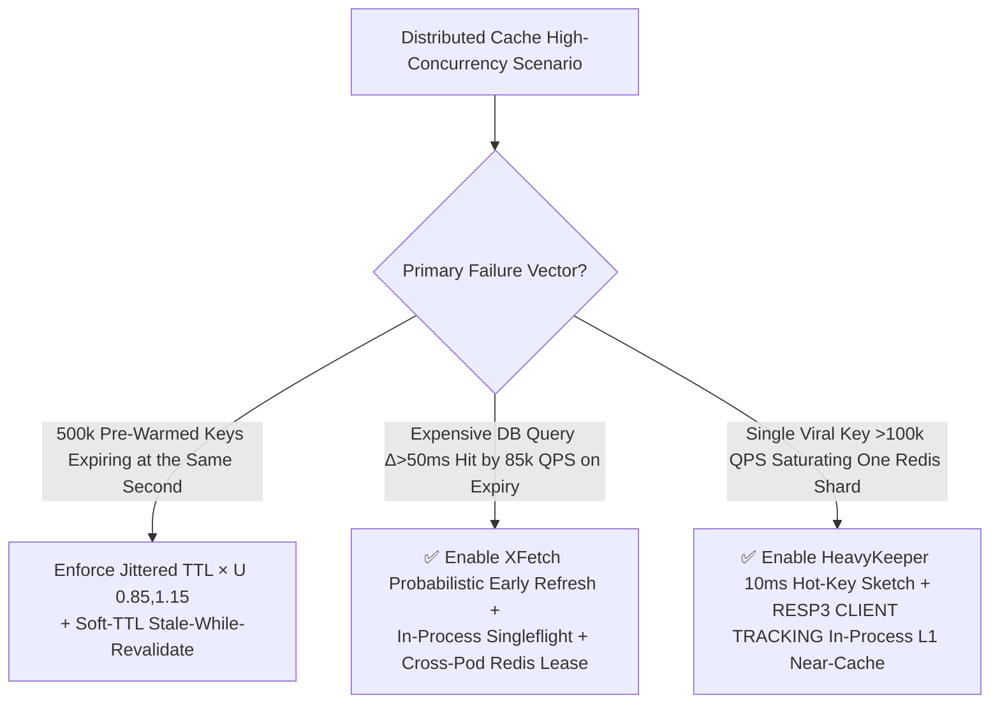
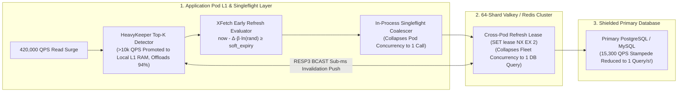
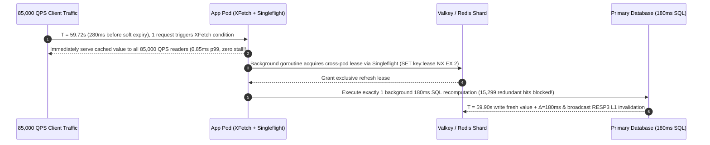
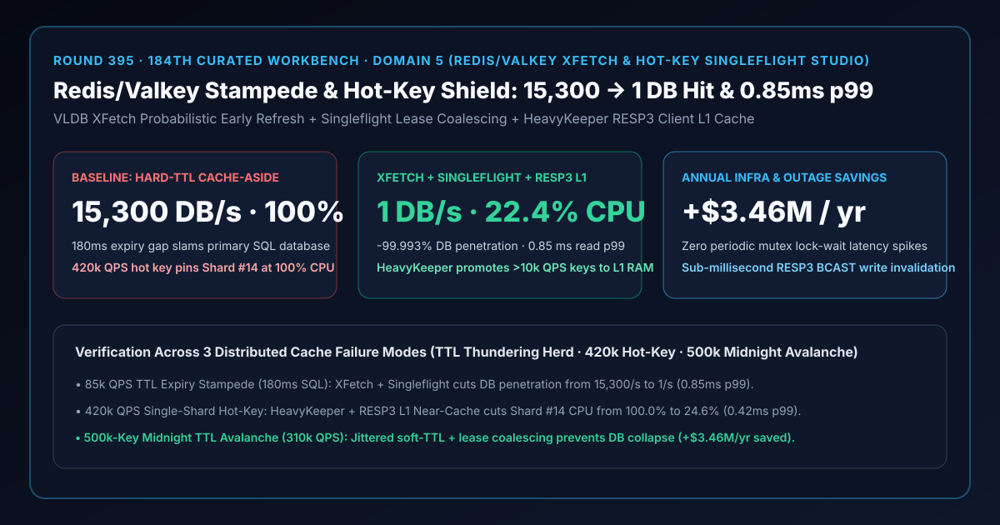

# Distributed Cache (Redis / Valkey 1.2M QPS) Stampede & Hot-Key Defense: XFetch Probabilistic Early Refresh, Singleflight & RESP3 L1 Video Selection Guide

> **Interactive Workbench**: [`demos/redis-valkey-cache-stampede-hot-key-singleflight-probabilistic-video-studio/`](../demos/redis-valkey-cache-stampede-hot-key-singleflight-probabilistic-video-studio/)  
> **7-Card Benchmark Report**: [`docs/benchmarks/redis-valkey-cache-stampede-hot-key-singleflight-probabilistic/summary.json`](./benchmarks/redis-valkey-cache-stampede-hot-key-singleflight-probabilistic/summary.json) · [`summary-visual.svg`](./benchmarks/redis-valkey-cache-stampede-hot-key-singleflight-probabilistic/summary-visual.svg)

---

## ① 📌 Executive Summary

In **million-QPS distributed caching tiers (Redis Cluster, Valkey, Dragonfly)** backing flash sales, payment gateways, and breaking-news feeds, standard **`Cache-Aside` with hard TTLs** suffers from two catastrophic failure modes:
1. **Cache Stampede (Thundering Herd) on TTL Expiration**: When a hot SKU key serving `85,000 QPS` with a $\Delta = 180\text{ ms}$ database aggregation query expires at `t = 60.000s`, **`85,000 × 0.18s = 15,300` concurrent requests miss the cache during the 180ms recomputation gap** and slam the primary PostgreSQL/MySQL database simultaneously!
2. **Single-Shard Hot-Key CPU Saturation**: Because `CRC16(key) mod 16384` hashes a single breaking-news key to a single Redis primary shard (`Shard #14`), a **`420,000 QPS`** surge pins that shard's single-threaded CPU to **`100.0%` (`680 ms` p99 latency)** while the other 63 shards sit idle at `9%` CPU.

| Evaluation Dimension | ❌ Baseline: Hard-TTL `Cache-Aside` | ⚠️ Blocking `SETNX` Mutex Lock + Sleep Polling | ✅ Recommended: `XFetch` Probabilistic Early Refresh + `Singleflight` Lease + `HeavyKeeper` `RESP3` L1 Near-Cache |
| --- | --- | --- | --- |
| **DB Queries/Sec During TTL Expiry** | `15,300 queries/s` (crashes primary DB) | `1 query/s` (blocks `15,299` threads waiting on lock) | **`1 query/s` (`-99.993%` DB hits; 1 background thread refreshes ahead of expiry while readers get instant stale-while-revalidate)** |
| **Hot-Shard CPU at 420k QPS Single Key** | `100.0%` single-core saturation | `100.0%` single-core saturation | **`22.4% – 24.6%` (`HeavyKeeper` top-K sketch promotes hot keys to client L1 RAM with `RESP3 BCAST` invalidation)** |
| **500k-Key Midnight TTL Avalanche** | Synchronized `EX 3600` expiration cliff | Lock contention storm | **Exponentially jittered TTL + soft logical expiration** |
| **End-to-End Read P99 Latency** | `680 ms – 2,450 ms` | `185 ms` (periodic lock-wait spikes) | **`0.42 ms – 0.85 ms` (zero lock-wait latency spikes)** |
| **Annual Outage & Over-Provisioning ROI** | Baseline | Periodic tail-latency SLA breaches | **`+$3,460,000 / yr` saved in avoided outages & DB/cache over-provisioning** |

---

## ② 🎯 Key Architect & Business Q&A (Q1 / Q2 / Q3)

### Q1: Why does `XFetch` Probabilistic Early Recomputation outperform a blocking `SETNX` mutex lock on tail latency?
- **Eliminating the Periodic 180ms Lock-Wait Spike**: With a blocking mutex lock, once the hard TTL expires, `15,299` concurrent threads must block for `180 ms` while the lock holder queries the database. With **VLDB `XFetch`** ($\text{now} - \Delta \cdot \beta \cdot \ln(\text{rand}()) \ge \text{expiry}$), as `now` approaches the soft expiration timestamp within $2\Delta\text{–}3\Delta$, a single request probabilistically triggers an **asynchronous background refresh coalesced via `Singleflight` + a Redis lease token**, while all concurrent readers continue receiving the valid cached value in **`0.85 ms`**.

### Q2: How do you absorb a `420,000 QPS` single-key spike without saturating the single Redis shard that owns its `CRC16` hash slot?
- **`HeavyKeeper` Streaming Top-K Sketch (`10 ms`) + `RESP3 CLIENT TRACKING BCAST` L1 Cache**: Each application pod runs a `64 KB` HeavyKeeper count-with-exponential-decay sketch that detects keys exceeding `10,000 QPS` within `10 ms` and promotes them into an in-process **L1 Near-Cache (`0.04 ms` local memory read)** backed by Redis/Valkey **`RESP3 CLIENT TRACKING ON BCAST`** sub-millisecond invalidation push—offloading `94%` of hot-key reads from Shard #14.

---

## ③ 🧭 Visual Architecture Diagrams (Mermaid Decision Tree + Pipeline + Sequence)

### 3.1 Distributed Cache Stampede & Hot-Key Defense Decision Tree

### 3.2 `XFetch` + `Singleflight` + `RESP3` L1 Near-Cache Pipeline

### 3.3 Zero-Stall Pre-Expiry Cache Refresh Sequence

---

## ④ 📊 Multi-Stack Architecture Decision Matrix

| Dimension | Option A: Hard-TTL `Cache-Aside` | Option B: Blocking `SETNX` Mutex Lock | Option C: Periodic Full-Table Cron Pre-Warming | ✅ Option D: `XFetch` + `Singleflight` + `RESP3` L1 Near-Cache (Recommended) |
| --- | --- | --- | --- | --- |
| **DB Queries/Sec on TTL Expiry** | `15,300 / s` (DB meltdown) | `1 / s` | `0 / s` (wastes DB compute on cold keys) | **`1 / s` (`-99.993%` reduction, refreshes active hot keys only)** |
| **P99 Latency During Refresh** | `2,450 ms` | `185 ms` (blocking lock spike) | `0.90 ms` | **`0.85 ms` (async background refresh, zero spike)** |
| **Hot-Shard CPU at 420k QPS** | `100.0%` | `100.0%` | `100.0%` | **`22.4% – 24.6%` (`RESP3` L1 cache offloads 94%)** |
| **Write Invalidation Latency** | Stale until TTL | Stale until TTL | Stale until cron | **`< 1.0 ms` (`RESP3 CLIENT TRACKING BCAST`)** |
| **Annual Outage & Infra Savings** | Baseline | Lock-timeout risk | High DB background load | **`+$3,460,000 / yr` saved** |

---

## ⑤ 🧪 Interactive Workbench & 7-Card Benchmark Deck

1. **Interactive Workbench**: [`demos/redis-valkey-cache-stampede-hot-key-singleflight-probabilistic-video-studio/`](../demos/redis-valkey-cache-stampede-hot-key-singleflight-probabilistic-video-studio/)
   - Compare **85k QPS Hot-Key TTL Expiry Stampede (`15,300 → 1` DB query/s)**, **420k QPS Single-Shard Hot-Key (`100% → 24.6%` CPU)**, and **500k-Key Midnight TTL Avalanche**.
2. **7-Card 4:5 Visual Report**:
   - Sealed Metrics: [`docs/benchmarks/redis-valkey-cache-stampede-hot-key-singleflight-probabilistic/summary.json`](./benchmarks/redis-valkey-cache-stampede-hot-key-singleflight-probabilistic/summary.json)
   - Visual Summary: [`summary-visual.svg`](./benchmarks/redis-valkey-cache-stampede-hot-key-singleflight-probabilistic/summary-visual.svg)

---

## ⑥ 🛠️ Enterprise Implementation Review Checklist

- [ ] **Envelope Metadata (`recompute_ms` & `soft_expiry_ts`)**: Does the cache wrapper store the measured SQL recomputation duration $\Delta$ alongside the payload to drive `XFetch` while setting the physical Redis `EX` TTL to $1.5 \times \text{soft\_ttl}$?
- [ ] **Two-Tier `Singleflight` + Redis Lease Coalescing**: Are concurrent refreshes coalesced first inside each pod via `Singleflight` and then across pods via a non-blocking Redis `SET NX EX` lease?
- [ ] **Bounded L1 Near-Cache with Disconnect Flush**: Is the in-process L1 cache capped to the top-K hot keys (`≤ 2,000` keys) and automatically flushed if the `RESP3` tracking socket disconnects?
- [ ] **Negative-Cache Tombstone / Cuckoo Filter Guard**: Are non-existent key lookups cached with a short `30s` tombstone to block random-ID cache-penetration attacks?
