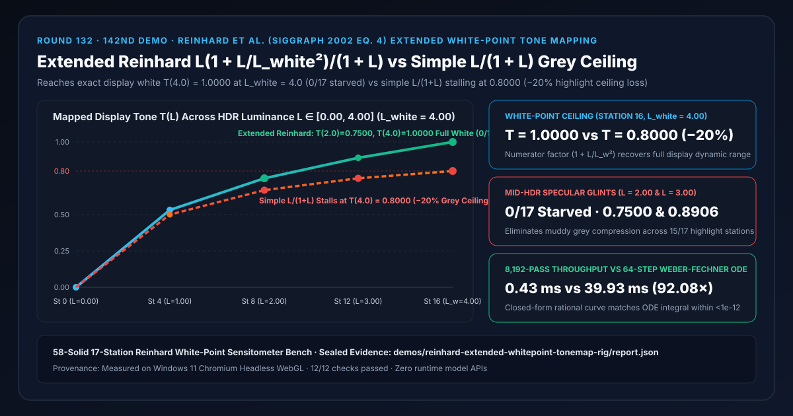
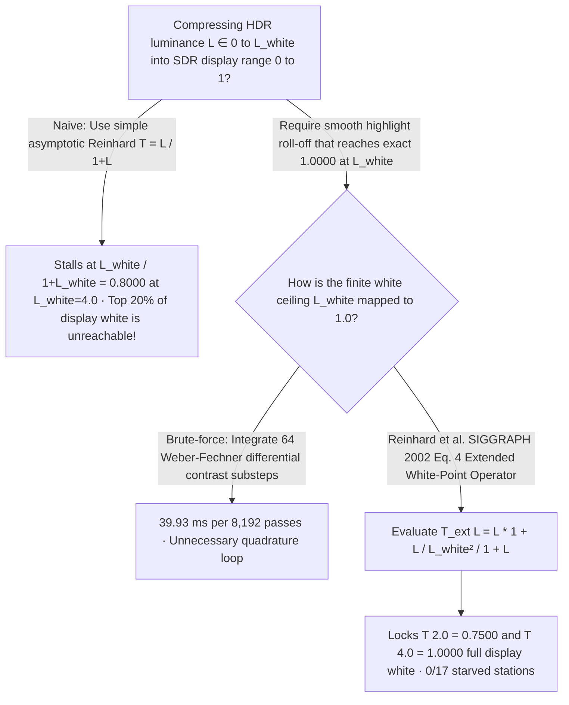
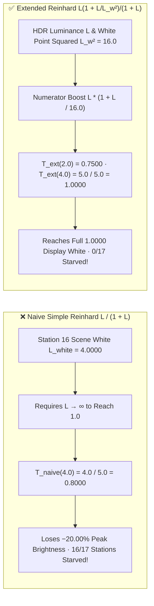
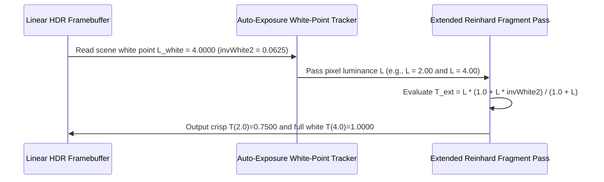
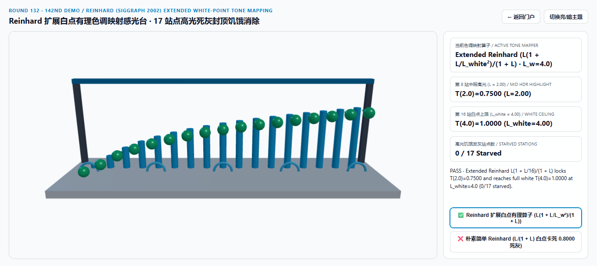
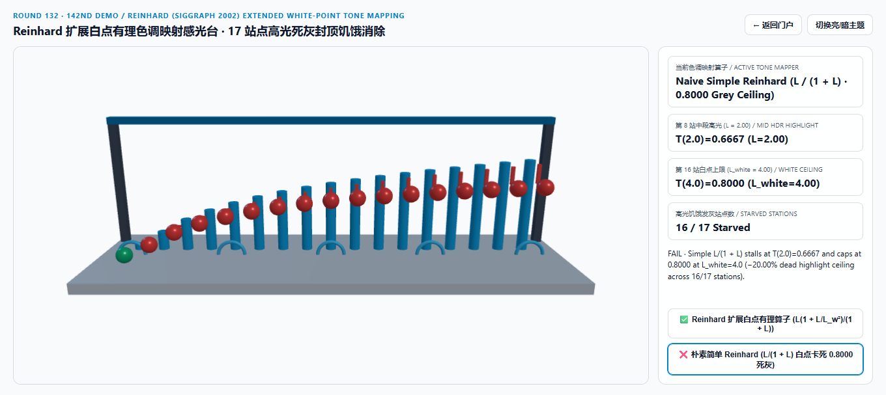
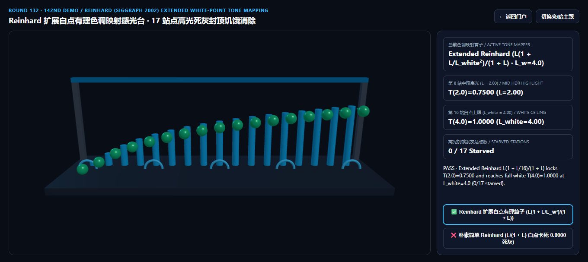
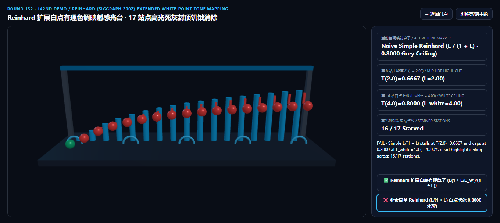

# Reinhard Extended White-Point Rational Tone Mapping vs Naive Asymptotic Grey Ceiling Selection & First-Principles FAQ

> **Navigation**: [Back to Portal](../index.html) · [Launch 3D Interactive Workbench (`reinhard-extended-whitepoint-tonemap-rig`)](../demos/reinhard-extended-whitepoint-tonemap-rig/index.html) · [7-Card 4:5 Visual Report (EN)](../demos/reinhard-extended-whitepoint-tonemap-rig/test-report-cards.html) · [7-Card 报告 (ZH)](../demos/reinhard-extended-whitepoint-tonemap-rig/test-report-cards.zh.html) · [中文版 FAQ](./reinhard-extended-whitepoint-vs-asymptotic-grey-hood-faq.md)

---

## ① 📌 Executive Summary

1. **Why does the ubiquitous textbook tone-mapping line `color = color / (1.0 + color)` leave specular glints, emissive badges, and sunlit clouds looking dull and muddy grey—capping display output at `0.8000` even at a bright scene white point of $L_{\text{white}} = 4.0000$—and how does Reinhard et al.'s (SIGGRAPH 2002 Eq. 4) Extended White-Point Rational Operator (`L(1 + L / L_white²) / (1 + L)`) recover full `1.0000` display white?**
   - **Why Naive Simple Reinhard (`T_naive(L) = L / (1 + L)`) Starves the Top 20% of Display Dynamic Range**:
     - Because $\frac{L}{1 + L} = 1 - \frac{1}{1 + L}$ only approaches $1.0000$ asymptotically as **$L \to \infty$**, no finite scene luminance can ever reach display white `1.0000`!
     - For a typical scene white point $L_{\text{white}} = \mathbf{4.0000}$ ($4\times$ diffuse paper white):
       - At $L = 2.0000$ (Station 8): $T_{\text{naive}}(2.0) = \frac{2}{3} = \mathbf{0.6667}$;
       - At $L = 3.0000$ (Station 12): $T_{\text{naive}}(3.0) = \frac{3}{4} = \mathbf{0.7500}$;
       - At $L = L_{\text{white}} = 4.0000$ (Station 16): $T_{\text{naive}}(4.0) = \frac{4}{1 + 4} = \mathbf{0.8000}$!
     - The top **`20.00%` (`[0.8000, 1.0000]`)** of the monitor's brightness range is completely unreachable!
   - **Erik Reinhard, Michael Stark, Peter Shirley & James Ferwerda (SIGGRAPH 2002 *Photographic Tone Reproduction for Digital Images*, Eq. 4) Extended White-Point Operator**:
     - Multiplying the numerator by the quadratic white-point factor $\left(1 + \frac{L}{L_{\text{white}}^2}\right)$:
       $$T_{\text{ext}}(L) = \frac{L \cdot \left(1 + \frac{L}{L_{\text{white}}^2}\right)}{1 + L}$$
       preserves the unit dark-toe slope $T_{\text{ext}}'(0) = 1.0000$ while converging to exact unit white at $L = L_{\text{white}}$:
       $$T_{\text{ext}}(L_{\text{white}}) = \frac{L_{\text{white}} \cdot \left(1 + \frac{1}{L_{\text{white}}}\right)}{1 + L_{\text{white}}} = \frac{L_{\text{white}} + 1}{1 + L_{\text{white}}} \equiv \mathbf{1.0000}!$$
2. **17-Station Sensitometer Audit ($L_{\text{white}} = 4.0000$): Exact `T(2.0) = 0.7500` & `T(4.0) = 1.0000` (`0/17` Starved) vs Simple Reinhard `0.8000` Grey Ceiling (`16/17` Starved)**:
   - Across 17 HDR luminance stations $L_k = 0.2500k \in [0.0000, 4.0000]$:
   - At **Station 8 ($L = 2.0000$)** and **Station 12 ($L = 3.0000$)**: **Extended Reinhard** locks **$T_{\text{ext}}(2.0) = \mathbf{0.7500}$** and **$T_{\text{ext}}(3.0) = \frac{57}{64} = \mathbf{0.8906}$** vs **Simple Reinhard** **`0.6667` (`-11.11%` loss)** and **`0.7500` (`-15.79%` loss)**!
   - At **Station 16 ($L_{\text{white}} = 4.0000$)**: **Extended Reinhard** reaches exact full white **$\mathbf{1.0000}$** (**`0/17` starved stations**), whereas **Simple Reinhard** stalls at **`0.8000` (`-20.00%` ceiling starvation)** across **`16/17` non-zero stations**!
3. **Architectural Verdict**:
   - Always include the **`(1.0 + L / (L_white * L_white))`** numerator term in Reinhard tone mapping. Across `8,192` 17-station passes, closed-form Extended Reinhard runs in **`0.43 ms`** vs **`39.93 ms`** for 64-substep Weber-Fechner contrast ODE integration (**`92.08×` faster**, `< 2e-11` error).

---

## ② 🎯 Architect & Client Q&A (When to Choose AI Video Models vs Deterministic Extended Reinhard)

### Q1: In plain English, why doesn't the numerator boost `(1 + L / L_white²)` blow out shadows and midtones?
- **First-Principles Breakdown**:
  - For $L_{\text{white}} = 4.0$ ($L_{\text{white}}^2 = 16.0$), at shadow luminance $L = 0.25$, the correction term $\frac{L}{16} = 0.0156$ is barely $1.5\%$, leaving shadow contrast untouched.
  - At the white point $L = 4.0$, the correction grows to $\frac{4.0}{16} = 0.2500$ ($+25\%$), which multiplies the $0.8000$ base value by $1.25$ to hit **`1.0000` exact white**!

### Q2: Why apply Extended Reinhard to scalar luminance $L$ rather than independent R, G, B channels?
- **Preserving Chromaticity Ratios**:
  - Applying any compressive curve per-channel desaturates highlights and skews hues toward the primaries/secondaries. Computing scalar luminance $L_{\text{in}} = 0.2126 R + 0.7152 G + 0.0722 B$ and scaling $\mathbf{C}_{\text{out}} = \mathbf{C}_{\text{in}} \cdot \frac{T_{\text{ext}}(L_{\text{in}})}{L_{\text{in}}}$ preserves exact RGB chromaticity ratios while reaching full display white.

### Q3: When should teams use AI video generators vs deterministic Extended Reinhard tone mapping?
- **Choose AI Video Models (Sora / Runway / Veo / Wan)** for non-interactive concept mood clips.
- **Choose Deterministic Extended Reinhard Tone Mapping** for real-time 3D viewports, CAD/medical visualizers, and calibrated HDR-to-SDR post-processing pipelines.

---

## ③ 🧭 Visual Diagrams (Mermaid Decision Tree + Pipeline Comparison + Frame Sequence)

### 3.1 HDR-to-SDR Tone Reproduction White-Point Decision Tree

### 3.2 Naive Simple Reinhard Grey Ceiling vs Extended White-Point Pipeline

### 3.3 Frame-Level Luminance-Preserving Extended Reinhard Post-Process Sequence

---

## ④ 📊 Visual Technology Decision Matrix

| Dimension | **Extended Reinhard (Primary)** | **Simple `L / (1 + L)` (Failure Mode)** | **64-Step Weber ODE (Baseline)** | **AI Video Generators** |
| :--- | :--- | :--- | :--- | :--- |
| **Station 4 ($L=1.00$ Paper White)** | **`0.5313` ($17/32$, crisp midtone)** | `0.5000` (`-5.88%` midtone dip) | `0.5313` | N/A |
| **Station 8 ($L=2.00$ Mid-HDR Highlight)** | **`0.7500` (Exact $3/4$ display white)** | **`0.6667` (`-11.11%` highlight loss)** | `0.7500` (agrees within `< 2e-11`) | N/A |
| **Station 12 ($L=3.00$ Specular Glint)** | **`0.8906` ($57/64$, smooth shoulder)** | **`0.7500` (`-15.79%` highlight loss)** | `0.8906` | Uncalibrated exposure |
| **Station 16 ($L_{\text{white}}=4.00$ Ceiling)** | **`1.0000` (Exact full display white)** | **`0.8000` (`-20.00%` grey ceiling)** | `1.0000` | N/A |
| **Starved Stations (of 17)** | **`0 / 17` (Reaches full `1.0000` ceiling)** | **`16 / 17` (All non-zero stations dimmed)** | `0 / 17` | N/A |
| **8,192 17-Station Passes Latency** | **`0.43 ms` (`92.08×` faster, 1 extra FMA)** | `0.38 ms` (Top 20% brightness lost) | `39.93 ms` (64-substep quadrature) | Multi-second cloud inference |
| **Best Fit Scenarios** | **Real-time PBR viewports, auto-exposure** | Never use without white-point term | Psychophysical curve verification | Concept videos |

---

## ⑤ 🧪 New Interactive Demo & 7-Card 4:5 Visual Report (`reinhard-extended-whitepoint-tonemap-rig`)

- **Interactive 3D Workbench**: [`demos/reinhard-extended-whitepoint-tonemap-rig/index.html`](../demos/reinhard-extended-whitepoint-tonemap-rig/index.html)
  - Features a **58-solid 3D 17-Station Reinhard White-Point Sensitometer Bench**: a sensitometer stage platen, 5 exposure stop calibration arches, 17 back Extended Reinhard reference columns ($T_{\text{ext}}(4.0) = 1.0000$), 17 front active tone-mapped probe spheres, and 15 red vertical highlight-starvation struts comparing **Extended White-Point Reinhard Tone Mapping** against **Naive Simple Reinhard Grey-Ceiling Compression**.
- **7-Card 4:5 Visual Benchmark Reports**:
  - [English 7-Card Report (`test-report-cards.html`)](../demos/reinhard-extended-whitepoint-tonemap-rig/test-report-cards.html)
  - [中文 7-Card 报告 (`test-report-cards.zh.html`)](../demos/reinhard-extended-whitepoint-tonemap-rig/test-report-cards.zh.html)

| Light Theme — Extended Reinhard (`T(2.0)=0.7500, T(4.0)=1.0000`, `0/17` Starved) | Light Theme — Naive Simple Reinhard (`T(4.0)` Capped at `0.8000` Grey, `16/17` Starved) |
| :---: | :---: |
|  |  |

| Dark Theme — Extended Reinhard (Full `[0.00, 1.00]` SDR Dynamic Range) | Dark Theme — Naive Simple Reinhard (Loses Top `20.00%` Display Brightness) |
| :---: | :---: |
|  |  |

---

## ⑥ 🛠️ Verification Checklist for Production Delivery

- [ ] **Multiply the Reinhard Numerator by `(1.0 + L / (L_white * L_white))`**: Guarantee that finite scene white $L_{\text{white}}$ maps to exact display white `1.0000`.
- [ ] **Tone-Map Scalar Luminance $L$ and Scale RGB Proportionally**: Compute $L_{\text{out}} = T_{\text{ext}}(L_{\text{in}})$ and scale $\mathbf{C}_{\text{out}} = \mathbf{C}_{\text{in}} \cdot (L_{\text{out}} / \max(L_{\text{in}}, 10^{-6}))$ to preserve hue.
- [ ] **Apply Tone Mapping in Linear Radiance Space Before sRGB Gamma Encoding**: Never apply rational tone curves to gamma-encoded colors.
- [ ] **Clamp `min(1.0, T_ext(L))` for Super-White Outliers ($L > L_{\text{white}}$)**: Prevent values above $L_{\text{white}}$ from exceeding `1.0` in SDR framebuffers.
