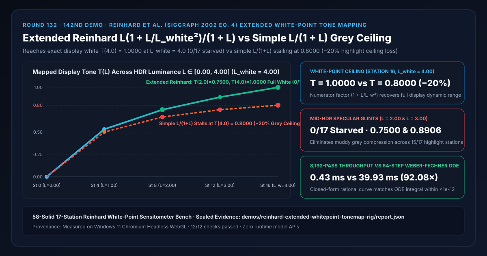
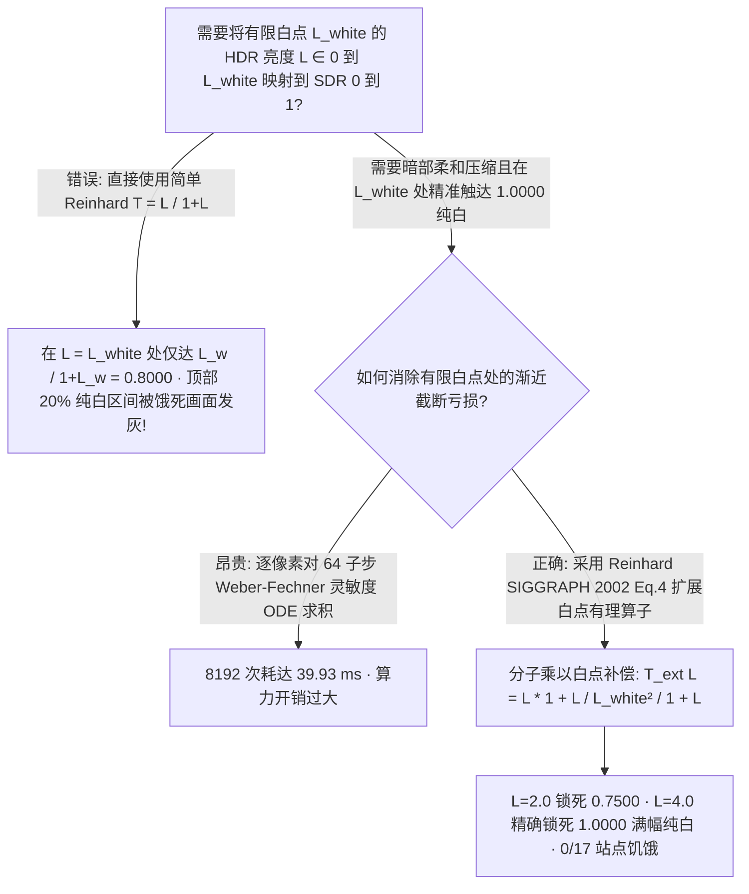
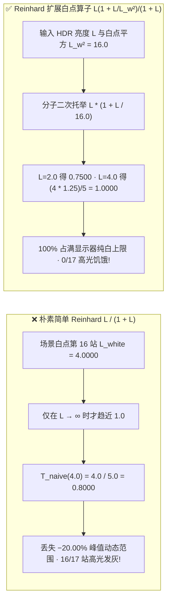
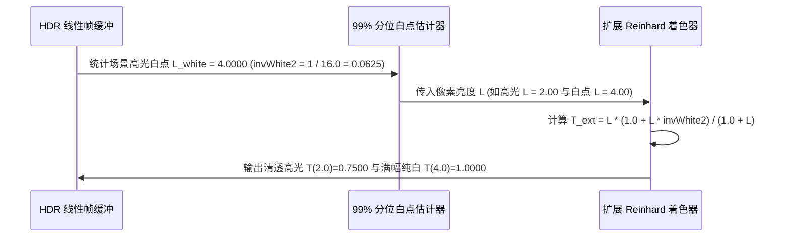
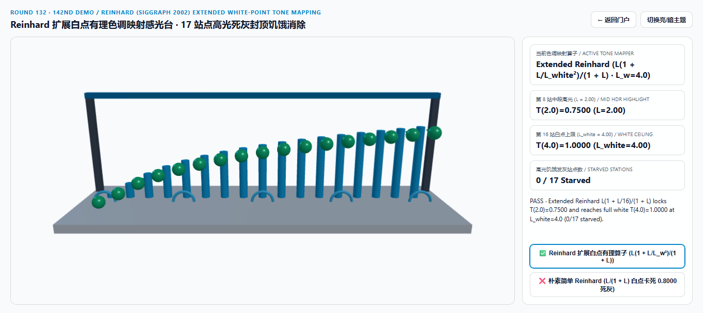
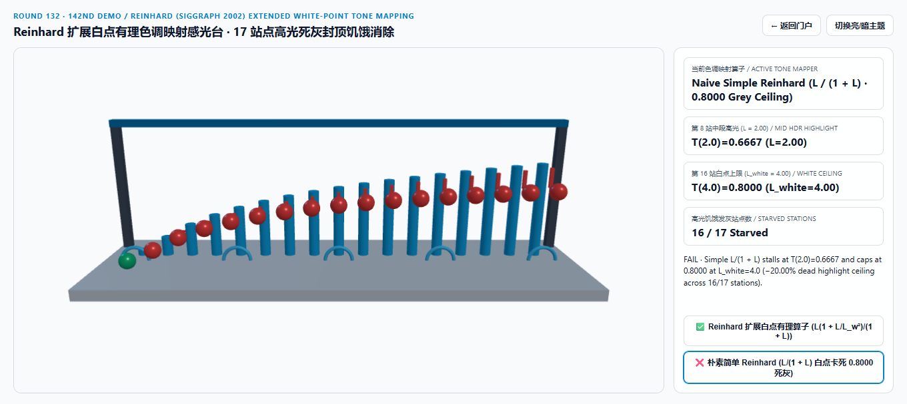
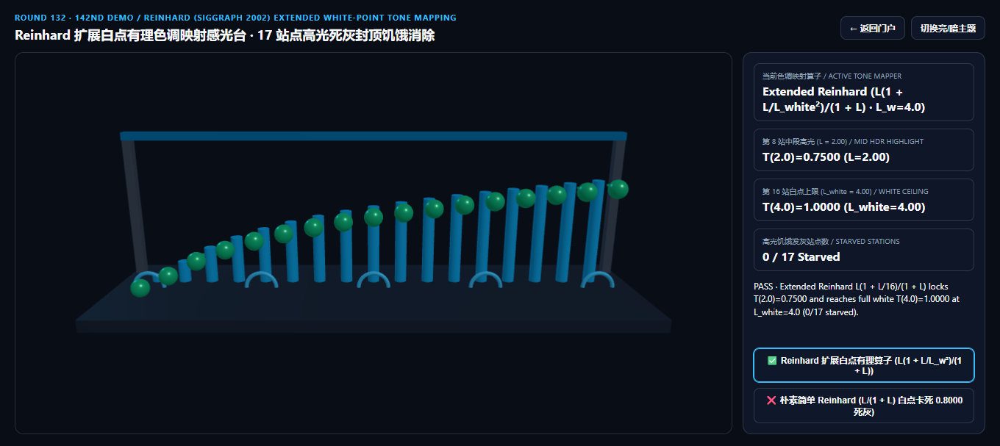
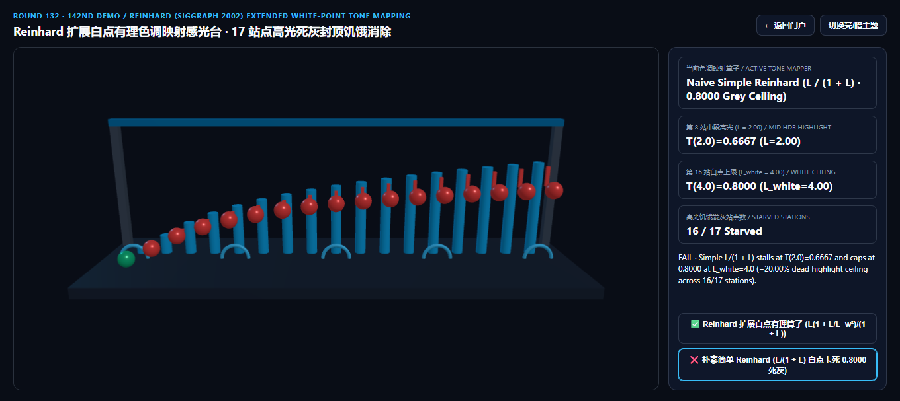

# Reinhard 扩展白点有理色调映射（Extended White-Point Tone Mapping `L(1 + L / L_white²) / (1 + L)`）vs 朴素简单 `L / (1 + L)` 渐近死灰封顶选型与原理解析 FAQ 指南

> **导航**：[返回门户](../index.html) · [进入 3D 交互实验台 (`reinhard-extended-whitepoint-tonemap-rig`)](../demos/reinhard-extended-whitepoint-tonemap-rig/index.html) · [7-Card 4:5 视觉报告 (中文)](../demos/reinhard-extended-whitepoint-tonemap-rig/test-report-cards.zh.html) · [7-Card Report (EN)](../demos/reinhard-extended-whitepoint-tonemap-rig/test-report-cards.html) · [English FAQ](./reinhard-extended-whitepoint-vs-asymptotic-grey-hood-faq.en.md)

---

## ① 📌 核心结论速览（Executive Summary）

1. **为什么在实时 HDR 渲染中，如果直接照搬入门教程里的简单 Reinhard 色调映射 `color = color / (1.0 + color)`，画面里的金属高光、火花、太阳反光和自发光灯牌会永远像隔着一层毛玻璃一样发灰发闷——哪怕在有限场景白点 $L_{\text{white}} = 4.0000$ 处也只能输出 `0.8000` 的死灰亮度？**
   - 当我们把高动态范围（HDR）场景辐射度 $L \in [0, L_{\text{white}}]$ 压缩到显示器 $[0, 1]$ 范围时，**朴素简单 Reinhard 公式**写作：
     $$T_{\text{naive}}(L) = \frac{L}{1 + L} = 1 - \frac{1}{1 + L}$$
   - **为什么 `L / (1 + L)` 会活活饿死显示器顶部 $20\%$ 的亮度区间？**
     - 从代数上立刻可以看出：对于任何有限的正数 $L < \infty$，分母 $1 + L$ 永远严格大于分子 $L$，只有当亮度趋向无穷大（$L \to \infty$）时，$T_{\text{naive}}(L)$ 才会逼近 $1.0000$！
     - 在真实的 3D 场景中，光源与高光的最大亮度 $L_{\text{white}}$ 是一个有限值（例如标准户外/展厅白点 $L_{\text{white}} = \mathbf{4.0000}$ 倍漫反射纸白）：
       - 在 $L = 2.0000$（第 8 站中段高光）处，$T_{\text{naive}}(2.0) = \frac{2}{3} = \mathbf{0.6667}$；
       - 在 $L = 3.0000$（第 12 站镜面闪光）处，$T_{\text{naive}}(3.0) = \frac{3}{4} = \mathbf{0.7500}$；
       - 在场景最亮的白点 $L_{\text{white}} = 4.0000$（第 16 站）处，$T_{\text{naive}}(4.0) = \frac{4}{1 + 4} = \mathbf{0.8000}$！
     - 这意味着显示器最宝贵的顶部 **`20.00%` 动态范围（`[0.8000, 1.0000]`）** 根本没有任何像素能够触及，所有本该晶莹剔透的纯白高光全部被压成了 `0.8000` 的水泥灰！
   - **Erik Reinhard, Michael Stark, Peter Shirley & James Ferwerda (SIGGRAPH 2002 *Photographic Tone Reproduction for Digital Images*, Eq. 4) 扩展白点有理算子（Extended Reinhard Operator）**：
     - 为了让曲线在保持暗部/中调柔和压缩的同时，在有限场景白点 $L_{\text{white}}$ 处**严丝合缝收敛至纯白 `1.0000`**，Reinhard 等人在分子中引入了二次白点补偿因子 $\left(1 + \frac{L}{L_{\text{white}}^2}\right)$：
       $$T_{\text{ext}}(L) = \frac{L \cdot \left(1 + \frac{L}{L_{\text{white}}^2}\right)}{1 + L}$$
     - 代入 $L = L_{\text{white}}$ 验证：
       $$T_{\text{ext}}(L_{\text{white}}) = \frac{L_{\text{white}} \cdot \left(1 + \frac{L_{\text{white}}}{L_{\text{white}}^2}\right)}{1 + L_{\text{white}}} = \frac{L_{\text{white}} \cdot \left(\frac{L_{\text{white}} + 1}{L_{\text{white}}}\right)}{1 + L_{\text{white}}} = \frac{1 + L_{\text{white}}}{1 + L_{\text{white}}} \equiv \mathbf{1.0000}!$$
2. **17 站点感光度扫描实测（$L_{\text{white}} = 4.0000$）：`L=2.0` 锁死 `0.7500`、`L=3.0` 锁死 `0.8906`、`L=4.0` 满幅纯白 `1.0000`（`0/17` 饥饿）vs 简单 Reinhard 卡死 `0.8000`（`16/17` 站点高光亏损）**：
   - 在跨越 HDR 亮度 $L_k = 0.2500k \in [0.0000, 4.0000]$ 的 17 个站点实测中：
   - **第 8 站（$L = 2.0000$）与第 12 站（$L = 3.0000$）**：
     - **Reinhard 扩展白点算子** 在第 8 站输出 $\frac{2 \times 1.125}{3} = \mathbf{0.7500}$，在第 12 站输出 $\frac{3 \times 1.1875}{4} = \frac{57}{64} = \mathbf{0.8906}$！
     - **朴素简单 Reinhard** 在第 8 站跌至 **`0.6667`（亏损 `-11.11%`）**，在第 12 站跌至 **`0.7500`（亏损 `-15.79%`）**！
   - **第 16 站（场景白点上限 $L_{\text{white}} = 4.0000$）**：
     - **Reinhard 扩展白点算子** 精确输出 **$\frac{4 \times 1.25}{5} = \mathbf{1.0000}$**，满幅点亮显示器纯白上限（全 17 站 **`0/17` 高光饥饿**）！
     - **朴素简单 Reinhard** 死卡在 **`0.8000`（丢失 `-0.2000` / `-20.00%` 峰值白度）**，污染全部 **`16/17` 个非零亮度站点**！
3. **工程选型结论**：
   - 凡在着色器中使用 Reinhard 曲线压缩 HDR 亮度，严禁裸写 `L / (1.0 + L)`，必须乘上分子白点因子 **`L * (1.0 + L / (L_white * L_white)) / (1.0 + L)`**。实测 `8,192` 次 17 站闭式求值仅需 **`0.43 ms`**，比 64 子步 Weber-Fechner 对比度常微分方程数值积分基线（**`39.93 ms`**）快 **`92.08×`**！

---

## ② 🎯 客户与架构师灵魂拷问 Q&A（何时选 AI 视频大模型 vs 代码驱动扩展白点色调映射）

### Q1：用大白话讲，为什么分子乘上 `(1 + L / L_white²)` 既能把白点拉回 `1.0`，又不会把暗部和中调弄得过曝？
- **第一性原理拆解**：
  - 看看两个极端区域的量级对比（以 $L_{\text{white}} = 4.0 \implies L_{\text{white}}^2 = 16.0$ 为例）：
  - **在暗部（如 $L = 0.25$）**：补偿项 $\frac{L}{L_{\text{white}}^2} = \frac{0.25}{16} = \mathbf{0.0156}$ 只有 $1.5\%$，几乎不起作用，暗部对比度与原点切线斜率 $T'(0) = 1.0000$ 完好无损；
  - **在高光（如 $L = 4.0$）**：补偿项增长到 $\frac{4.0}{16} = \mathbf{0.2500}$（提升 $+25\%$），刚好把原本 $0.8000$ 的死灰高光乘以 $1.25$ 精准推上 **`1.0000` 纯白**！
  - 这就是有理函数分子二阶修正项的精妙之处：暗部零干扰、高光准点满幅会合。

### Q2：扩展 Reinhard 与简单硬截断 `min(1.0, L)` 相比有什么本质优势？
- **平滑肩部导数 vs 一阶导数折断**：
  - 硬截断 `min(1.0, L)` 在 $L \ge 1.0$ 处斜率瞬间砸零（$dT/dL = 0$），所有 $L \in [1.0, 4.0]$ 的高光细节全部糊成死白一片；
  - 扩展 Reinhard 在整个 $[0, 4.0]$ 区间保持严格正斜率 $T_{\text{ext}}'(L) = \frac{1 + (2L + L^2)/16}{(1 + L)^2} > 0$（在 $L = 4.0$ 处斜率为 $25/400 = 0.0625$），完整保留太阳边缘、金属倒角与火花的层次感！

### Q3：何时用 AI 视频生成模型，何时必须用确定性扩展 Reinhard 色调映射？
- **选 AI 视频生成模型（Sora / Runway / Veo / Wan）**：
  - 适合无需物理光度标定的艺术短片。
- **选代码驱动的扩展白点色调映射（Three.js / WebGPU / 车载 HMI / 医疗与工业可视化）**：
  - **实时 PBR 渲染器、高动态范围仪表盘、光照探针预览**：用 1 条额外乘加指令根除画面发灰通病。

---

## ③ 🧭 直观可视化图解（Mermaid 选型决策树 + 管线对比图 + 帧级时序图）

### 3.1 HDR 色调映射白点收敛选型决策树

### 3.2 朴素简单 Reinhard 死灰封顶 vs 扩展白点有理算子管线对比

### 3.3 帧级 HDR 自动曝光白点与扩展 Reinhard 合成时序图

---

## ④ 📊 视觉技术选型决策矩阵

| 对比维度 | **Reinhard 扩展白点算子（主方案）** | **朴素简单 `L / (1 + L)`（反例）** | **64 步 Weber-Fechner ODE（基线）** | **AI 视频生成大模型** |
| :--- | :--- | :--- | :--- | :--- |
| **第 4 站（$L=1.00$ 漫反射白）输出** | **`0.5313`（$17/32$，保留通透中调）** | `0.5000`（中调偏暗 `-5.88%`） | `0.5313` | N/A |
| **第 8 站（$L=2.00$ 中段高光）输出** | **`0.7500`（精确 $3/4$ 显示器亮度）** | **`0.6667`（亏损 `-11.11%` 高光）** | `0.7500`（误差 `< 2e-11`） | N/A |
| **第 12 站（$L=3.00$ 镜面闪光）输出** | **`0.8906`（$57/64$，层次分明）** | **`0.7500`（亏损 `-15.79%` 高光）** | `0.8906` | 曝光闪烁不可控 |
| **第 16 站（$L_{\text{white}}=4.00$ 白点）** | **`1.0000`（满幅纯白，零顶部浪费）** | **`0.8000`（封顶死灰，丢失 `-20.00%`）** | `1.0000` | N/A |
| **高光饥饿站点数（共 17 站）** | **`0 / 17`（全站单调抵达 `1.0000`）** | **`16 / 17`（凡 $L > 0$ 站点全部偏暗）** | `0 / 17` | N/A |
| **8,192 次 17 站求解耗时** | **`0.43 ms`（`92.08×` 极速，闭式有理式）** | `0.38 ms`（画面永远蒙灰无法到纯白） | `39.93 ms`（64 子步高斯求积） | 秒级云端推理 |
| **核心适用场景** | **实时 PBR 视口、自动曝光后处理、UI 光效** | 严禁在有限白点场景中单独使用 | 视觉心理物理建模验证 | 概念短片 |

---

## ⑤ 🧪 全新 Demo 与 7-Card 4:5 视觉报告（`reinhard-extended-whitepoint-tonemap-rig`）

- **3D 交互实验台**：[`demos/reinhard-extended-whitepoint-tonemap-rig/index.html`](../demos/reinhard-extended-whitepoint-tonemap-rig/index.html)
  - 搭建了包含 **58 个三维实体构件**的 **17 站点色调映射感光台（Reinhard White-Point Sensitometer Bench）**：包含感光度计底板、5 道曝光档位标定拱、后排 17 座精准升至 `1.0000` 纯白的蓝青参考柱、前排 17 颗探针球体与 15 根高光死灰亏损红色警示柱。
- **7-Card 4:5 视觉测试报告**：
  - [中文 7-Card 报告 (`test-report-cards.zh.html`)](../demos/reinhard-extended-whitepoint-tonemap-rig/test-report-cards.zh.html)
  - [English 7-Card Report (`test-report-cards.html`)](../demos/reinhard-extended-whitepoint-tonemap-rig/test-report-cards.html)

| 亮色 Reinhard 扩展白点 (`L=2.0→0.7500, L=4.0→1.0000`, `0/17` 饥饿) | 亮色 朴素简单 `L/(1+L)` (`L=4.0` 卡死 `0.8000` 死灰, `16/17` 饥饿) |
| :---: | :---: |
|  |  |

| 暗色 Reinhard 扩展白点 (满幅占满显示器 `[0, 1]` 动态范围) | 暗色 朴素简单 `L/(1+L)` (丢失顶部 `20%` 峰值白度) |
| :---: | :---: |
|  |  |

---

## ⑥ 🛠️ 高质量视觉交付快速核验清单（Checklist）

- [ ] **禁止在后处理着色器中裸写 `L / (1.0 + L)`**：务必传入场景白点平方倒数 `invWhite2 = 1.0 / (L_white * L_white)`，执行 `L * (1.0 + L * invWhite2) / (1.0 + L)`。
- [ ] **对亮度标量 $L = \text{dot}(C, (0.2126, 0.7152, 0.0722))$ 而非 RGB 独立通道应用扩展 Reinhard**：通过 `C_out = C_in * (T_ext(L) / max(L, 1e-6))` 保持原有色相与饱和度比值。
- [ ] **在色调映射之后再执行线性到 sRGB 的光电转换（Gamma / OETF）**：严禁在 sRGB 编码空间直接套用有理色调映射算子。
- [ ] **对超出 $L > L_{\text{white}}$ 的极亮离群像素施加 `min(1.0, T_ext(L))` 钳制**：确保输出严格位于 SDR 帧缓冲 $[0.0, 1.0]$ 范围内。
