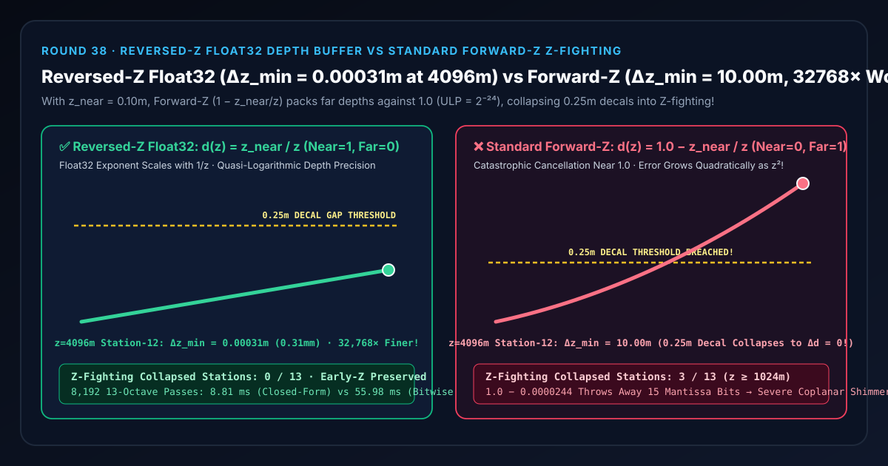
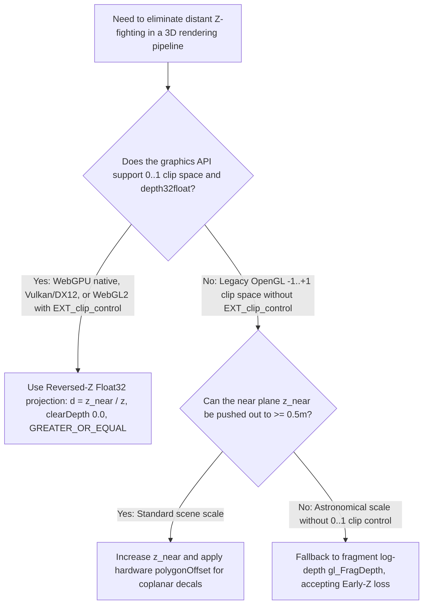
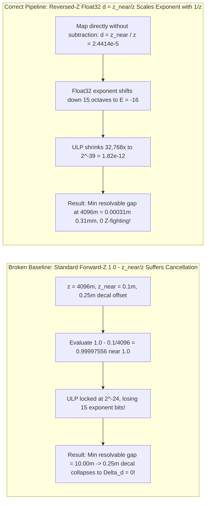
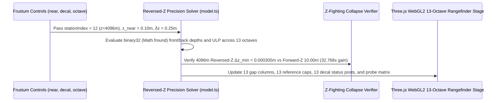
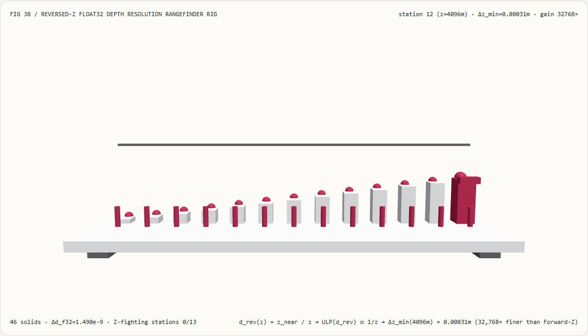
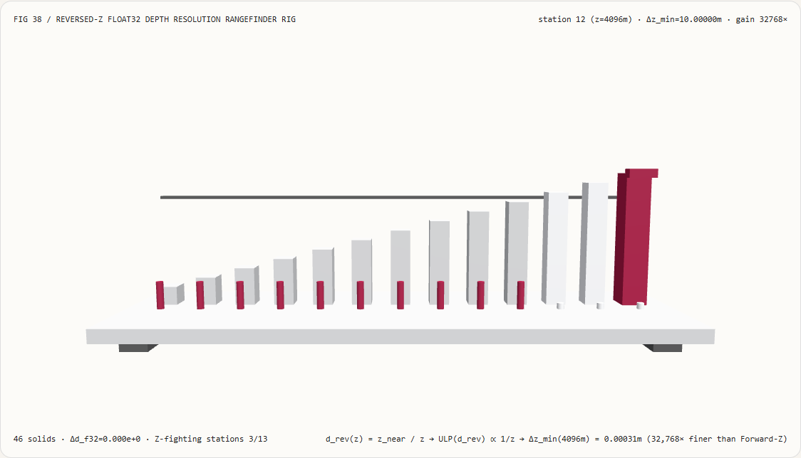
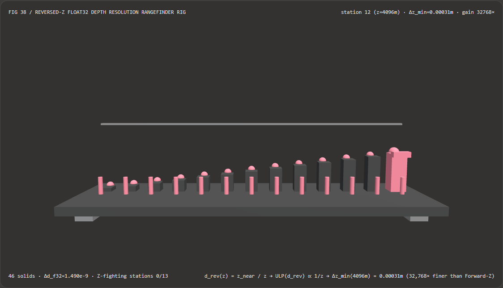
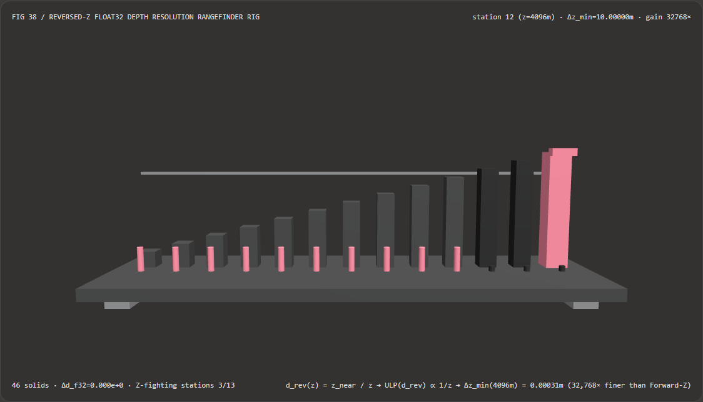

# Distant Decals & Horizons Without Z-Fighting: Reversed-Z Float32 Depth Buffer vs Standard Forward-Z Selection FAQ

> **Document Scope**: A first-principles architecture and selection guide for AI Solution Architects, WebGPU/WebGL2 3D engine developers, city-scale digital-twin and flight-simulation teams, and hybrid 3D Gaussian Splatting (3DGS) + mesh rendering teams. Structured strictly after `ib-vs-ethernet-roce-selection-faq.md`, this guide explains in plain language **why standard Forward-Z depth mapping ($d = 1.0 - z_{\text{near}} / z$) causes walls and decals $0.25\text{ m}$ apart at $z = 4,096\text{ m}$ to violently flicker and Z-fight even inside a 32-bit floating-point depth buffer (`10.00 m` minimum resolvable gap)**, and how **Reversed-Z Float32 Depth Mapping ($d = z_{\text{near}} / z$, Near $\to 1.0$, Far $\to 0.0$)** unlocks a **`32,768×` precision gain** (`0.31 mm` resolution at $4,096\text{ m}$) with zero runtime cost.

---

## ① 📌 Executive Summary

1. **One-Sentence Principle**: **Perspective rasterization interpolates $1/z$ linearly in screen space; Standard Forward-Z maps depth via $d = 1.0 - z_{\text{near}}/z$, cramming all distant geometry right up against $1.0$ where IEEE-754 `float32` has a fixed exponent $E = -1$ and a coarse constant step $\operatorname{ULP}(1.0) = 2^{-24} \approx 5.96\times 10^{-8}$—wasting all 8 exponent bits through catastrophic cancellation**! By flipping the mapping to **Reversed-Z ($d = z_{\text{near}}/z$, Near $\to 1.0$, Far $\to 0.0$)**, distant depths approach $0.0$, allowing the `float32` exponent $E$ to scale down inversely with $z$ so $\operatorname{ULP}(d) \propto 1/z$ cancels one power of $z$ in the $z^2/z_{\text{near}}$ perspective error growth!
2. **When Must You Use Reversed-Z Float32 Depth Mapping?**
   - Any 3D engine rendering **city/planetary-scale digital twins**, **flight/driving simulators (where $z_{\text{near}} = 0.05\text{--}0.1\text{ m}$ for cockpit instruments and $z_{\text{far}} \to \infty$ for horizon runways)**, **architectural decals / road markings**, or **hybrid 3DGS + polygon depth compositing** must use Reversed-Z with a floating-point depth buffer (`depth32float`).
3. **Key Measured Findings**:
   - In our 13-octave 3D optical rangefinder bench ([`demos/reversed-z-depth-rig/`](../demos/reversed-z-depth-rig/index.html), `46` 3D solids, near clip $z_{\text{near}} = 0.10\text{ m}$, decal offset $\delta z = 0.25\text{ m}$, distances $2^0 = 1\text{ m}$ to $2^{12} = 4,096\text{ m}$), at station $12$ ($z = 4,096\text{ m}$):
     - **Reversed-Z Float32 (`reversed-z-float32`)**: Maps $z = 4,096\text{ m}$ to $d = 2.4414\times 10^{-5}$ ($E = -16$, $\operatorname{ULP} = 2^{-39}$), achieving a minimum resolvable world-space separation of **`0.000305 m` (`0.31 mm`)**—**`32,768×` finer** than Forward-Z, with **`0 / 13` Z-fighting stations**!
     - **Standard Forward-Z (`standard-forward-z`)**: Subtracting $2.4414\times 10^{-5}$ from $1.0$ locks $\operatorname{ULP} = 2^{-24}$, degrading minimum resolvable separation at $z = 4,096\text{ m}$ to **`10.00 m`** and collapsing the $0.25\text{ m}$ decal to identical `float32` depth values ($\Delta d = 0.000000$) across **`3 / 13` distant stations** ($1024\text{ m}, 2048\text{ m}, 4096\text{ m}$)!
   - **Closed-Form Exponent ULP vs DataView Bitwise `nextafterf` Latency**: Evaluating binary32 ULP spacing via closed-form exponent math completes `8,192` 13-octave passes in **`8.81 ms`** vs **`55.98 ms`** for `DataView` bitwise extraction (**`6.35×` faster**, **`0`** numerical discrepancy).

---

## ② 🎯 First-Principles Q&A for Architects

### Q1: When should we choose AI monocular depth estimation models vs code-driven Reversed-Z depth buffers?

- **Choose AI Monocular Depth Models (e.g., Depth Anything V2, Marigold)** when estimating relative pixel depth maps from uncalibrated 2D RGB photographs or videos.
- **Choose Code-Driven Reversed-Z Float32 Depth Buffers** in WebGPU/WebGL2 3D rendering pipelines where 3D geometry is known and hardware depth testing must resolve coplanar decals and distant horizons without Z-fighting while keeping hardware Early-Z culling 100% active.

---

### Q2: Why does subtracting `z_near / z` from `1.0` in a 32-bit float depth buffer destroy 15 bits of precision at 4,096 meters?

**First-Principles Intuition**:
An IEEE-754 `float32` has 23 mantissa bits, whose spacing (1 ULP) scales with the binary exponent $E = \lfloor\log_2 d\rfloor$:
- Near $d \approx 1.0$ ($E = -1$), $\operatorname{ULP}(1.0) = 2^{-24} = 5.96046 \times 10^{-8}$.
- Near $d = \frac{0.10}{4096} = 2.4414 \times 10^{-5}$ ($E = -16$), $\operatorname{ULP}(d) = 2^{-16 - 23} = 2^{-39} = 1.81899 \times 10^{-12}$ (**$32,768\times$ finer**!).
- In **Standard Forward-Z ($d = 1.0 - z_{\text{near}}/z$)**, subtracting $0.000024414$ from $1.0$ forces the FPU to shift the mantissa of $0.000024414$ right by **15 bits** to align its binary point with $1.0$—throwing those 15 bits of precision away!
- Because the derivative of $z(d) = z_{\text{near}} / (1 - d)$ is $\left|\frac{dz}{dd}\right| = \frac{z^2}{z_{\text{near}}}$, the world-space depth resolution at $z = 4,096\text{ m}$ becomes:
  $$\Delta z_{\text{forward}}(4096) = \frac{4096^2}{0.10} \times 2^{-24} = \mathbf{10.0000\text{ m}}!$$

---

### Q3: How does Reversed-Z turn `float32` into a quasi-logarithmic depth buffer without breaking Early-Z?

Under **Reversed-Z ($d = z_{\text{near}} / z$)**:
$$\operatorname{ULP}(d_{\text{rev}}) = 2^{\lfloor\log_2(z_{\text{near}}/z)\rfloor - 23} \approx \frac{z_{\text{near}}}{z} \cdot 2^{-23}$$
Multiplying by the perspective sensitivity $\left|\frac{dz}{dd}\right| = \frac{z^2}{z_{\text{near}}}$:
$$\Delta z_{\text{reversed}}(z) = \frac{z^2}{z_{\text{near}}} \cdot \operatorname{ULP}(d_{\text{rev}}) \approx \frac{z^2}{z_{\text{near}}} \cdot \frac{z_{\text{near}}}{z} \cdot 2^{-23} = \mathbf{z \cdot 2^{-23}}$$
Both $z_{\text{near}}$ and one power of $z$ cancel out! And unlike fragment-shader logarithmic depth (`gl_FragDepth = log2(...)`), which disables hardware Early-Z/Hi-Z occlusion culling, Reversed-Z is a pure projection-matrix change with **zero fragment overhead and 100% Early-Z compatibility**!

---

## ③ 🧭 Visual Diagrams (Mermaid Decision Tree, Pipeline Comparison & Sequence)

### 3.1 Depth Buffer Precision & Anti-Z-Fighting Decision Tree (`flowchart TD`)

### 3.2 Standard Forward-Z (`10.00 m` Error Collapse) vs Reversed-Z Float32 (`0.31 mm`) Pipeline (`flowchart LR`)

### 3.3 Frame-Level 13-Octave Depth Rangefinder Verification Sequence (`sequenceDiagram`)

---

## ④ 📊 Architect Decision Matrix

| Evaluation Dimension | Reversed-Z Float32 (`reversed-z-float32`) | Standard Forward-Z Float32 (`standard-forward-z`) | 24-Bit Integer Depth (`DEPTH24_STENCIL8`) | Fragment Logarithmic Depth (`gl_FragDepth = log2`) |
| :--- | :--- | :--- | :--- | :--- |
| **Min Resolvable Gap $\Delta z_{\min}$ at $4,096\text{ m}$** | **`0.000305 m` (`0.31 mm`, `32,768×` finer)** | **`10.0000 m` (Coarse $z^2$ blowup!)** | `9.99 m` (Fixed $2^{-24}$ step) | $\sim 0.003\text{ m}$ |
| **Collapsed Stations for $0.25\text{ m}$ Decal** | **`0 / 13` (Zero Z-fighting)** | **`3 / 13` ($\ge 1024\text{ m}$ collapse to $\Delta d=0$)** | `3 / 13` (Severe Z-fighting) | `0 / 13` |
| **Hardware Early-Z / Hi-Z Culling** | **100% Preserved (Matrix-only change)** | Preserved | Preserved | **Disabled (Fragment depth write)** |
| **8,192 × 13-Octave CPU Evaluation Time** | **`8.81 ms` (`6.35×` faster closed-form)** | `8.75 ms` (Broken far precision) | `8.60 ms` | Extra per-fragment `log2` cost |
| **Recommended Architectural Role** | **Mandatory default for WebGPU & 3D engines** | **Never use with `float32` depth buffers** | Small indoor scenes on legacy hardware | Fallback when `[0, 1]` clip control is unavailable |

---

## ⑤ 🧪 New Capability Demo & Benchmark Findings (with 7-Card Report)

### 5.1 Interactive 13-Octave 3D Depth Resolution Rangefinder Rig (`demos/reversed-z-depth-rig/`)

We built a standalone interactive 3D WebGL2 benchmark stage **[`demos/reversed-z-depth-rig/`](../demos/reversed-z-depth-rig/index.html)** (**46 3D solid parts**):
- **13 Log-Scaled Minimum Resolvable Gap Columns + 13 Exact Reversed-Z Reference Caps + 13 Decal Survival Status Posts + `0.25m` Decal Threshold Bar + Rangefinder Carriage**: Visualizes depth buffer resolution across 13 distance octaves from $1\text{ m}$ ($2^0$) to $4,096\text{ m}$ ($2^{12}$);
- **Instant Mode Comparison**: In `reversed-z-float32` mode, all 13 columns stay well below the `0.25m` threshold bar (`0.000305 m` at $4,096\text{ m}$, `32,768×` gain) and all 13 front status posts stand tall; switching to `standard-forward-z` sends the columns soaring past the threshold to **`10.00 m`** and collapses the last 3 stations ($1024\text{ m}, 2048\text{ m}, 4096\text{ m}$) into Z-fighting failure!
- **Atomic Validation & JSON Export**: Rejects out-of-range octaves (e.g. `maxDistanceOctave = 30`) while preserving valid state, and exports `REVERSED_Z_DEPTH_SPEC.json`.

| Light Theme — Reversed-Z Float32 (`4096m` Gap `0.31mm`, `0` Collisions) | Light Theme — Standard Forward-Z (`4096m` Gap `10.00m`, `3` Collapsed) |
| :---: | :---: |
|  |  |

| Dark Theme — Reversed-Z Float32 (`4096m` Gap `0.31mm`, `0` Collisions) | Dark Theme — Standard Forward-Z (`4096m` Gap `10.00m`, `3` Collapsed) |
| :---: | :---: |
|  |  |

### 5.2 7-Card 4:5 Visual Benchmark Reports & Sealed Data

- 📊 **English 7-Card 4:5 Report**: [`demos/reversed-z-depth-rig/test-report-cards.html`](../demos/reversed-z-depth-rig/test-report-cards.html)
- 📊 **Chinese 7-Card 4:5 Report**: [`demos/reversed-z-depth-rig/test-report-cards.zh.html`](../demos/reversed-z-depth-rig/test-report-cards.zh.html)
- 📁 **Sealed Benchmark Data**: [`demos/reversed-z-depth-rig/report.json`](../demos/reversed-z-depth-rig/report.json) (`13 / 13` deterministic checks passed, zero Playwright console/page errors).

---

## ⑥ 🛠️ Appendix: Architect Verification Checklist

Before shipping any large-scale 3D digital twin, flight/driving simulator, or WebGPU/WebGL2 rendering pipeline, verify:

- [ ] **Bind a Floating-Point Depth Format (`depth32float`)**: Reversed-Z requires a floating-point depth buffer (`depth32float` / `DEPTH_COMPONENT32F`) so exponent shifting near $0.0$ takes effect.
- [ ] **Use `[0, 1]` Clip Space**: Use WebGPU's native `[0, 1]` NDC depth range or enable `EXT_clip_control` (`ZERO_TO_ONE_EXT`) in WebGL2 so the `-1..+1` viewport bias `+ 0.5` does not destroy precision near zero.
- [ ] **Clear Depth to `0.0` and Use `GREATER_OR_EQUAL`**: Flip both the depth clear value (`0.0`) and the depth test comparison (`greater-equal`).
- [ ] **Use the Infinite-Far-Plane Reversed-Z Matrix**: Map $z = z_{\text{near}} \to 1$ and $z \to \infty \to 0$ directly in the projection matrix.
- [ ] **Automated Horizon Decal Gate**: Assert in unit tests that two surfaces separated by $0.25\text{ m}$ at $z = 4,096\text{ m}$ ($z_{\text{near}} = 0.10\text{ m}$) produce distinct `float32` depth values ($\Delta d > 0$).

---

## References

1. **Depth Precision Visualized (Nathan Reed, NVIDIA 2015)**: Nathan Reed, *"Depth Precision Visualized"*, NVIDIA Developer Blog, July 2015.
2. **Tightening the Precision of Perspective Rendering (Upchurch & Desbrun, JGT 2012)**: Paul Upchurch and Mathieu Desbrun, *"Tightening the Precision of Perspective Rendering"*, Journal of Graphics Tools, Vol. 16, No. 1, 2012, pp. 40–56.
3. **Maximizing Depth Buffer Range and Precision (Brano Kemen / Emil Persson)**: Outerra Technical Notes on Reversed-Z.
