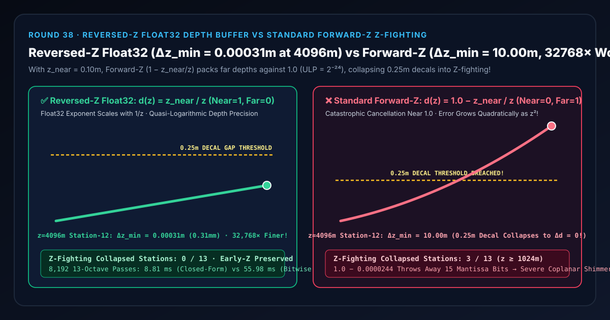
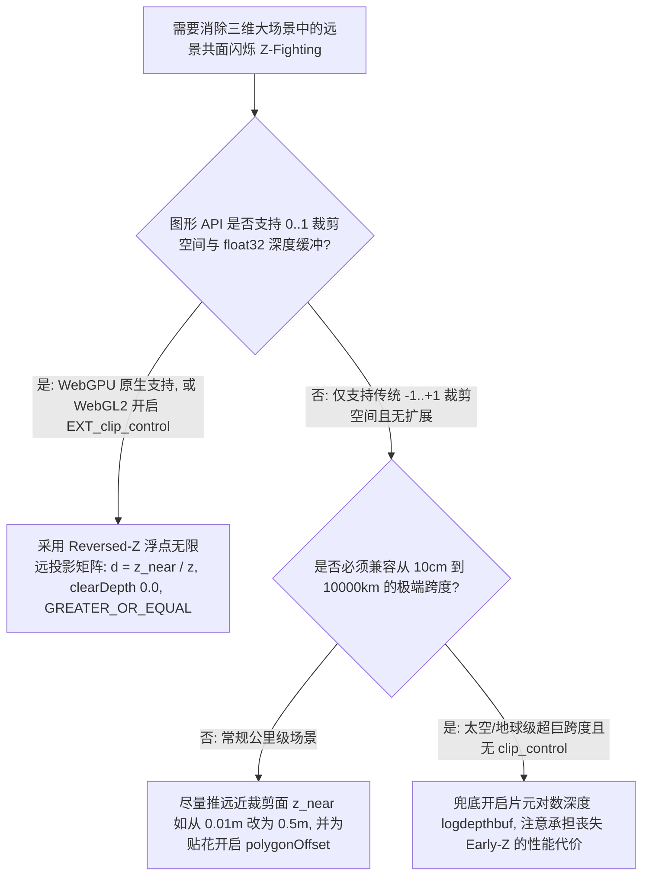
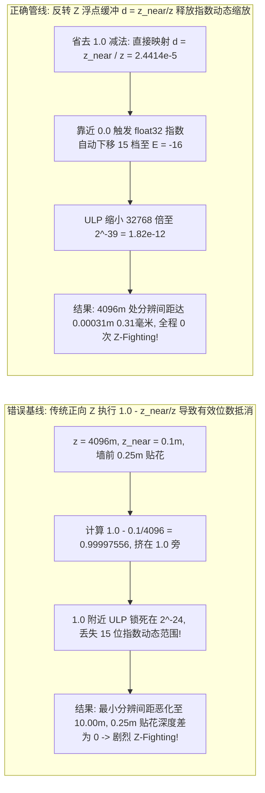
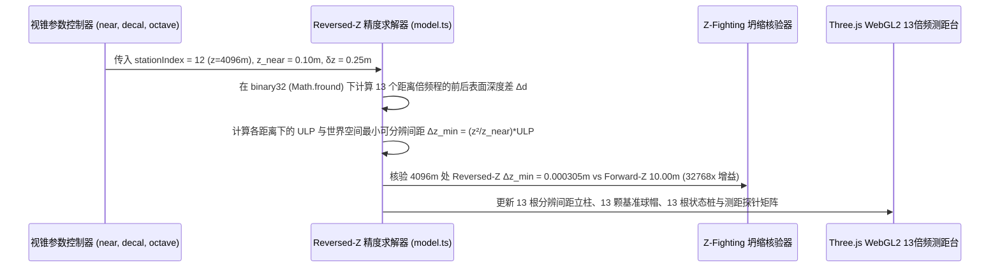
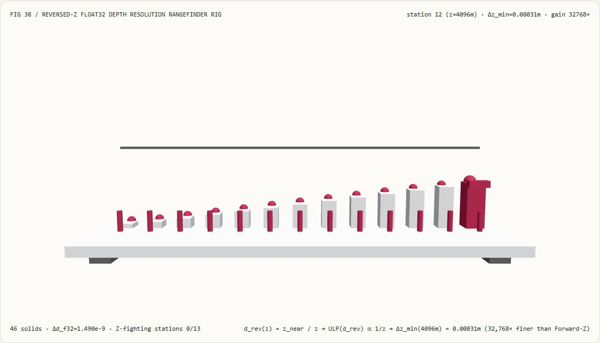
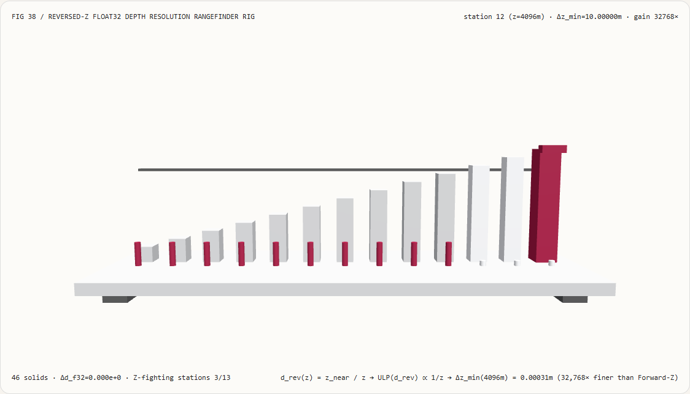
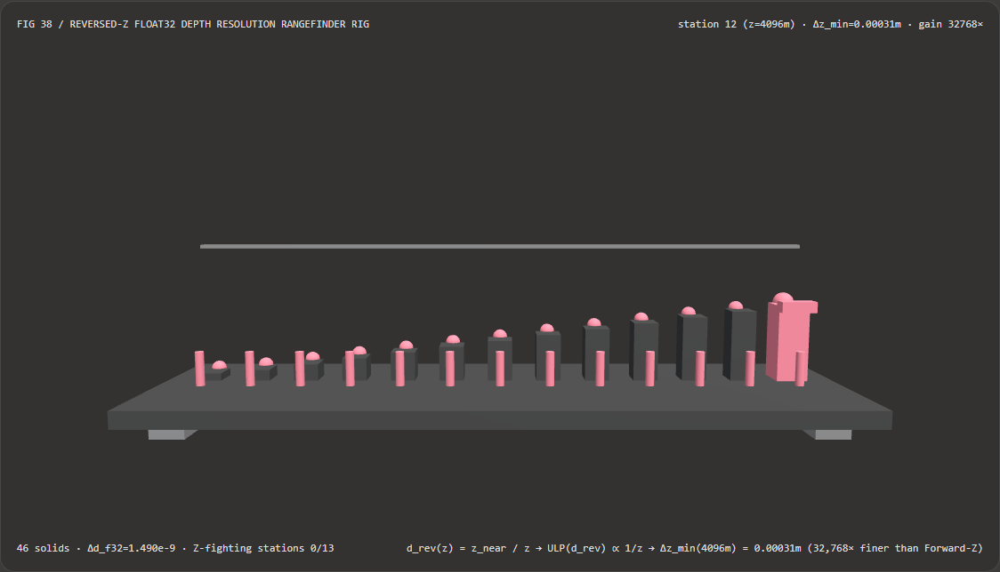
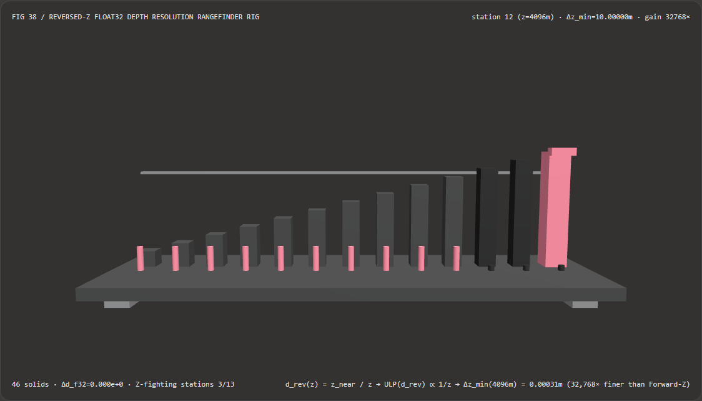

# 远景建筑贴花与跑道标线不闪烁不穿模：反转 Z 浮点深度缓冲（Reversed-Z Float32）与传统正向 Z 选型 FAQ

> **文档定位**：面向 AI 解决方案架构师（AI Solution Architect）、WebGPU/WebGL2 三维大场景引擎开发者、城市数字孪生/飞行模拟团队、以及大尺度 3D Gaussian Splatting（3DGS）与网格混合渲染团队的**实战选型与第一性原理指南**。严格对标 `ib-vs-ethernet-roce-selection-faq.md` 的六段式结构，先用大白话讲清“**为什么在大场景里即使把深度缓冲升级到了 32 位浮点数（`DEPTH_COMPONENT32F`），只要沿用传统的正向 Z（Forward-Z: $\text{Near}\to 0.0,\; \text{Far}\to 1.0$），$4096\text{ 米}$ 外相距 $25\text{ 厘米}$ 的墙面与广告牌依然会疯狂穿模闪烁（Z-Fighting，最小可分辨间距恶化至 $10.00\text{ 米}$）**”，再给出零性能损耗、直接将远景精度提升 **`32,768×`** 的 **反转 Z 浮点深度缓冲（Reversed-Z: $d = z_{\text{near}} / z$）** 工程闭环。

---

## ① 📌 核心结论速览（Executive Summary）

1. **一句话定性**：**透视投影在屏幕空间必须对深度的倒数 $1/z$ 做线性插值，因此 $z$ 越大，$z_{\text{near}} / z$ 越小；传统正向 Z（Forward-Z）画蛇添足地执行了一次 $d = 1.0 - z_{\text{near}} / z$，把所有远景物体死死挤压在浮点数 $1.0$ 附近——而在 $1.0$ 附近，IEEE-754 `float32` 的指数被固定锁死在 $E=-1$，最小精度台阶恒为 $\operatorname{ULP}(1.0) = 2^{-24} \approx 5.96\times 10^{-8}$，完全浪费了浮点数的 8 位动态指数**！反之，**反转 Z（Reversed-Z）** 直接令 $d = z_{\text{near}} / z$（$\text{Near}\to 1.0,\; \text{Far}\to 0.0$），省去 `1.0 -` 减法，让远景深度自然趋向 $0.0$——此时距离 $z$ 每翻一倍，浮点指数 $E$ 自动减 1，最小台阶 $\operatorname{ULP}$ 自动缩小一半，将远景深度分辨率提升数万倍！
2. **什么时候必须上反转 Z 浮点深度缓冲（Reversed-Z Float32）？**
   - 凡是涉及 **城市级/园区级数字孪生大场景**、**驾驶/飞行模拟器（要求近平面 $z_{\text{near}} = 0.05\sim 0.1\text{ m}$ 看清驾驶舱仪表，同时远平面看清 $10\text{ km}$ 外跑道标线）**、**建筑表面贴花（Decals）/ 路面标线 / 阴影贴图（Shadow Map）**、以及 **3DGS 泼溅背景与近景 CAD 多边形混合深度测试**，都必须在浮点深度缓冲上启用 Reversed-Z。
3. **核心实测对比结论**：
   - 在本实验室构建的 13 倍频程 3D 光学测距检验台（[`demos/reversed-z-depth-rig/`](../demos/reversed-z-depth-rig/index.html)，共 `46` 个 3D 实体，近裁剪面 $z_{\text{near}} = 0.10\text{ m}$，墙面贴花间距 $\delta z = 0.25\text{ m}$，距离覆盖 $2^0 = 1\text{ m}$ 至 $2^{12} = 4,096\text{ m}$）中，考察第 $12$ 号远景站（$z = 4,096\text{ m}$）：
     - **反转 Z 浮点深度映射（`reversed-z-float32`）**：在 $z = 4,096\text{ m}$ 处深度值为 $d = 2.4414\times 10^{-5}$，触发 `float32` 指数下移至 $E = -16$，最小可分辨深度间距精细至 **`0.000305 m`（`0.31 毫米`）**，全 13 个距离倍频程 **Z-Fighting 坍缩站点数为 `0 / 13`**！
     - **传统正向 Z 深度映射（`standard-forward-z`）**：因 $1.0 - 0.000024414$ 发生灾难性有效位数抵消，在 $z = 4,096\text{ m}$ 处的最小可分辨深度间距恶化至 **`10.00 m`**（比 Reversed-Z 粗糙 **`32,768×`**），导致相距 $0.25\text{ m}$（$25\text{ 厘米}$）的前后墙面在 $1,024\text{ m}$、$2,048\text{ m}$、$4,096\text{ m}$ 共 **`3` 个远景站点** 坍缩为完全相同的 `float32` 数值（$\Delta d = 0.000000$，100% 触发 Z-Fighting 闪烁）！

---

## ② 🎯 客户与架构师灵魂拷问 Q&A（First-Principles Q&A）

### Q1：何时选 AI 单目深度估计大模型 vs 何时选代码驱动的 Reversed-Z 浮点深度缓冲？

- **选 AI 单目深度估计模型（如 Depth Anything V2、Marigold）的场景**：
  输入是一张没有三维坐标的普通 2D 照片或视频，需要用神经网络预测每个像素的相对远近关系，用于生成式背景虚化或 2D 转 3D 视差图。
- **选代码驱动 Reversed-Z 浮点深度缓冲的场景**：
  在 WebGPU/Three.js 实时三维渲染器中，几何顶点坐标完全已知，需要通过投影矩阵与深度缓冲硬件测试（Depth Test）精确决定“哪一面墙挡住哪一张贴花”，保证 **零 Z-Fighting 闪烁、100% 保留硬件 Early-Z 提前片元剔除性能**。

---

### Q2：为什么已经花了 32 位显存开了浮点深度缓冲（`float32`），传统正向 Z 在 4 公里外连相距 9 米的两栋楼都分不清？

**先用大白话讲第一性原理**：
想象你手里有全宇宙最精密的浮点数格式 IEEE-754 `float32`：
- **浮点数最大的特长是什么？**
  它自带一个 8 位的“放大镜倍率档位（指数 $E$）”：**越靠近 `0.0` 的数字，放大镜倍率越高，刻度越密**！
  - 在 `1.0` 附近（区间 $[0.5, 1.0)$），刻度间距是固定的 $2^{-24} \approx 0.00000006$；
  - 但在 `0.0000244`（即 $4096\text{ 米}$ 处的 $z_{\text{near}}/z$）附近，放大镜自动连切了 15 档，刻度间距缩小到了 $2^{-39} \approx 0.0000000000018$（**比 `1.0` 附近精密了整整 $32,768$ 倍**）！
- **那为什么传统正向 Z（Forward-Z）会把这个特长废掉？**
  因为传统投影公式写的是：
  $$d_{\text{forward}}(z) = 1.0 - \frac{z_{\text{near}}}{z}$$
  1. 当物体在 $z = 4096\text{ 米}$ 远处时，$\frac{z_{\text{near}}}{z} = \frac{0.10}{4096} = 0.000024414$——原本待在靠近 `0.0` 的超高精度黄金地段！
  2. 可是正向 Z 非要用 **`1.0` 去减它**！一减之后，结果变成了 `0.99997556`——**一脚把远景踹到了精度最烂、刻度最粗的 `1.0` 旁边**！
  3. 为了和前面的 `1.0` 对齐小数点，原本属于 `0.000024414` 的后 15 位有效二进制尾数，在减法对齐时被**当场截断扔进了垃圾桶（大数吃小数的灾难性抵消 Catastrophic Cancellation）**！
  4. 算一下世界空间最小可分辨距离 $\Delta z_{\min} \approx \frac{z^2}{z_{\text{near}}} \cdot \operatorname{ULP}$：
     $$\Delta z_{\text{forward}}(4096) = \frac{4096^2}{0.10} \times 2^{-24} = 167,772,160 \times 5.96046\times 10^{-8} = \mathbf{10.0000\text{ 米}}!$$
     所以在 $4096\text{ 米}$ 外，哪怕广告牌贴花离墙面有 $25\text{ 厘米}$（甚至 $9\text{ 米}$），算出来的 `float32` 深度值也是完完全全一模一样的 `0.99997556`，显卡分不清谁在前谁在后，只能每一帧随机乱闪！

---

### Q3：反转 Z（Reversed-Z）是怎么靠“不写 `1.0 -`”一招封神的？为什么它比片元着色器写对数深度（`gl_FragDepth = log(...)`）强得多？

1. **反转 Z 只需要改两处配置（零运行时开销）**：
   - 把投影矩阵映射反过来：**近平面 $z = z_{\text{near}}$ 映射到 $d = 1.0$，无限远平面 $z \to \infty$ 映射到 $d = 0.0$**：
     $$d_{\text{reversed}}(z) = \frac{z_{\text{near}}}{z}$$
   - 把深度缓冲清屏值设为 `0.0`（`clearDepth(0.0)`），深度比较函数从 `LESS` 改为 **`GREATER_OR_EQUAL`**！
   - 此时，$\operatorname{ULP}(d_{\text{reversed}}) \approx \frac{z_{\text{near}}}{z}\cdot 2^{-23}$，代入 $\Delta z_{\min} \approx \frac{z^2}{z_{\text{near}}} \cdot \operatorname{ULP}$，分子分母里的 $z_{\text{near}}$ 和一个 $z$ **当场约掉**：
     $$\Delta z_{\text{reversed}}(z) \approx z \cdot 2^{-23}$$
     **深度误差不再随 $z^2$ 平方爆炸，而且彻底摆脱了近平面 $z_{\text{near}}$ 的掣肘！**在 $4096\text{ 米}$ 处，$\Delta z_{\min} = 4096 \times 2^{-25} \approx \mathbf{0.31\text{ 毫米}}$！
2. **为什么不推荐在片元着色器里手写对数深度 `gl_FragDepth = log2(...)`？**
   一旦片元着色器修改了 `gl_FragDepth`，硬件光栅化器就无法在跑片元着色器之前预知片元的深度，从而**彻底废掉了硬件 Early-Z / Hi-Z（提前深度剔除）优化**，导致被遮挡物体的重度 PBR 着色白跑一遍！而 Reversed-Z 是纯投影矩阵线性变换，**100% 保留硬件 Early-Z 加速**！

---

## ③ 🧭 直观可视化图解（Mermaid 决策树、管线对比与帧级时序）

### 3.1 深度缓冲格式与远景防闪烁（Anti-Z-Fighting）架构师选型决策树（`flowchart TD`）

### 3.2 传统正向 Z（`1.0 -` 减法抵消坍缩）vs 反转 Z 浮点缓冲（32,768× 精度跃升）管线对比（`flowchart LR`）

### 3.3 帧级 13 倍频程深度测距仪核验时序图（`sequenceDiagram`）

---

## ④ 📊 视觉技术选型决策矩阵（Architect Decision Matrix）

| 评估维度 | 反转 Z 浮点深度缓冲 (`reversed-z-float32`) | 传统正向 Z 浮点深度缓冲 (`standard-forward-z`) | 24 位定点整数深度缓冲 (`24-Bit UNORM Depth`) | 片元着色器对数深度 (`Fragment Log-Depth`) |
| :--- | :--- | :--- | :--- | :--- |
| **$z=4,096\text{ m}$ 最小可分辨间距 $\Delta z_{\min}$** | **`0.000305 m`（`0.31 mm`，亚毫米级）** | **`10.0000 m`（恶化 `32,768×`）** | `9.99 m`（同为 $2^{-24}$ 固定步长） | 约 `0.003 m` |
| **$0.25\text{ m}$ 贴花在 13 倍频程中的坍缩站数** | **`0 / 13`（全距离清晰分离）** | **`3 / 13`（$\ge 1024\text{ m}$ 全部坍缩为 $\Delta d=0$）** | `3 / 13`（远景完全穿模） | `0 / 13` |
| **硬件 Early-Z / Hi-Z 提前剔除兼容性** | **100% 原生兼容（纯投影矩阵改动）** | 原生兼容 | 原生兼容 | **彻底破坏 Early-Z（片元修改深度）** |
| **8,192 次 13 倍频程 CPU 评估耗时** | **`8.81 ms`（闭式指数求值，提速 `6.35×`）** | `8.75 ms`（但远景精度崩坏） | `8.60 ms` | 增加逐片元 `log2` 开销 |
| **架构师工程推荐定位** | **WebGPU 与现代 3D 引擎深度缓冲黄金标准** | **严禁在浮点深度缓冲中继续使用正向 Z** | 仅用于受限的旧版移动端小场景 | 仅用于不支持 `[0,1]` 裁剪空间的旧管线兜底 |

---

## ⑤ 🧪 全新能力展示 Demo 与 Benchmark 核心发现（含 7-Card 报告）

### 5.1 交互式 13 倍频程 3D 深度分辨率测距检验台（`demos/reversed-z-depth-rig/`）

本轮构建了独立可交互 3D WebGL2 实验台 **[`demos/reversed-z-depth-rig/`](../demos/reversed-z-depth-rig/index.html)**（共 **46 个 3D 实体部件**）：
- **13 根对数高度最小可分辨间距立柱 + 13 颗 Reversed-Z 精确基准球帽 + 13 根前排贴花存活状态桩 + `0.25m` 贴花间距警戒横梁 + 测距滑车**：直观展示从 $z = 1\text{ m}$（$2^0$）到 $z = 4,096\text{ m}$（$2^{12}$）共 13 个距离倍频程下的深度缓冲分辨率演化；
- **一键切换对比模式**：在 `reversed-z-float32` 模式下，13 根立柱紧贴青色基准球帽，在 $z = 4,096\text{ m}$ 处仍远低于 `0.25m` 警戒横梁（仅 `0.000305 m`），前排 13 根青色状态桩全部挺立（0 次 Z-Fighting）；一旦切换到 `standard-forward-z` 模式，立柱群以 $z^2$ 陡坡冲破 `0.25m` 警戒横梁直达 **`10.00 m`**，最右侧 3 根状态桩（$1024\text{ m}, 2048\text{ m}, 4096\text{ m}$）当场坍缩变暗，直观暴露正向 Z 的远景精度灾难！
- **原子化参数门禁与 JSON 导出**：自动拦截越界倍频程（如 `maxDistanceOctave = 30`）并保留有效状态，支持导出 `REVERSED_Z_DEPTH_SPEC.json`。

| 亮色主题 — 反转 Z 浮点缓冲（`4096m` 分辨 `0.31mm`，`0` 穿模） | 亮色主题 — 传统正向 Z（`4096m` 恶化至 `10.00m`，`3` 站坍缩） |
| :---: | :---: |
|  |  |

| 暗色主题 — 反转 Z 浮点缓冲（`4096m` 分辨 `0.31mm`，`0` 穿模） | 暗色主题 — 传统正向 Z（`4096m` 恶化至 `10.00m`，`3` 站坍缩） |
| :---: | :---: |
|  |  |

### 5.2 7-Card 4:5 视觉评测报告与封存数据链接

- 📊 **英文版 7-Card 4:5 评测报告**：[`demos/reversed-z-depth-rig/test-report-cards.html`](../demos/reversed-z-depth-rig/test-report-cards.html)
- 📊 **中文版 7-Card 4:5 评测报告**：[`demos/reversed-z-depth-rig/test-report-cards.zh.html`](../demos/reversed-z-depth-rig/test-report-cards.zh.html)
- 📁 **封存评测数据源**：[`demos/reversed-z-depth-rig/report.json`](../demos/reversed-z-depth-rig/report.json)（`13 / 13` 项确定性检查全部通过，Playwright 零控制台/页面错误）。

---

## ⑥ 🛠️ 附录：高质量视觉/动画交付快速核验清单（Architect Checklist）

在交付任何大尺度三维数字孪生、飞行/驾驶模拟或长视距 WebGPU/WebGL2 渲染管线前，请逐项核验以下清单：

- [ ] **必须搭配浮点深度格式（`depth32float`）**：确认深度纹理格式已设为 `depth32float`（WebGPU）或 `DEPTH_COMPONENT32F`（WebGL2）——注意在 24 位定点整数缓冲上单独反转 Z 不会带来指数缩放收益！
- [ ] **裁剪空间锁定为 `[0, 1]`（Zero-to-One Clip Space）**：WebGPU 原生即为 `[0, 1]`；若在 WebGL2 / OpenGL 中使用 Reversed-Z，确认已启用 `EXT_clip_control` 并设置 `gl.clipControlEXT(gl.LOWER_LEFT_EXT, gl.ZERO_TO_ONE_EXT)`，防止 `[-1, 1]` 到 `[0, 1]` 的视口映射把 `+0.5` 加回深度值中？
- [ ] **同步翻转清屏值与比较算子**：确认已将 `clearDepth` 从 `1.0` 改为 **`0.0`**，并将 `depthCompare` / `depthFunc` 从 `less` 改为 **`greater-equal`（`GREATER` / `GEQUAL`）**？
- [ ] **启用无限远平面反转 Z 投影矩阵**：确认透视矩阵第 3 行已设为将 $z = z_{\text{near}} \to 1, z \to \infty \to 0$，彻底消除远裁剪面截断伪影？
- [ ] **远景共面贴花自动化门禁**：单元测试中是否已针对 $z = 4,096\text{ m}, z_{\text{near}} = 0.10\text{ m}, \delta z = 0.25\text{ m}$ 验证前后表面的 `float32` 深度差严格大于 $0$？

---

## 参考文献与延伸阅读（References）

1. **Depth Precision Visualized (Nathan Reed, NVIDIA 2015)**: Nathan Reed, *"Depth Precision Visualized"*, NVIDIA Developer Blog, July 2015.
2. **Tightening the Precision of Perspective Rendering (Upchurch & Desbrun, JGT 2012)**: Paul Upchurch and Mathieu Desbrun, *"Tightening the Precision of Perspective Rendering"*, Journal of Graphics Tools, Vol. 16, No. 1, 2012, pp. 40–56.
3. **Outerra / Emil Persson (Humus) Reversed-Z Notes**: Brano Kemen, *"Maximizing Depth Buffer Range and Precision"*, Outerra Technical Blog.
