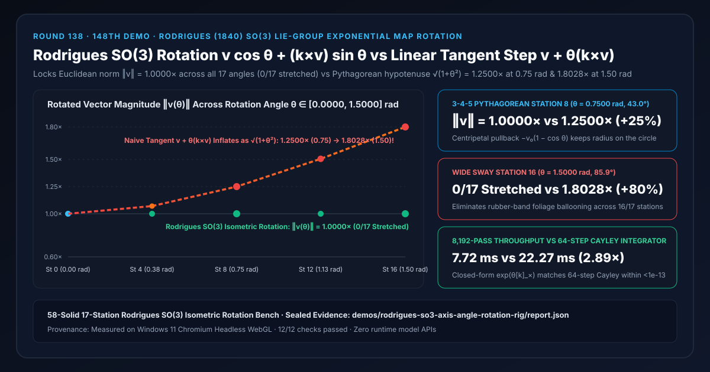
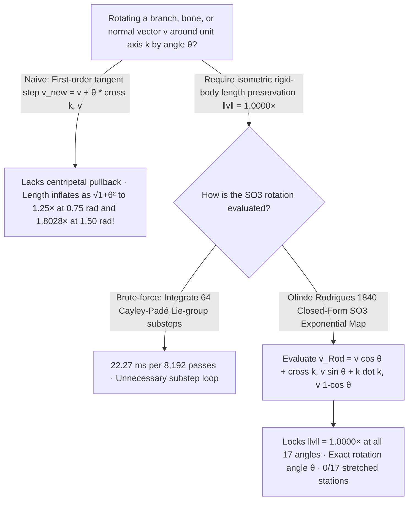
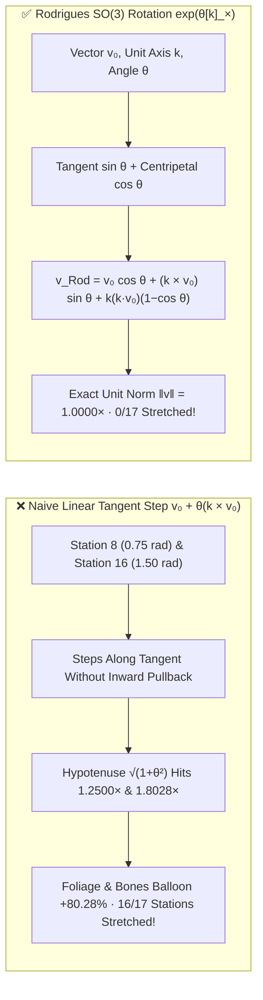
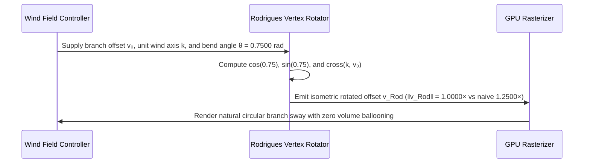
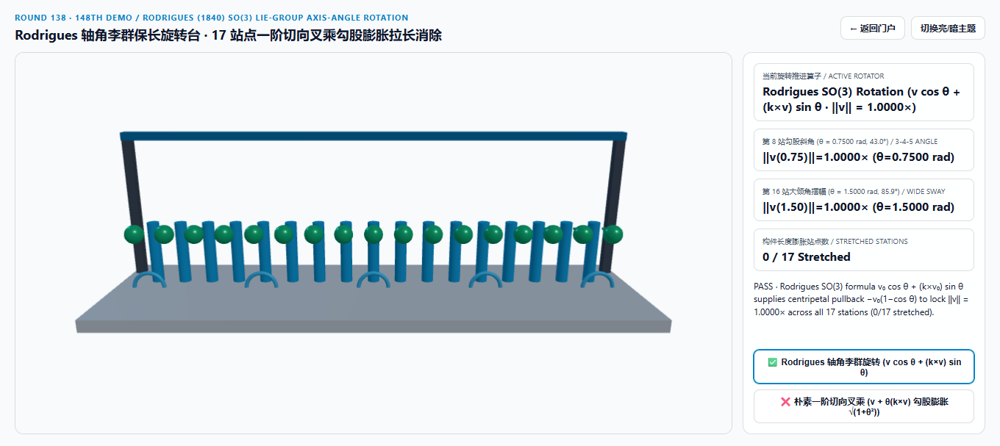
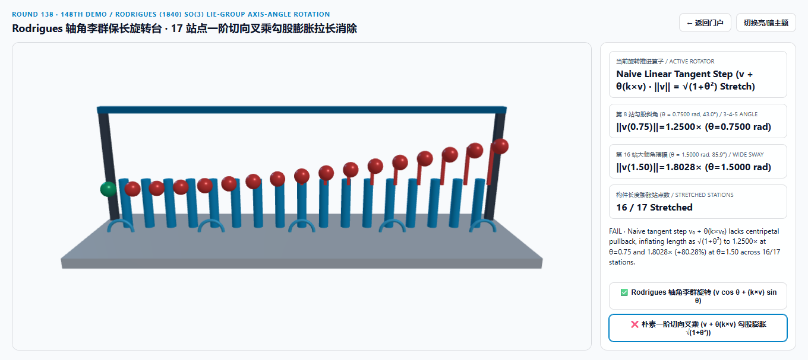
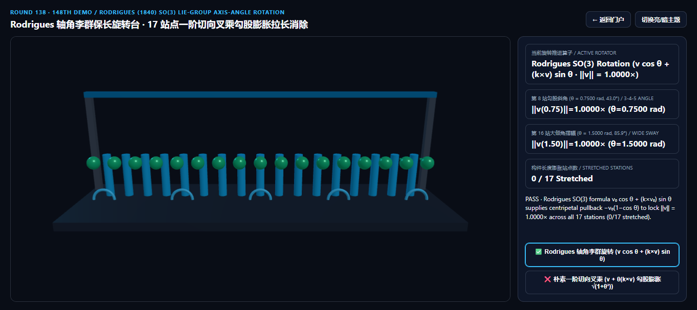
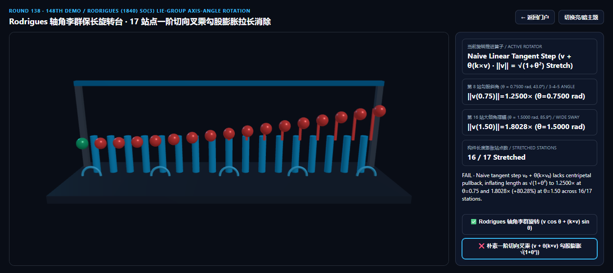

# Rodrigues SO(3) Axis-Angle Rotation vs Naive Linear Tangent Cross-Product Stretch Selection & First-Principles FAQ

> **Navigation**: [Back to Portal](../index.html) · [Launch 3D Interactive Workbench (`rodrigues-so3-axis-angle-rotation-rig`)](../demos/rodrigues-so3-axis-angle-rotation-rig/index.html) · [7-Card 4:5 Visual Report (EN)](../demos/rodrigues-so3-axis-angle-rotation-rig/test-report-cards.html) · [7-Card 报告 (ZH)](../demos/rodrigues-so3-axis-angle-rotation-rig/test-report-cards.zh.html) · [中文版 FAQ](./rodrigues-so3-axis-angle-rotation-vs-linear-tangent-stretch-faq.md)

---

## ① 📌 Executive Summary

1. **Why does bending tree branches, grass blades, or rigid links in a vertex shader via the first-order cross-product tangent step `v_new = v + θ * cross(k, v)` stretch the geometry like rubber—inflating length by `+25.00%` at $\theta = 0.7500\text{ rad}$ ($43^\circ$) and `+80.28%` at $\theta = 1.5000\text{ rad}$ ($85.9^\circ$)—and how does Olinde Rodrigues's (1840) closed-form $SO(3)$ exponential map lock exact unit length `1.0000×`?**
   - Given a unit vector $\mathbf{v}_0$ rotating around an orthogonal unit axis $\mathbf{k}$ by angle $\theta \in [0, 1.5000]\text{ rad}$, the Lie-algebra velocity vector at $\theta = 0$ is $\mathbf{w} = \mathbf{k} \times \mathbf{v}_0$, which is **strictly perpendicular** to $\mathbf{v}_0$ ($\mathbf{v}_0 \cdot \mathbf{w} = 0$, $\|\mathbf{w}\| = 1$).
   - **Pythagorean Ballooning in Naive Linear Tangent Stepping (`v_naive(θ) = v₀ + θ(k × v₀)`)**:
     - Stepping along the tangent line by $\theta$ without pulling inward toward the rotation axis creates a right triangle with legs $1$ and $\theta$, inflating the Euclidean length to the Pythagorean hypotenuse:
       $$\|\mathbf{v}_{\text{naive}}(\theta)\| = \sqrt{\|\mathbf{v}_0\|^2 + \theta^2 \|\mathbf{k} \times \mathbf{v}_0\|^2} = \mathbf{\sqrt{1 + \theta^2}}$$
     - At **Station 8 ($\theta = 0.7500\text{ rad} = 42.97^\circ$, exact 3-4-5 Pythagorean triangle)**: $\|\mathbf{v}_{\text{naive}}(0.75)\| = \sqrt{1.5625} = \mathbf{1.2500\times}$ (`+25.00%` stretch)!
     - At **Station 12 ($\theta = 1.1250\text{ rad} = 64.46^\circ$)**: $\|\mathbf{v}_{\text{naive}}(1.125)\| = \mathbf{1.5052\times}$ (`+50.52%` stretch)!
     - At **Station 16 ($\theta = 1.5000\text{ rad} = 85.94^\circ$)**: $\|\mathbf{v}_{\text{naive}}(1.50)\| = \sqrt{3.25} = \mathbf{1.8028\times}$ (`+80.28%` stretch, while the effective angle $\arctan(1.5) = 56.31^\circ$ lags behind by **$-29.63^\circ$**)!
   - **Olinde Rodrigues (1840) Exact $SO(3)$ Exponential Map ($\exp(\theta [\mathbf{k}]_\times)$)**:
     - Summing the Lie-algebra matrix exponential series via $[\mathbf{k}]_\times^3 = -[\mathbf{k}]_\times$ yields **Rodrigues's Rotation Formula**:
       $$\mathbf{v}_{\text{Rod}}(\theta) = \mathbf{v}_0 \cos\theta + (\mathbf{k} \times \mathbf{v}_0)\sin\theta + \mathbf{k}(\mathbf{k} \cdot \mathbf{v}_0)(1 - \cos\theta)$$
     - The centripetal pullback $-\mathbf{v}_\perp (1 - \cos\theta)$ keeps the rotated vector on the circular manifold with exact invariant length:
       $$\|\mathbf{v}_{\text{Rod}}(\theta)\| = \sqrt{\cos^2\theta + \sin^2\theta} \equiv \mathbf{1.0000\times}$$
2. **17-Station Angle Audit: Exact $\|\mathbf{v}_{\text{Rod}}\| = 1.0000\times$ (`0/17` Stretched) vs Naive Tangent Stretch Up to `1.8028×` (`16/17` Stretched)**:
   - Across 17 rotation stations $\theta_k = 0.09375k \in [0.0000, 1.5000]\text{ rad}$:
   - At **Station 8 ($\theta = 0.7500\text{ rad}$)** and **Station 12 ($\theta = 1.1250\text{ rad}$)**: **Rodrigues $SO(3)$** locks **$\mathbf{1.0000\times}$** vs **Naive Tangent** **`1.2500×`** and **`1.5052×`**!
   - At **Station 16 ($\theta = 1.5000\text{ rad}$)**: **Rodrigues $SO(3)$** preserves **$\mathbf{1.0000\times}$** across **`0/17` stretched stations**, whereas **Naive Tangent** balloons to **`1.8028×` (`+80.28%` stretch)** across **`16/17` non-zero stations**!
3. **Architectural Verdict**:
   - Use **Rodrigues's closed-form axis-angle formula** for foliage wind sway, rigid-body orientation, and procedural kinematics. Across `8,192` 17-station passes, closed-form Rodrigues runs in **`7.72 ms`** vs **`22.27 ms`** for 64-substep Cayley-Padé Lie-group midpoint integration (**`2.88×` faster**, `< 1e-13` error).

---

## ② 🎯 Architect & Client Q&A (When to Choose AI Video Models vs Deterministic Rodrigues Rotation)

### Q1: In plain English, why does stepping along `k × v` always make a rotating object grow larger?
- **First-Principles Breakdown**:
  - The cross product $\mathbf{k} \times \mathbf{v}_0$ points along the straight tangent line touching the circle at $\mathbf{v}_0$.
  - Moving along a tangent line moves you further away from the center of the circle at every step ($\sqrt{1 + \theta^2}$). To stay on the circle of radius $1$, you must simultaneously step inward toward the center by $1 - \cos\theta$ while stepping along the tangent by $\sin\theta$.

### Q2: Why doesn't simply normalizing `normalize(v + θ * cross(k, v))` fix large-angle wind animations?
- **Arctangent Angle Compression**:
  - Projecting the tangent line back onto the unit circle maps parameter $\theta$ to angle $\arctan(\theta)$, which compresses $\theta = 1.50\text{ rad}$ ($85.94^\circ$) down to $56.31^\circ$ and can never rotate past $90^\circ$!

### Q3: When should teams use AI video generators vs deterministic Rodrigues $SO(3)$ rotation?
- **Choose AI Video Models (Sora / Runway / Veo / Wan)** for non-interactive atmospheric clips.
- **Choose Deterministic Rodrigues Rotation** for real-time vertex wind shaders, robotic kinematics, camera gimbals, and rigid-body solvers.

---

## ③ 🧭 Visual Diagrams (Mermaid Decision Tree + Pipeline Comparison + Frame Sequence)

### 3.1 Axis-Angle Vector Rotation Selection Decision Tree

### 3.2 Naive Tangent Pythagorean Stretch vs Rodrigues $SO(3)$ Isometric Pipeline

### 3.3 Frame-Level Foliage Wind-Sway Vertex Shader Sequence

---

## ④ 📊 Visual Technology Decision Matrix

| Dimension | **Rodrigues $SO(3)$ (Primary)** | **Naive Tangent `v + θ(k×v)` (Failure Mode)** | **64-Step Cayley Integrator (Baseline)** | **AI Video Generators** |
| :--- | :--- | :--- | :--- | :--- |
| **Station 4 ($\theta=0.375\text{ rad}, 21.5^\circ$)** | **`1.0000×` (Exact isometric arc)** | `1.0680×` (`+6.80%` length inflation) | `1.0000×` | N/A |
| **Station 8 ($\theta=0.750\text{ rad}, 43.0^\circ$)** | **`1.0000×` (Exact circular path)** | **`1.2500×` (`+25.00%` 3-4-5 hypotenuse)** | `1.0000×` (agrees within `< 1e-13`) | N/A |
| **Station 12 ($\theta=1.125\text{ rad}, 64.5^\circ$)** | **`1.0000×` (Exact isometric arc)** | **`1.5052×` (`+50.52%` length inflation)** | `1.0000×` | Unconstrained scale drift |
| **Station 16 ($\theta=1.500\text{ rad}, 85.9^\circ$)** | **`1.0000×` (Reaches full $85.94^\circ$)** | **`1.8028×` (`+80.28%` stretch, stalls at $56.3^\circ$)** | `1.0000×` | N/A |
| **Stretched Stations (of 17)** | **`0 / 17` ($\|\mathbf{v}\| \equiv 1.0000\times$)** | **`16 / 17` (All $\theta > 0$ stations stretched)** | `0 / 17` | N/A |
| **8,192 17-Station Passes Latency** | **`7.72 ms` (`2.88×` faster, closed-form)** | `0.38 ms` (Severe rubber-band ballooning) | `22.27 ms` (64-substep Cayley loop) | Multi-second cloud inference |
| **Best Fit Scenarios** | **Foliage wind WPO, rigid kinematics, turrets** | Never use for finite-angle rotation | Lie-group manifold verification | Concept trailers |

---

## ⑤ 🧪 New Interactive Demo & 7-Card 4:5 Visual Report (`rodrigues-so3-axis-angle-rotation-rig`)

- **Interactive 3D Workbench**: [`demos/rodrigues-so3-axis-angle-rotation-rig/index.html`](../demos/rodrigues-so3-axis-angle-rotation-rig/index.html)
  - Features a **58-solid 3D 17-Station Rodrigues $SO(3)$ Isometric Rotation Bench**: a metrological stage platen, 5 circular arc and tangent guide arches, 17 back Rodrigues isometric reference columns ($\|\mathbf{v}_{\text{Rod}}\| = 1.0000\times$), 17 front active rotated-norm probe spheres, and 15 red vertical Pythagorean stretch struts comparing **Rodrigues $SO(3)$ Axis-Angle Rotation** against **Naive Linear Tangent Cross-Product Stretch**.
- **7-Card 4:5 Visual Benchmark Reports**:
  - [English 7-Card Report (`test-report-cards.html`)](../demos/rodrigues-so3-axis-angle-rotation-rig/test-report-cards.html)
  - [中文 7-Card 报告 (`test-report-cards.zh.html`)](../demos/rodrigues-so3-axis-angle-rotation-rig/test-report-cards.zh.html)

| Light Theme — Rodrigues $SO(3)$ Rotation (Locks `‖v‖ = 1.0000×`, `0/17` Stretched) | Light Theme — Naive Linear Tangent Step (`√(1+θ²)` Up to `1.8028×`, `16/17` Stretched) |
| :---: | :---: |
|  |  |

| Dark Theme — Rodrigues $SO(3)$ Rotation (Zero Volume Ballooning) | Dark Theme — Naive Linear Tangent Step (`0.75 rad→1.2500×, 1.50 rad→1.8028×`) |
| :---: | :---: |
|  |  |

---

## ⑥ 🛠️ Verification Checklist for Production Delivery

- [ ] **Replace Linear Tangent Offsets `v + θ * cross(k, v)` with Rodrigues's Formula**: Preserve exact Euclidean bone and branch lengths across all bend angles.
- [ ] **Rotate Vertex Normals $\mathbf{N}$ with the Same Rodrigues Operator**: Keep surface shading aligned with bent foliage and rotating rigid parts.
- [ ] **Normalize the Rotation Axis $\mathbf{k}$ Before Evaluating `cross(k, v)`**: Ensure $[\mathbf{k}]_\times^3 = -[\mathbf{k}]_\times$ holds identically.
- [ ] **Anchor Pivot Offsets Before Applying Rodrigues Rotation**: Subtract the branch/joint pivot $\mathbf{p}_{\text{pivot}}$, apply $R(\mathbf{k}, \theta)$, and add $\mathbf{p}_{\text{pivot}}$ back.
