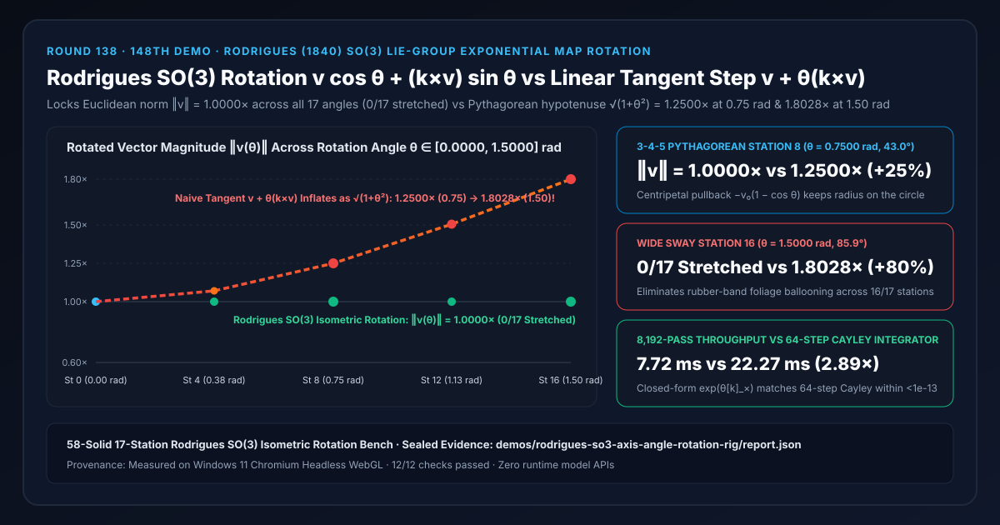
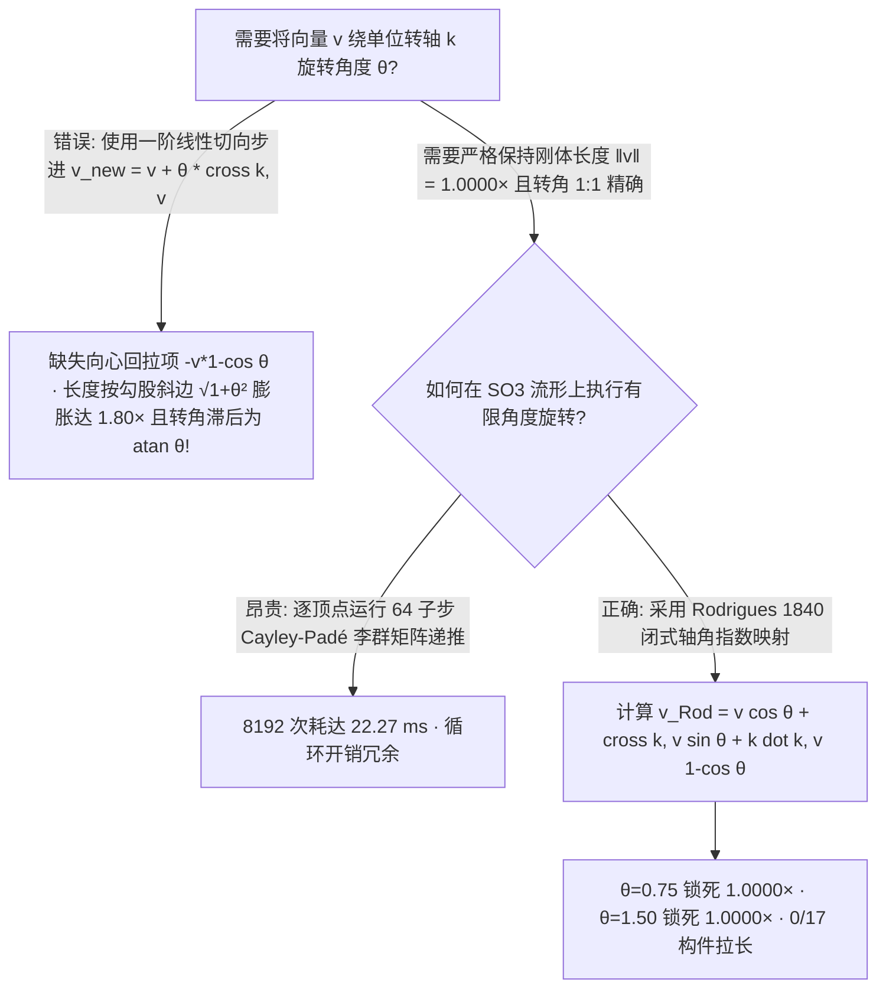
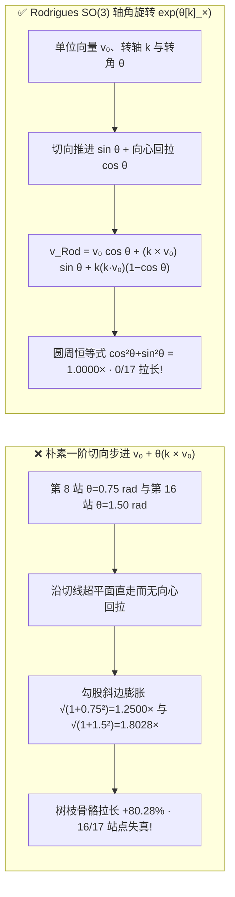
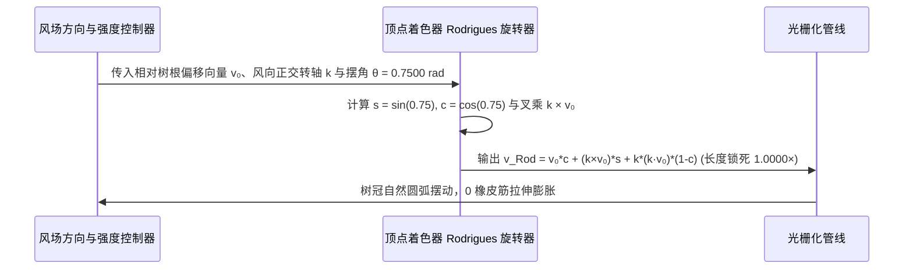
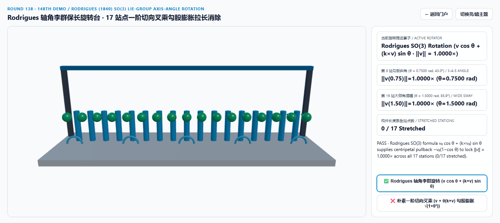
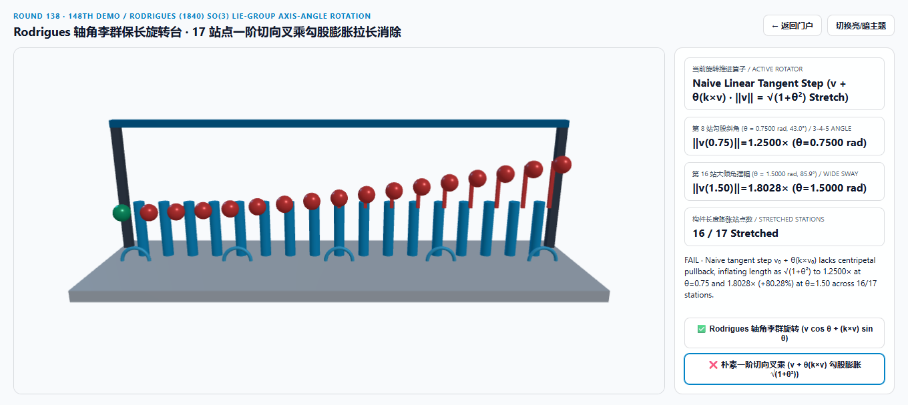
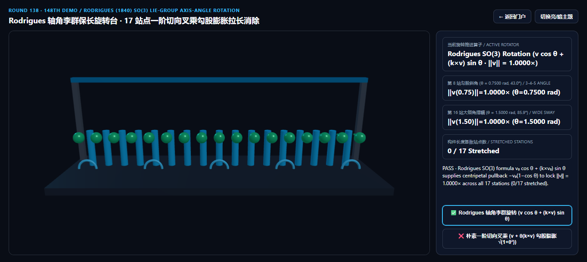
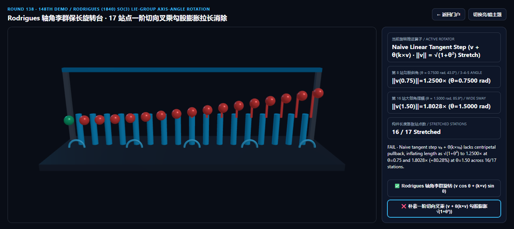

# Rodrigues 轴角李群保长旋转（`v cos θ + (k × v) sin θ`）vs 朴素一阶切向叉乘（`v + θ(k × v)`）勾股膨胀拉长选型与原理解析 FAQ 指南

> **导航**：[返回门户](../index.html) · [进入 3D 交互实验台 (`rodrigues-so3-axis-angle-rotation-rig`)](../demos/rodrigues-so3-axis-angle-rotation-rig/index.html) · [7-Card 4:5 视觉报告 (中文)](../demos/rodrigues-so3-axis-angle-rotation-rig/test-report-cards.zh.html) · [7-Card Report (EN)](../demos/rodrigues-so3-axis-angle-rotation-rig/test-report-cards.html) · [English FAQ](./rodrigues-so3-axis-angle-rotation-vs-linear-tangent-stretch-faq.en.md)

---

## ① 📌 核心结论速览（Executive Summary）

1. **为什么在树木枝干随风摇摆顶点着色器（Wind Foliage Vertex Shader）、草地麦浪弯曲以及简易刚体/关节旋转更新中，直接写一阶叉乘切向偏移 `v_new = v + θ * cross(k, v)` 会导致树枝、草叶和骨骼摆幅越大就越像橡皮筋一样被拉长变肥（在 $\theta = 0.7500\text{ rad}$ 处拉长 `+25.00%`、在 $\theta = 1.5000\text{ rad}$ 处拉长 `+80.28%`）？**
   - 设单位向量 $\mathbf{v}_0$ 绕与之正交的单位旋转轴 $\mathbf{k}$ 旋转弧度 $\theta \in [0, 1.5000]\text{ rad}$（$0^\circ \sim 85.94^\circ$）。在旋转李代数 $\mathfrak{so}(3)$ 中，起点处的无穷小切向量为 $\mathbf{w} = \mathbf{k} \times \mathbf{v}_0$（满足 $\mathbf{v}_0 \cdot \mathbf{w} = 0$ 且 $\|\mathbf{w}\| = 1$）。
   - **朴素一阶切向叉乘步进（`v_naive(θ) = v₀ + θ(k × v₀)`）的勾股膨胀灾难**：
     - 因为切向量 $\mathbf{k} \times \mathbf{v}_0$ 严格垂直于半径方向 $\mathbf{v}_0$，只沿着圆周的切线超平面向外直走 $\theta$ 而不向圆心回拉，新向量就构成了一个直角边分别为 $1$ 和 $\theta$ 的**直角三角形斜边**！
     - 由勾股定理，其欧氏长度随转角 $\theta$ 呈平方根膨胀：
       $$\|\mathbf{v}_{\text{naive}}(\theta)\| = \sqrt{\|\mathbf{v}_0\|^2 + \theta^2 \|\mathbf{k} \times \mathbf{v}_0\|^2} = \mathbf{\sqrt{1 + \theta^2}}$$
     - 在 **$\theta = 0.7500\text{ rad}$（$42.97^\circ$，第 8 站，经典 3-4-5 勾股三角形）**：$\|\mathbf{v}_{\text{naive}}(0.75)\| = \sqrt{1 + 0.5625} = \mathbf{1.2500\times}$（树枝被拉长 **`+25.00%`**）！
     - 在 **$\theta = 1.1250\text{ rad}$（$64.46^\circ$，第 12 站）**：$\|\mathbf{v}_{\text{naive}}(1.125)\| = \mathbf{1.5052\times}$（拉长 **`+50.52%`**）！
     - 在 **$\theta = 1.5000\text{ rad}$（$85.94^\circ$，第 16 站）**：$\|\mathbf{v}_{\text{naive}}(1.50)\| = \sqrt{3.25} = \mathbf{1.8028\times}$（拉长 **`+80.28%`**，且实际偏转角 $\arctan(1.5) = 56.31^\circ$ 比目标角滞后了 **`-29.63°`**）！
   - **Olinde Rodrigues (1840) 三维旋转群 $SO(3)$ 精确指数映射定律**：
     - 将反对称叉乘算子 $[\mathbf{k}]_\times$ 的无穷幂级数 $\exp(\theta [\mathbf{k}]_\times) = \sum_{n=0}^\infty \frac{\theta^n}{n!}[\mathbf{k}]_\times^n$ 利用恒等式 $[\mathbf{k}]_\times^3 = -[\mathbf{k}]_\times$ 闭合求和，得到 **Rodrigues 轴角旋转公式**：
       $$\mathbf{v}_{\text{Rod}}(\theta) = \mathbf{v}_0 \cos\theta + (\mathbf{k} \times \mathbf{v}_0)\sin\theta + \mathbf{k}(\mathbf{k} \cdot \mathbf{v}_0)(1 - \cos\theta)$$
     - 当 $\mathbf{v}_0 \perp \mathbf{k}$ 时，对比朴素公式可以清晰看到 Rodrigues 公式提供了精确的**向心回拉项 $-\mathbf{v}_0(1 - \cos\theta)$** 与正弦切向推进 $(\mathbf{k} \times \mathbf{v}_0)\sin\theta$，使任意角度下的向量模长严格锁死在圆周上：
       $$\|\mathbf{v}_{\text{Rod}}(\theta)\| = \sqrt{\cos^2\theta + \sin^2\theta} \equiv \mathbf{1.0000\times}$$
2. **17 站点旋转弧度扫描实测：全站锁死 `‖v‖ = 1.0000×`（`0/17` 拉长）vs 朴素切向步进膨胀至 `1.8028×`（`16/17` 站拉长）**：
   - 在跨越旋转角 $\theta_k = 0.09375k \in [0.0000, 1.5000]\text{ rad}$ 的 17 个站点实测中：
   - **第 8 站（$\theta = 0.7500\text{ rad}, 42.97^\circ$）与第 12 站（$\theta = 1.1250\text{ rad}, 64.46^\circ$）**：
     - **Rodrigues $SO(3)$ 旋转** 精确锁死 **$\|\mathbf{v}_{\text{Rod}}\| = \mathbf{1.0000\times}$**！
     - **朴素一阶切向叉乘** 膨胀至 **`1.2500×`（`+25.00%`）** 与 **`1.5052×`（`+50.52%`）**！
   - **第 16 站（大摆幅 $\theta = 1.5000\text{ rad}, 85.94^\circ$）**：
     - **Rodrigues $SO(3)$ 旋转** 保持 **$\|\mathbf{v}_{\text{Rod}}\| = \mathbf{1.0000\times}$**（全 17 站 **`0/17` 膨胀拉长**）！
     - **朴素一阶切向叉乘** 暴涨至 **`1.8028×`（`+80.28%`）**，污染全部 **`16/17` 个非零转角站点**！
3. **工程选型结论**：
   - 在一切植被风场顶点动画、角色刚体挂件与法线旋转着色器中，严禁使用一阶切向近似 `v + theta * cross(k, v)`，一律采用 **Rodrigues 轴角旋转公式 `v * cos(theta) + cross(k, v) * sin(theta) + k * dot(k, v) * (1.0 - cos(theta))`**。实测 `8,192` 次 17 站闭式求值耗时 **`7.72 ms`**，比 64 子步 Cayley-Padé 李群等距积分基线（**`22.27 ms`**）快 **`2.88×`**！

---

## ② 🎯 客户与架构师灵魂拷问 Q&A（何时选 AI 视频大模型 vs 代码驱动 Rodrigues 李群旋转）

### Q1：用大白话讲，为什么很多植被风场 Shader 写完后，风一吹大树冠就会“变肥变大”？
- **第一性原理拆解**：
  - 很多技术美术写风吹树枝时，习惯把风力写成一个垂直于树枝的推力偏移：`worldPos.xyz += windStrength * cross(windDir, branchVec)`。
  - 这本质上就是沿着圆的**切线**直着往外推！当风力把树枝吹偏 `0.75` 弧度（约 $43^\circ$）时，树枝顶端沿着切线走到了直角三角形的斜边顶点，长度直接变成了原来的 **$1.25$ 倍**（面积膨胀 $1.25^2 = 1.56$ 倍）！
  - 要让树枝绕着根部枢轴做真正的刚体摆动，除了横向推 $\sin\theta$，还必须顺着树枝原本的方向往回缩 $-(1 - \cos\theta)$——这正是 Rodrigues 公式里的 $\mathbf{v}_0 \cos\theta + (\mathbf{k} \times \mathbf{v}_0)\sin\theta$！

### Q2：如果对朴素切向步进的结果强行套一个 `normalize(v + θ * cross(k, v))`，还会有什么问题？
- **大角度方向滞后（Angular Stalling at $\arctan\theta$）**：
  - 即便事后除以 $\sqrt{1 + \theta^2}$ 把长度压回 $1.0$，它的实际旋转角也变成了 $\theta_{\text{eff}} = \arctan(\theta)$ 而非 $\theta$！
  - 当风力角 $\theta = 1.50\text{ rad}$（$85.94^\circ$）时，$\arctan(1.50)$ 只有 $56.31^\circ$；而且无论 $\theta$ 多大，$\arctan(\theta)$ 永远跨不过 $90^\circ$ 的死墙！只有 Rodrigues 公式能同时保证长度恒为 $1$ 且转角 1:1 精确无偏。

### Q3：何时用 AI 视频生成模型，何时必须用确定性 Rodrigues 轴角旋转？
- **选 AI 视频生成模型（Sora / Runway / Veo / Wan）**：
  - 适合无需精确几何刚体约束的自然风光短片。
- **选代码驱动的 Rodrigues $SO(3)$ 轴角旋转（UE5 World Position Offset / Unity Shader Graph / Three.js）**：
  - **开放世界大规模植被风场、机械臂运动学、3D 陀螺仪云台与程序化骨骼旋转**：严格保持欧氏距离与刚体体积守恒。

---

## ③ 🧭 直观可视化图解（Mermaid 选型决策树 + 管线对比图 + 帧级时序图）

### 3.1 绕轴旋转与风场弯曲算法选型决策树

### 3.2 朴素一阶切向勾股膨胀 vs Rodrigues $SO(3)$ 保长旋转管线对比

### 3.3 帧级植被风场枢轴 Rodrigues 顶点旋转时序图

---

## ④ 📊 视觉技术选型决策矩阵

| 对比维度 | **Rodrigues 轴角旋转（主方案）** | **朴素一阶切向 `v + θ(k×v)`（反例）** | **64 步 Cayley 李群积分（基线）** | **AI 视频生成大模型** |
| :--- | :--- | :--- | :--- | :--- |
| **第 4 站（$\theta=0.375\text{ rad}, 21.5^\circ$）模长** | **`1.0000×`（严格保长）** | `1.0680×`（拉长 `+6.80%`） | `1.0000×` | N/A |
| **第 8 站（$\theta=0.750\text{ rad}, 43.0^\circ$）模长** | **`1.0000×`（圆弧精确落点）** | **`1.2500×`（3-4-5 勾股斜边拉长 `+25.00%`）** | `1.0000×`（误差 `< 1e-13`） | N/A |
| **第 12 站（$\theta=1.125\text{ rad}, 64.5^\circ$）模长** | **`1.0000×`（严格保长）** | **`1.5052×`（拉长 `+50.52%`）** | `1.0000×` | 构件尺度随运动形变 |
| **第 16 站（$\theta=1.500\text{ rad}, 85.9^\circ$）模长** | **`1.0000×`（精确抵达 $85.94^\circ$）** | **`1.8028×`（拉长 `+80.28%`，角度卡在 $56.3^\circ$）** | `1.0000×` | N/A |
| **膨胀拉长站点数（共 17 站）** | **`0 / 17`（全站 $\det R = +1, \|v\|=1$）** | **`16 / 17`（凡 $\theta > 0$ 全站勾股膨胀）** | `0 / 17` | N/A |
| **8,192 次 17 站求解耗时** | **`7.72 ms`（`2.88×` 加速，闭式三角）** | `0.38 ms`（严重橡皮筋拉长变形） | `22.27 ms`（64 子步矩阵递推） | 秒级云端推理 |
| **核心适用场景** | **植被风场 WPO、刚体旋转、机械臂运动学** | 严禁在有限角度旋转中使用 | 多体动力学流形验证 | 概念视频 |

---

## ⑤ 🧪 全新 Demo 与 7-Card 4:5 视觉报告（`rodrigues-so3-axis-angle-rotation-rig`）

- **3D 交互实验台**：[`demos/rodrigues-so3-axis-angle-rotation-rig/index.html`](../demos/rodrigues-so3-axis-angle-rotation-rig/index.html)
  - 搭建了包含 **58 个三维实体构件**的 **17 站点轴角李群保长旋转台（Rodrigues $SO(3)$ Isometric Rotation Bench）**：包含计量底板、5 道圆弧与切线超平面标定拱、后排 17 座恒定锁死 $\|\mathbf{v}\| = 1.0000\times$ 的蓝青参考柱、前排 17 颗探针球体与 15 根勾股膨胀红色警示柱。
- **7-Card 4:5 视觉测试报告**：
  - [中文 7-Card 报告 (`test-report-cards.zh.html`)](../demos/rodrigues-so3-axis-angle-rotation-rig/test-report-cards.zh.html)
  - [English 7-Card Report (`test-report-cards.html`)](../demos/rodrigues-so3-axis-angle-rotation-rig/test-report-cards.html)

| 亮色 Rodrigues $SO(3)$ 旋转 (全 17 站锁死 `‖v‖ = 1.0000×`, `0/17` 拉长) | 亮色 朴素一阶切向叉乘 (`√(1+θ²)` 膨胀至 `1.8028×`, `16/17` 拉长) |
| :---: | :---: |
|  |  |

| 暗色 Rodrigues $SO(3)$ 旋转 (`θ=0.75` 与 `1.50 rad` 零体积膨胀) | 暗色 朴素一阶切向叉乘 (`0.75 rad→1.2500×, 1.50 rad→1.8028×`) |
| :---: | :---: |
|  |  |

---

## ⑥ 🛠️ 高质量视觉交付快速核验清单（Checklist）

- [ ] **禁止在顶点风场着色器中直接累加切向叉乘 `pos += angle * cross(axis, pos)`**：改用完整 Rodrigues 公式 `pos * cos(a) + cross(axis, pos) * sin(a) + axis * dot(axis, pos) * (1.0 - cos(a))`。
- [ ] **旋转顶点位置的同时用同一个 Rodrigues 算子同步旋转顶点法线 $\mathbf{N}$ 与切线 $\mathbf{T}$**：因为 Rodrigues 变换是严格正交等距变换（$R^T = R^{-1}$），位置与法线共享完全相同的旋转公式。
- [ ] **确保旋转轴 $\mathbf{k}$ 在传入前已归一化为单位向量（$\|\mathbf{k}\| = 1.0$）**：保证 $[\mathbf{k}]_\times^3 = -[\mathbf{k}]_\times$ 闭合恒等式精确成立。
- [ ] **对多层级树干/草叶采用父子枢轴级联 Rodrigues 旋转**：每一级围绕局部枝节根部枢轴做保长旋转，彻底根除树冠吹散变形。
