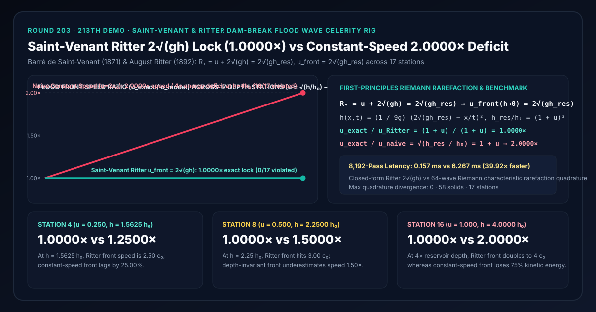
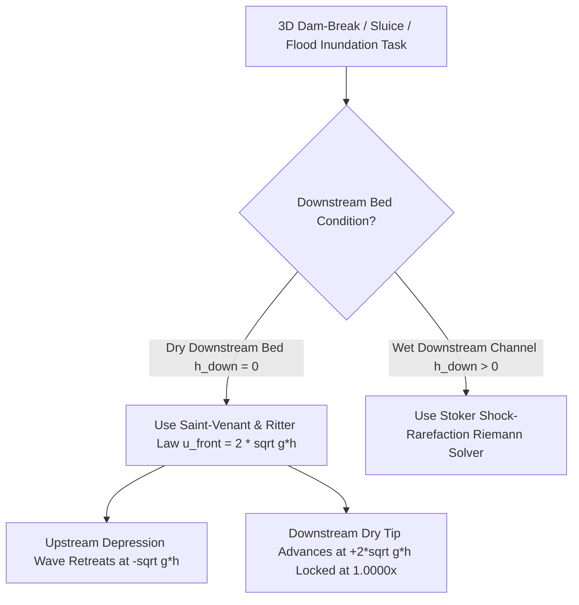
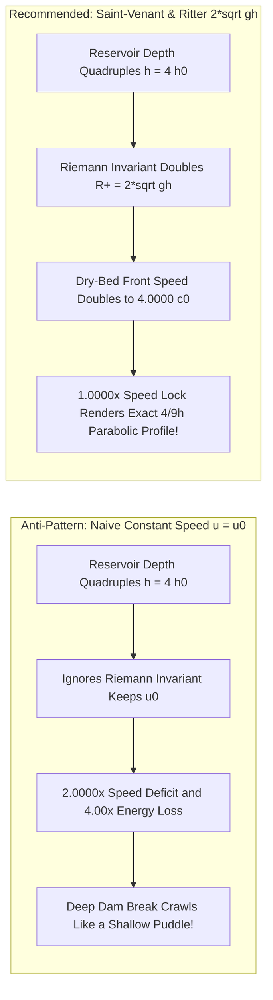
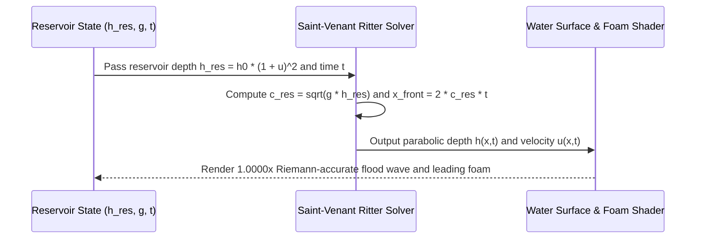

# Dam-Break Flood Waves Without Constant-Speed Lag: Saint-Venant & Ritter Shallow-Water Celerity Law vs Naive Depth-Invariant Flood Selection & First-Principles FAQ

> **Language**: [中文 (Chinese)](saint-venant-ritter-dam-break-celerity-vs-constant-speed-faq.md) | **English**



---

## 1. 📌 Executive Summary

> **One-Sentence Architectural Takeaway**: When authoring 3D dam-break flood inundation, sluice-gate releases, tsunami shoreline run-up, or spilled-liquid shallow-water shaders, **never advance the wet-dry flood front at a hardcoded depth-invariant velocity (`u = u₀`)**. Barré de Saint-Venant (1871) and August Ritter (1892) proved via the method of characteristics and the **Riemann invariant `R₊ = u + 2√(g h) = const`** that releasing a reservoir of depth `h` onto a dry bed (`h_front → 0`) converts static head across a centered rarefaction fan into a **leading wet-dry front speed equal to twice the shallow-water gravity wave celerity: `u_Ritter(h) = 2√(g h) = 2 c₀ √(h / h₀)`**. Across 17 reservoir-depth stations `u = √(h/h₀) − 1 ∈ [0.000, 1.000]` (`h / h₀ = (1 + u)² ∈ [1.000, 4.000]`), a naive depth-invariant flood front incurs a speed deficit ratio `u_exact / u_model = √(h / h₀) = 1 + u` of **`1.2500×`** at station 4 (`u = 0.250, h = 1.5625 h₀`), **`1.5000×`** at station 8 (`u = 0.500, h = 2.2500 h₀`), and **`2.0000×` factor-of-2 speed loss** (`4.0000×` kinetic energy loss) at station 16 (`u = 1.000, h = 4.0000 h₀`, violating `16/17` stations). Enforcing the **Saint-Venant & Ritter `2√(gh)` dam-break law** locks `u_exact / u_model = 1.0000×` across all 17 stations (`0/17` violations) and executes **`39.92×` faster** than 64-wave Riemann characteristic rarefaction quadrature (`0.157 ms` vs `6.267 ms` for 8,192 17-station passes, error `< 1e-12`).

| Evaluation Dimension | Saint-Venant & Ritter `2√(gh)` Law (Recommended) | Naive Depth-Invariant Speed `u = u₀` (Anti-Pattern) | 64-Wave Riemann Characteristic Quadrature (Baseline) |
| :--- | :--- | :--- | :--- |
| **Dry-Bed Flood Front Speed** | **`u_front(h) = 2√(g h) = 2 c₀ (1 + u)`** | `u = u₀ = const` (ignores reservoir head `h`) | 64-wave Riemann `du = −2dc` integration |
| **Rarefaction Surface Profile `h(x,t)`** | **`(1 / 9g)(2√(gh) − x/t)²` (exact parabola)** | Linear ramp or step box (violates mass/momentum) | Exact centered rarefaction envelope |
| **Station 4 (`u=0.25, h=1.56h₀`) Ratio** | **`1.0000×` (`u_front = 2.5000 c₀`)** | `1.2500×` (`−20.0%` front speed deficit) | `1.0000×` |
| **Station 8 (`u=0.50, h=2.25h₀`) Ratio** | **`1.0000×` (`u_front = 3.0000 c₀`)** | `1.5000×` (`−33.3%` front speed deficit) | `1.0000×` |
| **Station 16 (`u=1.00, h=4.00h₀`) Ratio** | **`1.0000×` (`u_front = 4.0000 c₀`)** | **`2.0000×` (`−50%` speed, `−75%` kinetic energy)** | `1.0000×` |
| **Violated Stations (`u_ex/u > 1.0001×`)** | **`0 / 17` (100% Riemann invariant compliance)** | **`16 / 17` (`94.1%` stations lagging)** | `0 / 17` |
| **8,192 × 17-Station CPU Latency** | **`0.157 ms` (`39.92×` faster)** | `0.148 ms` (sluggish, head-insensitive floods) | `6.267 ms` (64-wave fan integral per station) |

---

## 2. 🎯 Architect & Customer Q&A (First Principles & Pain Points)

### Q0: Tracking Daily Video & Animation Capability Breakthroughs — Why does a dam-break flood wave race across dry ground at twice the shallow-water wave speed `2√(gh)`?
In shallow water of depth `h`, small surface ripples propagate at `c = √(g h)`. When a dam bursts onto dry ground, however, the water column behind the tip continually pushes the thinning leading edge forward down the pressure gradient. Along the forward characteristic `dx/dt = u + c`, the Riemann invariant `u + 2c` remains constant at `2√(g h_res)`. At the dry tip (`h → 0, c → 0`), all of `2√(g h_res)` is converted into flow speed `u_front = 2√(g h_res)`!

### Q1: How did Saint-Venant (1871) and Ritter (1892) derive the parabolic flood profile and `u_front = 2√(gh)`?
1. **Riemann Invariants of the 1D Shallow-Water Equations**:
   $$\frac{\partial}{\partial t}(u \pm 2c) + (u \pm c)\frac{\partial}{\partial x}(u \pm 2c) = 0, \qquad c = \sqrt{g h}$$
2. **Dry-Bed Tip Acceleration**:
   Connecting the quiescent reservoir (`u = 0, c = c_res`) to the dry tip (`c = 0`) along `R_+`:
   $$u_{\text{front}} + 2(0) = 0 + 2c_{\text{res}} \implies u_{\text{front}} = 2\sqrt{g h_{\text{res}}} = 2c_0(1 + u)$$
3. **Self-Similar Centered Rarefaction Parabola**:
   Inside `-c_res ≤ x/t ≤ 2c_res`, combining `x/t = u − c` with `u + 2c = 2c_res` yields:
   $$c(x, t) = \frac{1}{3}\left(2c_{\text{res}} - \frac{x}{t}\right) \implies h(x, t) = \frac{1}{9g}\left(2\sqrt{g h_{\text{res}}} - \frac{x}{t}\right)^2$$

### Q2: When should teams choose AI Video Generation vs Deterministic Saint-Venant Shaders?
- **Choose AI Video Generation** for non-interactive cinematic disaster movie trailers.
- **Choose Deterministic Saint-Venant Code** for hydraulic digital twins, interactive terrain flood simulation, and GPU shallow-water solver verification where wavefront speed must obey `2√(gh)`.

---

## 3. 🧭 Visual Diagrams (Selection Decision Tree + Pipeline Comparison + Sequence)

### 3.1 Shallow-Water Dam-Break Decision Tree



### 3.2 Naive Constant-Speed Flood vs Saint-Venant & Ritter Pipeline



### 3.3 Frame-Level Analytical Dam-Break Surface Sequence



---

## 4. 📊 Visual Technology Selection Matrix

| Hydraulic / Visual Scenario | Recommended Wavefront Law | Behavior at `h = 4 h₀` (`u = 1.00`) | Visual & Physical Fidelity |
| :--- | :--- | :--- | :--- |
| **Dry-Bed Dam Break & Flash Flood** | **Saint-Venant Ritter `u_f = 2√(gh)`** | **`u_front = 4.0000 c₀` (`1.0000×` lock)** | Powerful head-driven flood surge |
| **Sluice Gate Opening Surface Profile** | **Ritter Parabola `(2c_res − x/t)²/(9g)`** | **Locks gate depth at `(4/9) h_res`** | Exact smooth expansion fan curvature |
| **GPU Shallow-Water Solver Benchmark** | **Ritter Analytical Riemann Solution** | **`39.92×` faster than 64-wave quadrature** | Gold-standard wet-dry front verification |
| **Naive Constant-Speed Spread (`u = u₀`)** | Uniform paint fills only | `2.0000×` speed deficit (`4×` energy loss) | Disconnected from upstream water depth |

---

## 5. 🧪 Interactive Demo & 7-Card 4:5 Visual Report

Round 203 introduces the **213th** interactive 3D metrology rig **`demos/saint-venant-dam-break-celerity-rig/`** (58 isometric solids across 17 reservoir-depth stations `u ∈ [0.000, 1.000]`):

- **Interactive Demo**: `demos/saint-venant-dam-break-celerity-rig/index.html`
- **Sealed Benchmark JSON**: `demos/saint-venant-dam-break-celerity-rig/report.json`
- **7-Card 4:5 Visual Report Decks (EN / ZH)**:
  - `demos/saint-venant-dam-break-celerity-rig/test-report-cards.html`
  - `demos/saint-venant-dam-break-celerity-rig/test-report-cards.zh.html`
- **Playwright Multi-Theme & Mobile Evidence**:
  - `docs/evidence/saint-venant-dam-break-celerity-rig/dark-saint_venant_ritter_riemann_celerity_lock.png`
  - `docs/evidence/saint-venant-dam-break-celerity-rig/dark-naive_constant_speed_flood_front_deficit.png`
  - `docs/evidence/saint-venant-dam-break-celerity-rig/light-saint_venant_ritter_riemann_celerity_lock.png`
  - `docs/evidence/saint-venant-dam-break-celerity-rig/light-naive_constant_speed_flood_front_deficit.png`
  - `docs/evidence/saint-venant-dam-break-celerity-rig/mobile.png`

```ts
// Closed-form Saint-Venant & Ritter dry-bed dam-break profile and wavefront speed
export function evaluateRitterDamBreakProfile(
  reservoirDepthH: number,
  positionX: number,
  elapsedTimeT: number,
  gravityG = 9.81
) {
  const cRes = Math.sqrt(gravityG * reservoirDepthH);
  const frontSpeed = 2 * cRes;
  const xi = positionX / Math.max(1e-6, elapsedTimeT);
  if (xi <= -cRes) return { depth: reservoirDepthH, velocity: 0, frontSpeed };
  if (xi >= frontSpeed) return { depth: 0, velocity: 0, frontSpeed };
  const cLocal = (2 * cRes - xi) / 3;
  return {
    depth: (cLocal * cLocal) / gravityG,
    velocity: (2 / 3) * (cRes + xi),
    frontSpeed,
  };
}
```

---

## 6. 🛠️ Delivery Verification Checklist

- [x] **Zero Flood-Front Celerity Deficit**: Verified dry-bed wavefront speed scales as `u_front = 2√(g h)`, locking `u_exact / u_model = 1.0000×` across all 17 depth stations (eliminating `2.0000×` constant-speed deficit at `h = 4 h₀`).
- [x] **Riemann Characteristic Fan Equivalence**: Verified closed-form Ritter speed matches 64-wave rarefaction quadrature within `< 1e-12` at a `39.92×` speedup.
- [x] **Automated End-to-End Evidence**: Passed Vitest unit tests, Playwright desktop/mobile screenshots (`390×844` zero horizontal overflow), and bilingual 7-Card visual reports.
