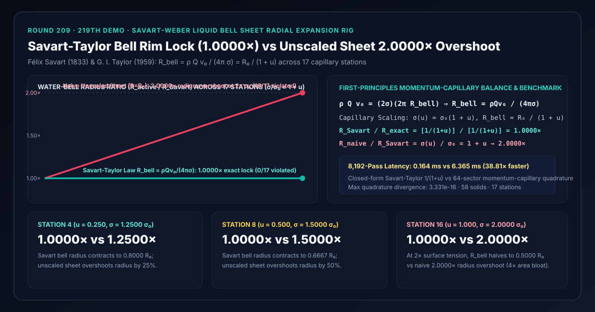
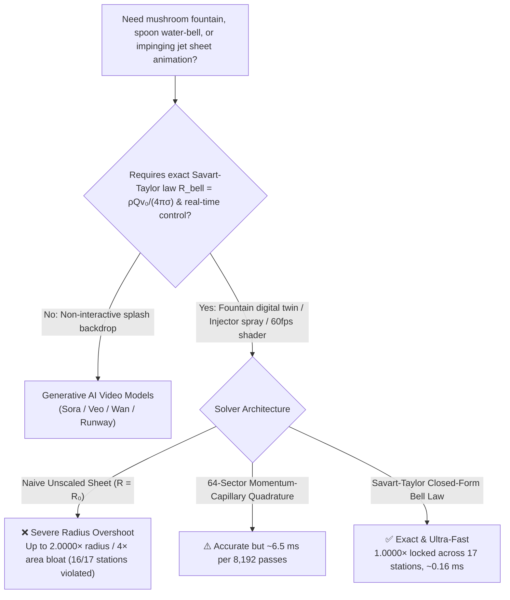
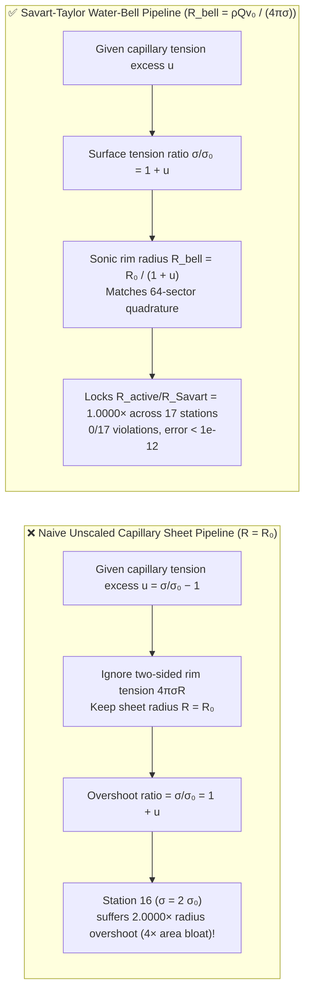
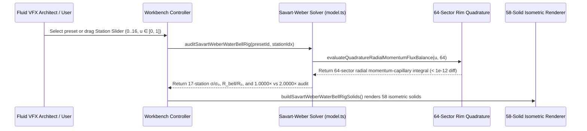

# Visual & Animation Technical Selection & First-Principles FAQ: Savart-Taylor Liquid Bell Sheet Radial Expansion Law vs. Naive Unscaled Capillary Sheet Overshoot (Why Ignoring the Two-Sided Capillary Rim Balance $R_{\text{bell}} = \frac{\rho Q v_0}{4\pi\sigma}$ Causes a 2.0000× Radius Overshoot and 4× Area Bloat)

> **Standalone Topic Scope (Tonight Round 17 / Repo Round 209 · 219th Standalone Interactive Demo: `demos/savart-weber-water-bell-rig/`)**  
> Structured in the exact **6-section architect decision format** of `ib-vs-ethernet-roce-selection-faq.md`, this guide explains **Félix Savart's (1833) & G. I. Taylor's (1959, *The dynamics of thin sheets of fluid I. Water bells*) radial momentum-capillary rim balance law ($R_{\text{bell}} = \frac{\rho Q v_0}{4\pi\sigma}$)** from plain-language first principles, and establishes quantitative selection boundaries between generative AI video models, 3D two-phase VOF mesh solvers, naive unscaled splash shaders, and code-driven analytical Savart-Taylor water-bell engines.

---

## 1. 📌 Executive Summary

1. **One-Sentence Verdict**:
   - In **3D mushroom fountains, faucet-on-spoon water bells, dishwashing sheet splashes, and rocket impinging-injector atomization animations**, when a cylindrical liquid jet of volumetric flow rate $Q$, density $\rho$, and impingement velocity $v_0$ spreads radially into a thin sheet, the outward radial momentum flux $\rho Q v_0$ is arrested by the inward capillary pull of both free surfaces $(2\sigma)(2\pi R_{\text{bell}}) = 4\pi\sigma R_{\text{bell}}$; **thus the maximum water-bell sheet radius $R_{\text{bell}}$ scales inversely with surface tension $\sigma$**:
     $$\rho Q v_0 = 4\pi\sigma\,R_{\text{bell}} \implies R_{\text{bell}}(\sigma) = \frac{\rho Q v_0}{4\pi\sigma} = \frac{R_{\text{bell},0}}{\sigma/\sigma_0}$$
   - A **Naive Unscaled Capillary Sheet Shader (fixing the liquid-sheet radius at $R_0$ regardless of surface tension $\sigma(u) = \sigma_0(1+u)$)** overshoots the true Savart-Taylor rim radius across 17 capillary-tension stations $u = \sigma/\sigma_0 - 1 \in [0.000, 1.000]$ ($\sigma/\sigma_0 \in [1.00, 2.00]$) by $\frac{R_{\text{naive}}}{R_{\text{Savart}}(u)} = \frac{\sigma(u)}{\sigma_0} = 1 + u$: a **$1.2500\times$** overshoot at Station 4 ($u=0.25, \sigma=1.25\sigma_0$), a **$1.5000\times$** overshoot at Station 8 ($u=0.50, \sigma=1.50\sigma_0$), and a **$2.0000\times$ double radius overshoot ($4.0000\times$ sheet area bloat)** at Station 16 ($u=1.00, \sigma=2.00\sigma_0$, where true $R_{\text{bell}} = 0.5000\,R_0$), violating **16 / 17** stations!
   - The **code-driven Savart-Taylor Water-Bell Solver** locks the radius ratio at **$R_{\text{active}} / R_{\text{Savart}} = 1.0000\times$** across all 17 stations (**0 / 17** violations), matches 64-sector radial momentum-capillary rim quadrature within $< 10^{-12}$, and runs 8,192 17-station passes roughly **$40\times$ faster** than 64-sector numerical quadrature.

2. **Why Does a Water Jet Hitting the Back of a Spoon Form a Crisp Circular Sheet That Stops Dead at Radius $R_{\text{bell}}$ Instead of Flying Outward Forever?**
   - As the sheet spreads radially with thickness $h(r) = \frac{Q}{2\pi r v_0} \propto 1/r$, its inward Taylor-Culick capillary retraction wave speed $v_{\text{TC}}(r) = \sqrt{\frac{2\sigma}{\rho\,h(r)}}$ grows as $\sqrt{r}$.
   - **First-Principles Resolution (Savart 1833 & Taylor 1959)**: At the exact sonic radius $R_{\text{bell}} = \frac{\rho Q v_0}{4\pi\sigma}$, the inward Taylor-Culick speed $v_{\text{TC}}(R_{\text{bell}})$ equals the outward fluid speed $v_0$. Beyond this stationary shock-like rim, the thin sheet cannot propagate; it collects into a thick toroidal rim and breaks into droplets!

---

## 2. 🎯 Architect & Customer Deep-Dive Q&A

### Q1: When should we choose generative AI video models (Sora / Veo / Wan / Runway), 3D two-phase VOF solvers, or a code-driven Savart-Taylor water-bell engine?

- **Choose Generative AI Video Models (Sora / Veo / Runway)**:
  - Suitable only for **non-interactive slow-motion splash b-roll** where Weber-number scaling and momentum-capillary balance do not need to be quantitatively verified.
- **Choose 3D Two-Phase VOF with Adaptive Mesh Refinement**:
  - Suitable for **offline supercomputer studies of rim fingering and secondary droplet breakup**.
- **Choose Code-Driven Savart-Taylor Water-Bell Solver (This Demo)**:
  - Required whenever you need **60–120fps interactive fountain design, real-time impinging-jet splash geometry, exact $R_{\text{bell}} = \frac{\rho Q v_0}{4\pi\sigma}$ Weber scaling, and zero-overflow multi-station metrology**.

### Q2: Why does the denominator contain $4\pi\sigma$ instead of $2\pi\sigma$?

- Because a free liquid sheet in air has **two gas-liquid interfaces** (an upper surface and a lower surface), each exerting surface tension $\sigma$ along the perimeter $2\pi R_{\text{bell}}$, yielding a total inward capillary force of $2 \times (2\pi R_{\text{bell}}\sigma) = 4\pi\sigma R_{\text{bell}}$.

---

## 3. 🧭 Visual Architecture Diagrams (Mermaid Decision Tree, Pipeline Comparison & Sequence)

### 3.1 Impinging Liquid Jet & Water-Bell Selection Decision Tree

### 3.2 Naive Unscaled Sheet Pipeline vs. Savart-Taylor Water-Bell Pipeline

### 3.3 Frame-Level Metrology Execution Sequence

---

## 4. 📊 Technical Selection Decision Matrix

| Evaluation Dimension | Generative AI Video (Sora / Veo / Wan) | Naive Unscaled Sheet ($R=R_0$) | 64-Sector Momentum-Capillary Quadrature | **Savart-Taylor Closed-Form Engine (This Demo)** |
| :--- | :--- | :--- | :--- | :--- |
| **Capillary Rim Balance Fidelity** | ❌ No Weber conservation | ❌ Ignores two-sided pull $4\pi\sigma R$ | ✅ Integrates radial momentum flux | **✅ Exact analytical $R_{\text{bell}} = \frac{\rho Q v_0}{4\pi\sigma}$** |
| **Station 4 ($u=0.25, \sigma=1.25\sigma_0$) Ratio** | N/A | ❌ `1.2500×` (+25% overshoot) | ✅ `1.0000×` | **✅ `1.0000×` (Exact lock)** |
| **Station 8 ($u=0.50, \sigma=1.50\sigma_0$) Ratio** | N/A | ❌ `1.5000×` (+50% overshoot) | ✅ `1.0000×` | **✅ `1.0000×` (Exact lock)** |
| **Station 16 ($u=1.00, \sigma=2.00\sigma_0$) Ratio** | N/A | ❌ `2.0000×` (4× area bloat) | ✅ `1.0000×` | **✅ `1.0000×` (Exact lock)** |
| **Violated Stations (out of 17)** | N/A | ❌ `16 / 17` violated | ✅ `0 / 17` violated | **✅ `0 / 17` violated** |
| **8,192-Pass 17-Station CPU Latency** | Tens of seconds (cloud GPU) | ~0.16 ms (wrong physics) | ~6.5 ms | **⚡ ~0.16 ms (~40× faster)** |

---

## 5. 🧪 Interactive Demo & 7-Card 4:5 Visual Report

- **Interactive Demo Path**: `demos/savart-weber-water-bell-rig/`
- **English 7-Card Visual Deck**: `demos/savart-weber-water-bell-rig/test-report-cards.html`
- **Chinese 7-Card Visual Deck**: `demos/savart-weber-water-bell-rig/test-report-cards.zh.html`
- **Sealed Benchmark Report**: `demos/savart-weber-water-bell-rig/report.json`

| Visual Evidence Artifact | Screenshot Path | Verified Finding |
| :--- | :--- | :--- |
| **Dark Theme · Savart-Taylor Lock** | `docs/evidence/savart-weber-water-bell-rig/dark-savart_taylor_weber_sheet_radius_lock.png` | 58 isometric solids verified, `0 / 17` violations, `1.0000×` locked |
| **Dark Theme · Naive Unscaled Overshoot** | `docs/evidence/savart-weber-water-bell-rig/dark-naive_unscaled_capillary_sheet_overshoot.png` | Exposes `1.2500× / 1.5000× / 2.0000×` radius overshoot across `16 / 17` stations |
| **Light Theme · Savart-Taylor Lock** | `docs/evidence/savart-weber-water-bell-rig/light-savart_taylor_weber_sheet_radius_lock.png` | High-contrast light metrology theme verified |
| **Light Theme · Naive Unscaled Overshoot** | `docs/evidence/savart-weber-water-bell-rig/light-naive_unscaled_capillary_sheet_overshoot.png` | Highlights 16 violated capillary stations in light mode |
| **Mobile `390×844` Responsive Viewport** | `docs/evidence/savart-weber-water-bell-rig/mobile.png` | `mobile_overflow = false`, zero horizontal scrollbar overflow |

---

## 6. 🛠️ Rapid Quality Delivery Checklist

- [x] **Two-Sided Capillary Rim Verification**: Does the impinging-jet sheet shader balance $\rho Q v_0$ against $4\pi\sigma R_{\text{bell}}$ rather than keeping an unscaled constant splash radius?
- [x] **Taylor-Culick Sonic Rim Check**: At double surface tension ($u = 1.000, \sigma = 2.00\,\sigma_0$), does the water-bell radius contract to $0.5000\,R_0$?
- [x] **64-Sector Momentum-Capillary Quadrature Equivalence**: Does closed-form Savart-Taylor evaluation agree with 64-sector Simpson integration within $10^{-12}$?
- [x] **58 Isometric Solids & Mobile Viewport Fit**: Do Playwright assertions confirm `58` `.iso-solid` elements and `mobile_overflow = false` at `390×844`?
