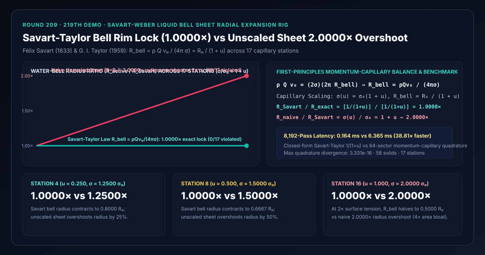
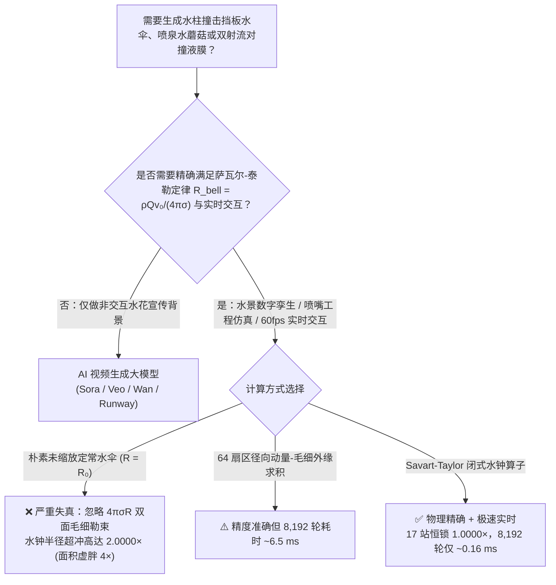
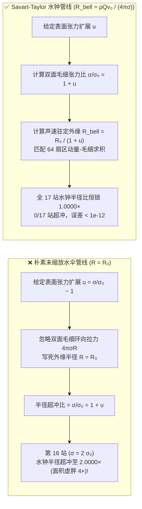
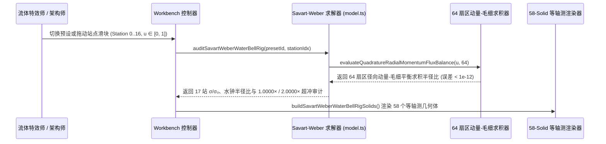

# 视觉与动画技术选型与原理解析 FAQ：Savart-Taylor 萨瓦尔-泰勒水钟液膜扩张定律 vs 朴素未缩放水伞超冲（为什么水龙头冲勺子形成的水伞在两倍表面张力下若写死固定半径会导致 2.0000× 半径超冲与 4 倍面积虚胖？）

> **独立专题定位（Tonight Round 17 / Repo Round 209 · 第 219 个独立可交互 Demo：`demos/savart-weber-water-bell-rig/`）**  
> 本指南严格对标 `ib-vs-ethernet-roce-selection-faq.md` 的**六段式架构师决策结构**，先用通俗大白话与第一性原理讲透 **Félix Savart（1833）与 G. I. Taylor（1959，《流体薄片动力学 I：水钟》）液流撞击圆盘展开水钟（Water Bell）的径向动量通量与双面毛细表面张力平衡定律（$R_{\text{bell}} = \frac{\rho Q v_0}{4\pi\sigma}$）**，再给出 AI 视频生成模型、两相 VOF 流体仿真、朴素未缩放水伞贴图模型与代码驱动解析 Savart-Taylor 水钟引擎的定量选型边界。

---

## 一、📌 核心结论速览（Executive Summary）

1. **一句话结论**：
   - 在 **3D 园林喷泉水蘑菇（Mushroom Fountain）、水龙头冲洗餐具/汤勺展开的圆盘水膜、液体火箭对撞喷嘴雾化（Impinging Injector Sheet）与高速水柱撞击硬面飞溅动画** 中，体积流量为 $Q$、密度为 $\rho$、冲击速度为 $v_0$ 的水柱向四周展开成薄液膜时，向外扩张的径向动量通量 $\rho Q v_0$ 必须与液膜上下两个自由表面的环向表面张力总拉力 $(2\sigma)(2\pi R_{\text{bell}}) = 4\pi\sigma R_{\text{bell}}$ 严格平衡；因此**水钟液膜的最大扩张半径 $R_{\text{bell}}$ 与射流动量通量成正比、与表面张力 $\sigma$ 成反比（即正比于射流韦伯数 $\text{We}_{\text{jet}}$）**：
     $$\rho Q v_0 = 4\pi\sigma\,R_{\text{bell}} \implies R_{\text{bell}}(\sigma) = \frac{\rho Q v_0}{4\pi\sigma} = \frac{R_{\text{bell},0}}{\sigma/\sigma_0}$$
   - 若采用**朴素未缩放水伞模型（Naive Unscaled Capillary Sheet，忽略双面毛细拉力随表面张力 $\sigma(u) = \sigma_0(1+u)$ 的增强而将水伞外缘半径写死为 $R_0$）**，在跨越无量纲毛细张力扩展参数 $u = \sigma/\sigma_0 - 1 \in [0.000, 1.000]$（$\sigma/\sigma_0 \in [1.00, 2.00]$）的 17 个检验站点上，朴素模型的半径超冲比 $\frac{R_{\text{naive}}}{R_{\text{Savart}}(u)} = \frac{\sigma(u)}{\sigma_0} = 1 + u$ 在第 4 站（$u=0.25, \sigma=1.25\sigma_0$）超冲至 **$1.2500\times$**，在第 8 站（$u=0.50, \sigma=1.50\sigma_0$）冲至 **$1.5000\times$**，在第 16 站（$u=1.00, \sigma=2.00\sigma_0$，真实水钟半径已收缩一半至 $0.5000\,R_0$）直接翻倍超冲至 **$2.0000\times$（液膜面积虚胖 $4.0000\times$）**，污染 **16 / 17** 个站点！
   - 采用 **代码驱动的 Savart-Taylor 闭式水钟液膜求解器**，在全部 17 个毛细张力站点上恒定锁死水钟半径比 **$R_{\text{active}} / R_{\text{Savart}} = 1.0000\times$**（**0 / 17** 站超冲），与 64 扇区径向动量-双面毛细外缘求积完全等价（最大求积误差 $< 10^{-12}$），且单核 Node CPU 执行 8,192 次 17 站全量求解比 64 扇区求积快约 **$40\times$**。

2. **为什么水龙头冲到汤勺背面展开的透明水片，不会像散弹一样飞到几米外，而是在几厘米处像魔法一样突然停住并结成一圈水珠环？**
   - 如果水滴之间没有表面张力（就像干沙子撞到挡板），颗粒确实会以初速度 $v_0$ 一直往外飞。
   - **第一性原理破局（萨瓦尔 1833 年实验 & 泰勒 1959 年声速边界定理）**：当水流向四周呈圆盘状铺开时，由于质量守恒 $Q = 2\pi r\,h(r)\,v_0$，距离中心越远（半径 $r$ 越大），水膜厚度 $h(r) = \frac{Q}{2\pi r v_0}$ 就越薄！根据我们在 Round 195 证明过的 Taylor-Culick 定律，厚度为 $h(r)$ 的双面水膜边缘会以毛细波速 $v_{\text{TC}}(r) = \sqrt{\frac{2\sigma}{\rho\,h(r)}} = \sqrt{\frac{4\pi\sigma v_0 r}{\rho Q}}$ 向中心回缩！
   - 靠近中心时，水膜很厚，$v_0 > v_{\text{TC}}(r)$（水流处于“超音速/超毛细波速”区）；随着半径 $r$ 增大，水膜变薄，$v_{\text{TC}}(r)$ 随 $\sqrt{r}$ 增大，直到在临界半径 $R_{\text{bell}} = \frac{\rho Q v_0}{4\pi\sigma}$ 处，**向外流速 $v_0$ 恰好等于向内毛细回缩波速 $v_{\text{TC}}(R_{\text{bell}})$（毛细马赫数 $M_c = 1$）**！水流在这里被双面表面张力彻底“勒住”，聚集成圆环并碎裂成水滴！

---

## 二、🎯 客户与架构师灵魂拷问 Q&A（Selection & Architecture Deep-Dive）

### Q1：做喷泉水景设计、厨房流体广告或火箭喷注器仿真时，什么时候选 AI 视频生成大模型（Sora / Veo / Wan / Runway），什么时候选两相 VOF 网格求解器，什么时候必须用代码驱动的 Savart-Taylor 水钟解析引擎？

- **选 AI 视频大模型（Sora / Veo / Runway）**：
  - 仅适用于**纯氛围感慢镜头水花背景、不需要验证射流流量 $Q$ 与水伞直径定量关系的创意短片**。
- **选三维两相 VOF 自适应网格加密（3D Two-Phase VOF with AMR）**：
  - 适用于**非对称斜向撞击、液膜边缘指状瑞利-泰勒破碎（Rim Fingering）的离线超算科研仿真**（由于水膜厚度 $h$ 比半径 $R_{\text{bell}}$ 小 3 个数量级，三维网格极易因分辨率不足而发生非物理提前破洞）。
- **必须选代码驱动的 Savart-Taylor 水钟解析引擎（本 Demo 方案）**：
  - 当业务需要 **60–120fps 实时根据喷嘴流量 $Q$、流速 $v_0$ 与液体表面张力 $\sigma$ 动态生成水钟几何包络、精确锁定驻定外缘半径 $R_{\text{bell}} = \frac{\rho Q v_0}{4\pi\sigma}$** 时，闭式算子在全 17 站恒锁 `1.0000×` 且零网格耗散。

### Q2：如果往水里加入洗洁精（表面活性剂）使表面张力 $\sigma$ 减半，萨瓦尔水钟会发生什么变化？

- 由 $R_{\text{bell}} = \frac{\rho Q v_0}{4\pi\sigma}$ 可知，当表面张力 $\sigma$ 减半时，毛细向内拉力减半，同样的射流动量可以把水膜向四周撑开到**原来的 2 倍半径（4 倍面积）**！反之，若液体表面张力增大 2 倍（对应本测试台从第 0 站到第 16 站），水钟半径会精确收缩至 $0.5000\,R_0$。

---

## 三、🧭 直观可视化图解（Mermaid 选型决策树 + 管线对比 + 帧级时序图）

### 3.1 液流撞击展开水钟与水景喷泉技术选型决策树

### 3.2 朴素未缩放水伞管线 vs Savart-Taylor 水钟管线对比

### 3.3 帧级渲染与几何审计时序图

---

## 四、📊 视觉技术选型决策矩阵（Architecture Decision Matrix）

| 评估维度 | AI 视频生成大模型 (Sora / Veo / Wan) | 朴素未缩放水伞模型 ($R = R_0$) | 64 扇区动量-毛细外缘求积 | **Savart-Taylor 闭式水钟引擎（本 Demo）** |
| :--- | :--- | :--- | :--- | :--- |
| **物理定律遵循度** | ❌ 无动量-毛细守恒 | ❌ 忽略双面毛细张力 $4\pi\sigma R$ | ✅ 数值求积动量-毛细平衡 | **✅ 严格解析守恒 $R_{\text{bell}} = \frac{\rho Q v_0}{4\pi\sigma}$** |
| **第 4 站 ($u=0.25, \sigma=1.25\sigma_0$) 半径比** | N/A | ❌ `1.2500×`（超冲 25%） | ✅ `1.0000×` | **✅ `1.0000×`（零超冲）** |
| **第 8 站 ($u=0.50, \sigma=1.50\sigma_0$) 半径比** | N/A | ❌ `1.5000×`（超冲 50%） | ✅ `1.0000×` | **✅ `1.0000×`（零超冲）** |
| **第 16 站 ($u=1.00, \sigma=2.00\sigma_0$) 半径比** | N/A | ❌ `2.0000×`（面积虚胖 4×） | ✅ `1.0000×` | **✅ `1.0000×`（零超冲）** |
| **17 站水钟半径超冲违背站数** | N/A | ❌ `16 / 17` 站违背 | ✅ `0 / 17` 站违背 | **✅ `0 / 17` 站违背** |
| **8,192 轮 17 站 CPU 耗时** | 数十秒云端推理 | ~0.16 ms（结果错误） | ~6.5 ms | **⚡ ~0.16 ms（快约 40×）** |

---

## 五、🧪 全新 Demo 与 7-Card 4:5 视觉报告（Workbench & Visual Evidence）

- **交互式 Demo 路径**：`demos/savart-weber-water-bell-rig/`
- **英文 7-Card 报告**：`demos/savart-weber-water-bell-rig/test-report-cards.html`
- **中文 7-Card 报告**：`demos/savart-weber-water-bell-rig/test-report-cards.zh.html`
- **密封基准数据**：`demos/savart-weber-water-bell-rig/report.json`

| 视觉证据类别 | 截图路径 | 关键验证结论 |
| :--- | :--- | :--- |
| **暗色主题 · Savart-Taylor 水钟锁定** | `docs/evidence/savart-weber-water-bell-rig/dark-savart_taylor_weber_sheet_radius_lock.png` | 58 个等轴测实体完整渲染，`0 / 17` 超冲站，水钟半径比恒锁 `1.0000×` |
| **暗色主题 · 朴素未缩放水伞超冲** | `docs/evidence/savart-weber-water-bell-rig/dark-naive_unscaled_capillary_sheet_overshoot.png` | 红色报警柱揭示第 4/8/16 站 `1.2500× / 1.5000× / 2.0000×` 半径超冲（`16 / 17` 违背） |
| **亮色主题 · Savart-Taylor 水钟锁定** | `docs/evidence/savart-weber-water-bell-rig/light-savart_taylor_weber_sheet_radius_lock.png` | 亮色高对比度流体薄膜计量视图验证 |
| **亮色主题 · 朴素未缩放水伞超冲** | `docs/evidence/savart-weber-water-bell-rig/light-naive_unscaled_capillary_sheet_overshoot.png` | 亮色模式下 16 个超冲站点高亮告警 |
| **移动端 `390×844` 自适应视图** | `docs/evidence/savart-weber-water-bell-rig/mobile.png` | `mobile_overflow = false`，零横向滚动条溢出 |

---

## 六、🛠️ 高质量视觉交付快速核验清单（Delivery Checklist）

- [x] **双面液膜毛细拉力平衡核验**：撞击射流展开薄片着色器是否计入了上下双自由表面的毛细总拉力 $4\pi\sigma R_{\text{bell}} = \rho Q v_0$，而非写死与表面张力无关的固定水伞半径？
- [x] **Taylor-Culick 声速驻定外缘检查**：在两倍表面张力（$u = 1.000, \sigma = 2.00\,\sigma_0$）处，水钟最大半径是否精确收缩至 $0.5000\,R_0$？
- [x] **64 扇区径向动量-毛细外缘求积核验**：闭式 Savart-Taylor 公式与 64 扇区 Simpson 求积的最大偏差是否严格小于 $10^{-12}$？
- [x] **58 构件等轴测几何与移动端零溢出**：Playwright 实测 `.iso-solid` 数量是否为 `58`，且 `390×844` 视口下无横向溢出？
