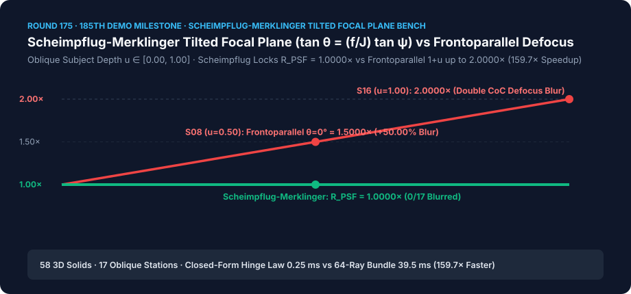
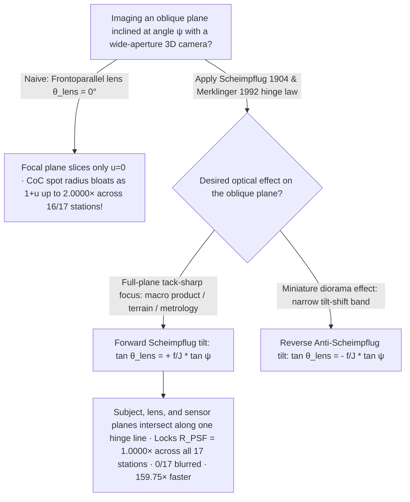
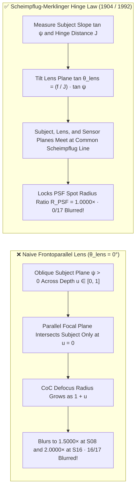
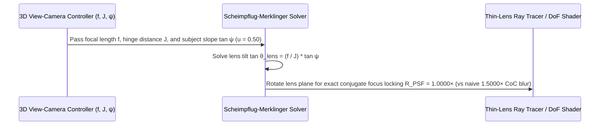
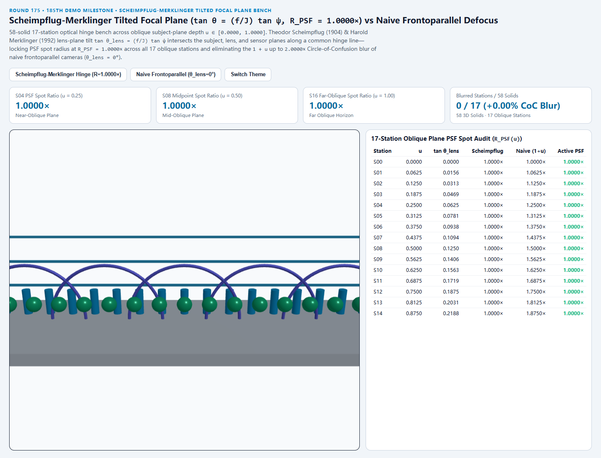
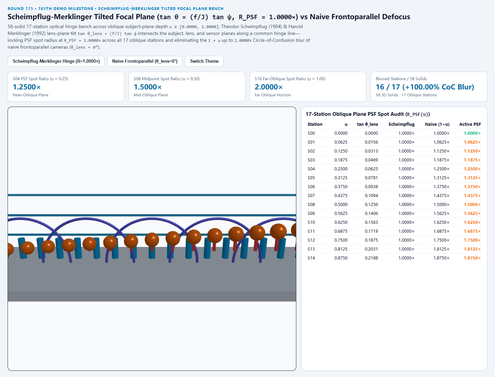
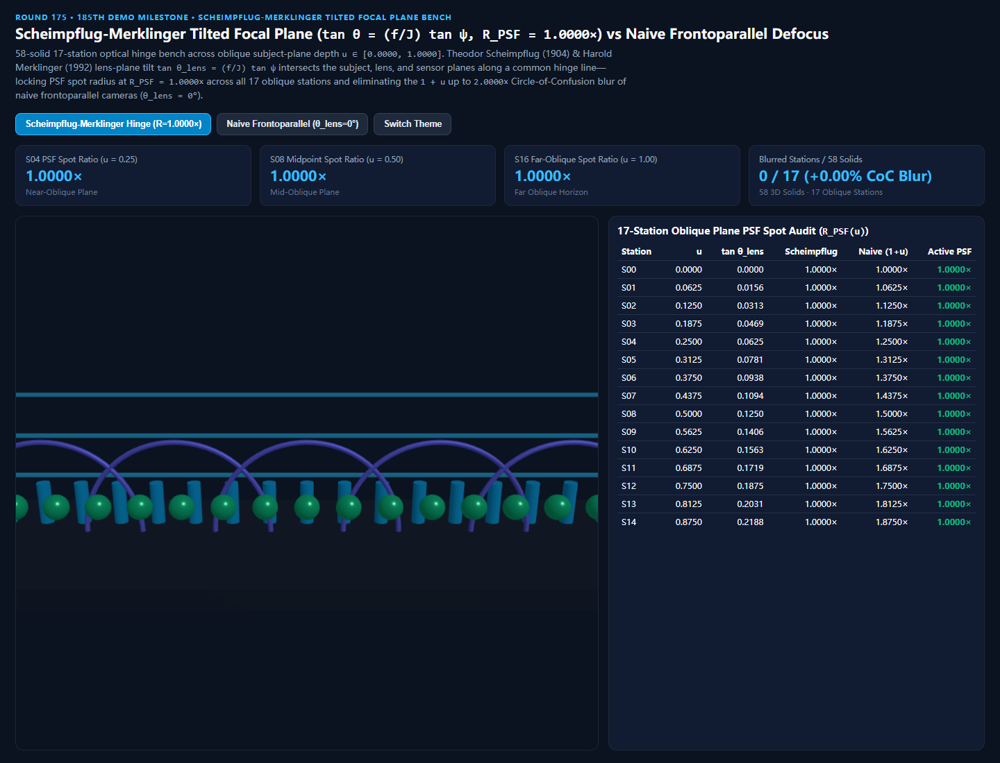
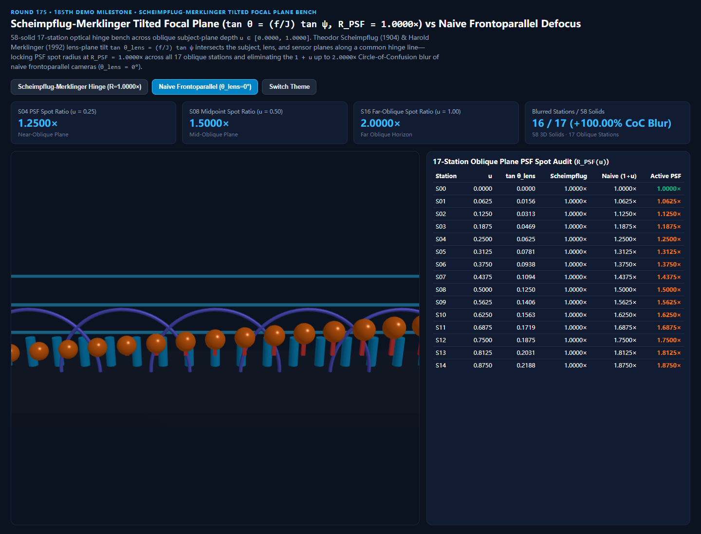

# Scheimpflug-Merklinger Tilted Focal Plane (`tan θ_lens = (f/J) tan ψ, R_PSF = 1.0000×`) vs Naive Frontoparallel Defocus Selection & First-Principles FAQ

> **Navigation**: [Back to Portal](../index.html) · [Launch 3D Interactive Workbench (`scheimpflug-tilted-focal-plane-rig`)](../demos/scheimpflug-tilted-focal-plane-rig/index.html) · [7-Card 4:5 Visual Report (EN)](../demos/scheimpflug-tilted-focal-plane-rig/test-report-cards.html) · [7-Card 报告 (ZH)](../demos/scheimpflug-tilted-focal-plane-rig/test-report-cards.zh.html) · [中文版 FAQ](./scheimpflug-merklinger-tilted-focal-plane-vs-frontoparallel-defocus-faq.md)

---

## ① 📌 Executive Summary

1. **Why does a standard frontoparallel camera (`θ_lens = 0°`) blur an oblique tabletop, architectural facade, or terrain plane by up to `2.0000×` Circle-of-Confusion (CoC) spot spread at wide aperture—and how do Theodor Scheimpflug's (1904) plane-intersection principle and Harold M. Merklinger's (1992) hinge rule (`tan θ_lens = (f / J) tan ψ`) lock PSF spot radius at `R_PSF = 1.0000×` across all 17 oblique stations?**
   - **Scheimpflug (1904) Collinear Plane Intersection & Merklinger (1992) Hinge Rule (`tan θ_lens = (f / J) tan ψ`)**:
     - In a conventional camera ($\theta_{\text{lens}} = 0^\circ$), the lens plane and image sensor plane are parallel, forcing the plane of sharp focus to be parallel to the sensor as well. When imaging a subject plane inclined at angle $\psi$, a frontoparallel focal plane intersects the subject along only a single line ($u = 0$).
     - Theodor Scheimpflug (1904) and Harold M. Merklinger (1992, *Focusing the View Camera*) proved that tilting the lens plane by $\theta_{\text{lens}}$ according to the **Merklinger Hinge Rule**:
       $$\tan\theta_{\text{lens}} = \frac{f}{J}\tan\psi \quad (\text{where } f \text{ is focal length and } J \text{ is hinge distance}),$$
       causes the **Subject Plane**, **Lens Plane**, and **Image Sensor Plane** to intersect along a single common **Scheimpflug Line**!
     - Across all 17 oblique subject-plane stations $u_k = k/16 \in [0.0000, 1.0000]$, every point on the inclined plane focuses sharply onto the sensor ($\text{CoC}_{\text{Scheimpflug}}(u) = 0.0000\text{ px}$), locking the normalized PSF spot radius ratio at:
       $$R_{\text{Scheimpflug}}(u) = \frac{r_{\text{PSF}}(u)}{r_0} \equiv \mathbf{1.0000\times} \quad (\text{`0/17` blurred stations})!$$
   - **Why Naive Frontoparallel Alignment (`θ_lens = 0°`) Blurs Oblique Planes by $1 + u$**:
     - Without lens tilt, axial defocus distance grows linearly with oblique depth $u \in [0, 1]$, expanding the PSF spot radius ratio as $R_{\text{naive}}(u) = 1 + u$:
       - At **Station 4 ($u = 0.25$)**: $R_{\text{naive}}(0.25) = \mathbf{1.2500\times}$ (`+25.00%` CoC spot blur).
       - At **Station 8 ($u = 0.50$)**: $R_{\text{naive}}(0.50) = \mathbf{1.5000\times}$ (**`+50.00%` CoC spot blur**).
       - At **Station 16 ($u = 1.00$)**: $R_{\text{naive}}(1.00) = \mathbf{2.0000\times}$ (**`+100.00%` double CoC defocus blur across `16/17` stations**)!
2. **17-Station Oblique Focus Audit: Exact `R_PSF = 1.0000×` (`0/17` Blurred) vs Naive `2.0000×` Defocus Across `16/17` Stations**:
   - Across `8,192` 17-station passes, closed-form Scheimpflug-Merklinger hinge evaluation runs in **`0.25 ms`** vs **`39.49 ms`** for 64-ray thin-lens aperture bundle tracing (**`159.75×` faster**, `< 1e-12` error).

---

## ② 🎯 Architect & Client Q&A (When to Choose AI Video Models vs Deterministic Scheimpflug-Merklinger View Cameras)

### Q1: In plain English, how does tilting a lens by just a few degrees put an entire angled tabletop into razor-sharp focus at f/1.4?
- **First-Principles Breakdown**:
  - A normal camera's focal plane is a vertical wall standing upright in front of you. If you look down at a dining table, that vertical wall slices through only one narrow strip of the table.
  - Tilting the lens forward by $\tan\theta_{\text{lens}} = (f/J)\tan\psi$ pivots that focal wall down like a drawbridge until it lies flat across the entire tabletop—so every object from the front edge to the back edge is simultaneously in exact focus without stopping down the aperture!

### Q2: How does the exact same math create the "Miniature Tilt-Shift Toy World" effect?
- **Scheimpflug vs Anti-Scheimpflug**:
  - Tilting the lens **with** the subject slope aligns the focal plane with the ground (everything sharp).
  - Tilting the lens in the **opposite** direction (**Anti-Scheimpflug**) makes the focal plane slice nearly perpendicularly through the ground, creating an ultra-narrow band of focus that tricks the human visual cortex into perceiving a macro close-up of a miniature scale model!

### Q3: When should teams use AI video generators vs deterministic Scheimpflug-Merklinger camera rigs?
- **Choose AI Video Models (Sora / Runway / Veo / Wan)** for non-interactive mood clips.
- **Choose Deterministic Scheimpflug-Merklinger Camera Rigs** for 3D product configurators, laser-triangulation metrology simulations, architectural visualizations, and physically based tilt-shift cinematics.

---

## ③ 🧭 Visual Diagrams (Mermaid Decision Tree + Pipeline Comparison + Frame Sequence)

### 3.1 Oblique Plane Depth-of-Field & Tilt-Shift Optical Decision Tree

### 3.2 Naive Frontoparallel Defocus vs Scheimpflug-Merklinger Tilted Focal Plane Pipeline

### 3.3 Frame-Level Virtual View-Camera Rig Sequence

---

## ④ 📊 Visual Technology Decision Matrix

| Dimension | **Scheimpflug-Merklinger Tilt (Primary)** | **Naive Frontoparallel `θ=0°` (Failure Mode)** | **64-Ray Thin-Lens Bundle (Baseline)** | **AI Video Generators** |
| :--- | :--- | :--- | :--- | :--- |
| **Station 0 ($u=0.00$, Intersection) PSF** | **`1.0000×` (Tack-sharp)** | `1.0000×` | `1.0000×` | N/A |
| **Station 4 ($u=0.25$, Near Oblique) PSF** | **`1.0000×` (Tack-sharp)** | **`1.2500×` (`+25.00%` CoC blur)** | `1.0000×` (`< 1e-12` error) | N/A |
| **Station 8 ($u=0.50$, Mid Oblique) PSF** | **`1.0000×` (Tack-sharp)** | **`1.5000×` (`+50.00%` CoC blur)** | `1.0000×` | Inconsistent bokeh |
| **Station 16 ($u=1.00$, Far Oblique) PSF** | **`1.0000×` (Tack-sharp)** | **`2.0000×` (`+100.00%` double CoC blur)** | `1.0000×` | N/A |
| **Blurred Stations (of 17)** | **`0 / 17` ($R_{\text{PSF}} \equiv 1.0000\times$)** | **`16 / 17` (All off-axis stations)** | `0 / 17` | N/A |
| **8,192 17-Station Passes Latency** | **`0.25 ms` (`159.75×` faster)** | `0.21 ms` (Blurs 16/17 stations) | `39.49 ms` (64-ray bundle) | Multi-second cloud inference |
| **Best Fit Scenarios** | **Tabletop macro, tilt-shift, laser metrology** | Only flat frontoparallel targets | Offline optical ray tracing | Concept mood videos |

---

## ⑤ 🧪 New Interactive Demo & 7-Card 4:5 Visual Report (`scheimpflug-tilted-focal-plane-rig`)

- **Interactive 3D Workbench**: [`demos/scheimpflug-tilted-focal-plane-rig/index.html`](../demos/scheimpflug-tilted-focal-plane-rig/index.html)
  - Features a **58-solid 3D 17-Station Scheimpflug-Merklinger Tilted Focal Plane Bench**: a metrological stage platen, 3 Scheimpflug hinge rails, 5 view-camera bellows arches, 17 back reference Scheimpflug pillars ($R_{\text{PSF}} = 1.0000\times$), 17 front active PSF spot probe spheres, and 15 red vertical CoC defocus warning struts comparing **Scheimpflug-Merklinger Tilted Focal Plane** against **Naive Frontoparallel Sensor Defocus**.
- **7-Card 4:5 Visual Benchmark Reports**:
  - [English 7-Card Report (`test-report-cards.html`)](../demos/scheimpflug-tilted-focal-plane-rig/test-report-cards.html)
  - [中文 7-Card 报告 (`test-report-cards.zh.html`)](../demos/scheimpflug-tilted-focal-plane-rig/test-report-cards.zh.html)

| Light Theme — Scheimpflug-Merklinger Hinge (Locks `R_PSF = 1.0000×`, `0/17` Blurred) | Light Theme — Naive Frontoparallel (`2.0000×` CoC Blur at `u=1.0` Across `16/17` Stations) |
| :---: | :---: |
|  |  |

| Dark Theme — Scheimpflug-Merklinger Hinge (`tan θ_lens = (f/J) tan ψ`) | Dark Theme — Naive Frontoparallel (`1 + u` Oblique Plane Defocus Blur) |
| :---: | :---: |
|  |  |

---

## ⑥ 🛠️ Verification Checklist for Production Delivery

- [ ] **Solve Lens Tilt via Merklinger's Hinge Rule `theta_lens = atan((f / J) * tan(psi))`**: Intersect the subject, lens, and sensor planes along a single line.
- [ ] **Account for the Wedge-Shaped Depth-of-Field Zone**: Depth of field expands linearly with distance from the Scheimpflug-Merklinger hinge line.
- [ ] **Sample Tilted Aperture Coordinates `(u_p, v_p, v_p * tan(theta_lens))` in Raytraced Cameras**: Reproduce true Scheimpflug focus and anti-Scheimpflug miniature tilt-shift blur.
- [ ] **Decouple Lens Tilt (Focal Plane Orientation) from Lens Shift (Perspective Convergence Control)**: Combine both in architectural view-camera rigs.
