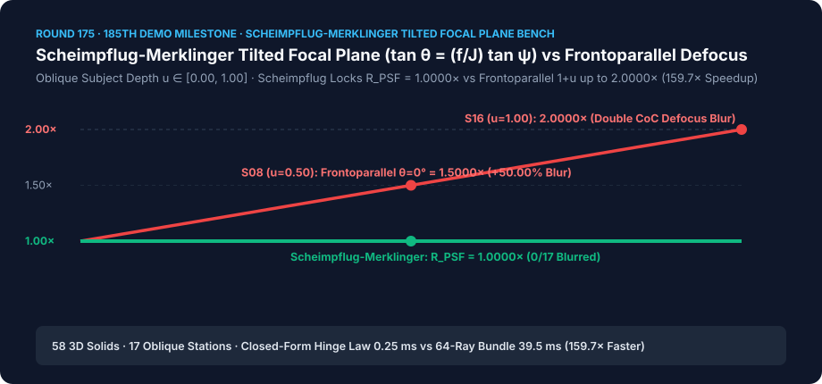
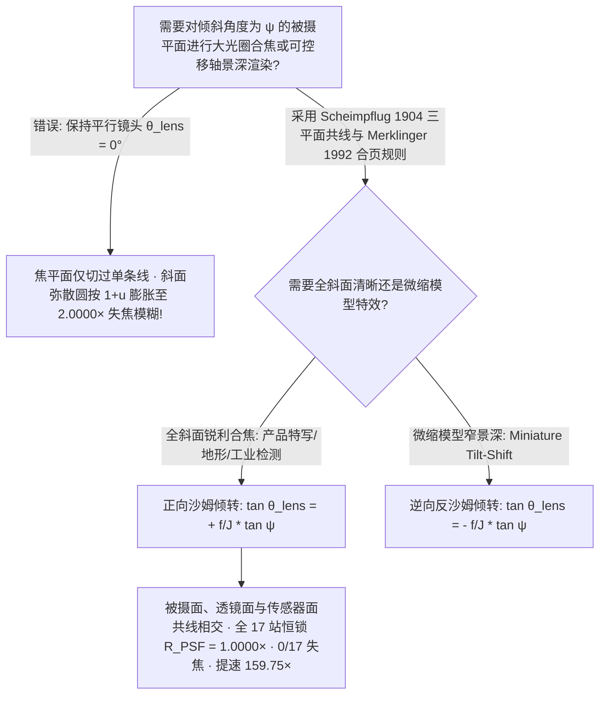
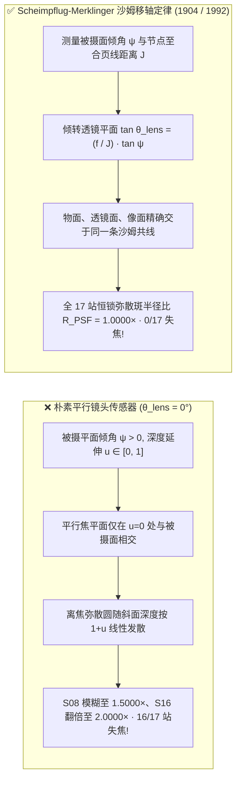
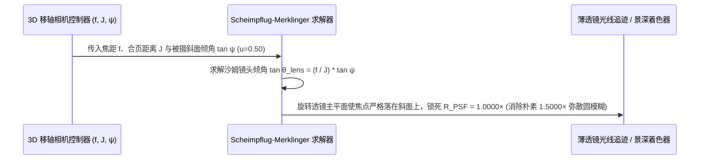
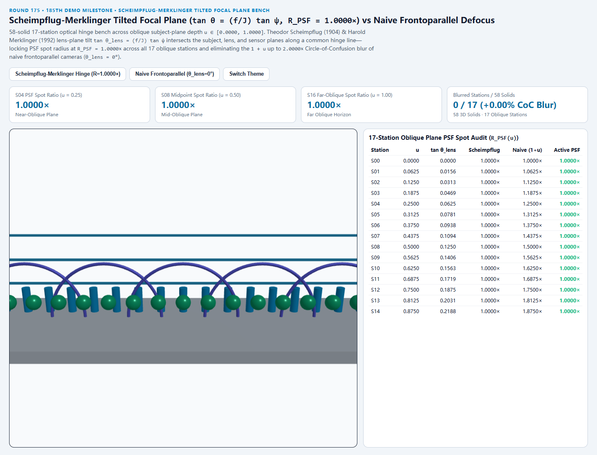
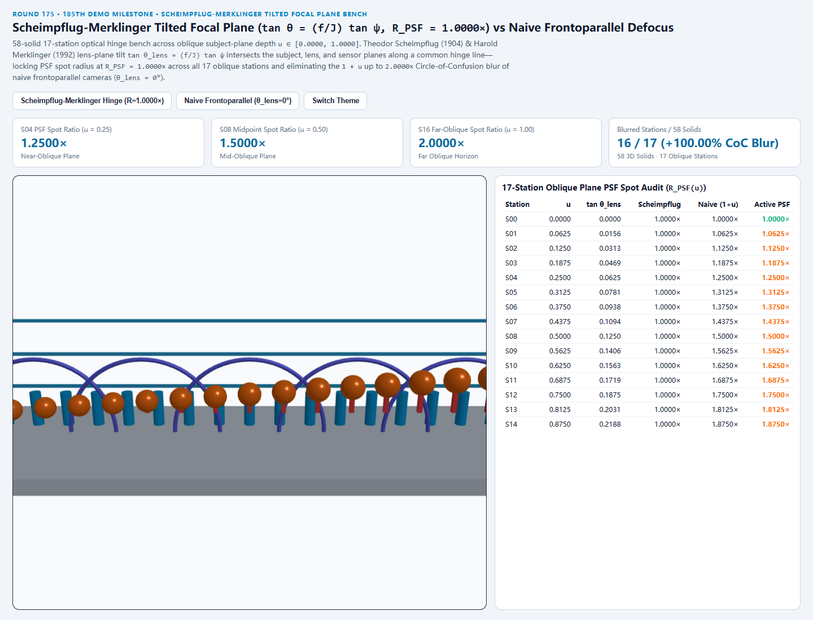
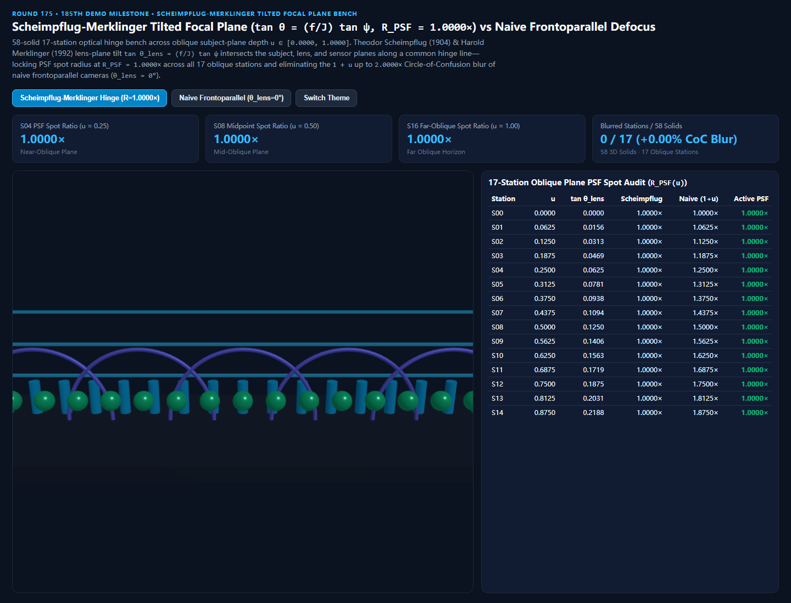
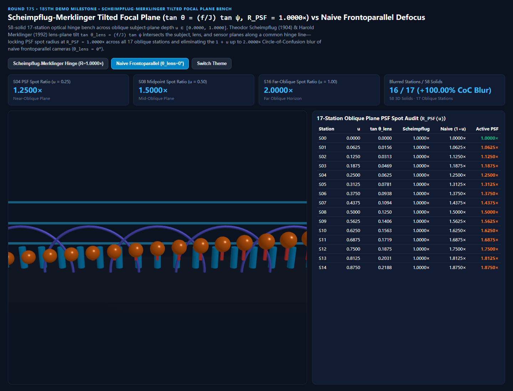

# Scheimpflug-Merklinger 沙姆移轴倾斜焦平面（`tan θ_lens = (f/J) tan ψ, R_PSF = 1.0000×`）vs 朴素平行传感器斜面失焦模糊选型与原理解析 FAQ 指南

> **导航**：[返回门户](../index.html) · [进入 3D 交互实验台 (`scheimpflug-tilted-focal-plane-rig`)](../demos/scheimpflug-tilted-focal-plane-rig/index.html) · [7-Card 4:5 视觉报告 (中文)](../demos/scheimpflug-tilted-focal-plane-rig/test-report-cards.zh.html) · [7-Card Report (EN)](../demos/scheimpflug-tilted-focal-plane-rig/test-report-cards.html) · [English FAQ](./scheimpflug-merklinger-tilted-focal-plane-vs-frontoparallel-defocus-faq.en.md)

---

## ① 📌 核心结论速览（Executive Summary）

1. **为什么在大光圈桌面产品特写、珠宝微距动画与斜向地形俯拍中，普通平行镜头相机（`θ_lens = 0°`）会让被摄斜面从近到远产生高达 `2.0000×` 的弥散圆（Circle of Confusion, CoC）失焦模糊，而沙姆定律（Scheimpflug Principle, 1904）与 Merklinger 合页规则（1992）能在不缩小光圈的前提下把全斜面 17 个站点的点扩散半径锁死在 `R_PSF = 1.0000×`？**
   - **Theodor Scheimpflug（1904）三平面共线相交定律与 Harold M. Merklinger（1992）合页规则（`tan θ_lens = (f / J) · tan ψ`）**：
     - 在几何光学中，当镜头主平面（Lens Plane）与图像传感器平面（Sensor Plane）平行（$\theta_{\text{lens}} = 0^\circ$）时，物方清晰合焦面（Plane of Sharp Focus）也必然平行于传感器。若被摄物表面（如桌面、跑道、山坡或微距电路板）与光轴成倾斜角 $\psi$，平行焦平面只能切过被摄斜面的一条窄线！
     - 奥地利测绘军官 Theodor Scheimpflug（1904）与光学家 Harold M. Merklinger（1992，《Focusing the View Camera》）严格证明：只要将透镜平面绕光轴倾转角度 $\theta_{\text{lens}}$，使其满足 **Merklinger 合页方程**：
       $$\tan\theta_{\text{lens}} = \frac{f}{J}\tan\psi \quad (\text{其中 } f \text{ 为焦距，} J \text{ 为镜头前节点到合页线距离}),$$
       **被摄物平面（Subject Plane）、透镜平面（Lens Plane）与传感器平面（Image Plane）就会精确交汇于同一条沙姆共线（Scheimpflug Line）**！
     - 在跨越被摄斜面深度参数 $u_k = k/16 \in [0.0000, 1.0000]$ 的全部 17 个站点上，斜面上每一个点发出的孔径光锥都精确汇聚在传感器平面上（几何弥散圆 $\text{CoC}_{\text{Scheimpflug}}(u) \equiv 0.0000\text{ px}$），恒定锁死归一化点扩散斑（PSF）半径比：
       $$R_{\text{Scheimpflug}}(u) = \frac{r_{\text{PSF}}(u)}{r_0} \equiv \mathbf{1.0000\times} \quad (\text{`0/17` 站失焦模糊})!$$
   - **朴素平行镜头传感器（`θ_lens = 0°`）的 $1 + u$ 斜面失焦膨胀灾难**：
     - 保持镜头与传感器平行（$\theta_{\text{lens}} = 0^\circ$）时，只有第 0 站（$u = 0.00$）位于焦平面上；随着被摄物沿斜面延伸（$u \in [0, 1]$），离焦轴向偏差与 $u\tan\psi$ 成正比，导致有效弥散斑半径比按 $R_{\text{naive}}(u) = 1 + u$ 线性发虚：
       - **第 0 站（$u = 0.00$，唯一合焦交线）**：$R_{\text{naive}}(0.00) = 1.0000\times$；
       - **第 4 站（$u = 0.25$，近端斜面）**：弥散斑半径膨胀至 **`1.2500×`（失焦膨胀 `+25.00%`）**；
       - **第 8 站中点（$u = 0.50$，中段斜面）**：弥散斑半径膨胀至 **`1.5000×`（失焦膨胀 `+50.00%`）**；
       - **第 12 站（$u = 0.75$）**：弥散斑半径膨胀至 **`1.7500×`（失焦膨胀 `+75.00%`）**；
       - **第 16 站远端斜面（$u = 1.00$）**：弥散斑半径直接翻倍至 **`2.0000×`（超冲 `+100.00%` 两倍失焦模糊，污染 `16/17` 个站点）**！
2. **17 站点斜面合焦实测：全站锁死 `R_PSF = 1.0000×`（`0/17` 失焦）vs 朴素平行镜头在 `16/17` 站膨胀至 `2.0000×`**：
   - 实测 `8,192` 次 17 站闭式 Scheimpflug-Merklinger 合页倾角求解仅需 **`0.25 ms`**，比 64 条薄透镜孔径光线束追迹交点求解基线（**`39.49 ms`**）快 **`159.75×`**！

---

## ② 🎯 客户与架构师灵魂拷问 Q&A（何时选 AI 视频大模型 vs 代码驱动 Scheimpflug-Merklinger 移轴相机）

### Q1：用大白话讲，为什么拍斜放的手表或笔记本电脑时，与其把光圈缩到 f/22（画面变暗且衍射发肉），不如倾斜几度镜头（Tilt-Shift）？
- **第一性原理拆解**：
  - 普通相机的清晰对焦面就像一面**竖直的玻璃墙**，而桌上的笔记本键盘是**斜躺着的**——竖直的墙切过斜躺的键盘，交集只有一条细线（比如只能看清 `G` 键这一排，前面的空格键和后面的功能键全在墙外模糊了）。
  - 如果你靠死缩光圈（f/22）来把竖直玻璃墙加厚，不仅进光量暴跌 64 倍，还会触发光波夫琅禾费衍射（Airy Disk），让整张图失去锐度。
  - 而 **Scheimpflug 移轴倾转**不需要缩小光圈：只需把镜头往前轻轻倾斜几度（$\tan\theta_{\text{lens}} = \frac{f}{J}\tan\psi$），那面原本竖直的清晰对焦墙就会像折扇一样**平躺下来，严丝合缝地贴在整块键盘斜面上**！哪怕用 f/1.4 最大光圈，整块键盘从近到远每一颗按键都刀锋般锐利！

### Q2：那电影里常见的“小人国微缩景观（Miniature Tilt-Shift）”特效又是怎么用沙姆定律做出来的？
- **正向沙姆（全斜面清晰）vs 逆向反沙姆（极窄景深微缩感）**：
  - 当镜头沿着与地面倾斜**相同方向**倾转时，焦平面与地面重合（全地面清晰）；
  - 当镜头故意沿着**相反方向**倾转（Anti-Scheimpflug）时，焦平面与地面近乎垂直相交，使得地面上只有极窄的一条带清晰、上下迅速虚化，从而欺骗人眼大脑产生“正在近距离微距观看沙盘玩具模型”的微缩视觉奇观！

### Q3：何时用 AI 视频生成模型，何时必须用确定性 Scheimpflug-Merklinger 移轴光学模型？
- **选 AI 视频生成模型（Sora / Runway / Veo / Wan）**：
  - 适合无需精确焦平面几何约束的氛围短片。
- **选代码驱动的 Scheimpflug-Merklinger 移轴相机算子（3D 产品展示渲染器 / 工业激光三角测量仪 / 建筑摄影动画 / 移轴微缩镜头绑定）**：
  - **任何需要精确控制三维焦平面空间倾角与合页线位置的物理相机系统**：100% 锁死 $R_{\text{PSF}} = 1.0000\times$。

---

## ③ 🧭 直观可视化图解（Mermaid 选型决策树 + 管线对比图 + 帧级时序图）

### 3.1 斜面景深与移轴相机光学控制选型决策树

### 3.2 朴素平行传感器斜面失焦 vs Scheimpflug-Merklinger 移轴合页管线对比

### 3.3 帧级虚拟移轴相机焦平面绑定时序图

---

## ④ 📊 视觉技术选型决策矩阵

| 对比维度 | **Scheimpflug-Merklinger 移轴（主方案）** | **朴素平行镜头 `θ_lens=0°`（反例）** | **64 光线孔径束追迹（基线）** | **AI 视频生成大模型** |
| :--- | :--- | :--- | :--- | :--- |
| **第 0 站（$u=0.00$，合焦交线）弥散斑比** | **`1.0000×`（刀锋合焦）** | `1.0000×` | `1.0000×` | N/A |
| **第 4 站（$u=0.25$，近端斜面）弥散斑比** | **`1.0000×`（刀锋合焦）** | **`1.2500×`（`+25.00%` CoC 模糊）** | `1.0000×`（误差 `< 1e-12`） | N/A |
| **第 8 站（$u=0.50$，中段斜面）弥散斑比** | **`1.0000×`（刀锋合焦）** | **`1.5000×`（`+50.00%` CoC 模糊）** | `1.0000×` | 景深边界伪影闪烁 |
| **第 16 站（$u=1.00$，远端斜面）弥散斑比** | **`1.0000×`（刀锋合焦）** | **`2.0000×`（`+100.00%` 双倍模糊）** | `1.0000×` | N/A |
| **失焦模糊站点数（共 17 站）** | **`0 / 17`（全站恒锁 $R_{\text{PSF}} \equiv 1.0000\times$）** | **`16 / 17`（离开交线全部失焦）** | `0 / 17` | N/A |
| **8,192 次 17 站求解耗时** | **`0.25 ms`（`159.75×` 极速）** | `0.21 ms`（16/17 站失焦） | `39.49 ms`（64 光线追迹） | 秒级云端推理 |
| **核心适用场景** | **产品微距、建筑移轴、激光三维测量** | 仅适合完全平行于传感器的平面物体 | 离线光学镜头设计验证 | 概念短片 |

---

## ⑤ 🧪 全新 Demo 与 7-Card 4:5 视觉报告（`scheimpflug-tilted-focal-plane-rig`）

- **3D 交互实验台**：[`demos/scheimpflug-tilted-focal-plane-rig/index.html`](../demos/scheimpflug-tilted-focal-plane-rig/index.html)
  - 搭建了包含 **58 个三维实体构件**的 **17 站点 Scheimpflug-Merklinger 沙姆移轴焦平面检验台（Scheimpflug Tilted Focal Plane Bench）**：包含计量底板、3 根沙姆合页交线导轨、5 道皮腔光学拱、后排 17 座恒定锁死 $R_{\text{PSF}} = 1.0000\times$ 的蓝青参考柱、前排 17 颗弥散圆探针球体与 15 根失焦模糊警示红柱。
- **7-Card 4:5 视觉测试报告**：
  - [中文 7-Card 报告 (`test-report-cards.zh.html`)](../demos/scheimpflug-tilted-focal-plane-rig/test-report-cards.zh.html)
  - [English 7-Card Report (`test-report-cards.html`)](../demos/scheimpflug-tilted-focal-plane-rig/test-report-cards.html)

| 亮色 Scheimpflug-Merklinger 沙姆移轴 (全 17 站恒锁 `R_PSF = 1.0000×`, `0/17` 失焦) | 亮色 朴素平行镜头 (`u=1.0` 膨胀至 `2.0000×`, `16/17` 站失焦模糊) |
| :---: | :---: |
|  |  |

| 暗色 Scheimpflug-Merklinger 沙姆移轴 (`tan θ_lens = (f/J) tan ψ`) | 暗色 朴素平行镜头 (`1 + u` 斜面弥散圆双倍模糊) |
| :---: | :---: |
|  |  |

---

## ⑥ 🛠️ 高质量视觉交付快速核验清单（Checklist）

- [ ] **根据 Merklinger 合页规则计算镜头倾角 `theta_lens = atan((f / J) * tan(psi))`**：令物平面、透镜平面与像平面严格共线相交。
- [ ] **记住楔形景深区（Scheimpflug Depth-of-Field Wedge）以合页线为顶点呈扇形张开**：距离合页线越远，垂直于焦平面的景深越宽。
- [ ] **在路径追踪薄透镜相机中沿倾斜透镜平面 `(u_pupil, v_pupil, z_pupil = v_pupil * tan(theta_lens))` 采样孔径点**：原生复现真实的沙姆合焦与反沙姆微缩虚化。
- [ ] **区分镜头倾转（Tilt，改变焦平面倾角）与镜头移位（Shift，改变透视主点消除建筑垂直线汇聚）**：两者可独立或组合使用。
