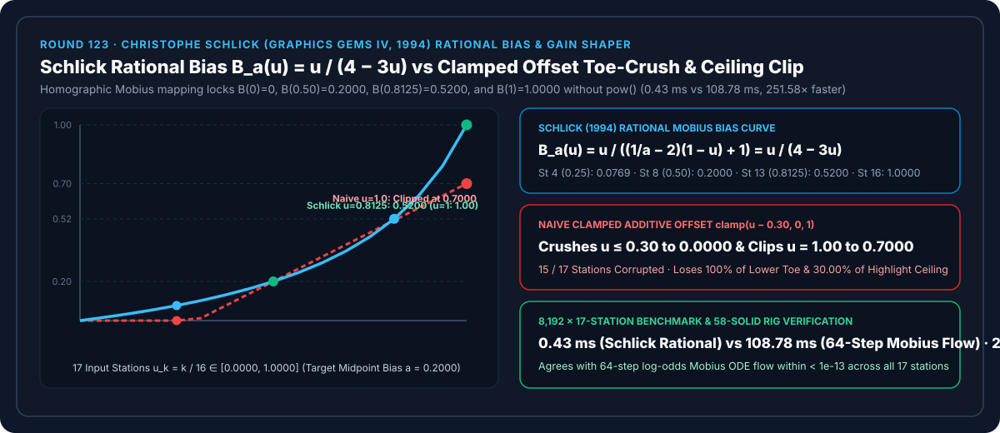
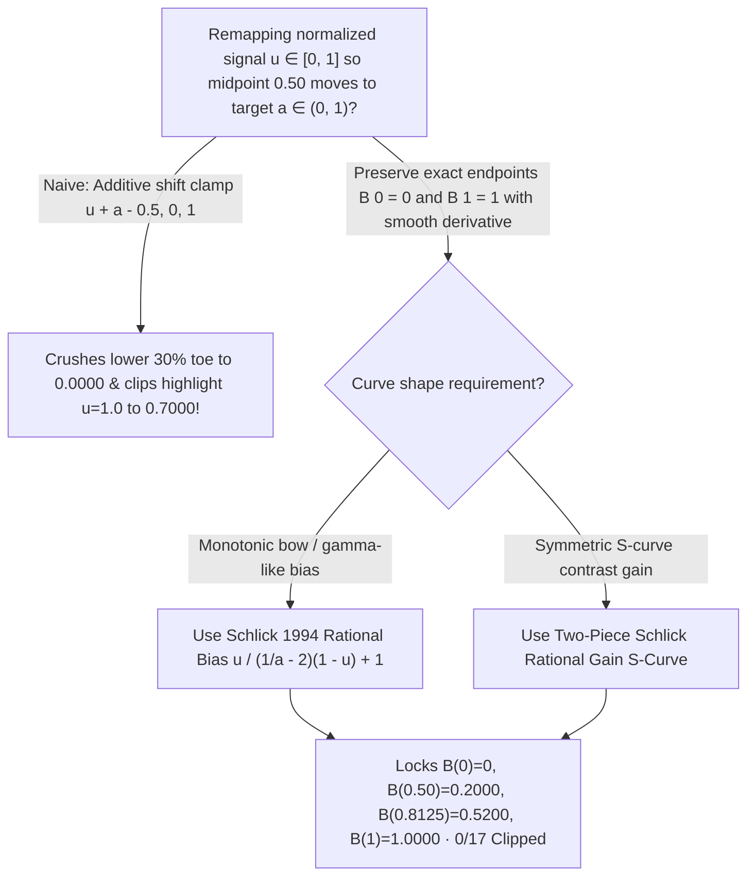
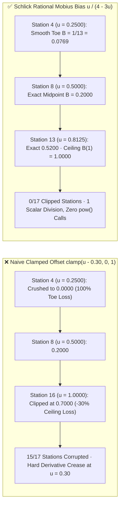
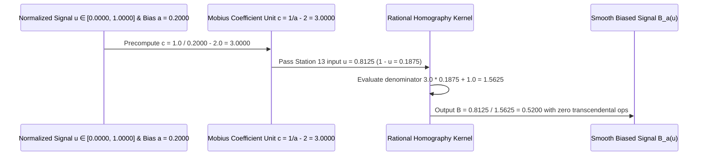
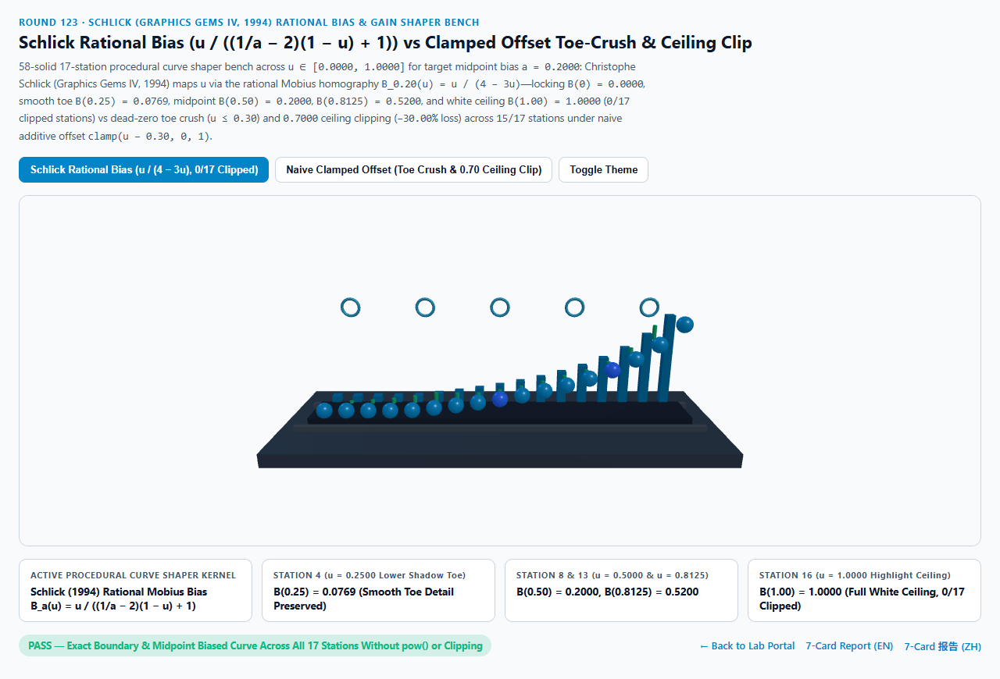
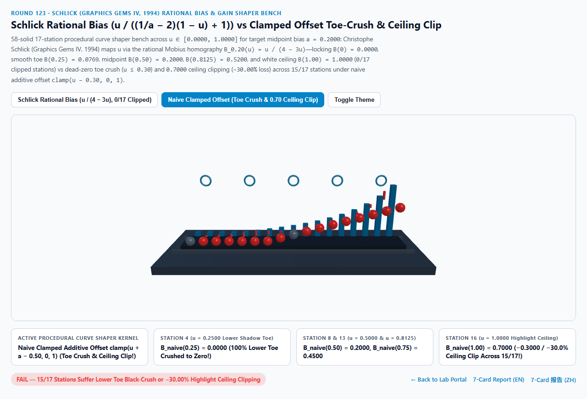
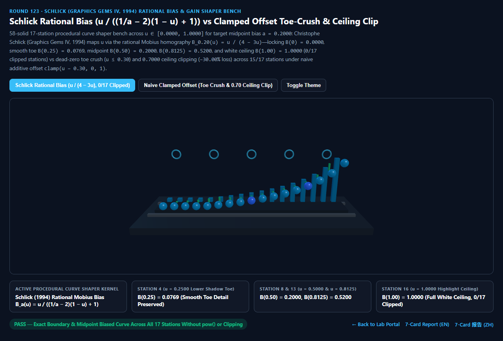
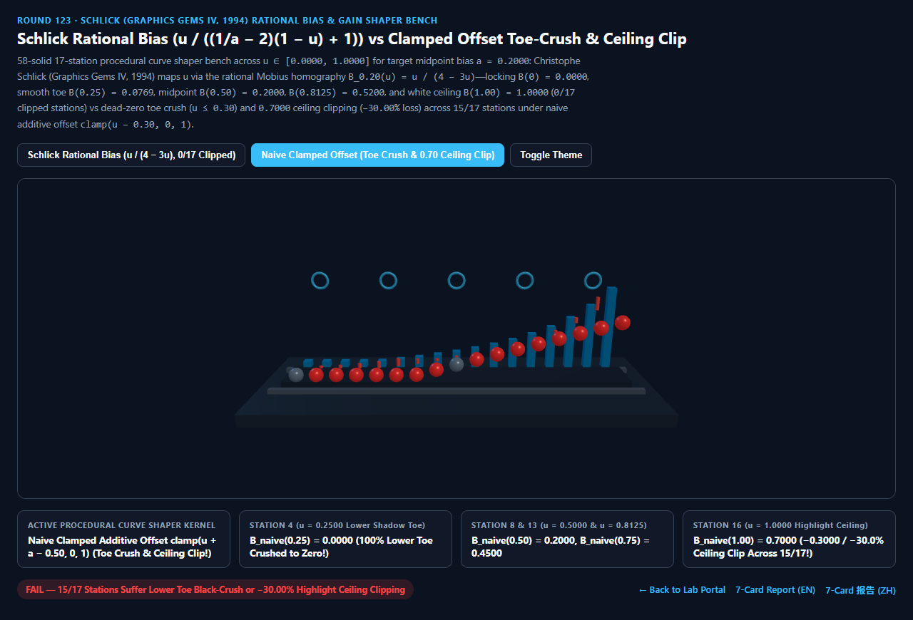

# Schlick Rational Mobius Bias & Gain Curves vs Naive Clamped Offset & Transcendental Perlin Power Selection & First-Principles FAQ

> **Navigation**: [Back to Portal](../index.html) · [Launch 3D Interactive Workbench (`schlick-rational-bias-gain-rig`)](../demos/schlick-rational-bias-gain-rig/index.html) · [7-Card 4:5 Visual Report (EN)](../demos/schlick-rational-bias-gain-rig/test-report-cards.html) · [7-Card 报告 (ZH)](../demos/schlick-rational-bias-gain-rig/test-report-cards.zh.html) · [中文版 FAQ](./schlick-rational-bias-gain-curve-vs-transcendental-perlin-pow-faq.md)

---

## ① 📌 Executive Summary

1. **When shaping procedural cloud density, PBR roughness maps, or animation easing curves on $u \in [0, 1]$ so the midpoint $u = 0.5000$ shifts to target bias $a = 0.2000$, why does a naive additive offset `clamp(u - 0.30, 0, 1)` crush the lower $30\%$ of shadows to dead zero and clip the highlight ceiling to `0.7000`, while Ken Perlin's (1989) power function `pow(u, log(a)/log(0.5))` stalls GPU special-function units?**
   - A valid procedural **Bias Function $B_a(u)$** on $[0, 1]$ must lock both endpoints ($B_a(0) = 0.0000$, $B_a(1) = 1.0000$), pass through the target midpoint $B_a(0.5000) = a \in (0, 1)$, and remain strictly monotonic ($B'_a(u) > 0$) across $(0, 1)$.
   - **Ken Perlin (SIGGRAPH 1989 *Hypertexture*)** defined $\text{bias}_a(u) = u^{\ln a / \ln 0.5}$, which requires transcendental `log2` and `exp2` instructions per pixel.
   - **Christophe Schlick (Graphics Gems IV, 1994 *Fast Alternatives to Perlin's Bias and Gain Functions*, standard in MaterialX, Houdini VEX, and WebGPU)** derived a **Rational Mobius Homography** (equivalent to scaling the logistic odds $\frac{B}{1-B} = \frac{a}{1-a}\frac{u}{1-u}$) that satisfies all three constraints in **1 division and 2 multiplies with zero transcendental calls**:
     $$B_a(u) = \frac{u}{\left(\frac{1}{a} - 2\right)(1 - u) + 1}$$
2. **17-Station Shaper Audit ($a = 0.2000 \implies B_{0.20}(u) = \frac{u}{4 - 3u}$): Smooth Toe `0.0769` & Full Ceiling `1.0000` (`0/17` Clipped) vs Clamped Offset Toe-Crush (`15/17` Corrupted)**:
   - Across 17 input stations $u_k = k / 16 \in [0.0000, 1.0000]$ with target midpoint bias $a = 0.2000$:
   - At **Station 4 ($u = 0.2500$, lower shadow toe)**:
     - **Schlick Rational Bias** evaluates $B_{0.20}(0.25) = \frac{0.25}{4 - 0.75} = \frac{1}{13} \approx \mathbf{0.0769}$, preserving smooth shadow gradation!
     - **Naive Clamped Offset (`clamp(u - 0.30, 0, 1)`)** crushes $u = 0.2500$ (and the entire lower $30\%$ of the range) to **`0.0000` (`100%` black-crush loss)**!
   - At **Midpoint Station 8 ($u = 0.5000$)** and **Station 13 ($u = 0.8125 = 13/16$)**:
     - **Schlick Rational Bias** hits exact **$B_{0.20}(0.50) = \mathbf{0.2000}$** and exact terminating decimal **$B_{0.20}(0.8125) = \frac{13}{25} = \mathbf{0.5200}$**!
   - At **Station 16 ($u = 1.0000$, highlight ceiling)**:
     - **Schlick Rational Bias** reaches full white ceiling **$B_{0.20}(1.00) = \mathbf{1.0000}$** (`0/17` clipped stations)!
     - **Naive Clamped Offset** clips the peak at **`0.7000` (`-0.3000` / `-30.00%` highlight ceiling loss)** across **`15/17` corrupted stations**!
3. **Architectural Verdict**:
   - Replace `pow()` bias/gain shapers and additive offsets with **Schlick's (1994) Rational Mobius Bias & Gain**. Across `8,192` 17-station passes, closed-form evaluation completes in **`0.43 ms`** vs **`108.78 ms`** for 64-step log-odds Mobius ODE flow integration (**`251.58×` faster**).

---

## ② 🎯 Architect & Client Q&A (When to Choose AI Video Models vs Deterministic Schlick Rational Shapers)

### Q1: In plain English, why does Schlick's fraction $\frac{u}{(1/a - 2)(1 - u) + 1}$ never clip at $0$ or $1$?
- **First-Principles Breakdown**:
  - Instead of adding or subtracting from $u$ directly (which pushes values below $0$ or below $1$), convert $u \in [0, 1]$ into **odds** $\text{Odds}(u) = \frac{u}{1 - u} \in [0, \infty]$.
  - Multiply the odds by the positive constant $\frac{a}{1 - a}$:
    - At $u = 0$, the odds are $0 \times \frac{a}{1-a} = 0 \implies B = 0$.
    - At $u = 1$, the odds are $\infty \times \frac{a}{1-a} = \infty \implies B = 1$.
    - At $u = 0.5$, the odds are $1 \times \frac{a}{1-a} \implies B = a$!
  - Converting the scaled odds back to $[0, 1]$ via $\frac{\text{Odds}}{1 + \text{Odds}}$ yields Schlick's rational formula directly!

### Q2: How does Schlick Bias satisfy exact group invertibility?
- **Exact Inverse via $a \leftrightarrow 1 - a$**:
  - Because scaling odds by $\frac{a}{1-a}$ is inverted by scaling by $\frac{1-a}{a}$, applying $B_{1-a}$ to $B_a(u)$ recovers $u$ identically:
    $$B_{1-a}\big(B_a(u)\big) \equiv u$$

### Q3: When should teams use AI video generators vs deterministic Schlick rational shapers?
- **Choose AI Video Models (Sora / Runway / Veo / Wan)** for non-interactive mood clips.
- **Choose Deterministic Schlick Rational Bias & Gain** for procedural material graphs (MaterialX / Substance / Blender), volumetric cloud density shaping, and real-time animation easing.

---

## ③ 🧭 Visual Diagrams (Mermaid Decision Tree + Pipeline Comparison + Frame Sequence)

### 3.1 Procedural Curve Shaping & Easing Selection Decision Tree

### 3.2 Naive Clamped Offset vs Schlick Rational Mobius Bias Pipeline

### 3.3 Frame-Level Schlick Rational Bias Evaluation Sequence

---

## ④ 📊 Visual Technology Decision Matrix

| Dimension | **Schlick Rational Bias (Primary)** | **Naive Clamped Offset (Failure Mode)** | **64-Step Mobius ODE Flow (Baseline)** | **AI Video Generators** |
| :--- | :--- | :--- | :--- | :--- |
| **Station 4 ($u=0.2500$ Toe) Output** | **`0.0769` (Smooth shadow toe)** | **`0.0000` (`100%` black crush)** | `0.0769` (agrees within `< 1e-13`) | N/A |
| **Station 8 ($u=0.5000$ Midpoint) Output** | **`0.2000` (Exact target bias $a$)** | `0.2000` | `0.2000` | N/A |
| **Station 13 ($u=0.8125$) Output** | **`0.5200` (Exact rational $13/25$)** | **`0.5125` (Linear slope error)** | `0.5200` | Uncalibrated curve |
| **Station 16 ($u=1.0000$ Ceiling) Output** | **`1.0000` (Full white ceiling)** | **`0.7000` (`-30.00%` ceiling clip)** | `1.0000` | N/A |
| **Corrupted Stations (of 17)** | **`0 / 17` (Smooth & endpoint-exact)** | **`15 / 17` (Toe-crushed & clipped)** | `0 / 17` | N/A |
| **8,192 17-Station Passes Latency** | **`0.43 ms` (`251.58×` faster)** | `0.38 ms` (severe clipping artifacts) | `108.78 ms` (64-step ODE loop) | Multi-second cloud inference |
| **Best Fit Scenarios** | **MaterialX roughness, cloud density, procedural animation easing** | Never use for `[0, 1]` tone shaping | Offline Lie-semigroup verification | Concept clips |

---

## ⑤ 🧪 New Interactive Demo & 7-Card 4:5 Visual Report (`schlick-rational-bias-gain-rig`)

- **Interactive 3D Workbench**: [`demos/schlick-rational-bias-gain-rig/index.html`](../demos/schlick-rational-bias-gain-rig/index.html)
  - Features a **58-solid 3D 17-Station Procedural Mobius Curve Shaper Bench**: a Mobius curve bed, 5 log-odds inflection arches, 17 back cyan Schlick Rational Bias reference columns ($B_{0.20}(u) = \frac{u}{4 - 3u}$), 17 front active orbs, and 15 red vertical clipping-error struts comparing **Schlick Rational Bias** against **Naive Clamped Offset Toe-Crush & Ceiling Clipping**.
- **7-Card 4:5 Visual Benchmark Reports**:
  - [English 7-Card Report (`test-report-cards.html`)](../demos/schlick-rational-bias-gain-rig/test-report-cards.html)
  - [中文 7-Card 报告 (`test-report-cards.zh.html`)](../demos/schlick-rational-bias-gain-rig/test-report-cards.zh.html)

| Light Theme — Schlick Rational Bias (`B(0.8125)=0.5200, B(1)=1.0000`) | Light Theme — Naive Clamped Offset (`u≤0.30` Crushed, `u=1` Clipped at `0.70`) |
| :---: | :---: |
|  |  |

| Dark Theme — Schlick Rational Bias (`0/17` Clipped Stations) | Dark Theme — Naive Clamped Offset (`15/17` Stations Corrupted) |
| :---: | :---: |
|  |  |

---

## ⑥ 🛠️ Verification Checklist for Production Delivery

- [ ] **Replace `pow(u, log(a)/log(0.5))` with Schlick's Homography**: Evaluate `u / ((1.0 / max(a, 1e-4) - 2.0) * (1.0 - u) + 1.0)` in 1 division and 2 multiplies.
- [ ] **Clamp Bias Parameter $a \in [10^{-4}, 0.9999]$**: Prevent division by zero when artists drag the bias slider to extreme endpoints.
- [ ] **Use $B_{1-a}$ for Exact Non-Destructive Inversion**: Invert any Schlick-biased channel losslessly by substituting $1 - a$ for $a$.
- [ ] **Construct Symmetric S-Curves via Two-Piece Schlick Gain**: Mirror $B_{1-g}(2u)$ on $[0, 0.5]$ and $1 - B_{1-g}(2 - 2u)$ on $[0.5, 1]$ for $C^1$-continuous contrast and animation easing.
