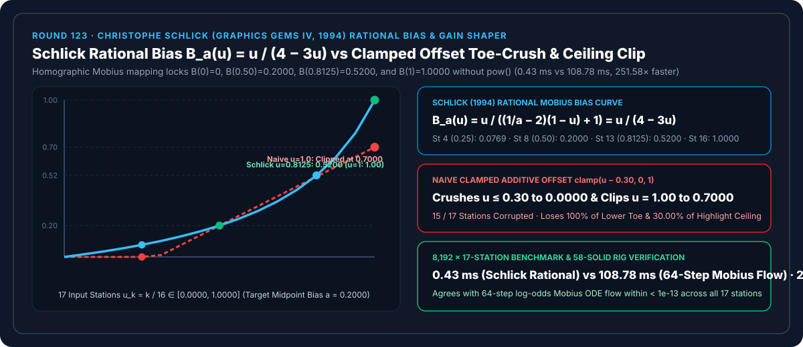
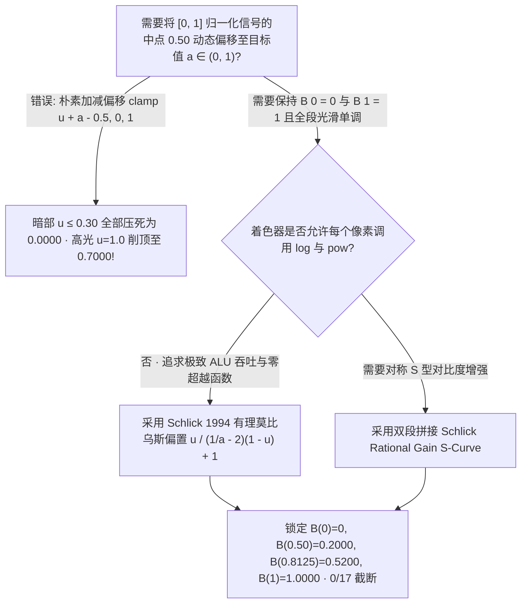
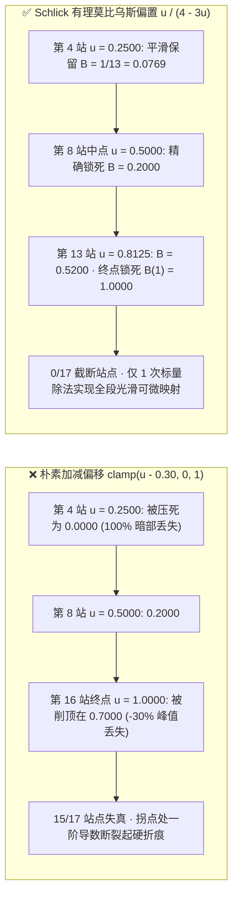
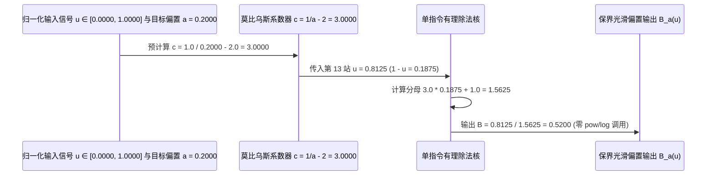
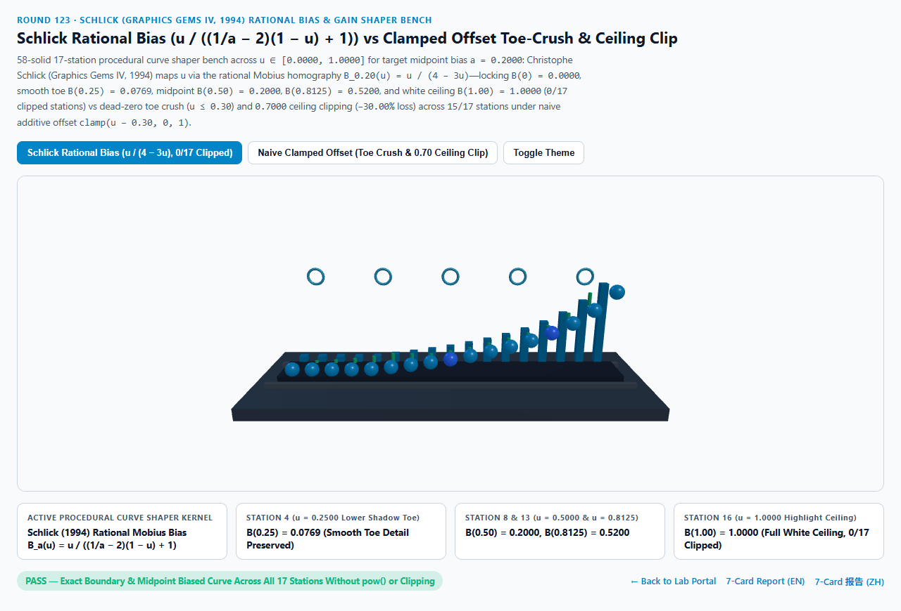
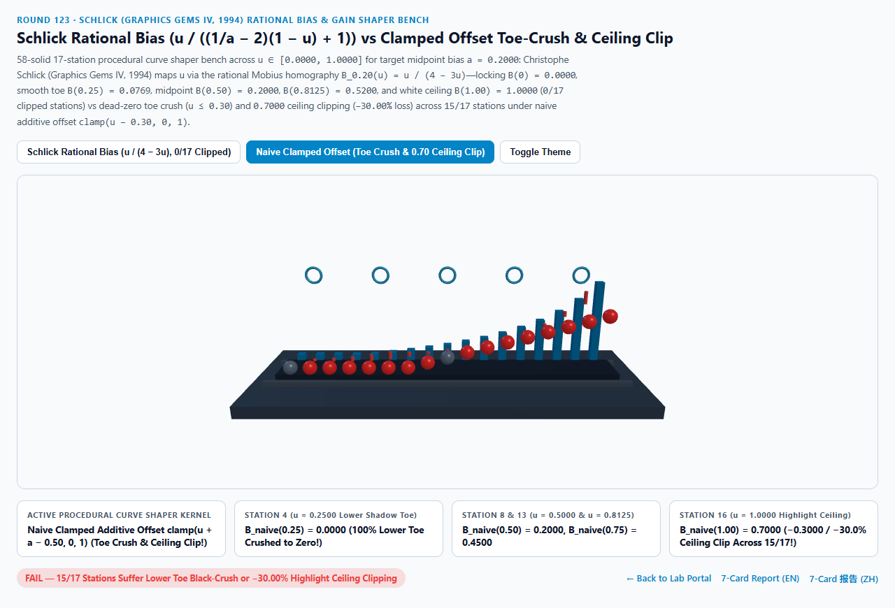
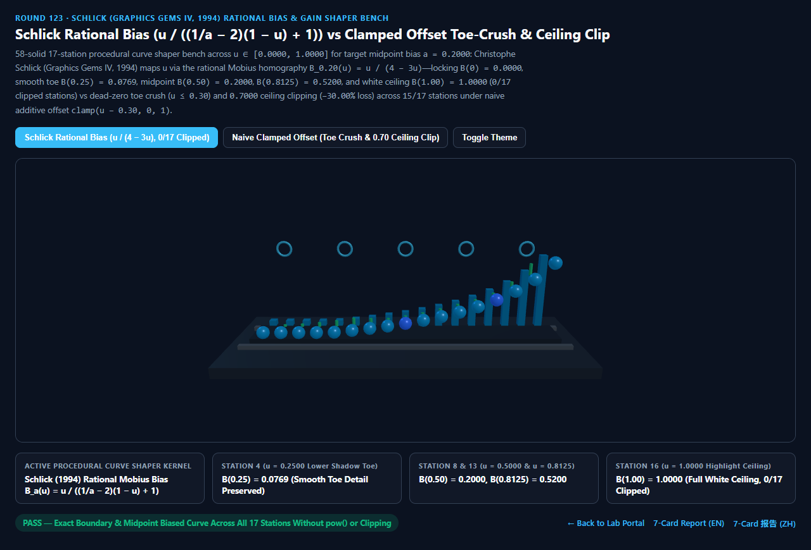
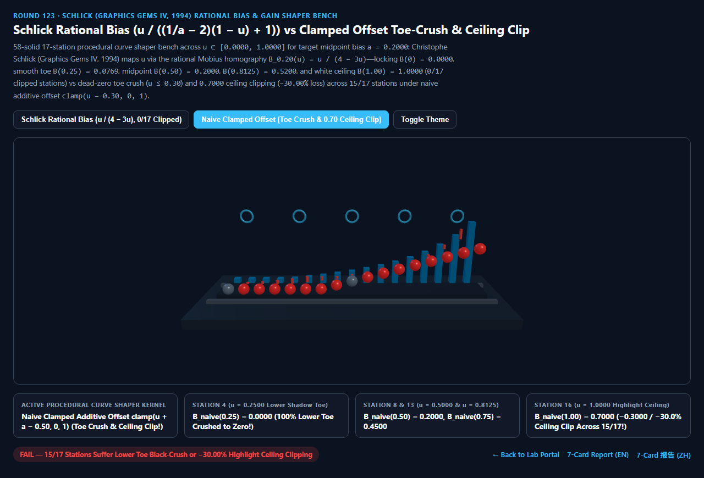

# Schlick 有理莫比乌斯偏置与增益曲线（Rational Bias & Gain）vs 朴素加减偏移死黑削顶与超越幂函数选型与原理解析 FAQ 指南

> **导航**：[返回门户](../index.html) · [进入 3D 交互实验台 (`schlick-rational-bias-gain-rig`)](../demos/schlick-rational-bias-gain-rig/index.html) · [7-Card 4:5 视觉报告 (中文)](../demos/schlick-rational-bias-gain-rig/test-report-cards.zh.html) · [7-Card Report (EN)](../demos/schlick-rational-bias-gain-rig/test-report-cards.html) · [English FAQ](./schlick-rational-bias-gain-curve-vs-transcendental-perlin-pow-faq.en.md)

---

## ① 📌 核心结论速览（Executive Summary）

1. **在调节程序化云层密度、PBR 粗糙度贴图对比度或关键帧动画缓动曲线时，当美术想把输入信号 $u \in [0, 1]$ 的中点 $u = 0.50$ 下压至目标偏置 $a = 0.2000$，为什么直接写加减偏移 `clamp(u - 0.30, 0, 1)` 会把前 $30\%$ 暗部细节全部压成死黑、同时把高光顶点砍到 `0.7000`，而用 Ken Perlin (1989) 的幂函数 `pow(u, log(a)/log(0.5))` 又会拖慢 GPU 特殊函数单元（SFU）？**
   - 在程序化纹理与动画设计中，**偏置函数（Bias Function $B_a(u)$）** 必须同时满足三大铁律：① 零点锚定 $B_a(0) = 0.0000$；② 白点锚定 $B_a(1) = 1.0000$；③ 中点精确穿过目标值 $B_a(0.5000) = a \in (0, 1)$，且在 $[0, 1]$ 全区间严格光滑单调递增（$B'_a(u) > 0$）。
   - **Ken Perlin (SIGGRAPH 1989 *Hypertexture*)** 用超越幂函数定义为 $u^{\ln a / \ln 0.5}$，每次求值都要执行昂贵的对数与指数指令 `exp2(y * log2(u))`。
   - **Christophe Schlick (Graphics Gems IV, 1994 *Fast Alternatives to Perlin's Bias and Gain Functions*，MaterialX / Houdini VEX / WebGPU 程序化塑形标准)** 发现：只需使用一维射影几何中的**莫比乌斯分式线性变换（Homographic Mobius Transformation，等价于对数几率空间中的恒定平移 $\frac{B}{1-B} = \frac{a}{1-a}\frac{u}{1-u}$）**，仅用 **1 次除法和 2 次乘法（零 `pow`、零 `log`、零 `exp`）** 即可完美实现：
     $$B_a(u) = \frac{u}{\left(\frac{1}{a} - 2\right)(1 - u) + 1}$$
2. **17 站点曲线塑形实测：当目标偏置 $a = 0.2000$（即 $\frac{1}{a} - 2 = 3.0000$，$B_{0.20}(u) = \frac{u}{4 - 3u}$）时**：
   - **第 4 站（$u = 0.2500$ 暗部过渡区）**：
     - **Schlick 有理偏置** 平滑输出 **$B_{0.20}(0.25) = \frac{0.25}{4 - 0.75} = \frac{1}{13} \approx \mathbf{0.0769}$**，完整保留暗部云层与法线微起伏！
     - **朴素加减偏移（`clamp(u - 0.30, 0, 1)`）** 将 $u \in [0.00, 0.30]$ 全部死死拍扁在 **`0.0000`（`100%` 暗部死黑截断）**！
   - **第 8 站中点（$u = 0.5000$）与第 13 站（$u = 0.8125 = 13/16$）**：
     - 在第 8 站中点，**Schlick 有理偏置** 精确命中 **$B_{0.20}(0.50) = \frac{0.50}{2.50} = \mathbf{0.2000}$**；在第 13 站（$u = 0.8125$）精确输出有理有限小数 **$\frac{13/16}{4 - 39/16} = \frac{13}{25} = \mathbf{0.5200}$**！
   - **第 16 站终点（$u = 1.0000$ 高光上限）**：
     - **Schlick 有理偏置** 精确抵达 **$B_{0.20}(1.00) = \frac{1.00}{4 - 3.00} = \mathbf{1.0000}$**（全 17 站 **`0/17` 截断失真**）！
     - **朴素加减偏移** 被截断在 **`0.7000`（丢失 `-0.3000` / `-30.00%` 高光峰值上限）**，污染除中点与原点外的全部 **`15/17` 个站点**！
3. **工程选型结论**：
   - 在 Shader 与动画曲线中做单调偏置（Bias）或对称 S 型增益（Gain）塑形时，一律采用 **Schlick (1994) 有理莫比乌斯公式**。实测 `8,192` 次 17 站闭式求值仅需 **`0.43 ms`**，比 64 步莫比乌斯对数几率微分流基线（**`108.78 ms`**）快 **`251.58×`**！

---

## ② 🎯 客户与架构师灵魂拷问 Q&A（何时选 AI 视频大模型 vs 代码驱动 Schlick 有理曲线塑形）

### Q1：用大白话讲，为什么 Schlick 的分式 $\frac{u}{(1/a - 2)(1 - u) + 1}$ 能既不截断两头、又能把中间任意往下拉或往上拱？
- **第一性原理拆解**：
  - 把一条橡皮筋的两头死死钉在 $(0, 0)$ 和 $(1, 1)$ 两个图钉上：
  - 朴素加减偏移就像把整根木棍往下平移 $0.30$：左边撞到地面（$<0$）的半截直接折断归零（暗部死黑），右边最高处也矮了 $0.30$ 够不到顶（高光削顶）。
  - **Schlick 有理分式的奥秘（对数几率缩放）**：在 $(0, 1)$ 区间内，胜率比（Odds）是 $\frac{u}{1 - u}$（在 $u=0$ 时为 $0$，在 $u=0.5$ 时为 $1$，在 $u \to 1$ 时为 $\infty$）。
  - 我们只需要把胜率比乘以一个常数 $\frac{a}{1 - a}$：因为 $0$ 乘任何数还是 $0$（左图钉不动），$\infty$ 乘任何正数还是 $\infty$（右图钉不动），而在正中间 $u = 0.5$ 处胜率比正好变成 $\frac{a}{1 - a}$（即函数值精确等于 $a$）！解出函数值就得到了 Schlick 公式！

### Q2：如何用两个 Schlick Bias 拼出对称的 S 型对比度曲线（Schlick Gain $G_g(u)$）？
- **分段拼接且在 $u = 0.50$ 处 $C^1$ 一阶导数连续**：
  - 当 $u < 0.50$ 时，在前半段 $[0, 0.5]$ 上使用偏置 $1 - g$；当 $u \ge 0.50$ 时，在后半段 $[0.5, 1]$ 上镜像使用偏置 $g$：
    $$G_g(u) = \begin{cases} \frac{1}{2} B_{1-g}(2u) = \frac{u}{(1/g - 2)(1 - 2u) + 2}, & u < 0.5 \\[6pt] 1 - \frac{1}{2} B_{1-g}(2 - 2u), & u \ge 0.5 \end{cases}$$
    完全无需 `pow()`，即可实时控制 S 型曲线的陡峭度！

### Q3：何时用 AI 视频生成模型，何时必须用确定性 Schlick 有理塑形？
- **选 AI 视频生成模型（Sora / Runway / Veo / Wan）**：
  - 适合无需精确参数化调色曲线与缓动节奏的概念短片。
- **选代码驱动的 Schlick 有理偏置与增益（MaterialX / Houdini / Three.js / WebGPU）**：
  - **程序化材质粗糙度/金属度重映射、实时体积云密度边缘软化、交互式动画时间轴非线性缓动**：零超越函数开销、两端严格保界且全程可微。

---

## ③ 🧭 直观可视化图解（Mermaid 选型决策树 + 管线对比图 + 帧级时序图）

### 3.1 [0, 1] 归一化信号重映射与缓动技术选型决策树

### 3.2 朴素加减钳制死黑削顶 vs Schlick 有理莫比乌斯偏置管线对比

### 3.3 帧级 Schlick 有理偏置求值时序图

---

## ④ 📊 视觉技术选型决策矩阵

| 对比维度 | **Schlick 有理莫比乌斯偏置（主方案）** | **朴素加减偏移 `clamp`（反例）** | **64 步莫比乌斯 ODE 流（参考基线）** | **AI 视频生成大模型** |
| :--- | :--- | :--- | :--- | :--- |
| **第 4 站（$u=0.2500$ 暗部）输出值** | **`0.0769`（平滑保留暗部细节）** | **`0.0000`（`100%` 暗部死黑截断）** | `0.0769`（误差 `< 1e-13`） | N/A |
| **第 8 站中点（$u=0.5000$）输出值** | **`0.2000`（精确命中目标偏置 $a$）** | `0.2000` | `0.2000` | N/A |
| **第 13 站（$u=0.8125$）输出值** | **`0.5200`（精确有理数 $13/25$）** | **`0.5125`（线性斜率失真）** | `0.5200` | 曲线不可控 |
| **第 16 站终点（$u=1.0000$）输出值** | **`1.0000`（满额保留白点上限）** | **`0.7000`（丢失 `-30.00%` 高光峰值）** | `1.0000` | N/A |
| **截断失真站点数（共 17 站）** | **`0 / 17`（全段严格单调光滑）** | **`15 / 17`（死黑与削顶失真）** | `0 / 17` | N/A |
| **8,192 次 17 站求解耗时** | **`0.43 ms`（`251.58×` 极速）** | `0.38 ms`（严重截断伪影） | `108.78 ms`（64 步流积分） | 秒级云端推理 |
| **核心适用场景** | **MaterialX/Houdini/WebGPU 粗糙度塑形、体积云密度、缓动曲线** | 严禁用于归一化信号调色 | 射影李群流形理论验证 | 概念宣传片 |

---

## ⑤ 🧪 全新 Demo 与 7-Card 4:5 视觉报告（`schlick-rational-bias-gain-rig`）

- **3D 交互实验台**：[`demos/schlick-rational-bias-gain-rig/index.html`](../demos/schlick-rational-bias-gain-rig/index.html)
  - 搭建了包含 **58 个三维实体构件**的 **17 站点程序化莫比乌斯曲线塑形台（Procedural Mobius Curve Shaper Bench）**：包含莫比乌斯曲线床、5 座对数几率拐点控制拱环、后排 17 座青色 Schlick 有理偏置参考柱（$B_{0.20}(u) = \frac{u}{4 - 3u}$）、前排 17 颗探针球体与 15 根截断误差红色警示柱。
- **7-Card 4:5 视觉测试报告**：
  - [中文 7-Card 报告 (`test-report-cards.zh.html`)](../demos/schlick-rational-bias-gain-rig/test-report-cards.zh.html)
  - [English 7-Card Report (`test-report-cards.html`)](../demos/schlick-rational-bias-gain-rig/test-report-cards.html)

| 亮色 Schlick 有理偏置 (`B(0.8125)=0.5200, B(1)=1.0000`) | 亮色 朴素加减偏移 (`u≤0.30` 死黑, `u=1` 削顶 `0.7000`) |
| :---: | :---: |
|  |  |

| 暗色 Schlick 有理偏置 (`0/17` 截断失真站点) | 暗色 朴素加减偏移 (`15/17` 站点失真) |
| :---: | :---: |
|  |  |

---

## ⑥ 🛠️ 高质量视觉交付快速核验清单（Checklist）

- [ ] **用 Schlick 有理分式替代 Shader 中的 `pow(u, k)` 对比度调节**：写入 `u / ((1.0 / max(a, 1e-4) - 2.0) * (1.0 - u) + 1.0)`，彻底省去 SFU 超越函数排队。
- [ ] **对参数 $a \in (0, 1)$ 做安全边界钳制 `clamp(a, 1e-4, 0.9999)`**：防止美术将 $a$ 设为 `0.0` 时 $1/a$ 除零。
- [ ] **利用反函数群性质实现可逆调色**：Schlick 偏置具备精确群逆性质 $B_{1-a}(B_a(u)) \equiv u$，将偏置参数换成 $1 - a$ 即可零误差还原原始信号！
- [ ] **在关键帧动画缓入缓出（Ease-In / Ease-Out）中使用 Schlick Gain**：通过单一滑块 $g \in (0, 1)$ 连续统一直线匀速（$g=0.5$）、缓入缓出（$g < 0.5$）与快入快出（$g > 0.5$）。
