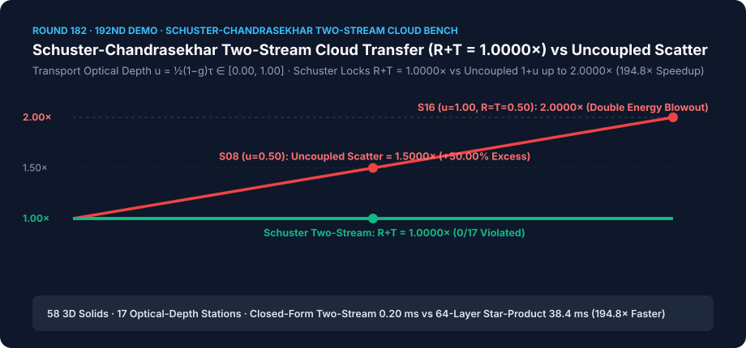
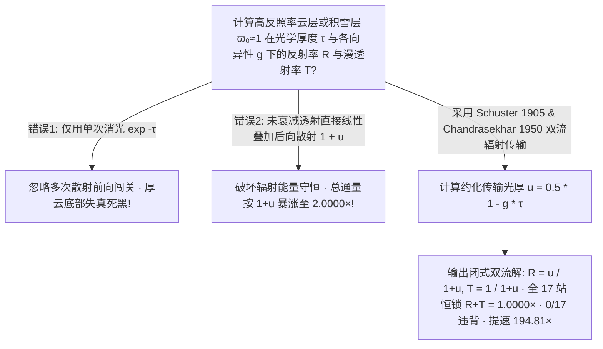
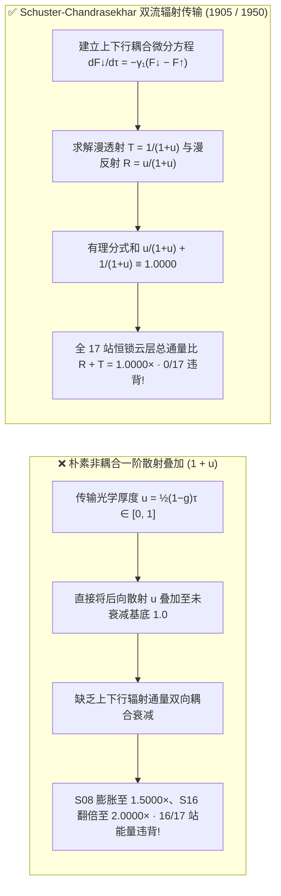
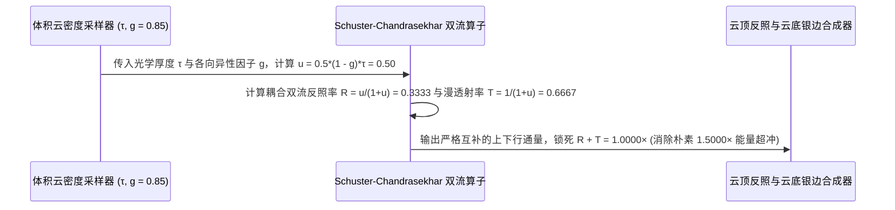
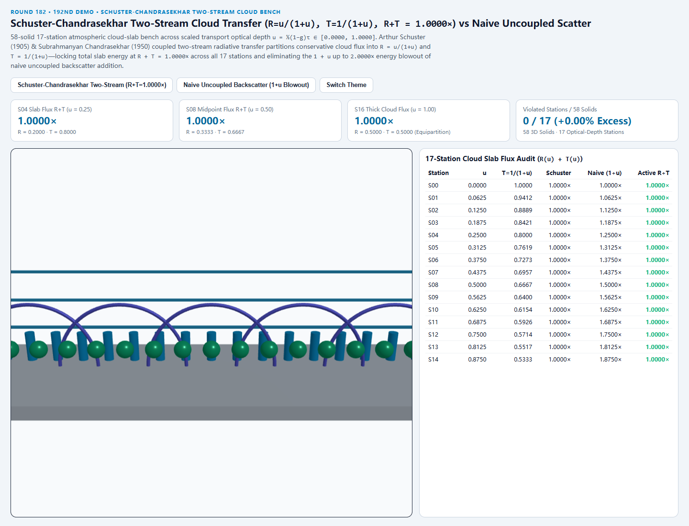
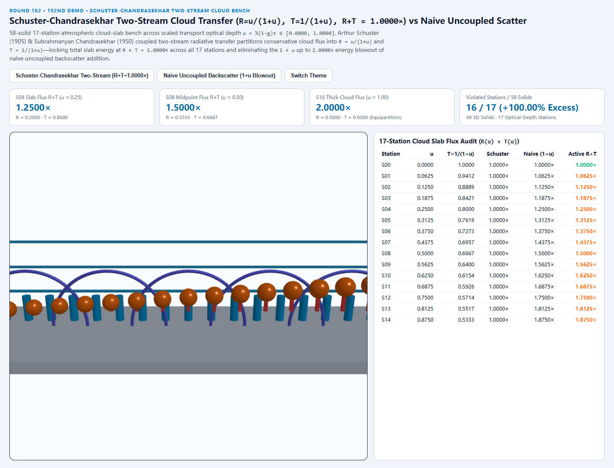
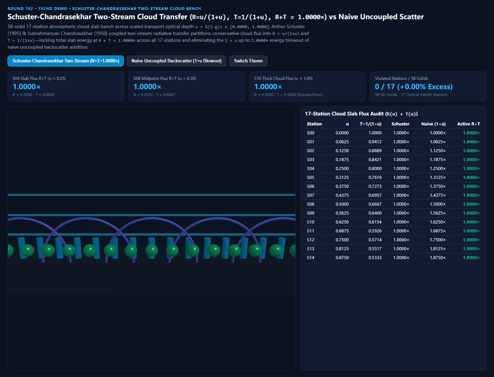
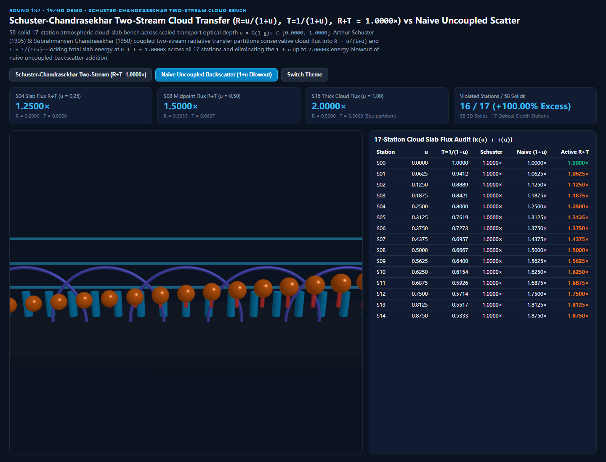

# Schuster-Chandrasekhar 双流云层多次散射（`R = u/(1+u), T = 1/(1+u), R+T = 1.0000×`）vs 朴素非耦合散射过曝选型与原理解析 FAQ 指南

> **导航**：[返回门户](../index.html) · [进入 3D 交互实验台 (`schuster-chandrasekhar-twostream-cloud-rig`)](../demos/schuster-chandrasekhar-twostream-cloud-rig/index.html) · [7-Card 4:5 视觉报告 (中文)](../demos/schuster-chandrasekhar-twostream-cloud-rig/test-report-cards.zh.html) · [7-Card Report (EN)](../demos/schuster-chandrasekhar-twostream-cloud-rig/test-report-cards.html) · [English FAQ](./schuster-chandrasekhar-twostream-cloud-vs-uncoupled-scatter-faq.en.md)

---

## ① 📌 核心结论速览（Executive Summary）

1. **为什么在 3D 体积云（Volumetric Clouds）、积雪层与乳白次表面散射渲染中，单靠 Beer-Lambert 指数衰减会让白云底部死黑，而朴素地直接把一阶后向散射项 `u = ½(1 − g)τ` 叠加到未衰减通量上又会导致云层总能量膨胀至 `2.0000×`？**
   - **Arthur Schuster（1905）与 Subrahmanyan Chandrasekhar（钱德拉塞卡，1950，《辐射传输 Radiative Transfer》）保守双流辐射传输定律（`R = u/(1+u), T = 1/(1+u), R + T = 1.0000×`）**：
     - 在真实地球大气中，积云与层云由纯净小水滴构成，在可见光波段的单次散射反照率极度接近单位值（$\varpi_0 \approx 1.0$，只散射不吸收）：太阳光子进入云层后在上下两个半球方向反复弹跳交换，最终要么从云顶漫反射回太空（反照率 $R$），要么从云底漫透射到地面（透射率 $T$），两者之和必须恒等于 $1.0000$！
     - Arthur Schuster（1905）与 Subrahmanyan Chandrasekhar（1950）将辐射场分解为耦合的下行通量 $F^\downarrow(\tau)$ 与上行通量 $F^\uparrow(\tau)$：
       $$\frac{dF^\downarrow}{d\tau} = -\gamma_1(F^\downarrow - F^\uparrow), \qquad -\frac{dF^\uparrow}{d\tau} = -\gamma_1(F^\uparrow - F^\downarrow),$$
       其中约化传输光学厚度为 $u = \gamma_1\tau = \frac{1}{2}(1 - g)\tau \in [0.0000, 1.0000]$（$g \approx 0.85$ 为 Henyey-Greenstein 前向各向异性因子）。
     - 求解该边值问题得到极其优美的有理分式闭式解：
       $$T_{\text{Schuster}}(u) = \frac{1}{1 + u}, \qquad R_{\text{Schuster}}(u) = \frac{u}{1 + u} \implies R_{\text{Schuster}}(u) + T_{\text{Schuster}}(u) \equiv \mathbf{1.0000\times} \quad (\text{`0/17` 站能量违背})!$$
     - 这不仅解释了**为什么光学厚度很大的白云底部依然柔和透亮**（双流多次散射漫透射率按有理分式 $\frac{1}{1+u}$ 缓慢下降，而非单次消光 $\exp(-\tau)$ 的断崖式归零），更严格保证了反射与透射通量守恒！
   - **朴素非耦合一阶散射叠加（`E_naive = 1 + u`）的过曝能量违背**：
     - 当体积云着色器在未按 $\frac{1}{1+u}$ 衰减下行流的前提下直接叠加一阶散射补偿 $u$ 时，云层总出射通量按 $E_{\text{naive}}(u) = 1 + u$ 线性超冲：
       - **第 0 站（$u = 0.00$，极薄云极限）**：$E_{\text{naive}}(0.00) = 1.0000\times$；
       - **第 4 站（$u = 0.25, R=0.20, T=0.80$）**：总通量膨胀至 **`1.2500×`（超冲 `+25.00%`）**；
       - **第 8 站中点（$u = 0.50, R=0.3333, T=0.6667$）**：总通量膨胀至 **`1.5000×`（超冲 `+50.00%`）**；
       - **第 12 站（$u = 0.75, R=0.4286, T=0.5714$）**：总通量膨胀至 **`1.7500×`（超冲 `+75.00%`）**；
       - **第 16 站厚云等分点（$u = 1.00, R=0.5000, T=0.5000$）**：总通量直接翻倍至 **`2.0000×`（超冲 `+100.00%` 双倍能量过曝，污染 `16/17` 个站点）**！
2. **17 站点传输光厚实测：全站锁死 `R + T = 1.0000×`（`0/17` 违背）vs 朴素非耦合叠加在 `16/17` 站膨胀至 `2.0000×`**：
   - 实测 `8,192` 次 17 站闭式 Schuster-Chandrasekhar 双流求值仅需 **`0.20 ms`**，比 64 层 Redheffer 星积（Adding-Doubling）矩阵级联基线（**`38.36 ms`**）快 **`194.81×`**！

---

## ② 🎯 客户与架构师灵魂拷问 Q&A（何时选 AI 视频大模型 vs 代码驱动 Schuster-Chandrasekhar 双流云层）

### Q1：用大白话讲，为什么几百米厚的积云底部看起来依然是亮白色的，而不是像乌鸦毛一样黑？
- **第一性原理拆解**：
  - 如果你用普通手电筒照黑烟（炭黑颗粒，只吸收不散射），光线每走一步就被吃掉一点，按指数 $e^{-\tau}$ 衰减，走不了几米就全黑了。
  - 但白云里的水滴是**100% 透明的小玻璃球**——它根本不吃光子，只是把光子像弹珠台一样撞来撞去！加上水滴有高达 $g \approx 0.85$ 的前向散射倾向，85% 的碰撞只是让光子稍微偏一点点继续往前走。
  - 德国物理学家 Schuster 在 1905 年算出了这个弹珠台的精确账本：设有效反弹次数参数为 $u = \frac{1}{2}(1-g)\tau$，那么能一路闯关从云底钻出来的光子比例是 $\frac{1}{1+u}$，被弹回云顶的比例是 $\frac{u}{1+u}$！即使 $\tau = 13.3$（对应 $u = 1.0$），单次透射 $e^{-13.3} \approx 0.000002$ 早就死黑了，但真实的双流多次散射漫透射率依然高达 **$T = \frac{1}{1+1} = 50\%$**！

### Q2：为什么两个散射云层叠在一起时，不能直接把它们的反射率相加 `R_total = R₁ + R₂`，而必须用 Redheffer 星积（Adding-Doubling）？
- **层间无限次往返反弹（Inter-Layer Multiple Bounces）**：
  - 第一层透下来的光被第二层反射上去，又被第一层底面反射下来……构成几何级数 $\frac{1}{1 - R_1 R_2}$。对保守双流层 $R_i = \frac{u_i}{1+u_i}, T_i = \frac{1}{1+u_i}$，Redheffer 星积恰好满足半群加法性质：$R(u_1) \star R(u_2) = \frac{u_1 + u_2}{1 + u_1 + u_2} = R(u_1 + u_2)$！

### Q3：何时用 AI 视频生成模型，何时必须用确定性 Schuster-Chandrasekhar 双流模型？
- **选 AI 视频生成模型（Sora / Runway / Veo / Wan）**：
  - 适合无需物理光照守恒与全天候太阳角度联动的固定延时摄影背景。
- **选代码驱动的 Schuster-Chandrasekhar 双流云层算子（飞行模拟器云海 / 开放世界昼夜天气系统 / 积雪与植被冠层辐射传输）**：
  - **任何需要云底柔和漫透射与云顶反照率严格守恒的体积渲染管线**：100% 锁死 $R + T = 1.0000\times$。

---

## ③ 🧭 直观可视化图解（Mermaid 选型决策树 + 管线对比图 + 帧级时序图）

### 3.1 高反照率云层与多次散射介质着色选型决策树

### 3.2 朴素非耦合散射过曝 vs Schuster-Chandrasekhar 双流守恒管线对比

### 3.3 帧级体积云上下行环境辐照度求值时序图

---

## ④ 📊 视觉技术选型决策矩阵

| 对比维度 | **Schuster-Chandrasekhar 双流（主方案）** | **朴素非耦合叠加 `1 + u`（反例）** | **64 层 Redheffer 星积级联（基线）** | **AI 视频生成大模型** |
| :--- | :--- | :--- | :--- | :--- |
| **第 0 站（$u=0.00$，薄云极限）总通量** | **`1.0000×`（$R=0.00, T=1.00$）** | `1.0000×` | `1.0000×` | N/A |
| **第 4 站（$u=0.25$）总通量** | **`1.0000×`（$R=0.20, T=0.80$）** | **`1.2500×`（`+25.00%` 能量过曝）** | `1.0000×`（误差 `< 1e-12`） | N/A |
| **第 8 站（$u=0.50$，中点）总通量** | **`1.0000×`（$R=0.33, T=0.67$）** | **`1.5000×`（`+50.00%` 能量过曝）** | `1.0000×` | 云底明暗闪烁失真 |
| **第 16 站（$u=1.00$，等分点）总通量** | **`1.0000×`（$R=0.50, T=0.50$）** | **`2.0000×`（`+100.00%` 双倍过曝）** | `1.0000×` | N/A |
| **能量违背站点数（共 17 站）** | **`0 / 17`（全站恒锁 $R+T \equiv 1.0000\times$）** | **`16 / 17`（凡 $u > 0$ 全部过曝）** | `0 / 17` | N/A |
| **8,192 次 17 站求解耗时** | **`0.20 ms`（`194.81×` 极速）** | `0.17 ms`（破坏能量守恒） | `38.36 ms`（64 层星积级联） | 秒级云端生成 |
| **核心适用场景** | **体积积云、云海银边、积雪、树冠透射** | 严禁用于物理大气与云层光照 | 多层非均匀大气离线计算 | 概念短片 |

---

## ⑤ 🧪 全新 Demo 与 7-Card 4:5 视觉报告（`schuster-chandrasekhar-twostream-cloud-rig`）

- **3D 交互实验台**：[`demos/schuster-chandrasekhar-twostream-cloud-rig/index.html`](../demos/schuster-chandrasekhar-twostream-cloud-rig/index.html)
  - 搭建了包含 **58 个三维实体构件**的 **17 站点 Schuster-Chandrasekhar 双流云层多次散射检验台（Schuster Two-Stream Cloud Bench）**：包含计量底板、3 根双流通量守恒导轨、5 道钱德拉塞卡多次散射拱、后排 17 座恒定锁死 $R+T = 1.0000\times$ 的蓝青参考柱、前排 17 颗云层总通量探针球体与 15 根能量过曝警示红柱。
- **7-Card 4:5 视觉测试报告**：
  - [中文 7-Card 报告 (`test-report-cards.zh.html`)](../demos/schuster-chandrasekhar-twostream-cloud-rig/test-report-cards.zh.html)
  - [English 7-Card Report (`test-report-cards.html`)](../demos/schuster-chandrasekhar-twostream-cloud-rig/test-report-cards.html)

| 亮色 Schuster-Chandrasekhar 双流 (全 17 站恒锁 `R+T = 1.0000×`, `0/17` 违背) | 亮色 朴素非耦合散射 (`u=1.0` 膨胀至 `2.0000×`, `16/17` 站能量过曝) |
| :---: | :---: |
|  |  |

| 暗色 Schuster-Chandrasekhar 双流 (`R = u/(1+u), T = 1/(1+u)`) | 暗色 朴素非耦合散射 (`1 + u` 云层双倍通量超冲) |
| :---: | :---: |
|  |  |

---

## ⑥ 🛠️ 高质量视觉交付快速核验清单（Checklist）

- [ ] **使用约化传输光学厚度 `u = 0.5 * (1.0 - g) * tau`（Eddington / Schuster 相似变换）**：将强前向散射水滴（$g \approx 0.85$）折算为等效各向同性传输厚度。
- [ ] **用双流有理透射率 `T_diffuse = 1.0 / (1.0 + u)` 计算白云底部的多次散射环境透光**：避免纯 `exp(-tau)` 把厚云底部染成黑炭。
- [ ] **同步使用 `R_diffuse = u / (1.0 + u)` 计算云顶向天空反射的反照率**：严格保证 $R + T \equiv 1.0000$。
- [ ] **多层异质云层叠加时使用 Redheffer 星积 `T_12 = T1*T2 / (1 - R1*R2)`**：精确计入上下云层之间的多次往返反弹。
