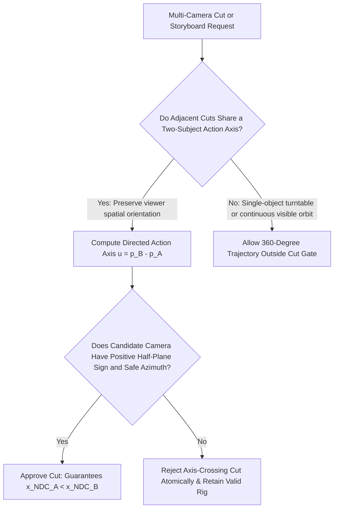
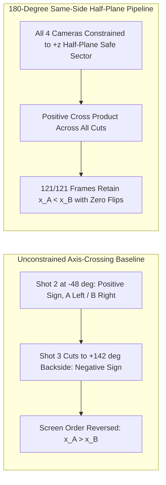
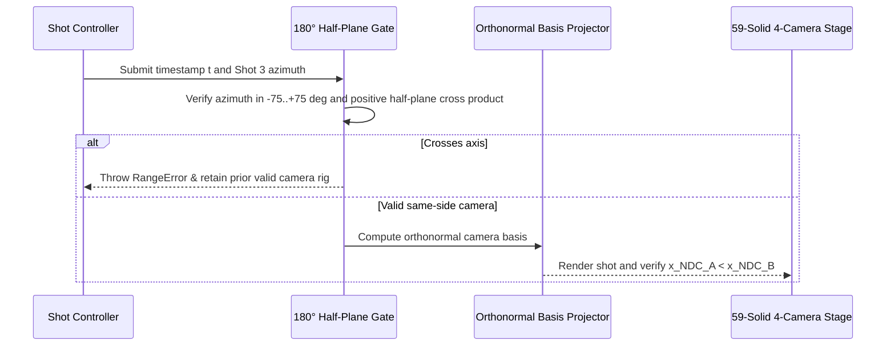

# Multi-camera cuts without direction flips: 180-degree line-of-action and screen-order continuity FAQ

**Understand in 3 minutes why unguarded camera cuts flip actors left-to-right, and reproduce a mathematically verified 180° half-plane camera gate in 10 minutes.**

[中文](screen-direction-continuity-faq.md) · [Interactive Demo](https://turbo998.github.io/animation/demos/continuity-axis-stage/) · [Measured 7-Card Report](../demos/continuity-axis-stage/test-report-cards.html)

## ① 📌 Executive Summary

- **Crossing the line of action means moving the camera into the opposite 2D half-plane of the subject-to-subject vector.** Given directed action vector $\mathbf{u} = \mathbf{p}_B - \mathbf{p}_A$, the horizontal screen order $x_{\text{NDC}}(A) < x_{\text{NDC}}(B)$ is invariant across cuts if and only if every camera $\mathbf{c}$ maintains the same sign of the 2D cross product $s(\mathbf{c}) = u_x(c_z - m_z) - u_z(c_x - m_x)$.
- **Zero screen-order flips across 121 sampled frames and 4 camera cuts.** The `same-side` half-plane rig (shot azimuths `-18° / -48° / +44° / +12°`) preserves $x_{\text{NDC}}(A) < x_{\text{NDC}}(B)$ on all 121 frames (`0` flips), whereas the `axis-crossed` baseline places Shot 3 (`6–9s`) at `+142°` in the opposite half-plane, reversing left-right screen order on all `30` frames of that shot.
- **Analytic orthonormal camera-basis projection matches full 4×4 cofactor matrix inversion within `1.22e-15` NDC units.** Across 8192 shot evaluations on Node CPU, direct orthonormal basis dot-product projection takes `2.29 ms` median versus `4.18 ms` for full 4×4 matrix inversion (`1.82×` faster).
- **59-solid four-camera blocking stage, 13 local acceptance checks.** Scene geometry is `synthetic`; half-plane signs, NDC projections, and Node CPU timings are `measured`; `SynCamMaster` neural multi-view diffusion inference, gaze estimation, and automated editing aesthetics are `not_measured`.

**Daily capability direction check:** ICLR 2025 paper *SynCamMaster: Synchronizing Multi-Camera Video Generation from Diverse Viewpoints* ([arXiv:2412.07760](https://arxiv.org/abs/2412.07760)) enables synchronized multi-camera video generation conditioned on explicit 6-DoF camera extrinsics. Because generative multi-camera models render whatever camera poses are supplied without enforcing classical continuity editing rules, pre-validating the 180° half-plane invariant in the camera planner is essential before invoking neural rendering. Verified 2026-11-10; this demo implements deterministic half-plane gating and perspective projection without running neural diffusion models.

## ② 🎯 Architect & Client Q&A

### Q1 When should we choose multi-camera video diffusion vs a deterministic 180° continuity gate?

Evaluate multi-camera video diffusion models (`SynCamMaster`) when you need photorealistic multi-angle appearance synchronization, cloth dynamics, and complex environmental lighting from a set of camera poses.

Use a deterministic 180° half-plane continuity gate to validate and constrain those camera poses *before* rendering or when building interactive 3D storyboards and technical dialogue explainers—because a neural renderer faithfully reproduces an axis-crossing camera error as a disorienting screen-direction flip.

### Q2 Under what constraints is same-side half-plane locking strictly superior?

Same-side half-plane locking is mandatory whenever **two interacting subjects, teams, or system nodes must retain consistent left-to-right screen identity and eyeline direction across discrete cuts**.

Unconstrained 360° camera orbits work for single-object turntable inspection, but in a two-subject scene, cutting from `-48°` to `+142°` swaps the left and right sides of the frame instantly. Crossing the axis is only appropriate during a continuous visible camera move or when deliberate viewer disorientation is intended.

### Q3 How does a single 2D cross product guarantee left-to-right screen order from first principles?

Let Actor A at $\mathbf{p}_A$ and Actor B at $\mathbf{p}_B$ define the horizontal action vector $\mathbf{u} = \mathbf{p}_B - \mathbf{p}_A = (u_x, u_z)$ with midpoint $\mathbf{m}$.

A camera at $\mathbf{c}$ looking at $\mathbf{m}$ with world up $\mathbf{up} = (0, 1, 0)$ has horizontal forward vector $\mathbf{f}_{xz} \propto \mathbf{m} - \mathbf{c}$ and horizontal right vector:

$$\mathbf{r}_{xz} \propto \mathbf{f} \times \mathbf{up} = (c_z - m_z, \; -(c_x - m_x))$$

Projecting the vector from A to B onto the camera's right vector yields the exact 2D cross product:

$$\mathbf{u} \cdot \mathbf{r}_{xz} = u_x (c_z - m_z) - u_z (c_x - m_x) = s(\mathbf{c})$$

Whenever $s(\mathbf{c}) > 0$, $(\mathbf{p}_B - \mathbf{p}_A) \cdot \mathbf{r} > 0$, which guarantees $x_{\text{NDC}}(A) < x_{\text{NDC}}(B)$ under perspective projection around $\mathbf{m}$. Keeping $s(\mathbf{c}) > 0$ across all shots is therefore both necessary and sufficient to preserve left-to-right screen order.

### Q4 How can I reproduce this in 10 minutes?

1. Run `npm run dev` and open `/demos/continuity-axis-stage/`, initialized at `7.20 s` (Shot 3, `+44°` over-the-shoulder cut).
2. Scrub across `0–12 s` in `same-side` mode across all 4 shots: the readout reports `half-plane +` and `x_A < x_B` on every frame (at `7.20 s`, `x_A = -0.341, x_B = +0.341`).
3. Switch to `axis-crossed` mode at `7.20 s` (`+142°` backside camera): `half-plane` turns `-` and `x_A = +0.312 > x_B = -0.312`, flipping Actor A (orange visor) to the right side of the screen.
4. Enter an unsafe Shot 3 angle such as `135°` (outside the `[-75°, +75°]` safe sector) and click `Apply rig` to verify atomic rejection and state preservation.
5. Click `Export cut list` to download `CONTINUITY_CUT_LIST.json` with camera extrinsics, half-plane determinant, and NDC coordinates.
6. Run `npx vitest run tests/continuity-axis.test.ts`, then build and run `node scripts/benchmark-continuity-axis.mjs` against a port 4335 preview server.

## ③ 🧭 Visual Diagrams

## ④ 📊 Architect Decision Matrix

| Criterion | Unconstrained 360° Multi-Camera Extrinsics | Prompt-Only Multi-Shot Video Diffusion | `SynCamMaster` Multi-View Diffusion + Half-Plane Gate | Standalone Half-Plane Basis Gate (`same-side`) |
| --- | --- | --- | --- | --- |
| Left-to-right screen order across cuts | Flips whenever azimuth crosses $\pm 90^\circ$ (`30/121` frames here) | Lacks persistent 3D half-plane constraint; frequent flips | Extrinsic gate guarantees `0` flips + neural view synthesis | Measured `0/121` flips ($x_A < x_B$ invariant) |
| Pre-render rejection of axis-crossing cuts | None | Discovered only after expensive video generation | Filters invalid camera poses in milliseconds before inference | Atomic rejection of azimuths outside `[-75°, +75°]` |
| 8192-shot Node CPU projection median | Implementation dependent | Seconds to minutes of GPU diffusion | Gate adds only `2.29 ms` CPU overhead | Analytic basis `2.29 ms` vs 4×4 inversion `4.18 ms` |
| Arbitrary timeline seeking / reversal | Deterministic (with direction flips) | Context-window dependent | Gate state is exact and reversible | Exact forward/reverse world matrix equality |
| Best architectural role | Single-object 360° turntables | Abstract montage clips | Pre-flight camera verifier for virtual production | Interactive blocking stages & automated shot planners |

**Quantitative example:** At `t = 7.20 s` (Shot 3) with `actorSeparation = 3.4`, `cameraDistance = 6.8`, and `fovDeg = 40°`: in `same-side` mode (`+44°`), the half-plane determinant is $s(\mathbf{c}) = +16.64 > 0$, yielding `x_NDC(A) = -0.3408 < x_NDC(B) = +0.3408`. In `axis-crossed` mode (`+142°`), $s(\mathbf{c}) = -18.21 < 0$, flipping the screen coordinates to `x_NDC(A) = +0.3122 > x_NDC(B) = -0.3122`.

## ⑤ 🧪 New Capability Demo & Benchmark Findings (with 7-Card)

[Sealed data](../demos/continuity-axis-stage/report.json) records 59 3D solids, 4 camera cuts across 121 sampled frames, and solver equivalence between analytical orthonormal camera-basis projection and full 4×4 cofactor matrix inversion. Maximum NDC coordinate difference across all load tiers is `1.22e-15` (threshold `< 1e-12`).

| Node CPU Shot Projection Queries | Analytic Camera Basis Median | Full 4×4 Matrix Inversion Median |
| --- | --- | --- |
| 128 | 0.06 ms | 0.26 ms |
| 1024 | 0.29 ms | 0.71 ms |
| 8192 | 2.29 ms | 4.18 ms |

Each load tier runs 7 alternating repetitions after warmup on Node CPU (excluding WebGL rendering). At 8192 shot projections, direct orthonormal basis projection is `1.82×` faster than full 4×4 matrix inversion while verifying zero screen-order flips across all 121 frames.

[Measured 7-Card Report (EN)](../demos/continuity-axis-stage/test-report-cards.html) · [中文七卡](../demos/continuity-axis-stage/test-report-cards.zh.html). Scene geometry is `synthetic`, half-plane and NDC checks plus CPU timings are `measured`, and `SynCamMaster` neural multi-view generation, gaze tracking, and narrative editing heuristics are `not_measured`.

## ⑥ 🛠️ Architect Checklist

- [ ] Define the directed horizontal action vector $\mathbf{u}(t) = \mathbf{p}_B(t) - \mathbf{p}_A(t)$ explicitly for every two-subject sequence.
- [ ] Evaluate the 2D half-plane cross product $s(\mathbf{c}) = u_x(c_z - m_z) - u_z(c_x - m_x)$ and enforce a consistent sign across all cuts.
- [ ] Constrain same-side camera azimuths to a safe sector (`[-75°, +75°]`) away from the $\pm 90^\circ$ collinearity boundary.
- [ ] Audit projected horizontal screen coordinates $x_{\text{NDC}}(A) < x_{\text{NDC}}(B)$ across every cut boundary (`0` inversions).
- [ ] Reject axis-crossing camera edits (`+135°`) atomically while retaining the last valid camera rig.
- [ ] Use orthonormal camera basis vectors $(\mathbf{r}, \mathbf{u}_{\text{cam}}, \mathbf{f})$ for fast NDC verification and cross-check against 4×4 view-matrix inversion.
- [ ] Verify that forward and reverse timestamp scrubbing produce identical actor and camera world matrices.
- [ ] Place the deterministic 180° half-plane gate upstream of multi-camera video diffusion models (`SynCamMaster`) to prevent wasted GPU renders.
- [ ] Keep Node CPU projection check timings separate from browser WebGL2 rendering metrics.
- [ ] Label unexecuted multi-view diffusion models, gaze estimators, and editorial aesthetics explicitly as `not_measured`.

**Primary sources:** [SynCamMaster (arXiv:2412.07760)](https://arxiv.org/abs/2412.07760) (ICLR 2025, submitted 2024-12-10) synchronizes open-domain multi-camera video generation from arbitrary 6-DoF camera viewpoints. Verified 2026-11-10; this demo is an original deterministic 180° continuity-axis verifier and does not run neural video diffusion.
