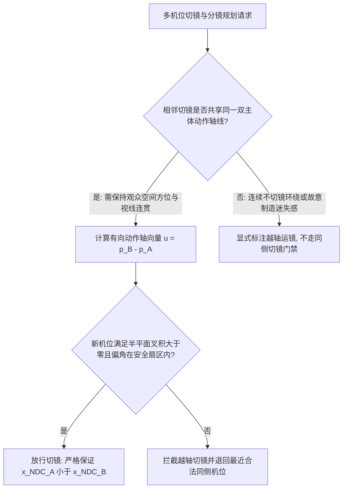
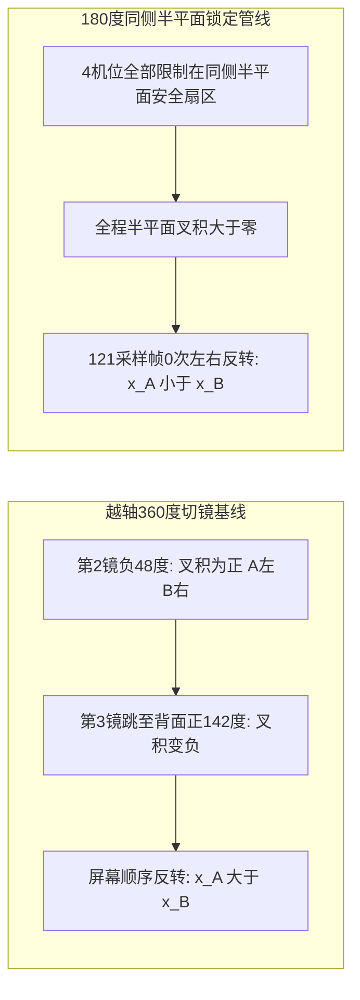
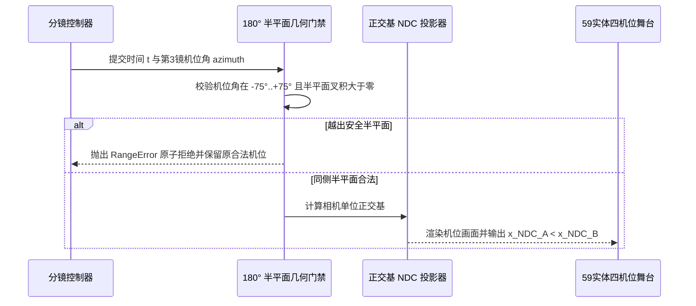

# 多机位切镜不跳轴：180 度动作轴线与屏幕左右方向守恒选型 FAQ

**3 分钟看懂为什么切镜头会让对话人物左右颠倒，10 分钟复刻可数学证明的 180° 同侧半平面机位门禁。**

[English](screen-direction-continuity-faq.en.md) · [交互 Demo](https://turbo998.github.io/animation/demos/continuity-axis-stage/) · [中文七卡](../demos/continuity-axis-stage/test-report-cards.zh.html)

## ① 📌 核心结论速览

- **切镜“跳轴”（Crossing the Line）的本质是相机跨过了双主体连线所在的二维半平面。** 当演员 A 与 B 构成有向动作轴向量 $\mathbf{u} = \mathbf{p}_B - \mathbf{p}_A$ 时，只有当所有机位相对于 $\mathbf{u}$ 的二维叉积符号 $s(\mathbf{c}) = u_x(c_z - m_z) - u_z(c_x - m_x)$ 保持同号，屏幕上 A 左 B 右的归一化设备坐标顺序（$x_{\text{NDC}}(A) < x_{\text{NDC}}(B)$）才不会反转。
- **121 个四镜头采样帧实现 `0` 次屏幕方向反转。** 同侧半平面模式（4 机位方位角 `-18° / -48° / +44° / +12°`）在全部 121 个采样时刻严格保持 $x_{\text{NDC}}(A) < x_{\text{NDC}}(B)$；而越轴基线在第 3 镜（`6–9s`）将机位放到对面半平面的 `+142°`，导致 `30` 个采样帧全部发生左右位置颠倒。
- **解析相机正交基投影与完整 4×4 伴随矩阵求逆逐帧等价。** 在三档负载下，直接用相机正交基 $(\mathbf{r}, \mathbf{u}_{\text{cam}}, \mathbf{f})$ 做内积投影与 4×4 矩阵伴随求逆的最大 NDC 坐标差仅 `1.22e-15`，8192 次投影中位数耗时为 `2.29 ms` 对比 `4.18 ms`。
- **59 实体四机位对话舞台，13 项本机实测验收。** 场景为 `synthetic`；半平面符号、NDC 屏幕顺序与 Node CPU 耗时为 `measured`；`SynCamMaster` 神经多视角扩散生成、面部视线追踪与叙事剪辑启发式为 `not_measured`。

**每日能力方向核验：** ICLR 2025 论文 *SynCamMaster: Synchronizing Multi-Camera Video Generation from Diverse Viewpoints*（[arXiv:2412.07760](https://arxiv.org/abs/2412.07760)）实现了外参条件控制的多机位同步视频生成；而在多镜头虚拟制片与 AI 分镜自动调度中，生成模型本身并不自动拒绝越过 180° 动作轴线的外参轨迹，必须由上层相机规划器提供半平面几何门禁。2026-11-10 核验原文；本例仅实现确定性半平面校验与透视投影，未运行多视角扩散模型。

## ② 🎯 客户与架构师灵魂拷问 Q&A

### Q1 何时选多机位视频大模型，何时选确定性 180° 轴线几何门禁？

当需要从不同视角同步生成逼真人物外观、衣料光影与复杂背景时，可评估 `SynCamMaster` 等 6-DoF 外参控制的多机位视频扩散模型。

但视频大模型只会忠实渲染你给它的相机外参——如果你传入的第 3 镜相机矩阵跨过了演员 A 与 B 的连线，生成的画面同样会发生“跳轴”，让观众瞬间分不清谁在跟谁说话。因此在把机位序列喂给渲染器或视频大模型之前，必须用确定性半平面几何门禁先锁死机位所在侧。

### Q2 在什么约束下同侧半平面锁死严格更优？

在双人访谈、法庭质证、技术架构对谈、体育攻防演示等**要求观众跨镜头立即识别左右阵营与视线方向**的场景中，同侧半平面约束是硬性几何不变量。

如果放任环绕相机在 `-180°` 到 `+180°` 全圆周自由切镜，一旦跨过 $\pm 90^\circ$ 轴线边界，原本在画面左边向右看的演员 A 会在下一帧跳到画面右边向左看。只有当艺术表达故意追求方向迷失感、或者镜头在连续不切镜的运镜中当着观众面缓缓绕过轴线时，才允许改变半平面符号。

### Q3 底层管线如何用一行叉积公式锁死屏幕左右顺序？

把摄影棚地面看作水平 $(x, z)$ 平面：演员 A 位于 $\mathbf{p}_A$，演员 B 位于 $\mathbf{p}_B$，中点为 $\mathbf{m}$。有向动作轴向量为 $\mathbf{u} = \mathbf{p}_B - \mathbf{p}_A = (u_x, u_z)$。

当相机位于 $\mathbf{c}$ 并朝向中点 $\mathbf{m}$ 时，视线前向向量在水平面的投影为 $\mathbf{f}_{xz} \propto \mathbf{m} - \mathbf{c}$。世界向上向量为 $\mathbf{up} = (0, 1, 0)$，因此相机的水平右向量为：

$$\mathbf{r}_{xz} \propto \mathbf{f} \times \mathbf{up} = (-(m_z - c_z), \; m_x - c_x) = (c_z - m_z, \; -(c_x - m_x))$$

现在把动作轴向量 $\mathbf{u} = \mathbf{p}_B - \mathbf{p}_A$ 投影到相机右向量 $\mathbf{r}_{xz}$ 上，内积恰好等于二维叉积：

$$\mathbf{u} \cdot \mathbf{r}_{xz} = u_x (c_z - m_z) - u_z (c_x - m_x) = s(\mathbf{c})$$

只要 $s(\mathbf{c}) > 0$，就有 $(\mathbf{p}_B - \mathbf{p}_A) \cdot \mathbf{r} > 0$，即投影到屏幕水平轴后必然满足 $x_{\text{NDC}}(A) < x_{\text{NDC}}(B)$！这一几何恒等式从第一性原理证明了：守住半平面叉积正号，就等价于守住屏幕左右顺序。

### Q4 十分钟如何复刻？

1. `npm run dev` 后打开 `/demos/continuity-axis-stage/`，默认停在 `7.20 s`（第 3 镜，`+44°` 过肩镜头）。
2. 在同侧半平面模式（`same-side`）下从 `0 s` 拖到 `12 s` 经历全部 4 个镜头：读数始终显示 `half-plane +` 且 `x_A < x_B`（如 `7.20 s` 时 `x_A = -0.341, x_B = +0.341`）。
3. 切换到越轴跳向基线（`axis-crossed`）：在第 3 镜（`7.20 s`，机位跳到背面 `+142°`），`half-plane` 变为 `-`，`x_A = +0.312 > x_B = -0.312`，戴橙色面罩的演员 A 瞬间反跳到屏幕右侧！
4. 在控制栏尝试输入越界的第 3 镜角度（如 `135°`，超出 `[-75°, +75°]` 安全扇区）并点击应用：系统原子拒绝该越轴机位并保留原有效状态。
5. 点击导出 `CONTINUITY_CUT_LIST.json`，获取当前机位外参、半平面行列式与演员 NDC 坐标。
6. 运行 `npx vitest run tests\continuity-axis.test.ts`；构建并在 4335 端口预览后执行 `node scripts\benchmark-continuity-axis.mjs`。

## ③ 🧭 直观可视化图解

## ④ 📊 Architect Decision Matrix

| 评估维度 | 无约束随机/环绕多机位外参 | 纯提示词驱动多镜头 AI 视频 | `SynCamMaster` 等多视角扩散 + 本例半平面门禁 | 本例独立半平面正交基门禁 (`same-side`) |
| --- | --- | --- | --- | --- |
| 跨镜头屏幕左右顺序守恒 | 越过 $\pm 90^\circ$ 即发生反转（本例 30/121 帧反转） | 缺乏三维半平面记忆，频繁跳轴 | 外参门禁保证 `0` 反转 + 扩散模型渲染外观 | 121 帧实测 `0` 次反转（$x_A < x_B$ 恒成立） |
| 越轴机位事前拦截能力 | 无拦截 | 只能抽卡后人工废片重跑 | 渲染前毫秒级过滤非法外参 | 对 `[-75°, +75°]` 外机位执行原子拒绝 |
| 8192 次镜头投影 CPU 耗时 | 视实现而定 | 需秒级至分钟级 GPU 推理 | 门禁仅占 `2.29 ms` CPU 开销 | 解析正交基 `2.29 ms` vs 4×4 求逆 `4.18 ms` |
| 任意时间轴拖拽与逆序重访 | 确定性（但方向错乱） | 自回归依赖历史上下文 | 几何门禁状态完全可逆 | 正逆序重访矩阵逐元素完全一致 |
| 适用场景 | 单物体 360° 商品展示转台 | 抽象艺术混剪 | 虚拟制片多机位生成管线前置校验 | 分镜预演工作台、多机位切镜教学与自动化验收 |

**定量算例：** 在 `t = 7.20 s`（第 3 镜），演员间距 `3.4`、相机距离 `6.8`、视场角 `40°`。同侧模式下机位角为 `+44°`，半平面叉积 $s(\mathbf{c}) = +16.64 > 0$，投影得到 `x_NDC(A) = -0.3408 < x_NDC(B) = +0.3408`；越轴基线机位角为 `+142°`，半平面叉积 $s(\mathbf{c}) = -18.21 < 0$，投影变为 `x_NDC(A) = +0.3122 > x_NDC(B) = -0.3122`，左右顺序完全颠倒。

## ⑤ 🧪 全新 Demo 与 Benchmark 核心发现（含 7-Card）

[封存数据](../demos/continuity-axis-stage/report.json)记录了 59 个三维实体、4 个镜头切镜时间线、121 个采样帧的屏幕左右顺序核验，以及解析相机正交基投影与完整 4×4 伴随矩阵求逆的等价性与耗时对照。两种投影方法在全部负载下的最大 NDC 坐标差仅 `1.22e-15`（门限 `< 1e-12`）。

| Node CPU 镜头投影查询数 | 解析相机正交基投影中位数 | 完整 4×4 矩阵求逆投影中位数 |
| --- | --- | --- |
| 128 | 0.06 ms | 0.26 ms |
| 1024 | 0.29 ms | 0.71 ms |
| 8192 | 2.29 ms | 4.18 ms |

每档负载在预热后按交替顺序重复 7 次，记录 Node CPU 耗时中位数（不含 WebGL 渲染）。在 8192 次镜头投影校验中，直接用相机正交基内积投影比构造并求逆 4×4 矩阵快约 `1.82×`，且同侧半平面模式在全部 121 个采样帧保持 `0` 次屏幕左右反转。

[中文七卡](../demos/continuity-axis-stage/test-report-cards.zh.html) · [English](../demos/continuity-axis-stage/test-report-cards.html)。画面为 `synthetic`，半平面几何与 CPU 计时为 `measured`；`SynCamMaster` 神经多视角扩散生成、视线估计与自动剪辑审美为 `not_measured`。

## ⑥ 🛠️ Architect Checklist

- [ ] 在多机位切镜管线中显式定义有向动作轴向量 $\mathbf{u}(t) = \mathbf{p}_B(t) - \mathbf{p}_A(t)$。
- [ ] 对每个候选机位计算水平半平面二维叉积 $s(\mathbf{c}) = u_x(c_z - m_z) - u_z(c_x - m_x)$，确保整场切镜同号。
- [ ] 将同侧切镜方位角限制在远离轴线奇异点的安全扇区（如 `[-75°, +75°]`），防止擦边切镜引起透视重叠。
- [ ] 在切镜前后逐帧核验投影屏幕顺序 $x_{\text{NDC}}(A) < x_{\text{NDC}}(B)$，确保反转帧数为 `0`。
- [ ] 对越出安全半平面的机位修改请求（如 `+135°`）执行原子拒绝，保留上一个合法分镜配置。
- [ ] 优先使用单位正交相机基 $(\mathbf{r}, \mathbf{u}_{\text{cam}}, \mathbf{f})$ 内积计算 NDC 投影，并与完整 4×4 视图矩阵求逆交叉核验。
- [ ] 验证正序播放与逆序跳转至同一切镜时间戳时，导出的演员与相机矩阵完全一致。
- [ ] 将确定性 180° 轴线门禁放在多视角视频扩散模型（如 `SynCamMaster`）调用之前，避免浪费算力渲染越轴废片。
- [ ] 区分 Node CPU 外参投影校验耗时与浏览器 WebGL2 帧渲染耗时。
- [ ] 未执行的多视角神经视频生成、人脸视线识别与艺术越轴叙事统一标注为 `not_measured`。

**一手来源：** [SynCamMaster (arXiv:2412.07760)](https://arxiv.org/abs/2412.07760)（ICLR 2025，2024-12-10 提交）提出多视角同步模块以根据给定 6-DoF 相机外参生成跨机位一致的视频。2026-11-10 核验；本例聚焦外参输入前的 180° 动作轴线几何不变量核验，未运行该扩散模型。
