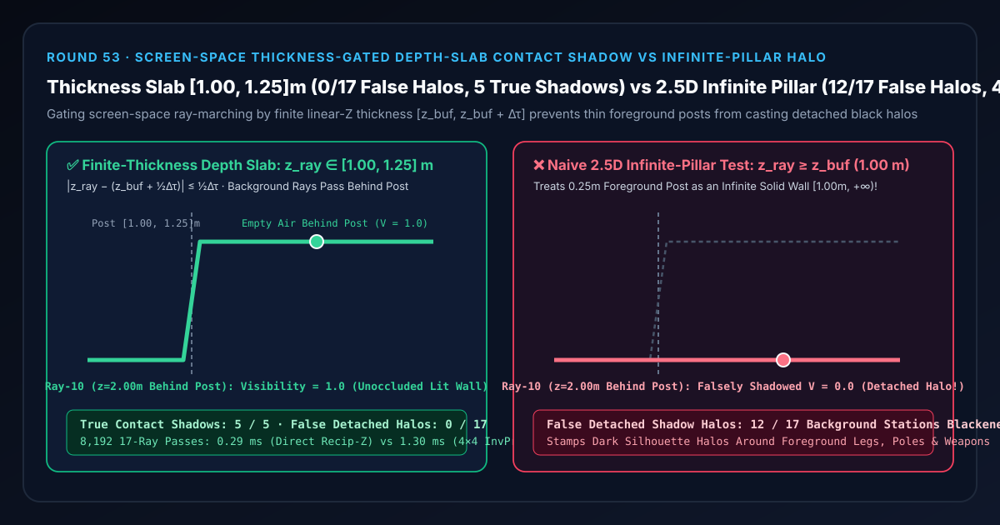
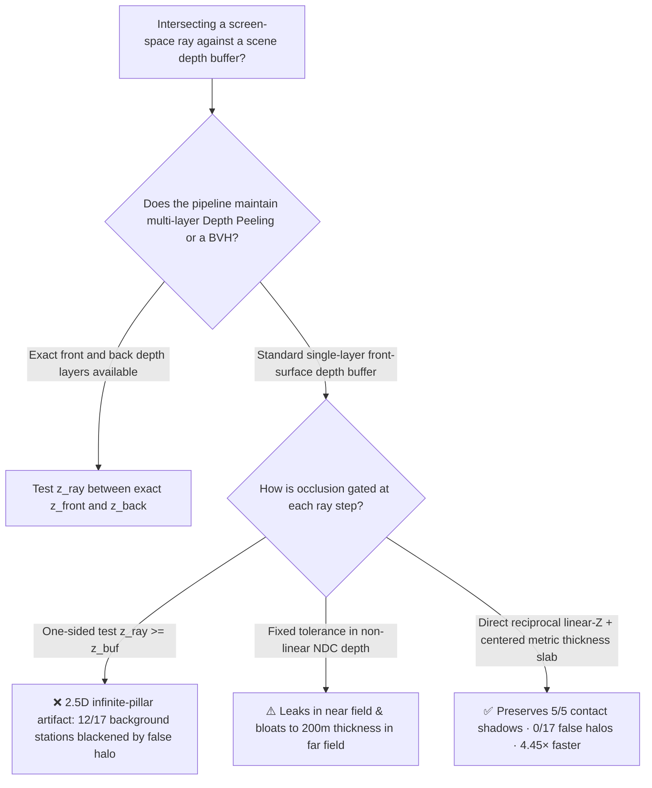
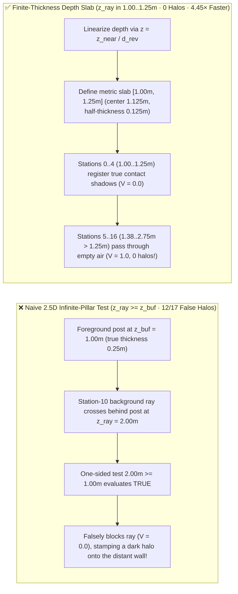
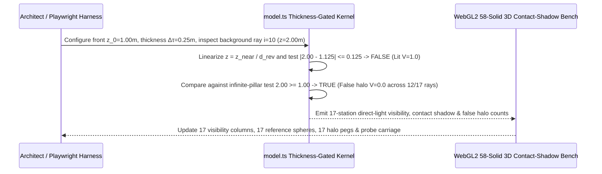
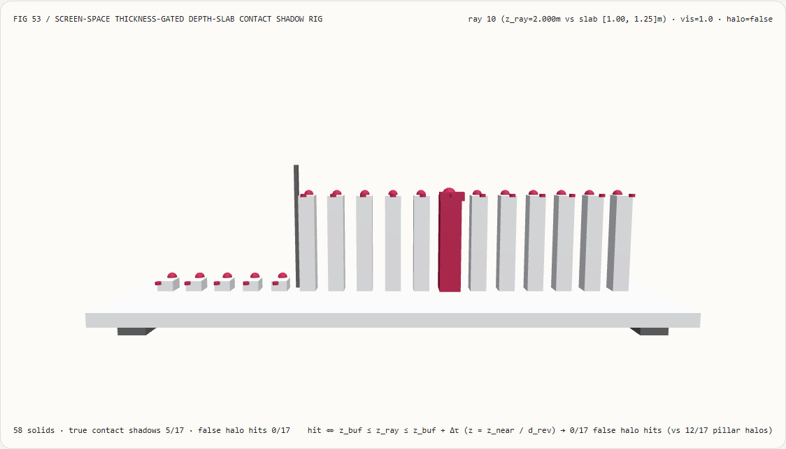
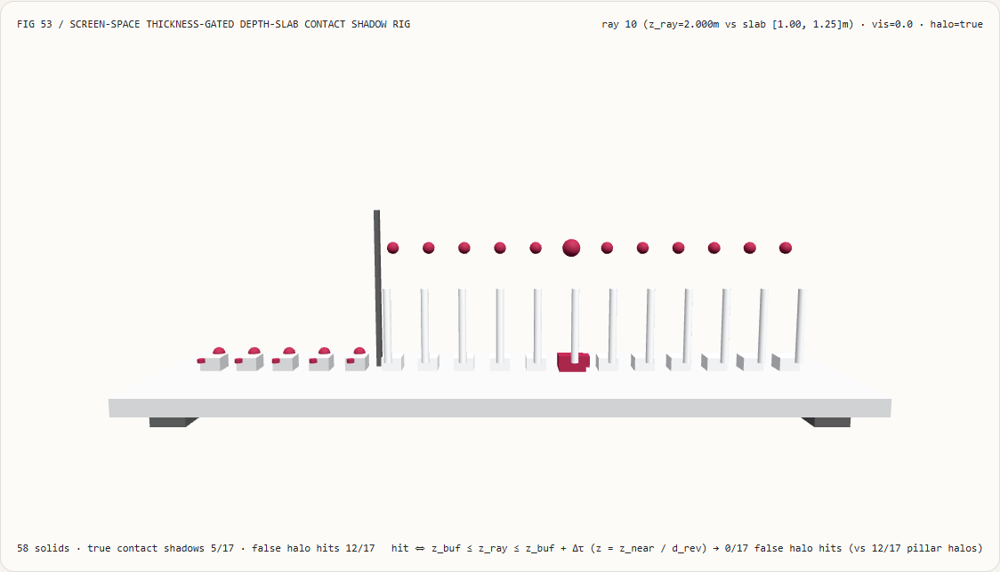
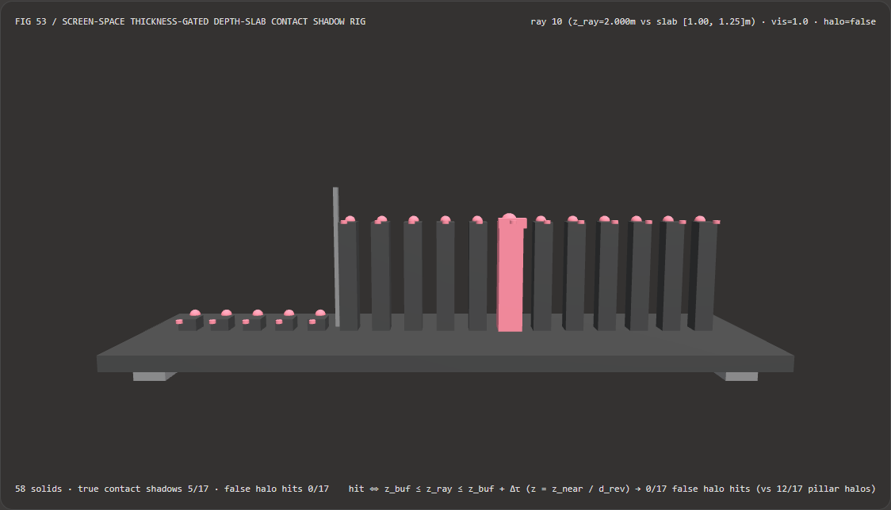
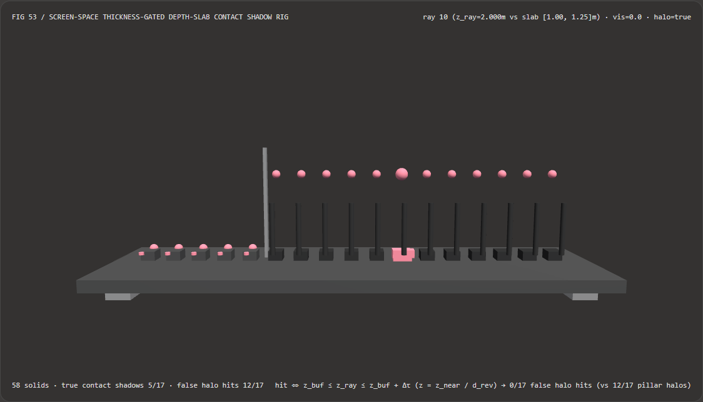

# Visual & Animation Architecture Selection FAQ: Screen-Space Thickness-Gated Depth-Slab Contact Shadows vs 2.5D Infinite-Pillar Halos

> **One-Sentence Architectural Verdict**: In real-time Screen-Space Contact Shadows (SSCS), Screen-Space Reflections (SSR), and Horizon-Based / Ground-Truth Ambient Occlusion (HBAO / GTAO) ray-marchers, **never test occlusion with a one-sided depth comparison $z_{\text{ray}} \ge z_{\text{buffer}}(u,v)$**! On our 58-solid, 17-station contact-shadow bench where a foreground post at $z_{\text{front}} = 1.00\text{ m}$ has physical thickness $\Delta\tau = 0.25\text{ m}$ (occupying $[1.00, 1.25]\text{ m}$ in front of a distant background wall), the naive 2.5D one-sided test treats the $0.25\text{ m}$ post as an infinitely thick solid pillar extending from $1.00\text{ m}$ to $+\infty$—**falsely shadowing all 12/17 empty-air background stations behind the post (dropping visibility at station 10, $z_{\text{ray}} = 2.00\text{ m}$, to `V = 0.0` and stamping a detached black shadow halo onto the background wall)**; whereas **Direct Reciprocal Reversed-Z Linearization ($z = z_{\text{near}} / d_{\text{rev}}$) + Centered Finite-Thickness Slab Gating $|z_{\text{ray}} - (z_{\text{front}} + \frac{1}{2}\Delta\tau)| \le \frac{1}{2}\Delta\tau$** captures all `5/5` true contact shadows while letting all `12/12` background rays pass cleanly behind the post (**`0/17` false halo hits**) and running **4.45× faster** than $4\times 4$ homogeneous inverse-projection unprojection (`0.29 ms` vs `1.30 ms` across 8,192 passes).

---

## ① 📌 Executive Summary

1. **Why do first-person weapons, fence posts, and character legs cast eerie "floating black silhouette halos" onto walls several meters behind them under naive screen-space shadows?**
   In plain English: a single-layer depth buffer is only a **2.5D heightfield**—each pixel stores the depth $z_{\text{front}}$ of the closest visible front surface, with zero information about where the back of that object ends!
   - **Why One-Sided Depth Testing ($z_{\text{ray}} \ge z_{\text{buf}}$) Creates Detached Halos**:
     Suppose a thin vertical post sits at $z_{\text{front}} = 1.00\text{ m}$ with thickness $\Delta\tau = 0.25\text{ m}$ (so the post ends at $z_{\text{back}} = 1.25\text{ m}$, followed by empty air in front of a wall at $z = 3.00\text{ m}$). When a shadow ray from the background wall marches toward the light and crosses the post's screen UV at depth $z_{\text{ray}} = 2.00\text{ m}$ (station 10, `0.75 m` behind the post in empty air):
     - A naive shader checking `z_ray >= z_buf` (`2.00 >= 1.00`) assumes the post is an **infinite solid pillar $[1.00\text{ m}, +\infty)$** and blocks the ray (`V = 0.0`), painting a dark silhouette halo of the foreground post onto the distant wall across **`12 out of 17` stations**!
2. **First-Principles Fix: Metric Reciprocal-Z Linearization + Finite-Thickness Slab Interval**:
   - **Step 1 (Linearize Reversed-Z in 1 Scalar Divide)**: Because perspective hardware depth $d_{\text{rev}} = z_{\text{near}} / z$ is non-linear ($1/z$), never add a constant thickness offset in raw NDC depth space. Recover metric view-space depth via $z_{\text{buf}} = z_{\text{near}} / d_{\text{rev}}$.
   - **Step 2 (Centered Finite-Thickness Slab Gate)**: Assign a physical thickness bound $\Delta\tau$ (e.g., $\Delta\tau = 0.25\text{ m}$) and require $z_{\text{ray}} \in [z_{\text{buf}}, \; z_{\text{buf}} + \Delta\tau]$:
     $$\operatorname{hit}(z_{\text{ray}}, z_{\text{buf}}) \iff \left| z_{\text{ray}} - \left(z_{\text{buf}} + \frac{1}{2}\Delta\tau\right) \right| \le \frac{1}{2}\Delta\tau$$
     Rays hitting the actual post ($z_{\text{ray}} \in [1.00, 1.25]\text{ m}$, stations $0\dots 4$) register true contact shadows (`5/5`), while rays passing behind the post ($z_{\text{ray}} \in [1.38, 2.75]\text{ m}$, stations $5\dots 16$) pass through unoccluded (`V = 1.0`, **`0/17` false halos**)!
3. **Interactive 3D Workbench & Measured Evidence**:
   - Standalone 3D Bench: `demos/depth-thickness-contact-shadow-rig/` (58 Three.js solids: baseplate, 4 support feet, occluder back-face divider, 17 direct-light visibility columns, 17 exact reference spheres, 17 false-halo pegs, and the active shadow probe carriage).
   - Measured 7-Card 4:5 Reports: `demos/depth-thickness-contact-shadow-rig/test-report-cards.html` (EN) and `test-report-cards.zh.html` (ZH).

---

## ② 🎯 Soul-Searching Q&A for Architects & Clients

### Q1: Why must we linearize depth ($z = z_{\text{near}} / d_{\text{rev}}$) before testing thickness instead of checking `abs(d_ray - d_buf) <= 0.005` in raw NDC depth?
**Because raw perspective depth spacing $\Delta d \approx z_{\text{near}} \Delta\tau / z^2$ shrinks quadratically with distance—making a fixed NDC threshold too thin in the foreground and hundreds of meters thick in the background!**
With $z_{\text{near}} = 0.10\text{ m}$, a fixed NDC tolerance $\Delta d = 0.005$ represents only $1.2\text{ cm}$ of thickness at $z = 0.50\text{ m}$ (causing foreground contact shadows to leak), yet balloons to **$200\text{ m}$ of thickness at $z = 20\text{ m}$** (bringing back giant background halos). Converting to linear metric meters first ensures $\Delta\tau = 0.25\text{ m}$ means $0.25\text{ m}$ everywhere.

### Q2: Why is direct reciprocal division `nearZ / d_rev` 4.45× faster than unprojecting via the $4\times 4$ inverse projection matrix?
**Because $4\times 4$ matrix multiplication performs 16 multiply-adds per step when 14 of those entries are zero or unused for depth!**
Inside an 8-to-16-step per-pixel screen-space ray marcher, only linear $z$ is needed at each tap. Evaluating `nearZ / d_rev` directly cuts 8,192-pass latency from `1.30 ms` down to **`0.29 ms` (4.45× speedup)** with `0.0000e+0` numerical difference.

### Q3: How do thickness-gated screen-space contact shadows relate to Cascaded Shadow Maps (CSM) and hardware ray tracing?
**They serve as the high-precision centimeter-scale contact layer complementing macro shadow maps:**
- **When to use CSM / Hardware Ray-Traced Shadows**: For macro shadows from buildings, trees, and off-screen occluders;
- **When deterministic thickness-gated SSCS is mandatory**: To resolve sub-texel grass blades, shoe-to-ground contact seams, and cockpit switches without light-bleed or detached background halos.

---

## ③ 🧭 Visual Diagrams (Mermaid Decision Tree, Pipeline Comparison & Sequence Flow)

### 3.1 Screen-Space Ray-Depth Intersection Selection Decision Tree

### 3.2 Naive 2.5D Infinite-Pillar Halo vs Finite-Thickness Slab Pipeline

### 3.3 Frame-Level Contact Shadow Probe Sequence Diagram

---

## ④ 📊 Visual Technology Selection Decision Matrix

| Evaluation Dimension | ✅ Direct Reciprocal-Z + Thickness Slab | ⚠️ $4\times 4$ Inverse-Projection Baseline | ❌ Naive 2.5D Infinite Pillar ($z_{\text{ray}} \ge z_{\text{buf}}$) | ❌ Non-Linear NDC Tolerance ($\Delta d_{\text{ndc}}$) |
| :--- | :--- | :--- | :--- | :--- |
| **True Contact Shadows ($i=0\dots 4$)** | **Exact `5 / 5` captured ($V=0.0$)** | Exact `5 / 5` captured | `5 / 5` captured (Over-shadows everything behind) | Leaks in near field |
| **Visibility at Station 10 ($z=2.00\text{ m}$)** | **Exact `1.0` (Cleanly lit background)** | Exact `1.0` | **`0.0` (Falsely blackened by detached halo!)** | Distance-dependent distortion |
| **False Detached Halo Stations** | **`0 / 17` stations (100% halo-free)** | `0 / 17` stations | **`12 / 17` background stations blackened!** | Severe far-field halos |
| **Operations per Ray-March Step** | **1 scalar divide + 1 centered `abs` compare** | 16 matrix multiply-adds + 1 divide | 1 compare (Unusable halo artifacts) | 1 subtract (Wrong perspective scale) |
| **8,192-Pass 17-Ray CPU Latency** | **`0.29 ms` (Fastest · 4.45× speedup)** | `1.30 ms` (4.45× slower) | `0.24 ms` (12/17 false halo errors) | `0.25 ms` (Non-metric thickness) |
| **Recommended Use Case** | **SSCS contact shadows, SSR reflections, GTAO** | Full 3D world-position reconstruction | **Never use with foreground objects** | **Never use with perspective cameras** |

---

## ⑤ 🧪 New Interactive 3D Demo & 7-Card 4:5 Visual Report

### 5.1 Live Workbench & Report Links
- **Interactive 3D Workbench**: [`demos/depth-thickness-contact-shadow-rig/index.html`](../demos/depth-thickness-contact-shadow-rig/index.html)
- **7-Card 4:5 Visual Report (EN)**: [`demos/depth-thickness-contact-shadow-rig/test-report-cards.html`](../demos/depth-thickness-contact-shadow-rig/test-report-cards.html)
- **7-Card 4:5 Visual Report (ZH)**: [`demos/depth-thickness-contact-shadow-rig/test-report-cards.zh.html`](../demos/depth-thickness-contact-shadow-rig/test-report-cards.zh.html)
- **Sealed Telemetry JSON**: [`demos/depth-thickness-contact-shadow-rig/report.json`](../demos/depth-thickness-contact-shadow-rig/report.json)

### 5.2 Multi-Theme & Multi-Mode Playwright Visual Evidence

| Finite-Thickness Slab Gate (Light · 5 Contact Shadows, 12 Lit Background Rays) | Naive 2.5D Infinite Pillar (Light · `12/17` Background Rays Blackened!) |
| :---: | :---: |
|  |  |

| Finite-Thickness Slab Gate (Dark · 58 Three.js Solids) | Naive 2.5D Infinite Pillar (Dark · 12 Red Halo Pegs Exposed) |
| :---: | :---: |
|  |  |

---

## ⑥ 🛠️ Rapid SA Delivery Verification Checklist

Before shipping a Screen-Space Contact Shadow (SSCS) or Screen-Space Reflection (SSR) ray-marcher to production, verify every item below:

- [ ] **Metric Linear-Z Conversion**: Are hardware depth buffer samples converted to linear view-space meters ($z = z_{\text{near}} / d_{\text{rev}}$) before adding or comparing thickness $\Delta\tau$?
- [ ] **Two-Sided Slab Interval Gate**: Does the hit test enforce both front and back bounds $|z_{\text{ray}} - (z_{\text{buf}} + \frac{1}{2}\Delta\tau)| \le \frac{1}{2}\Delta\tau$ so rays passing behind thin foreground objects never cast detached halos?
- [ ] **Distance-Proportional Thickness Floor**: Does $\Delta\tau$ scale gently with view distance ($\Delta\tau = \max(\tau_{\min}, k \cdot z_{\text{ray}})$) so distant grazing steps do not under-sample thin ridges?
- [ ] **Screen-Edge Vignette Attenuation**: Are screen-space rays smoothly faded out near viewport boundaries ($u, v \in [0, 1]$) to prevent abrupt clipping when an occluder leaves the screen?
- [ ] **Stratified Step Jitter**: Is the starting ray offset jittered via $4\times 4$ bit-interleaved / $R_2$ noise so 8-step contact shadows blend smoothly under TAA without banding?
