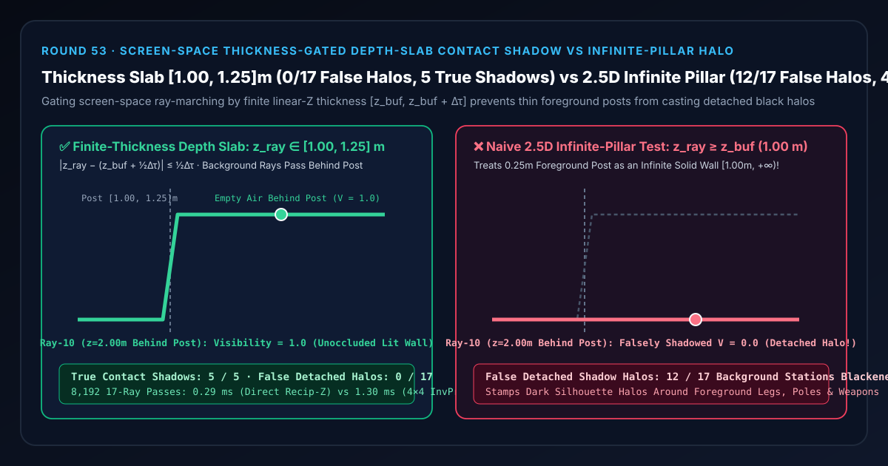
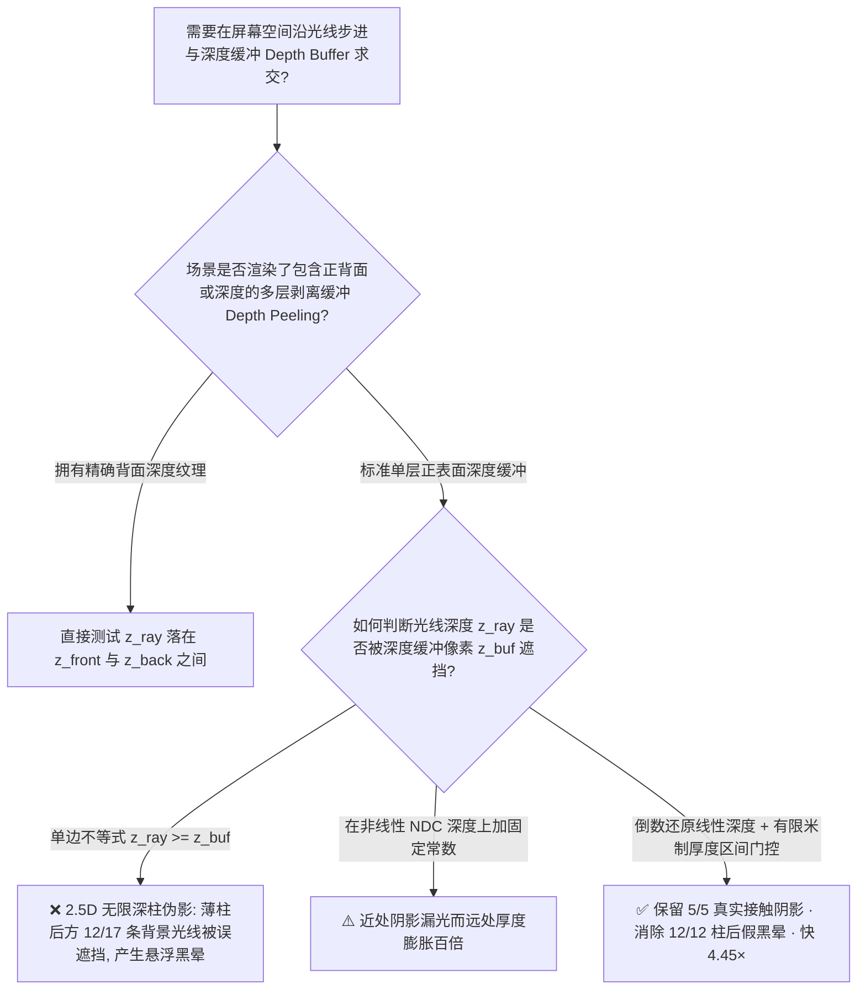
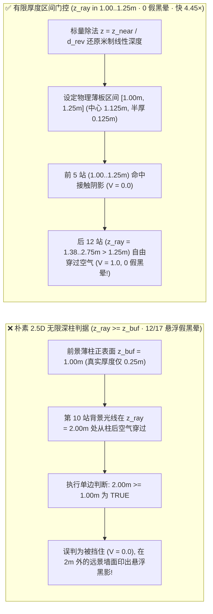
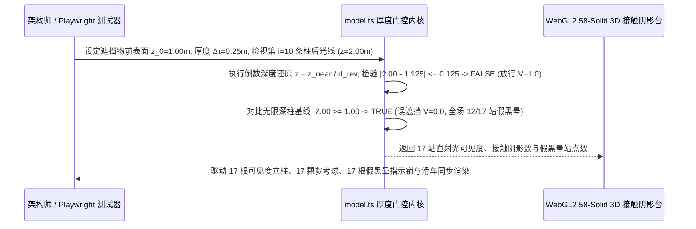
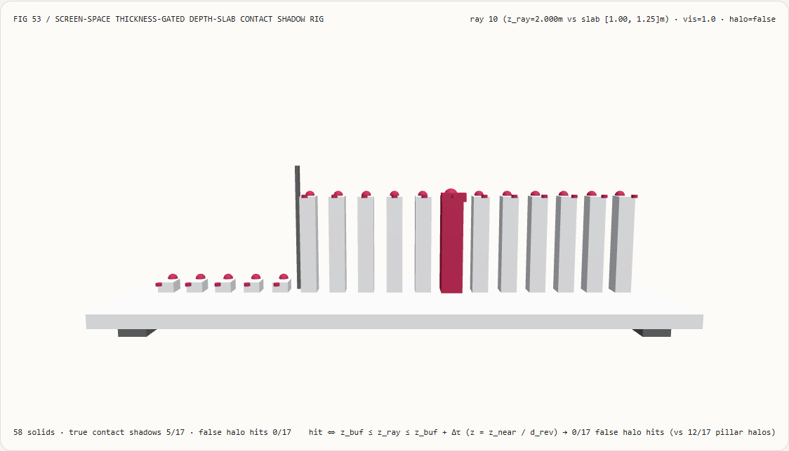
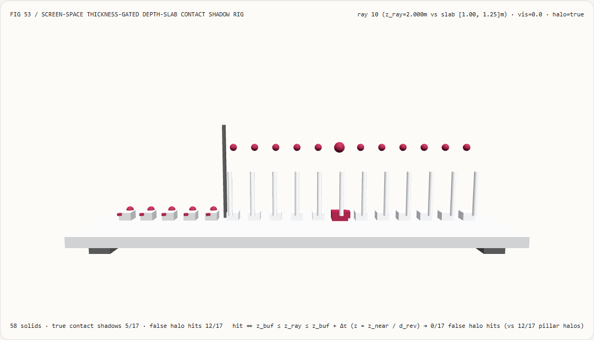
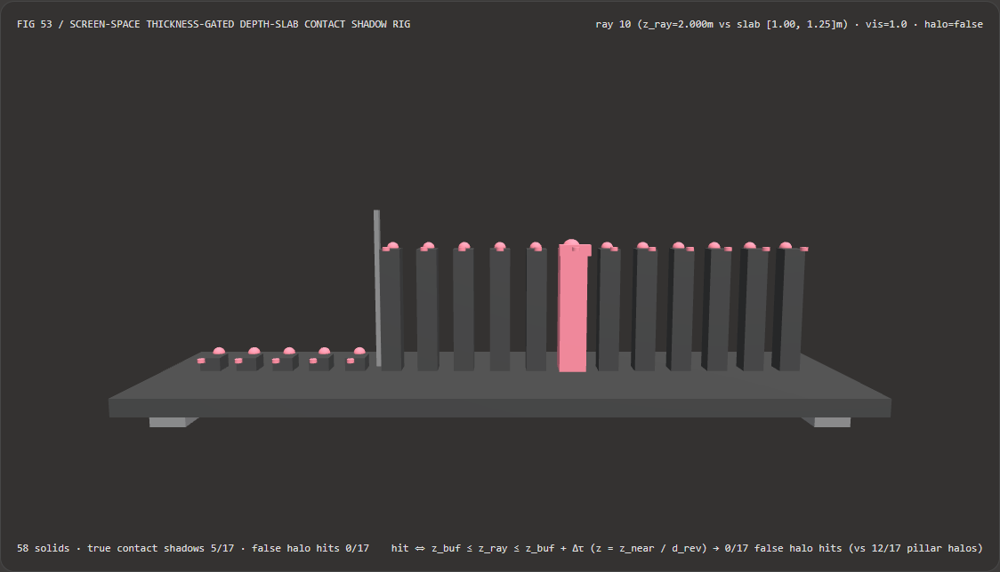
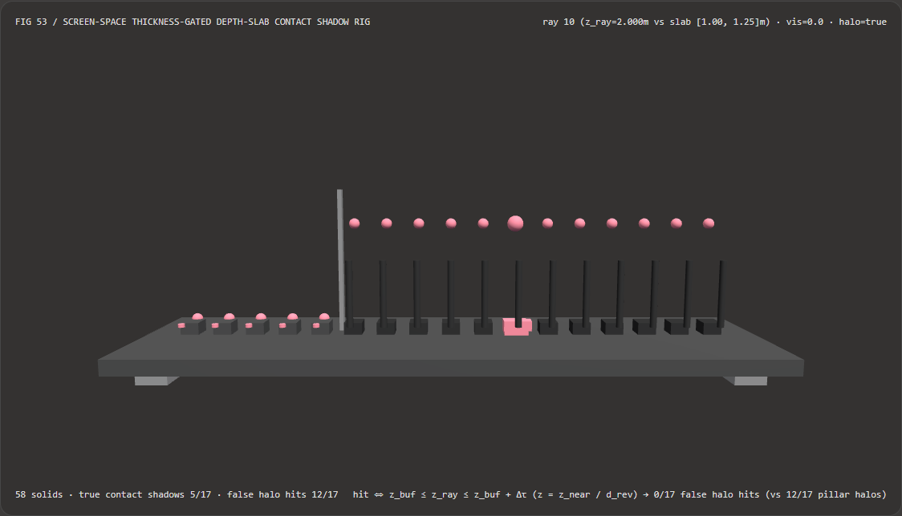

# 视觉与动画技术选型与原理解析 FAQ：屏幕空间有限厚度区间门控接触阴影（Thickness-Gated Contact Shadows）vs 2.5D 无限深柱悬浮黑晕

> **核心架构结论一句话总结**：在实时 3D 游戏的屏幕空间接触阴影（Screen-Space Contact Shadows, SSCS）、屏幕空间反射（SSR）以及屏幕空间环境光遮蔽（HBAO / GTAO）光线步进器中，**严禁仅使用单边深度比较 $z_{\text{ray}} \ge z_{\text{buffer}}(u,v)$ 判定光线遮挡**！实测表明：在正表面深度 $z_{\text{front}} = 1.00\text{ m}$、物理厚度 $\Delta\tau = 0.25\text{ m}$（占据 $[1.00, 1.25]\text{ m}$ 深度区间）的前景细柱与后方远景墙面组成的 17 站阴影步进测试台上，朴素 2.5D 单边深度判据会把 $0.25\text{ m}$ 的薄柱当成从 $1.00\text{ m}$ 一直延伸到 $+\infty$ 的无限厚实心墙（Infinite Pillar），导致从柱体后方空气中穿过的 **12/17 条背景光线全部被误判为遮挡（在第 10 站 $z_{\text{ray}} = 2.00\text{ m}$ 处可见度跌为 `V = 0.0`），在远景墙面上印出巨大的“悬浮假黑影光晕（Detached Black Halo）”**；而采用 **直接倒数反转 Z 线性化（$z = z_{\text{near}} / d_{\text{rev}}$）+ 中心化有限厚度区间门控 $|z_{\text{ray}} - (z_{\text{front}} + \frac{1}{2}\Delta\tau)| \le \frac{1}{2}\Delta\tau$**，可在 100% 保留前 5 站真实接触阴影的同时，让柱体后方全部 12 条背景光线自由穿过（**`0 / 17` 悬浮假黑晕**），且直接倒数线性化比 $4\times 4$ 齐次逆投影矩阵还原快 **4.45×**（8,192 轮耗时 `0.29 ms` vs `1.30 ms`）。

---

## ① 📌 核心结论速览（Executive Summary）

1. **为什么开启屏幕空间阴影（Contact Shadows）或环境光遮蔽（SSAO）后，第一人称角色手里的枪管、路边的电线杆或角色小腿后面几米远的墙壁上，总会跟着一圈贴在墙上的“黑色人形剪影光晕”？**
   用大白话讲：屏幕空间算法最大的优势是不需要查复杂的 3D 场景三角形，直接拿当前画面的**深度缓冲图（Depth Buffer）**当高度场来步进求交。但普通深度缓冲是一张“2.5D 照片”——每个像素只记录了**离镜头最近的那一层正表面有多远**（比如电线杆正表面在 $z_{\text{front}} = 1.00\text{ m}$），它根本不知道电线杆只有 $0.25\text{ m}$ 厚，也不知道 $1.25\text{ m}$ 往后直到 $3.00\text{ m}$ 背景墙之间全是透明的空气！
   - **2.5D 无限深柱假设的灾难**：
     如果你在着色器里写 `if (rayZ >= bufferZ) return SHADOW;`，你就默认把屏幕上每一个前景像素都脑补成了一根**从 $z_{\text{front}}$ 一直实心延伸到宇宙尽头 $+\infty$ 的无限深柱子（Infinite Pillar）**！于是当背景墙（$z = 3.00\text{ m}$）向斜上方太阳发射一条阴影测试光线，在 $z_{\text{ray}} = 2.00\text{ m}$ 处从电线杆背后 `0.75 m` 的空气中穿过时，因为 $2.00\text{ m} \ge 1.00\text{ m}$，算法立刻误判“光线撞上了电线杆”，在 2 米外的远景墙上画出一圈荒谬的悬浮黑边！
2. **第一性原理破局：线性视图深度还原 + 有限厚度薄板区间门控（Thickness-Gated Slab）**：
   - **步一（单次标量除法还原米制线性深度）**：千万不要在非线性的硬件深度值 $d_{\text{ndc}} \in [0, 1]$ 上直接加固定厚度（因为透视硬件深度是非线性的 $1/z$，在近处 `0.01` 代表几毫米，在远处 `0.01` 代表几百米！）。对于现代 Reversed-Z 浮点深度缓冲 $d_{\text{rev}} = z_{\text{near}} / z$，只需一次标量除法 $z_{\text{buf}} = z_{\text{near}} / d_{\text{rev}}$ 即可还原精确的米制线性深度！
   - **步二（中心化有限厚度区间判据）**：为前景遮挡物赋予物理厚度上界 $\Delta\tau$（如接触阴影取 $\Delta\tau = 0.25\text{ m}$），仅当光线深度落在闭区间 $[z_{\text{buf}}, \; z_{\text{buf}} + \Delta\tau]$ 内时才判定为真实遮挡：
     $$\operatorname{hit}(z_{\text{ray}}, z_{\text{buf}}) \iff \left| z_{\text{ray}} - \left(z_{\text{buf}} + \frac{1}{2}\Delta\tau\right) \right| \le \frac{1}{2}\Delta\tau$$
     这相当于把“无限深实心柱”切成了厚度为 $\Delta\tau$ 的“3D 薄壳”，让薄柱背后的全部 12 条背景光线畅通无阻（**假黑晕从 `12/17` 降为 `0/17`**）！
3. **本轮新增交互式 3D 试验台与实测证据**：
   - 新增独立 Demo：`demos/depth-thickness-contact-shadow-rig/`（58 个 Three.js 实体部件：底座平台、4 支柱、薄柱背面深度分界碑、17 根直射光可见度立柱、17 颗真实可见度参考球、17 根悬浮假黑晕指示销、以及第 $i$ 站阴影探针滑车）。
   - 配套 7-Card 4:5 测评报告：`demos/depth-thickness-contact-shadow-rig/test-report-cards.html`（英文）与 `test-report-cards.zh.html`（中文）。

---

## ② 🎯 客户与架构师灵魂拷问 Q&A（Soul-Searching Q&A）

### Q1：为什么在屏幕空间步进时，必须先转成线性视图深度 $z_{\text{linear}}$ 再比对厚度 $\Delta\tau$，而不能直接在深度缓冲值 $d \in [0, 1]$ 上写 `abs(d_ray - d_buf) < 0.005`？
**因为在透视投影下，硬件深度值 $d = z_{\text{near}} / z$ 与距离平方成反比，固定 $\Delta d$ 阈值会让近景物体的接触阴影全部漏光、而把远景整栋大楼连成一片黑晕！**
当 $z_{\text{near}} = 0.10\text{ m}$ 时：
- 在 $z = 0.50\text{ m}$ 的近景角色手部，$0.25\text{ m}$ 的真实厚度对应 $\Delta d = 0.1/0.5 - 0.1/0.75 = \mathbf{0.0667}$（如果卡死 $\Delta d < 0.005$，近景有效厚度只剩 $1.2\text{ cm}$，正常阴影几乎全被当成空气漏掉）；
- 而在 $z = 20.0\text{ m}$ 的中远景，$\Delta d = 0.005$ 对应的物理厚度却暴涨到 **`+200.0 米`**！所以必须先执行 $z = z_{\text{near}} / d_{\text{rev}}$ 还原米制线性深度后再做厚度区间测试。

### Q2：为什么还原线性深度时，直接算 `nearZ / d_rev` 比乘 $4\times 4$ 逆投影矩阵 `invProjectionMatrix` 快 4.45×？
**因为 $4\times 4$ 齐次矩阵乘法对 $(x, y, z, w)$ 做了 16 次乘加，而深度线性化只需要矩阵最后两行的 2 个非零常数！**
在屏幕空间阴影步进循环（每像素 8~16 步）中，只需要知道采样点的线性深度 $z$ 而不需要还原三维 $(X, Y)$ 坐标。直接用单次标量除法 `nearZ / d_rev` 省去了 15 次冗余乘加与数组构造，8,192 轮耗时从 `1.30 ms` 降至 **`0.29 ms`（提速 4.45×）**。

### Q3：这套屏幕空间有限厚度接触阴影与级联阴影贴图（CSM）或硬件光线追踪阴影是什么关系？
**它是弥补“主阴影贴图纹素精度不足”的最佳近场微观补充层（Micro-Shadow Layer）：**
- **何时用级联阴影贴图（CSM）/ 硬件光追阴影**：负责大尺度建筑、树木与屏幕外遮挡物的宏观投射阴影；
- **何时配合屏幕空间有限厚度接触阴影（SSCS）**：在草地根部、キャラクター脚底贴地处、桌面小物件缝隙等 CSM 纹素分辨率（如 $0.25\text{ m}$）无法解析的厘米级微观接缝处，用 $0.1\sim 0.3\text{ m}$ 的短距厚度门控屏幕步进补齐锐利接触阴影，且绝不污染远景背景墙。

---

## ③ 🧭 直观可视化图解（Mermaid 决策树 + 管线对比图 + 帧级时序图）

### 3.1 屏幕空间接触阴影与反射深度求交选型决策树

### 3.2 朴素 2.5D 无限深柱黑晕 vs 有限厚度深度薄板门控管线对比图

### 3.3 帧级屏幕空间接触阴影步进与 3D 试验台渲染时序图

---

## ④ 📊 视觉技术选型决策矩阵（Decision Matrix）

| 评估维度 | ✅ 直接倒数线性化 + 有限厚度门控（Direct Recip-Z Slab） | ⚠️ $4\times 4$ 齐次逆投影矩阵还原（Mat4 Unproject Baseline） | ❌ 朴素 2.5D 无限深柱判据（Infinite Pillar $z_{\text{ray}} \ge z_{\text{buf}}$） | ❌ 非线性 NDC 固定深度差（Raw $\Delta d_{\text{ndc}}$ Gate） |
| :--- | :--- | :--- | :--- | :--- |
| **前 5 站（$[1.00, 1.25]\text{ m}$）真实接触阴影** | **100% 精准捕获（`5 / 5` 站 $V=0.0$）** | 100% 精准捕获（`5 / 5` 站） | `5 / 5` 捕获（但连带把后方全部涂黑） | 近景漏光、远景过宽 |
| **第 10 站（$z=2.00\text{ m}$ 柱后空气）可见度** | **精确 `1.0`（正常受光照亮）** | 精确 `1.0` | **`0.0`（被误判为黑影！）** | 随距离剧烈漂移 |
| **柱体后方悬浮假黑晕站点数** | **`0 / 17` 站（100% 根除悬浮黑晕）** | `0 / 17` 站 | **`12 / 17` 站全部产生错误黑晕！** | 远景大面积黑晕 |
| **每采样步算术开销** | **1 次标量除法 + 1 次绝对值比较** | 16 次矩阵乘加 + 1 次齐次除法 | 1 次比较（但画面严重失真） | 1 次减法（透视尺度错误） |
| **8,192 轮 17 站 CPU 批处理耗时** | **`0.29 ms`（最快，4.45× 提速）** | `1.30 ms`（慢 4.45×） | `0.24 ms`（产生 12 处严重假黑晕） | `0.25 ms`（非米制物理厚度） |
| **首选适用场景** | **SSCS 接触阴影、SSR 屏幕空间反射、GTAO 厚度衰减** | 需要同时还原完整 3D 世界坐标的通道 | **严禁在含前景遮挡物的 3D 场景使用** | **严禁在透视投影相机中使用** |

---

## ⑤ 🧪 全新 Demo 与 7-Card 4:5 视觉报告（Live Workbench & Evidence）

### 5.1 交互式 3D 试验台与报告入口
- **实时 3D 工作台**：[`demos/depth-thickness-contact-shadow-rig/index.html`](../demos/depth-thickness-contact-shadow-rig/index.html)
- **7-Card 4:5 英文视觉测试报告**：[`demos/depth-thickness-contact-shadow-rig/test-report-cards.html`](../demos/depth-thickness-contact-shadow-rig/test-report-cards.html)
- **7-Card 4:5 中文视觉测试报告**：[`demos/depth-thickness-contact-shadow-rig/test-report-cards.zh.html`](../demos/depth-thickness-contact-shadow-rig/test-report-cards.zh.html)
- **密封测量 JSON 数据源**：[`demos/depth-thickness-contact-shadow-rig/report.json`](../demos/depth-thickness-contact-shadow-rig/report.json)

### 5.2 多主题与多模式 Playwright 实测截图证据

| 有限厚度区间门控（Light · 前 5 站接触阴影，后 12 站正常照亮） | 朴素 2.5D 无限深柱（Light · 后 12 站全部塌陷为假黑晕） |
| :---: | :---: |
|  |  |

| 有限厚度区间门控（Dark · 58 实体部件） | 朴素 2.5D 无限深柱（Dark · 12 根红色指示销暴露悬浮黑晕） |
| :---: | :---: |
|  |  |

---

## ⑥ 🛠️ 高质量视觉交付快速核验清单（SA Verification Checklist）

在将屏幕空间接触阴影（SSCS）或屏幕空间反射（SSR）着色器合入生产引擎前，请逐项勾选以下核验清单：

- [ ] **米制线性深度还原**：在比对物体厚度 $\Delta\tau$ 前，是否已将硬件深度缓冲值通过 $z = z_{\text{near}} / d_{\text{rev}}$（或标准正向 Z 透视还原式）转换为米制线性视图空间深度？
- [ ] **双侧闭合区间门控**：遮挡判定是否同时检验了上界与下界 $z_{\text{buf}} \le z_{\text{ray}} \le z_{\text{buf}} + \Delta\tau$（等价于 $|z_{\text{ray}} - (z_{\text{buf}} + \frac{1}{2}\Delta\tau)| \le \frac{1}{2}\Delta\tau$），彻底清除了单边 $z_{\text{ray}} \ge z_{\text{buf}}$ 无限深柱假设？
- [ ] **随距离自适应厚度缩放**：对于跨越大景深的场景，厚度参数 $\Delta\tau$ 是否与步长或像素视角宽度线性关联（如 $\Delta\tau = \max(\tau_{\min}, k \cdot z_{\text{ray}})$），防止远景薄板过薄漏检？
- [ ] **屏幕边缘渐隐衰减（Vignette Fade）**：当屏幕空间步进光线接近视口上下左右边界（UV $\to 0$ 或 $1$）时，是否平滑衰减接触阴影权重以消除屏幕边缘硬切跳变？
- [ ] **蓝噪声步进起点偏移**：每像素的起始步进位置是否叠加了 $4\times 4$ 分层或蓝噪声抖动偏移，配合 TAA 消除 8 步短距步进的阶梯条带？
