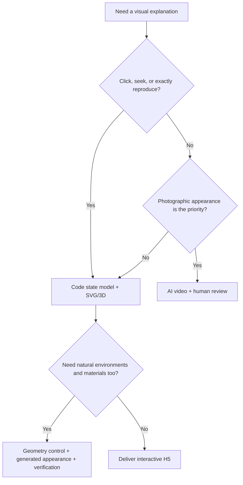
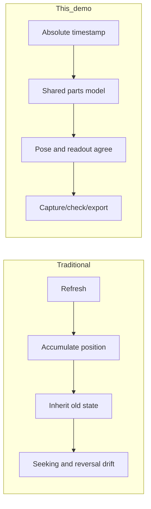
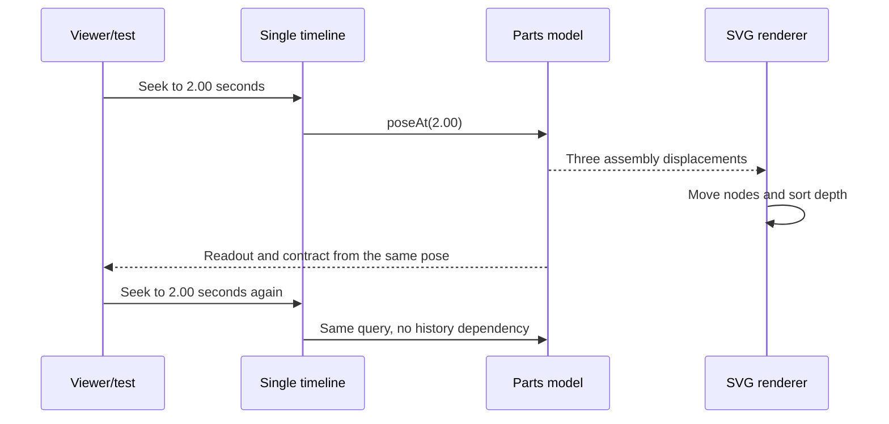

# Seekable, reversible mechanical cutaways: a selection and first-principles FAQ

**Reading path: three minutes for the decision; ten minutes for Q4.**

[中文](seekable-exploded-view-faq.md) · [Interactive demo](https://turbo998.github.io/generative-visual-lab/demos/seekable-cutaway/) · [Measured seven-card report](../demos/seekable-cutaway/test-report-cards.html)

## ① 📌 Executive Summary

- **Preserve relationships before chasing photographic realism.** This new original scanner cutaway has 78 solid parts. Its cover, scan bar and sensor board separate in order; it is not a repaint of an existing demo.
- **A timeline is a state query, not a list of accumulated nudges.** The same timestamp asks for the same positions. Seeking, reversal, screenshots and checks share one source of truth.
- **Code and AI video are complementary.** Code specifies geometry and interactions; a video model can supply appearance. Correct input geometry does not guarantee correct generated pixels.
- **Recent verified directions are not a daily popularity ranking.** Maxon's official October 14, 2026 release confirms Autograph MCP automation and editable camera/animation interchange with Cinema 4D. Adobe's ECCV 2026 coverage confirms sparse 3D blocking and gravity-aware camera control. No daily popularity denominator was available; neither those products nor neural models were executed here.

## ② 🎯 Customer and architect Q&A

### Q1 When should I choose AI video versus code-driven interactive animation?

Separate “must look real” from “the internal process must be right.” Atmospheric advertising, natural performances and complex textures often favor video generation. Product explanations, equipment training and inspectable architecture evolution favor code. A movie can seek to a frame, but it does not expose an underlying component model to click, inspect and export.

At first principles, a generative model **predicts plausible pixels from conditions**; it does not read an assembly's CAD truth. Code **computes geometry from explicitly defined state**. The first excels at complex appearance; the second supports deterministic checks. Neither automatically establishes physical correctness.

### Q2 Under which explicit requirements is code strictly the better choice?

If acceptance requires identical component coordinates for identical input, clickable fault branches, arbitrary step selection, or no runtime network access, deterministic code directly provides those surfaces. A standalone generated clip does not. This is a conclusion about specific acceptance constraints, not a universal claim about artistic quality.

All 78 solids in the demo have unique IDs. Selecting the sensor board highlights that exact group. The downloaded contract records actual time, direction and pose, rather than a vague instruction to “take the scanner apart.”

### Q3 How does the rendering pipeline work, and why can old animation look wrong?

A common implementation adds a little position on every refresh. Faster refresh means more additions; background recovery, seeking and reversal inherit historical state. Another failure begins with visual polish and adds the component relationships later, producing screws through covers or numbers that lag their moving parts.

This demo defines dimensions and assemblies first. A single `0–8 second` clock describes opening over the first four seconds and closing over the next four. The outer cover leads, followed by the scan bar and then the sensor board. Motion and readouts use the same progress. Static SVG paths are built once; playback updates existing nodes and reorders them by depth.

**This is not a spring or material solver.** Its smooth curve is a teaching schedule, not a force model. Intersection checks cover the defined rectangular bounding solids. Rounded-corner clearance, real manufacturing tolerances, imaging performance and assembly forces remain outside scope.

### Q4 How can I reuse it in ten minutes?

1. Pick a recognizable object or process. Write what moves, where it moves, and what the motion explains.
2. Define IDs, dimensions, assembly ownership and displacement in `model.ts`; remove decorative parts with no mechanical purpose.
3. Put all state in `poseAt(time)`. Buttons, seeking, exports and checks must call it, not duplicate its logic.
4. Run `node scripts\build-cutaway.mjs`, then `npm run dev`; open `/demos/seekable-cutaway/` and inspect midpoint, exploded and reset poses.
5. Run `npx vitest run tests\seekable-cutaway.test.ts`. After a production build, `node scripts\benchmark-cutaway.mjs` records browser evidence against the repository's preview port 4320.

For customer service training, replace the illustrative dimensions with authorized dimensions and attach approved assembly instructions and hazard notices to each step. A qualified person must approve the real sequence; the illustration cannot become a repair safety manual merely by looking detailed.

## ③ 🧭 Visual explanations

## ④ 📊 Architect Decision Matrix

| Acceptance requirement | Generated video | Absolute-time SVG | Full 3D / DCC |
| --- | --- | --- | --- |
| Exact seek and component coordinates | Pixel seeking; no geometry guarantee | Direct state query | Possible with a shared clock |
| Natural characters and environments | Often a strength; review outputs | Expensive manual authoring | Modeling, materials and rendering required |
| Click components and export state | Additional interaction layer | Natural fit | Natural fit |
| Mobile static-site delivery | Decoding and bandwidth costs | No model API; measure SVG density | Check GPU and asset budgets |
| Industrial tolerances/material behavior | Appearance is not proof | Not supported by this demo | Appropriate engineering solver required |

**Capacity example:** eight seconds at a target 60 samples per second implies 480 samples, not 480 stored sets of component coordinates. The 78-part inventory and one time function remain the state source. This is design arithmetic, not a measured frame rate, memory saving or compression ratio.

## ⑤ 🧪 New capability demo and benchmark findings, including seven cards

**Provenance:** `synthetic_scene` geometry; `measured` functional checks and browser submission timings; `not_measured` neural inference, Maxon performance and generated-video quality. Paper metrics never enter the local timing bars.

The sealed [report.json](../demos/seekable-cutaway/report.json) records denominators, individual checks, environment, browser version, repeated raw timing samples, captures and reproduction commands. The [seven 4:5 cards](../demos/seekable-cutaway/test-report-cards.html) are generated from it. Timing compares **updating existing SVG nodes with reconstructing the same SVG paths**, measured as JavaScript DOM submission time. It excludes display latency and neural TTFT, and does not establish universal 60fps performance.

Checks cover repeated timestamps, reverse-order seeking, intersections at 801 discrete poses, mobile overflow, reduced motion, offscreen freeze, exported contracts and controls. Discrete sampling is not a continuous-time proof. Screenshots support human visual inspection; they are not aesthetic scores.

Reports follow the `benchmark-harness-engineering` seven-card structure and compatible deck contract. If its CLI cannot fetch dependencies, retain that failure and render offline without changing measurements or inventing model confidence.

## ⑥ 🛠️ Architect Checklist

- [ ] Separate appearance acceptance from mechanism correctness.
- [ ] Ground component IDs, dimensions, travel and support relationships.
- [ ] Remove the cover before moving enclosed parts.
- [ ] Use one time function for seeking, reversal, capture, readout and export.
- [ ] Default reduced motion to still; retain manual controls; freeze offscreen.
- [ ] Check 390px layout, light/dark themes, focus and controls.
- [ ] Inspect joints, contours and occlusion at 4×.
- [ ] Derive all numeric bars from sealed data; show missing metrics as `not_measured`.
- [ ] Have professionals approve real maintenance procedures and warnings.
- [ ] Publish bilingual FAQ, demo, visual summary, evidence and source/homepage links.

**Verified primary sources, retrieved 2026-11-09; not a daily popularity ranking:**

- [Maxon Fall 2026 release, October 14](https://www.maxon.net/en/article/maxon-fall-2026-release-faster-workflows-more-creative-control): editable DCC objects, camera interchange and MCP automation.
- [Adobe ECCV 2026 coverage](https://research.adobe.com/news/eccv-2026/): recent control-first research.
- [LooseControlVideo, arXiv June 17, 2026](https://arxiv.org/abs/2606.19495): oriented sparse 3D blocking as a generative condition; not executed here.
