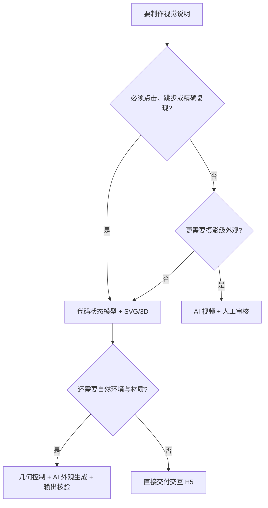
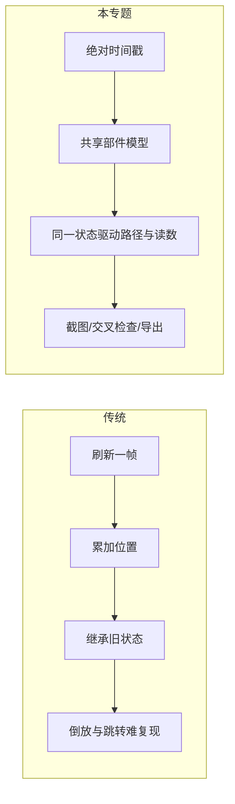
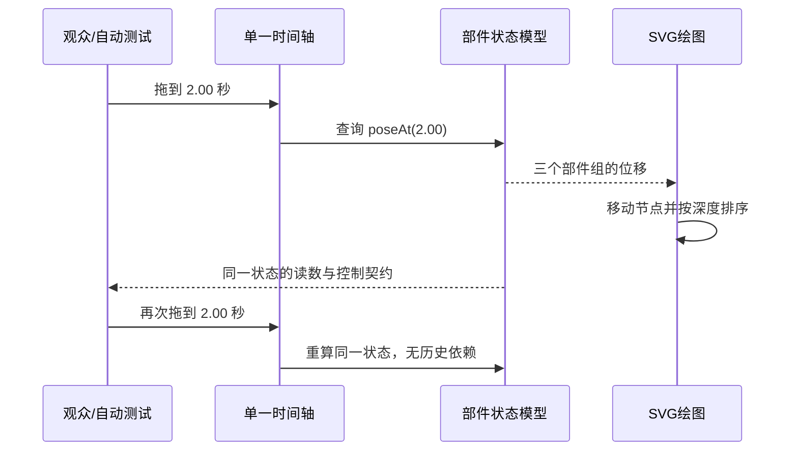

# 可拖拽、可倒放的机械拆解动画：技术选型与原理 FAQ

**阅读路径：3 分钟看结论与矩阵；10 分钟按 Q4 复刻。**

[English](seekable-exploded-view-faq.en.md) · [交互 Demo](https://turbo998.github.io/generative-visual-lab/demos/seekable-cutaway/) · [7-Card 实测](../demos/seekable-cutaway/test-report-cards.zh.html)

## ① 📌 核心结论速览（Executive Summary）

- **要讲清零件关系，先保住关系，再追求摄影级质感。** 本专题做了一台原创扫描仪剖视仪：78 个实体零件，上盖、扫描梁、感光板按顺序分离；不是旧 Demo 的改色版。
- **时间轴不是一串“挪一点”的命令，而是一张查询表。** 给同一个时间戳，就查询同一组位置。拖到中途、倒放、截图与自动测试因此能共用一个事实来源。
- **代码与生成视频不是二选一。** 代码控制零件、相机与标注；AI 视频可以补质感和环境，但生成结果仍需检查，不能因为输入几何正确就宣称输出一定正确。
- **今天核验到的是近期方向，不是“今日热度榜第一”。** Maxon 官方 2026-10-14 发布说明确认 Autograph 的 MCP 自动化、与 Cinema 4D 的相机/动画互通；Adobe ECCV 2026 页面确认稀疏 3D 排戏箱与重力参考相机控制。没有可靠日热度数据，也没有运行这些商业产品或神经模型。

## ② 🎯 客户与架构师灵魂拷问 Q&A

### Q1 何时选 AI 视频大模型 vs 何时选代码驱动交互式动画？

把需求分成两句话：“看起来像真的”和“内部过程必须对”。广告氛围片、自然人物动作、复杂纹理常更适合生成视频；产品原理讲解、设备培训、架构演进与逐步检查更适合代码动画。如果要求观众点某个零件，停在任意一步，再返回原位，视频只是播放素材，不是交互模型。

AI 视频的第一性原理是**从条件推测下一段像素**，不是读取 CAD 的装配真值。代码动画是**从你定义的状态算出几何**。前者能创造复杂外观，后者更容易接受确定性的检查；两者都不自动等于物理正确。

### Q2 什么场景下代码驱动动画严格更优？

当验收条件写成“同一输入必须给同一零件坐标”“故障分支必须可点击”“每一步都可跳转”“不允许运行时联网”时，确定性代码直接满足这些条件，单段生成视频不具备这些操作面。不是说代码在审美上永远胜出，而是**在这组明确约束下更合适**。

本例的 78 个实体有唯一 ID。选择感光板会突出同一组零件；导出文件记录实际时间、方向和部件状态，而不是一段模糊的“拆开扫描仪”提示词。

### Q3 核心渲染/生成管线底层如何运作？为什么旧动画容易假？

以前常见做法是每次屏幕刷新给位置加一点。快电脑刷新多，零件跑得快；后台恢复、跳转与倒放还会继承旧误差。另一种问题是画面先做漂亮，零件关系后补，结果螺钉穿过盖板，指针与读数不同步。

本例先列部件的长、宽、高和归属，再把 `0–8 秒`映射到装配进度：前 4 秒拆开，后 4 秒合上；外面的上盖先离开，扫描梁其次，感光板最后。绘图与数字读取同一个进度。静态路径一次建立，播放时主要移动现有 SVG 节点；观察角度固定，移动后按深度重排，避免上层突然被底层盖住。

**这不是弹簧或材料求解器。** 平滑曲线只是便于学习的时间安排；没有惯性、力学参数或扫描成像精度承诺。实体交叉检查针对定义的矩形包围体；圆角以内的空间、实际公差与装配受力不在验证范围内。

### Q4 10 分钟如何复刻到客户方案？

1. 选一个真实物体或流程；写出“谁动、动到哪里、说明什么”，别先找炫酷效果。
2. 在 `model.ts` 定义实体 ID、尺寸、部件归属与位移。拿掉不属于机制的装饰。
3. 用一个 `poseAt(time)` 计算所有状态。按钮、拖动、导出与测试调用它，不再复制第二套逻辑。
4. 运行 `node scripts\build-cutaway.mjs`，再运行 `npm run dev`；打开 `/demos/seekable-cutaway/`。按“中途→完整拆开→复位”验证。
5. 执行 `npx vitest run tests\seekable-cutaway.test.ts`；生产构建后执行 `node scripts\benchmark-cutaway.mjs`，得到封存 JSON 与截图。实际命令默认使用本仓库预览端口 4320。

客户案例：设备售后培训可把 78 个示意部件换成经授权的真实机型尺寸；每一步绑定拆装说明与风险提示。上线前仍需专业人员批准装配顺序，不能把网页示意当成维修安全手册。

## ③ 🧭 直观可视化图解

## ④ 📊 视觉技术选型决策矩阵（Architect Decision Matrix）

| 验收需求 | 生成视频 | SVG 绝对时间轴 | 完整 3D / DCC |
| --- | --- | --- | --- |
| 任意时间精确跳转、复现零件坐标 | 像素可跳转，几何真值不保证 | 本例可直接查询 | 可实现，需统一时钟 |
| 自然人物、复杂环境外观 | 强项；实际效果需审核 | 需手工造型，成本高 | 需建模、材质与渲染 |
| 点击部件、导出结构化状态 | 需要额外交互层 | 原生适合 | 原生适合 |
| 手机与静态网站部署 | 视频解码、流量占用 | 无模型 API；仍需实测 SVG 密度 | GPU 与资产体积需核验 |
| 真实工业公差与材料行为 | 不可仅凭画面证明 | 本例不支持 | 需合适的工程/物理求解器 |

**选型算例：** 8 秒、目标 60 帧/秒的教学片需要 480 次取样，但不需要存 480 套零件坐标。78 个零件与一个时间函数就是状态源。这是设计容量算例，不是测得的帧率、显存或压缩率。

## ⑤ 🧪 全新能力展示 Demo 与 Benchmark 核心发现（含 7-Card 报告）

**证据分层：** 场景为 `synthetic_scene`；测试与浏览器提交耗时为 `measured`；神经模型推理、Maxon 性能与 AI 视频质量均为 `not_measured`。论文结果不进入本机的性能条形图。

[封存 report.json](../demos/seekable-cutaway/report.json) 保存检查分母、逐项结果、浏览器版本、环境、原始重复耗时、截图路径与复现命令；[7 张 4:5 卡片](../demos/seekable-cutaway/test-report-cards.html)从该文件生成，不能手写“漂亮指标”。性能比较为**更新现有 SVG vs 重建同一批路径的 JavaScript DOM 提交耗时**，不包含显示器出光延迟，不代表模型 TTFT，更不代表所有浏览器都稳定 60fps。

核验内容包括：重复同一时间戳、逆序访问时间轴、801 个离散姿态的实体交叉、移动端横向溢出、减少动态、离屏冻结、导出契约与控制按钮。几何采样是离散检查，不是连续时间的形式证明；截图是人工视觉检查证据，不是美学评分。

报告采用 `benchmark-harness-engineering` 的七卡结构与兼容 Deck 契约。若官方 CLI 因依赖下载失败而不能运行，保留失败原因，使用离线渲染器，不改变数据或补造模型置信度。

## ⑥ 🛠️ 附录：高质量视觉/动画交付快速核验清单（Architect Checklist）

- [ ] “看起来真”与“机制正确”的验收标准分开写。
- [ ] 部件 ID、尺寸、移动方向与支撑关系有依据。
- [ ] 上盖先离开，内部部件不穿过固定外壳。
- [ ] 拖动、倒放、截图、读数、导出共用一个时间函数。
- [ ] 减少动态默认静止，手动控制仍有效；离屏不持续耗电。
- [ ] 在 390px 手机宽度与深浅主题检查文字、焦点和控制区。
- [ ] 在 4× 近景检查每个连接点、轮廓与遮挡。
- [ ] 所有量化条形图来自封存数据，未测项明确写 `not_measured`。
- [ ] 专业人员确认任何真实维修流程；网页示意不替代安全指引。
- [ ] 中英 FAQ、Demo、视觉总结、证据与主分支/个人网站入口齐全。

**核验来源（检索日期 2026-11-09，不声称日热度排名）：**

- [Maxon Fall 2026 官方发布，2026-10-14](https://www.maxon.net/en/article/maxon-fall-2026-release-faster-workflows-more-creative-control)：DCC 可编辑对象、相机互通与 MCP 自动化。
- [Adobe ECCV 2026 研究说明](https://research.adobe.com/news/eccv-2026/)：控制优先于单纯文本描述的近期研究方向。
- [LooseControlVideo，arXiv 2026-06-17](https://arxiv.org/abs/2606.19495)：稀疏有方向的 3D 箱作为生成控制，不是本例运行的模型。
