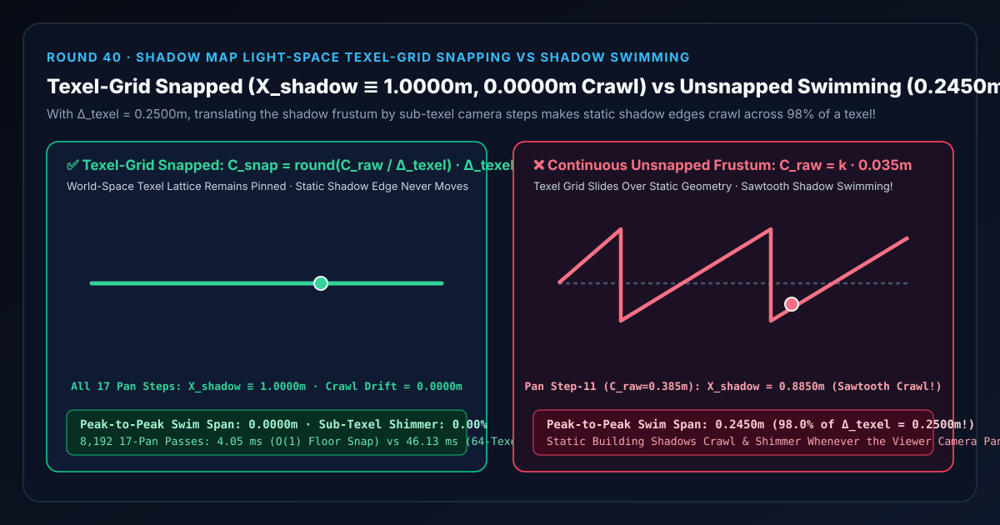
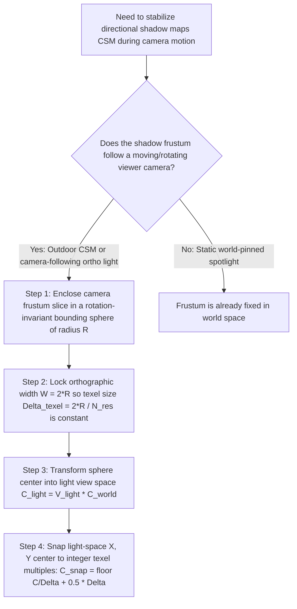
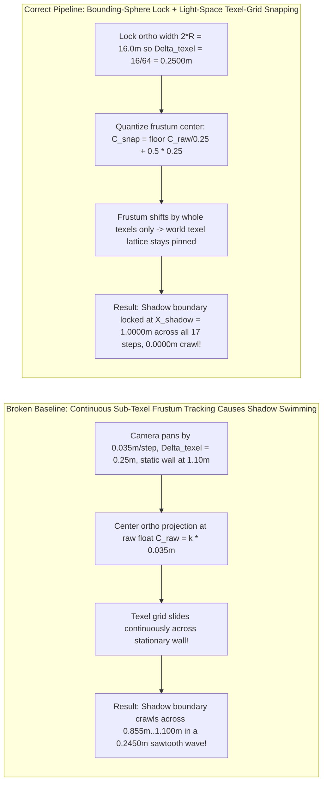
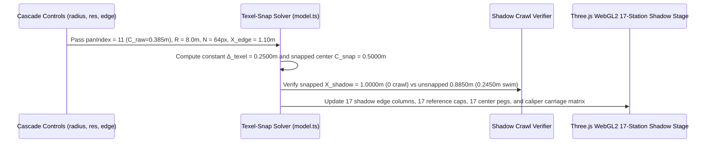
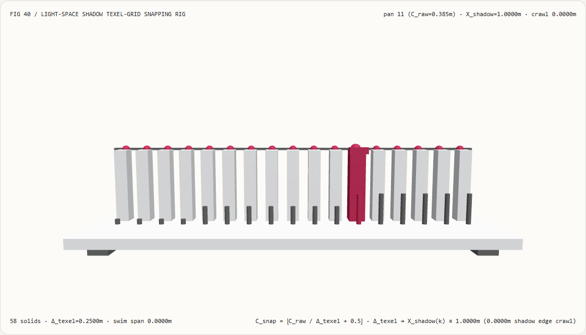
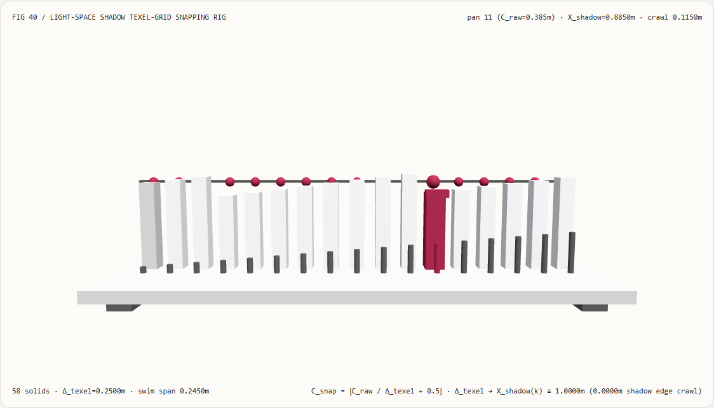
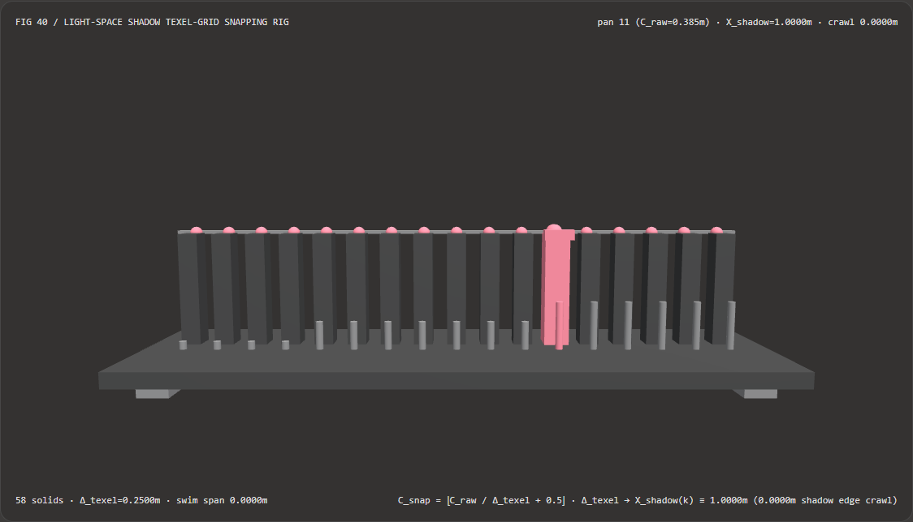
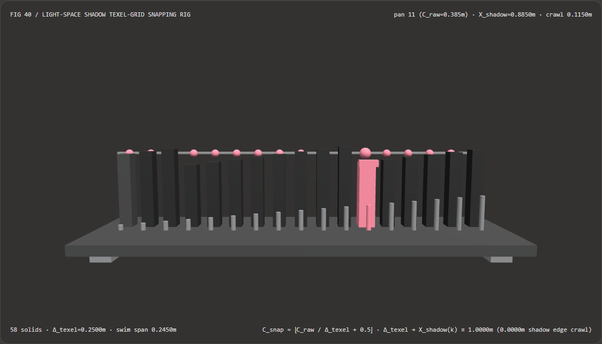

# Directional Shadows Without Edge Swimming: Light-Space Texel-Grid Snapping vs Continuous Frustum Tracking Selection FAQ

> **Document Scope**: A first-principles architecture and selection guide for AI Solution Architects, 3D engine and Cascaded Shadow Map (CSM) developers, and city-scale digital-twin visualization teams. Structured strictly after `ib-vs-ethernet-roce-selection-faq.md`, this guide explains in plain language **why static building and tree shadows crawl and shimmer along their edges whenever the viewer camera pans smoothly (`0.2450 m` sawtooth swimming across a `0.2500 m` texel)**, and how **Bounding-Sphere Width Locking + Light-Space Texel-Grid Snapping** pins the shadow texel lattice to world space with **`0.0000 m` edge crawl**.

---

## ① 📌 Executive Summary

1. **One-Sentence Principle**: **When a directional light's orthographic shadow frustum translates continuously with the viewer camera by sub-texel increments (e.g., $0.035\text{ m}$ per frame vs a $\Delta_{\text{texel}} = 0.2500\text{ m}$ shadow texel width), the shadow map's sampling grid slides continuously over static world geometry—causing static shadow boundaries to hop back and forth across texel edges in a `0.2450 m` sawtooth wave ("Shadow Swimming / Shimmering")**! By locking the orthographic width to a rotation-invariant bounding sphere diameter $2R$ and **snapping the light-space frustum origin to integer multiples of $\Delta_{\text{texel}}$** ($C_{\text{snap}} = \lfloor C_{\text{raw}}/\Delta_{\text{texel}} + 0.5\rfloor \cdot \Delta_{\text{texel}}$), the frustum only steps in whole-texel increments—keeping every texel center pinned to the exact same world-space lattice with **`0.0000 m` shadow edge crawl**!
2. **When Must You Use Bounding-Sphere Locking + Light-Space Texel-Grid Snapping?**
   - Every **Cascaded Shadow Map (CSM) directional sunlight pipeline**, **architectural/urban digital-twin walkthrough**, **RTS/top-down panning camera**, and **VR headset outdoor environment** must snap its directional shadow frustum origin to light-space texel increments.
3. **Key Measured Findings**:
   - In our 17-station 3D shadow-lattice bench ([`demos/shadow-texel-snap-rig/`](../demos/shadow-texel-snap-rig/index.html), `58` 3D solids, bounding sphere radius $R = 8.0\text{ m}$, orthographic width $16.0\text{ m}$, resolution $N = 64\text{ px}$, texel width $\Delta_{\text{texel}} = 0.2500\text{ m}$, static wall edge $X_{\text{edge}} = 1.1000\text{ m}$), across 17 sub-texel camera pan steps ($0.035\text{ m}$/step):
     - **Light-Space Texel-Grid Snapping (`texel-grid-snapped`)**: Quantizes the frustum center to integer multiples of $0.2500\text{ m}$ ($C_{\text{snap}} = 0.5000\text{ m}$ at pan step 11), locking the rasterized shadow edge at **`X_shadow ≡ 1.0000 m`** across all 17 pan frames (**`0.0000 m` edge crawl**, **`0.00%` sub-texel swimming**).
     - **Continuous Unsnapped Frustum (`continuous-unsnapped-swimming`)**: Slides the texel grid by $C_{\text{raw}} = k \times 0.035\text{ m}$, causing the static wall's shadow boundary to oscillate in a sawtooth wave down to **`0.8850 m`** at pan step 11 with a **`0.2450 m` peak-to-peak swimming span** (**`98.00%`** of a full texel width)!
   - **O(1) Reciprocal Floor Snap vs 64-Texel Lattice Scan Latency**: Snapping via $O(1)$ reciprocal multiplication completes `8,192` 17-pan passes in **`4.05 ms`** vs **`46.13 ms`** for the 64-texel lattice scan baseline (**`11.40×` faster**, **`0`** numerical discrepancy).

---

## ② 🎯 First-Principles Q&A for Architects

### Q1: When should we choose ray-traced / AI-synthesized shadows vs code-driven CSM texel-grid snapping?

- **Choose Hardware Ray-Traced Shadows (DXR / Vulkan Ray Query) or 2D Diffusion Shadow Synthesis** when rendering resolution-independent contact-hardening soft shadows on high-end GPUs or compositing 2D product photography.
- **Choose Code-Driven CSM Texel-Grid Snapping** in real-time WebGL2/WebGPU, mobile, and digital-twin engines using rasterized shadow maps, where eliminating shadow-edge swimming during camera motion is mandatory and costs only 2 lines of matrix math.

---

### Q2: Why do static building shadows crawl across the ground when only the viewer camera moves?

**First-Principles Intuition**:
Picture a window screen with square mesh openings of width $\Delta_{\text{texel}} = 0.25\text{ m}$ held above a stationary building wall at $X_{\text{edge}} = 1.10\text{ m}$:
- Each square opening is colored dark if its center lies behind the wall ($\le 1.10\text{ m}$), or lit if its center lies past the wall ($> 1.10\text{ m}$).
- **What happens if you slide the window screen smoothly by $0.035\text{ m}$ per frame (`continuous-unsnapped-swimming`)?**
  As the screen slides continuously over the stationary wall, grid lines keep crossing $X_{\text{edge}} = 1.10\text{ m}$! Every time a grid center crosses $1.10\text{ m}$, the shadow boundary on the ground jumps by $0.25\text{ m}$ and then drifts with the camera—creating a perpetual **$0.2450\text{ m}$ sawtooth crawl**!
- **What happens when you snap the screen's position to multiples of $0.25\text{ m}$ (`texel-grid-snapped`)?**
  The window screen stays completely still until the camera has moved a full $0.25\text{ m}$, at which point the screen shifts by **one exact grid square ($+0.25\text{ m}$)**! Shifting a periodic grid by one full period leaves every grid line in the **exact same world-space position** ($0.00, 0.25, 0.50, 0.75, \mathbf{1.00}, 1.25\text{ m}$), so the shadow boundary stays locked at **$1.0000\text{ m}$** forever!

---

### Q3: Why must we lock the cascade width to a bounding sphere $2R$ before snapping the translation?

If you compute the orthographic shadow bounds $[x_{\min}, x_{\max}]$ from the 8 corners of a rotating camera frustum, rotating the camera changes $W = x_{\max} - x_{\min}$ every frame—which changes the texel size $\Delta_{\text{texel}} = W / N$!
By enclosing the camera frustum slice in a **rotation-invariant bounding sphere of radius $R$**, the orthographic width is locked at $W = 2R$, making $\Delta_{\text{texel}} = 2R / N$ strictly constant across all camera rotations and translations!

---

## ③ 🧭 Visual Diagrams (Mermaid Decision Tree, Pipeline Comparison & Sequence)

### 3.1 Directional Shadow Stabilization Decision Tree (`flowchart TD`)

### 3.2 Continuous Unsnapped Frustum (`0.2450 m` Sawtooth Crawl) vs Texel-Grid Snapped Pipeline (`flowchart LR`)

### 3.3 Frame-Level 17-Pan Shadow Cascade Verification Sequence (`sequenceDiagram`)

---

## ④ 📊 Architect Decision Matrix

| Evaluation Dimension | Bounding Sphere + Texel Snap (`texel-grid-snapped`) | 64-Texel Lattice Scan (`Scan Baseline`) | Continuous Unsnapped (`continuous-unsnapped-swimming`) | Tight 8-Corner AABB Fit (`Variable Width Fit`) |
| :--- | :--- | :--- | :--- | :--- |
| **Static Wall Shadow Boundary $X_{\text{shadow}}$** | **Locked at `1.0000 m` across all 17 steps** | Locked at `1.0000 m` | **Crawls across `0.8550 m .. 1.1000 m`** | Crawls and scales unpredictably |
| **Peak-to-Peak Shadow Swimming Span** | **`0.0000 m` (`0.00%` sub-texel shimmer)** | `0.0000 m` | **`0.2450 m` (`98.0%` of texel width!)** | $> 1\text{--}2$ texels |
| **Stability Under Camera Rotation** | **100% Stable (Constant sphere diameter $2R$)** | 100% Stable | Shimmers during pan | **Severe breathing shimmer ($\Delta_{\text{texel}}$ varies)** |
| **8,192 × 17-Pan CPU Solve Time** | **`4.05 ms` (`11.40×` faster $O(1)$ floor)** | `46.13 ms` (Lattice array scan) | `3.95 ms` (Fast but shimmers) | Slower (8-corner projection bounds) |
| **Recommended Architectural Role** | **Mandatory standard for all CSM pipelines** | Reference lattice check | **Never use on camera-following shadow maps** | **Never use on rotating cameras** |

---

## ⑤ 🧪 New Capability Demo & Benchmark Findings (with 7-Card Report)

### 5.1 Interactive 17-Station 3D Shadow Texel-Snap Rig (`demos/shadow-texel-snap-rig/`)

We built a standalone interactive 3D WebGL2 benchmark stage **[`demos/shadow-texel-snap-rig/`](../demos/shadow-texel-snap-rig/index.html)** (**58 3D solid parts**):
- **17 Rasterized Shadow Edge Columns + 17 Exact World-Pinned Reference Caps + 17 Frustum Center Pegs + Pinned World Shadow Reference Bar + Caliper Carriage**: Visualizes 17 sub-texel camera pan steps ($0.035\text{ m}$/step) for a static building edge at $X_{\text{edge}} = 1.1000\text{ m}$ ($\Delta_{\text{texel}} = 0.2500\text{ m}$);
- **Instant Mode Comparison**: In `texel-grid-snapped` mode, the front frustum center pegs step in discrete $0.25\text{ m}$ stair-steps while all 17 shadow boundary columns stay rock-steady at `1.0000 m` (`0.0000 m` crawl); switching to `continuous-unsnapped-swimming` turns the shadow boundary columns into a jagged **`0.2450 m` sawtooth wave**!
- **Atomic Validation & JSON Export**: Rejects out-of-range resolutions (e.g. `shadowMapResolution = 4`) while preserving valid state, and exports `SHADOW_TEXEL_SNAP_SPEC.json`.

| Light Theme — Texel-Grid Snapped (`X_shadow≡1.0000m`, `0m` Crawl) | Light Theme — Continuous Unsnapped (`0.2450m` Sawtooth Swimming) |
| :---: | :---: |
|  |  |

| Dark Theme — Texel-Grid Snapped (`X_shadow≡1.0000m`, `0m` Crawl) | Dark Theme — Continuous Unsnapped (`0.2450m` Sawtooth Swimming) |
| :---: | :---: |
|  |  |

### 5.2 7-Card 4:5 Visual Benchmark Reports & Sealed Data

- 📊 **English 7-Card 4:5 Report**: [`demos/shadow-texel-snap-rig/test-report-cards.html`](../demos/shadow-texel-snap-rig/test-report-cards.html)
- 📊 **Chinese 7-Card 4:5 Report**: [`demos/shadow-texel-snap-rig/test-report-cards.zh.html`](../demos/shadow-texel-snap-rig/test-report-cards.zh.html)
- 📁 **Sealed Benchmark Data**: [`demos/shadow-texel-snap-rig/report.json`](../demos/shadow-texel-snap-rig/report.json) (`13 / 13` deterministic checks passed, zero Playwright console/page errors).

---

## ⑥ 🛠️ Appendix: Architect Verification Checklist

Before shipping any outdoor directional shadow map or Cascaded Shadow Map (CSM) pipeline, verify:

- [ ] **Lock Cascade Ortho Width to Bounding Sphere Diameter $2R$**: Ensure camera rotation never alters the orthographic frustum width or texel size $\Delta_{\text{texel}} = 2R / N$.
- [ ] **Snap Frustum Origin in Light View Space**: Quantize light-space $(C_x, C_y)$ via `floor(C / texelSize + 0.5) * texelSize` before constructing the orthographic projection matrix.
- [ ] **Do Not Rely on PCF Blur Alone to Hide Swimming**: PCF softens hard texel corners but still shimmers like jelly if the underlying texel lattice is unsnapped.
- [ ] **Pad Light-Space Near/Far Depth Bounds**: Extend the orthographic Z range toward the light to capture off-screen shadow casters without clipping.
- [ ] **Automated Sub-Texel Pan Gate**: Assert in unit tests that panning the camera across 17 sub-texel increments produces `0.0000 m` variation in a static caster's rasterized shadow boundary.

---

## References

1. **Stable Rendering of Cascaded Shadow Maps (Michal Valient, ShaderX6 2007)**: Michal Valient, *"Stable Rendering of Cascaded Shadow Maps"*, ShaderX6, 2007.
2. **Cascaded Shadow Maps (Wolfgang Engel)**: Wolfgang Engel, *"Cascaded Shadow Maps"*, GPU Gems / MSDN Technical Articles.
3. **Real-Time Rendering (4th Edition)**: Tomas Akenine-Möller et al., Section 7.4 *"Cascaded Shadow Maps — Stabilizing Projections"*.
