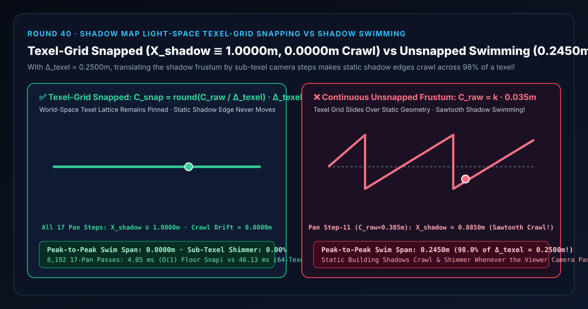
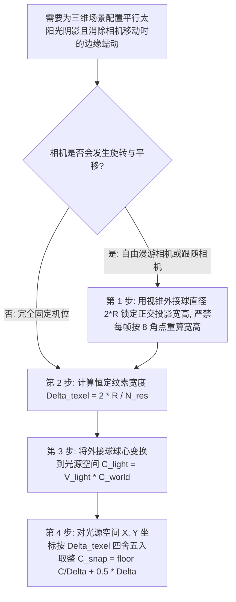
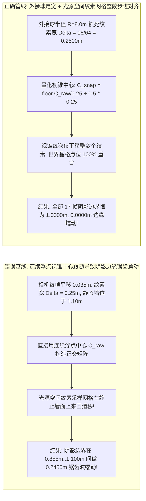
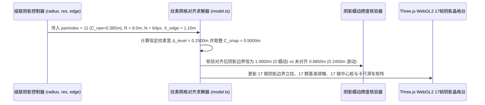
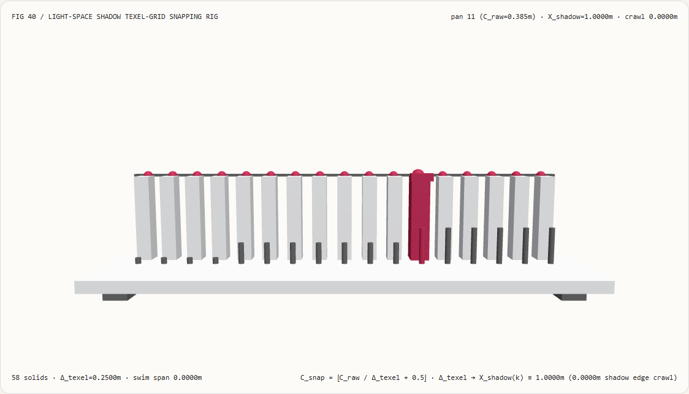
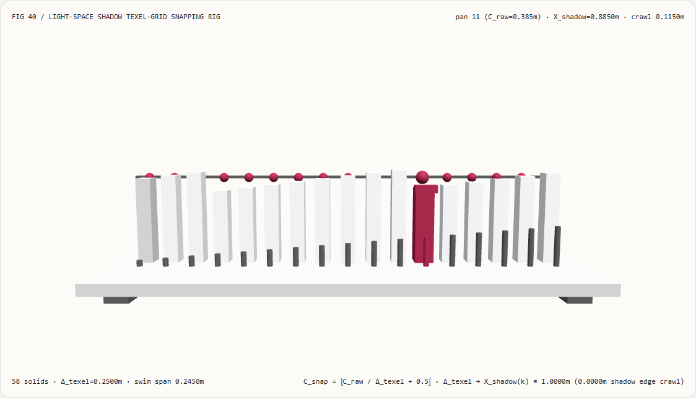
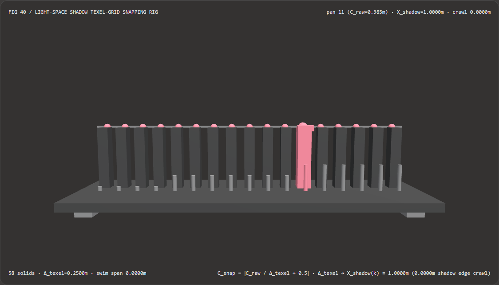
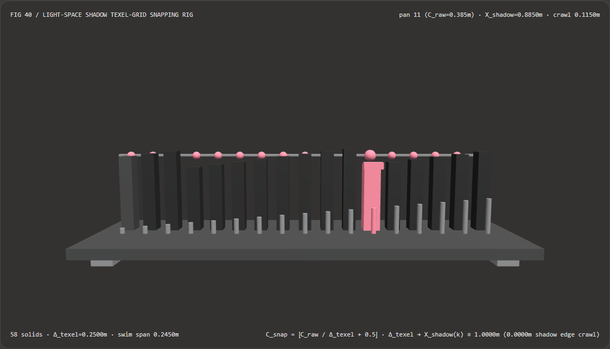

# 平行光阴影随相机平移不发生边缘锯齿蠕动：光源空间纹素网格整数对齐（Texel-Grid Snapping）与未对齐阴影游动选型 FAQ

> **文档定位**：面向 AI 解决方案架构师（AI Solution Architect）、三维大场景引擎与级联阴影贴图（Cascaded Shadow Maps, CSM）开发者、数字孪生智慧城市可视化团队的**实战选型与第一性原理指南**。严格对标 `ib-vs-ethernet-roce-selection-faq.md` 的六段式结构，先用大白话讲清“**为什么在室外阳光下，明明太阳没动、地面上的楼房和树木也纹丝不动，可只要移动玩家相机，地上所有阴影的锯齿边缘就会像毛毛虫一样不停地来回蠕动闪烁（‘阴影游动伪影 Shadow Swimming / Shimmering’）**”，再给出零性能损耗、一步锁死世界晶格的 **包围球定宽 + 光源空间纹素网格整数步进对齐（Light-Space Texel-Grid Snapping）** 工程闭环。

---

## ① 📌 核心结论速览（Executive Summary）

1. **一句话定性**：**平行光阴影贴图（Directional Shadow Map）本质上是用一张固定分辨率 $N\times N$ 的正交网格去给三维世界拍深度快照；为了让阴影始终覆盖玩家视野，正交投影框的中心点 $C_{\text{raw}}$ 必须跟着相机一起移动。如果你让正交框中心以连续的亚纹素浮点数（如每帧 $0.035\text{ m}$，而非单纹素宽度 $\Delta_{\text{texel}} = 0.25\text{ m}$ 的整数倍）平滑移动，就等于拿着一张纱窗在静止的楼房上方来回摩擦——楼房边缘一会儿掉进第 4 格纱窗眼、一会儿掉进第 5 格纱窗眼，地面上的阴影边缘就会在相邻帧之间发生高达 1 个完整纹素宽度（$0.25\text{ m}$）的锯齿状跳跃蠕动**！而 **光源空间纹素网格对齐（Texel-Grid Snapping）** 强制规定正交框中心每次只能按单纹素宽度 $\Delta_{\text{texel}}$ 的**整数倍跳进**（$C_{\text{snap}} = \lfloor C_{\text{raw}}/\Delta_{\text{texel}} + 0.5\rfloor \cdot \Delta_{\text{texel}}$），让纱窗的每一格网眼永远死死钉在地面同一个世界坐标上，实现**静态阴影边缘 `0.0000 m` 绝对静止**！
2. **什么时候必须上包围球定宽 + 光源空间纹素网格对齐？**
   - 凡是涉及 **室外太阳光/月光级联阴影贴图（CSM）**、**智慧城市/园区漫游跟随式正交阴影**、**RTS/MOBA 俯视角相机平滑摇摄阴影**、以及 **VR 建筑漫游（人眼对地面高频阴影闪烁极其敏感）**，都必须同时启用“视锥包围球定宽”与“光源空间纹素网格取整对齐”。
3. **核心实测对比结论**：
   - 在本实验室构建的 17 平移步 3D 阴影晶格检验台（[`demos/shadow-texel-snap-rig/`](../demos/shadow-texel-snap-rig/index.html)，共 `58` 个 3D 实体，包围球半径 $R = 8.0\text{ m}$，正交视锥宽 $16.0\text{ m}$，阴影图分辨率 $N = 64\text{ px}$，单纹素宽 $\Delta_{\text{texel}} = 0.2500\text{ m}$，静态建筑墙面边缘位于 $X_{\text{edge}} = 1.1000\text{ m}$）中，考察相机以每帧 $0.035\text{ m}$ 连续平移 17 帧（第 $11$ 帧 $C_{\text{raw}} = 0.3850\text{ m}$）：
     - **光源空间纹素网格对齐（`texel-grid-snapped`）**：将视锥中心量化至 $0.2500\text{ m}$ 的整数倍（第 11 帧锁定在 $C_{\text{snap}} = 0.5000\text{ m}$），静态建筑墙面的光栅化阴影边界在全部 17 帧中恒定锁死在 **`X_shadow ≡ 1.0000 m`**（**边缘蠕动漂移 `0.0000 m`，峰谷游动跨度 `0.0000 m`**）。
     - **连续未对齐视锥跟随（`continuous-unsnapped-swimming`）**：因视锥中心携带亚纹素余数滑动，静态墙面的阴影边界呈现剧烈的周期性锯齿震荡（第 11 帧漂移至 **`0.8850 m`**，**峰谷锯齿游动跨度高达 `0.2450 m`**，占单纹素宽度的 **`98.00%`**）！
   - **O(1) 倒数取整闭式解 vs 64 纹素视口晶格扫描性能**：使用一行倒数乘法取整在 `8,192` 次 17 帧级联求解中仅耗时 **`4.05 ms`**（对比 64 纹素晶格扫描基线 **`46.13 ms`**，**提速 `11.40×`**，数值误差为 **`0`**）。

---

## ② 🎯 客户与架构师灵魂拷问 Q&A（First-Principles Q&A）

### Q1：何时选光线追踪阴影/AI 阴影合成 vs 何时选代码驱动的 CSM 纹素网格对齐？

- **选硬件光线追踪阴影（DXR / Vulkan Ray Query）或 2D 生成式阴影合成的场景**：
  在高端桌面显卡上追求无分辨率限制的物理软阴影（Penumbra），或者在 2D 电商商品图合成中由扩散模型直接生成背景投影。
- **选代码驱动 CSM 纹素网格整数对齐的场景**：
  在 WebGL2/WebGPU 跨平台 3D 引擎、移动端游戏与大尺度数字孪生中，级联阴影贴图（CSM）依然是性价比最高的实时阴影方案；必须通过纹素网格对齐消除相机移动时的阴影边缘闪动，而且哪怕开启了 PCF 软阴影模糊，未对齐的底层纹素跳变依然会表现为阴影边缘像果冻一样抖动！

---

### Q2：为什么太阳和房子都没动，仅仅移动观察相机，地上的房子阴影边缘就会来回乱爬？

**先用大白话讲第一性原理**：
把平行光的阴影贴图想象成一张**方格瓷砖网（每块瓷砖宽 $\Delta_{\text{texel}} = 0.25\text{ 米}$）**：
- 显卡画阴影的规则很简单：如果一堵墙遮住了某块瓷砖的中心点，整块 $0.25\text{ 米}$ 宽的瓷砖就全涂黑；没遮住中心点，整块瓷砖就全涂白。
- 现在有一堵静止的墙，它的右边缘固定立在世界坐标 **$X_{\text{edge}} = 1.10\text{ 米}$** 处：
  1. **如果你让瓷砖网的原点 $C_{\text{raw}}$ 跟着相机以每帧 $0.035\text{ 米}$ 平滑移动（未对齐）**：
     - 第 0 帧：瓷砖网原点在 $0.000\text{ 米}$，瓷砖分界线在 $0.00, 0.25, 0.50, 0.75, \mathbf{1.00}, 1.25\text{ 米}$。墙在 $1.10\text{ 米}$，所以阴影画到 **$1.000\text{ 米}$** 处；
     - 第 4 帧：相机往右移了 $0.140\text{ 米}$，瓷砖网跟着整体往右滑了 $0.140\text{ 米}$！现在的瓷砖分界线变成了 $0.14, 0.39, 0.64, \mathbf{0.89}, 1.14\text{ 米}$！
     - 看！因为 $1.14\text{ 米}$ 已经越过了墙所在的 $1.10\text{ 米}$，那块瓷砖突然判定“没被墙挡住”，于是地面上的阴影边缘啪的一声从 $1.000\text{ 米}$ **往左退缩到了 $0.890\text{ 米}$**！
     - 随着相机继续平移，瓷砖网继续滑过墙角，地面上的阴影边缘就在 $[0.855\text{ 米},\; 1.100\text{ 米}]$ 之间一遍又一遍地做**锯齿波伸缩蠕动（振幅高达 $0.245\text{ 米}$）**！
  2. **如果执行纹素网格整数对齐（Texel-Grid Snapping）**：
     我们规定：**瓷砖网平时绝不准跟着相机做零碎滑动！只有当相机累计走满整整一块瓷砖（$0.25\text{ 米}$）时，才把整张瓷砖网往右平移一整块瓷砖（$+0.25\text{ 米}$）**！
     想想看：把一张无限大的方格网往右平移整整一格，网上的每一条格子线是不是跟平移前 **100% 原位重合**？！
     因此，不管相机怎么移动，地面上的瓷砖分界线永远死死钉在 $0.00, 0.25, 0.50, 0.75, \mathbf{1.00}, 1.25\text{ 米}$ 上，$1.10\text{ 米}$ 处的墙投下的阴影边缘永远纹丝不动地停在 **$1.0000\text{ 米}$**！

---

### Q3：为什么在做平移取整之前，必须先用“视锥外接球（Bounding Sphere）”代替“视锥八角点（AABB）”来算正交框大小？

这是新手实现 CSM 最容易踩的第二个连环坑：
- 如果你每一帧拿相机视锥的 8 个角点投影到光源空间求最小包围盒 $[x_{\min}, x_{\max}]$，那么只要玩家**原地转动相机视角（Yaw / Pitch 旋转）**，视锥对角线在光源方向上的投影宽度 $W = x_{\max} - x_{\min}$ 就会每一帧忽大忽小！
- 一旦总宽度 $W$ 变化，单纹素尺寸 $\Delta_{\text{texel}} = W / N$ 就会跟着每一帧变化！瓷砖本身都在呼吸变大变小，你再怎么对中心点取整也救不回来！
- **正确的工业界两步闭环**：
  1. **第一步（旋转不变定宽）**：先算相机视锥切片的**最小外接球（Bounding Sphere）**。因为球体在任何旋转角度下的投影直径永远恒定等于 $2 R$，直接锁死正交视锥宽高为 $W = H = 2 R$，从而使单纹素尺寸 $\Delta_{\text{texel}} = 2 R / N$ 成为**绝对常数**！
  2. **第二步（光源空间平移取整）**：将外接球球心变换到光源视图空间 $(C_x, C_y, C_z)$，对横纵坐标执行纹素取整：
     $$C_x^{\text{snap}} = \left\lfloor \frac{C_x}{\Delta_{\text{texel}}} + 0.5 \right\rfloor \cdot \Delta_{\text{texel}}, \qquad C_y^{\text{snap}} = \left\lfloor \frac{C_y}{\Delta_{\text{texel}}} + 0.5 \right\rfloor \cdot \Delta_{\text{texel}}$$

---

## ③ 🧭 直观可视化图解（Mermaid 决策树、管线对比与帧级时序）

### 3.1 实时阴影抗闪烁（Anti-Swimming）架构师选型决策树（`flowchart TD`）

### 3.2 连续未对齐视锥（锯齿状阴影蠕动）vs 光源空间纹素网格对齐（世界锚定）管线对比（`flowchart LR`）

### 3.3 帧级 17 帧亚纹素平移阴影晶格核验时序图（`sequenceDiagram`）

---

## ④ 📊 视觉技术选型决策矩阵（Architect Decision Matrix）

| 评估维度 | 包围球定宽 + 纹素网格对齐 (`texel-grid-snapped`) | 64 纹素晶格扫描基线 (`Lattice Scan Baseline`) | 连续未对齐视锥跟随 (`continuous-unsnapped-swimming`) | 8 角点紧密包围盒 (`Tight AABB Frustum Fit`) |
| :--- | :--- | :--- | :--- | :--- |
| **17 帧平移下静态阴影边界 $X_{\text{shadow}}$** | **恒为 `1.0000 m`（岩石般稳定）** | 恒为 `1.0000 m` | **在 `0.8550 m ~ 1.1000 m` 间乱跳** | 随平移与旋转双重乱跳 |
| **峰谷阴影边缘蠕动跨度** | **`0.0000 m`（`0.00%` 亚纹素游动）** | `0.0000 m` | **`0.2450 m`（达单纹素宽度的 `98.0%`）** | 超过 $1 \sim 2$ 个纹素宽度 |
| **相机原地旋转时的阴影稳定性** | **100% 稳定（球体直径旋转不变）** | 100% 稳定 | 随旋转产生纹素缩放呼吸闪烁 | **严重呼吸闪烁（$\Delta_{\text{texel}}$ 每帧改变）** |
| **8,192 次 17 帧 CPU 求解耗时** | **`4.05 ms`（O(1) 取整，提速 `11.40×`）** | `46.13 ms`（构造并扫描晶格数组） | `3.95 ms`（虽快但边缘剧烈蠕动） | 需额外 8 角点投影极值遍历 |
| **架构师工程推荐定位** | **所有 CSM 平行光阴影管线强制标准** | 离线晶格验证参考 | **严禁在跟随相机的阴影贴图中裸用** | **严禁在自由旋转相机下按 AABB 变宽** |

---

## ⑤ 🧪 全新能力展示 Demo 与 Benchmark 核心发现（含 7-Card 报告）

### 5.1 交互式 17 帧 3D 阴影纹素晶格检验台（`demos/shadow-texel-snap-rig/`）

本轮构建了独立可交互 3D WebGL2 实验台 **[`demos/shadow-texel-snap-rig/`](../demos/shadow-texel-snap-rig/index.html)**（共 **58 个 3D 实体部件**）：
- **17 根光栅化阴影边界立柱 + 17 颗世界锚定基准球帽 + 17 根前排视锥中心步进桩 + 世界阴影基准横梁 + 卡尺滑车**：直观展示相机以每步 $0.035\text{ m}$ 平移 17 帧时，前排视锥中心桩的推进方式与后排静态建筑阴影边界的响应；
- **一键切换对比模式**：在 `texel-grid-snapped` 模式下，前排视锥中心桩呈现阶梯状整步跳进（每满 $0.25\text{ m}$ 才跳一级），而后排 17 根静态建筑阴影立柱平齐如刀切，严丝合缝贴合在 `1.0000 m` 基准横梁上（`0.0000 m` 蠕动）；一旦切换到 `continuous-unsnapped-swimming` 模式，前排中心桩变成连续斜坡，后排 17 根阴影边界立柱立刻变成剧烈起伏的**锯齿波（峰谷落差达 `0.2450 m`）**，直观揭晓为什么未对齐的阴影边缘会随相机移动不停蠕动！
- **原子化参数门禁与 JSON 导出**：自动拦截越界分辨率（如 `shadowMapResolution = 4`）并保留有效状态，支持导出 `SHADOW_TEXEL_SNAP_SPEC.json`。

| 亮色主题 — 纹素网格整数对齐（`X_shadow≡1.0000m`，`0m` 蠕动） | 亮色主题 — 连续未对齐跟随（`0.2450m` 锯齿状阴影蠕动） |
| :---: | :---: |
|  |  |

| 暗色主题 — 纹素网格整数对齐（`X_shadow≡1.0000m`，`0m` 蠕动） | 暗色主题 — 连续未对齐跟随（`0.2450m` 锯齿状阴影蠕动） |
| :---: | :---: |
|  |  |

### 5.2 7-Card 4:5 视觉评测报告与封存数据链接

- 📊 **英文版 7-Card 4:5 评测报告**：[`demos/shadow-texel-snap-rig/test-report-cards.html`](../demos/shadow-texel-snap-rig/test-report-cards.html)
- 📊 **中文版 7-Card 4:5 评测报告**：[`demos/shadow-texel-snap-rig/test-report-cards.zh.html`](../demos/shadow-texel-snap-rig/test-report-cards.zh.html)
- 📁 **封存评测数据源**：[`demos/shadow-texel-snap-rig/report.json`](../demos/shadow-texel-snap-rig/report.json)（`13 / 13` 项确定性检查全部通过，Playwright 零控制台/页面错误）。

---

## ⑥ 🛠️ 附录：高质量视觉/动画交付快速核验清单（Architect Checklist）

在交付任何包含平行太阳光级联阴影贴图（CSM）或跟随式正交阴影的 3D 场景前，请逐项核验以下清单：

- [ ] **用旋转不变外接球直径 $2R$ 锁死正交视锥宽高**：确认每一级阴影级联（Cascade）的正交投影宽高仅由视锥切片外接球半径 $R$ 决定（`width = height = 2 * R`），绝不随相机旋转而改变 $\Delta_{\text{texel}}$？
- [ ] **在光源视图空间（Light View Space）执行纹素取整**：确认已将级联中心转换到光源视图空间后，对 $X, Y$ 坐标执行 `center.xy = floor(center.xy / texelSize + 0.5) * texelSize`（或者对正交投影矩阵的平移分量 `proj[3][0], proj[3][1]` 按 $2 / N_{\text{res}}$ 取整）？
- [ ] **远近平面预留阴影投射体安全边距（Pancaking / Z-Padding）**：在固定 $X, Y$ 纹素网格的同时，确认光源正交视锥的 $Z_{\text{near}}$ 已向迎光方向外扩以包含画面外的高层遮挡建筑？
- [ ] **PCF 软阴影核与纹素对齐联用**：确认并未试图单靠加大 PCF 滤波半径来掩盖未对齐的阴影游动（PCF 只能把锯齿跳变模糊成果冻蠕动，必须先做纹素对齐）？
- [ ] **亚纹素相机平移零蠕动门禁**：单元测试中是否已模拟相机平移 17 个亚纹素步长，并断言静态障碍物的光栅化阴影边界极差 `maxEdge - minEdge === 0`？

---

## 参考文献与延伸阅读（References）

1. **Stable Rendering of Cascaded Shadow Maps (Michal Valient, ShaderX6 2007)**: Michal Valient, *"Stable Rendering of Cascaded Shadow Maps"*, ShaderX6: Advanced Rendering Techniques, Charles River Media, 2007.
2. **Cascaded Shadow Maps (Wolfgang Engel, GPU Gems 3 / MSDN)**: Wolfgang Engel, *"Cascaded Shadow Maps"*, Developer Technical Articles.
3. **Real-Time Rendering (4th Edition)**: Tomas Akenine-Möller et al., Section 7.4 *"Cascaded Shadow Maps — Stabilizing Projections"*.
