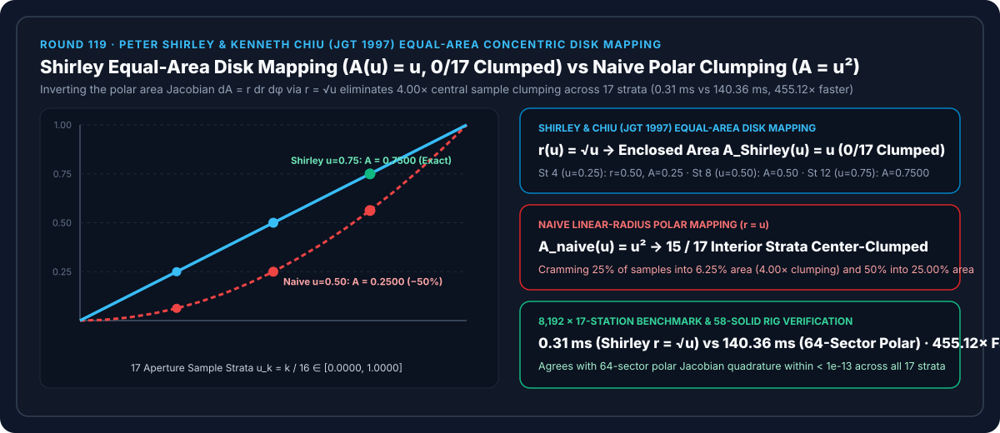
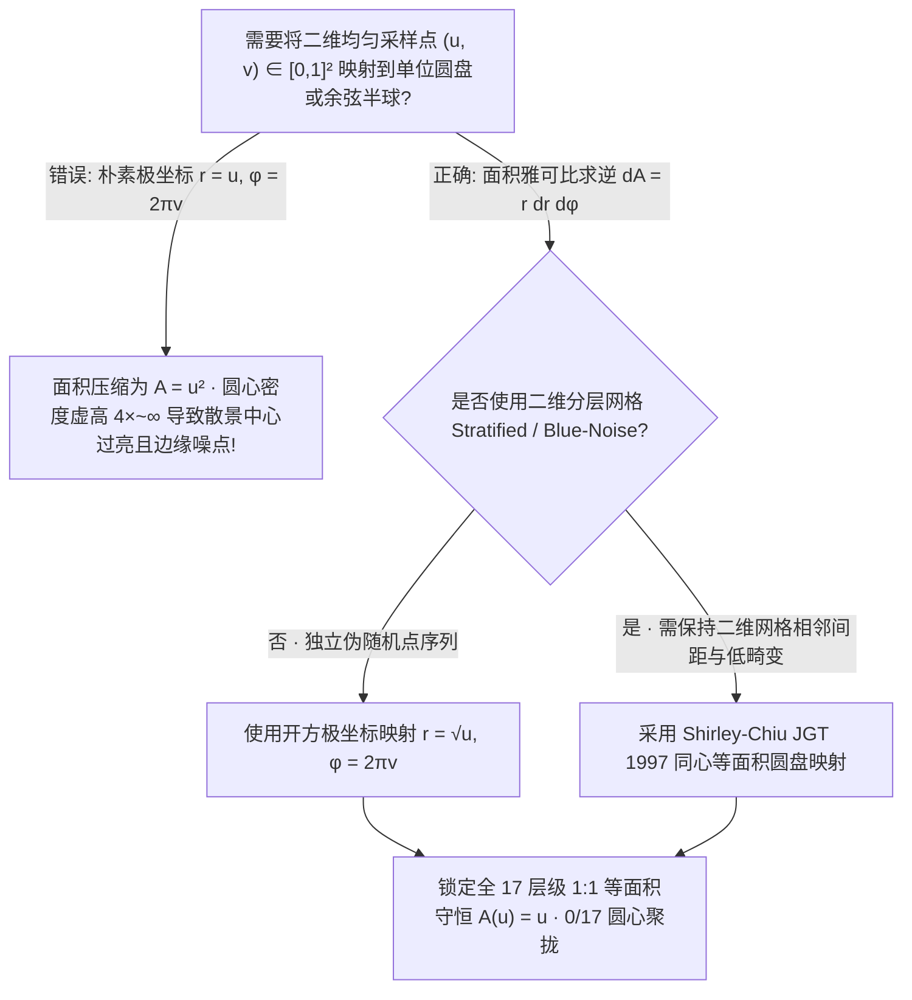
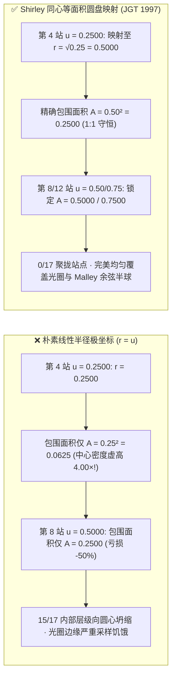
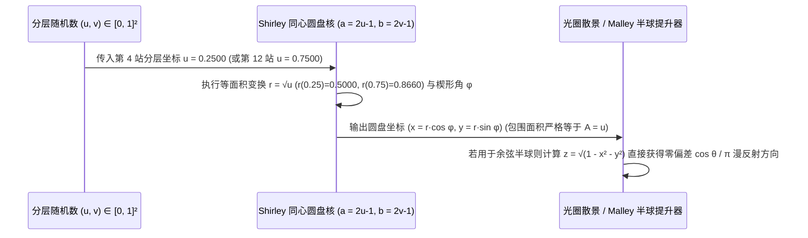
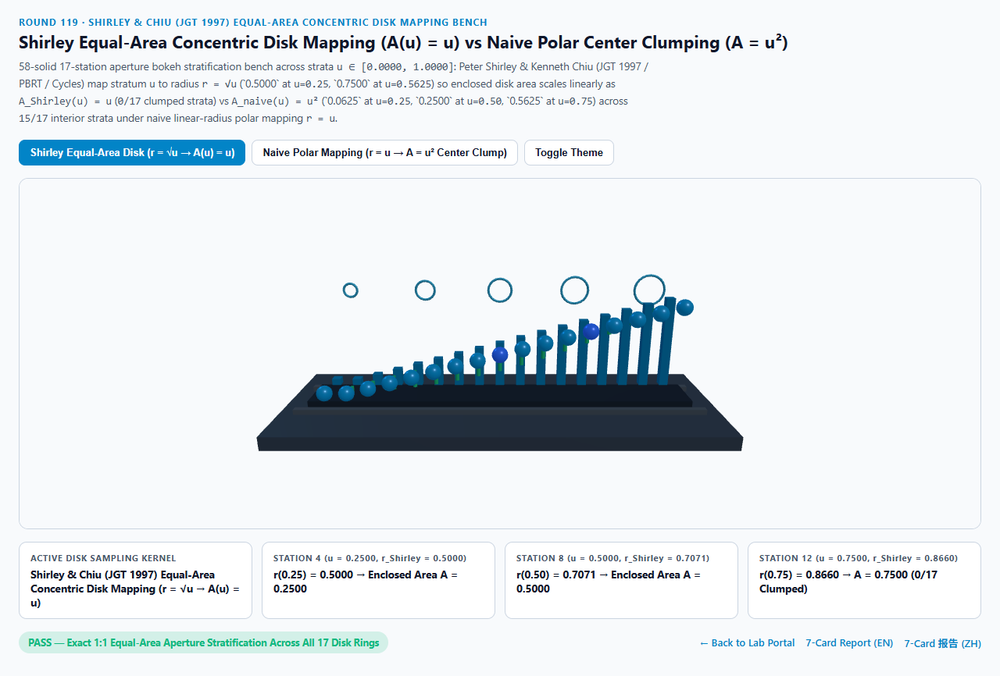
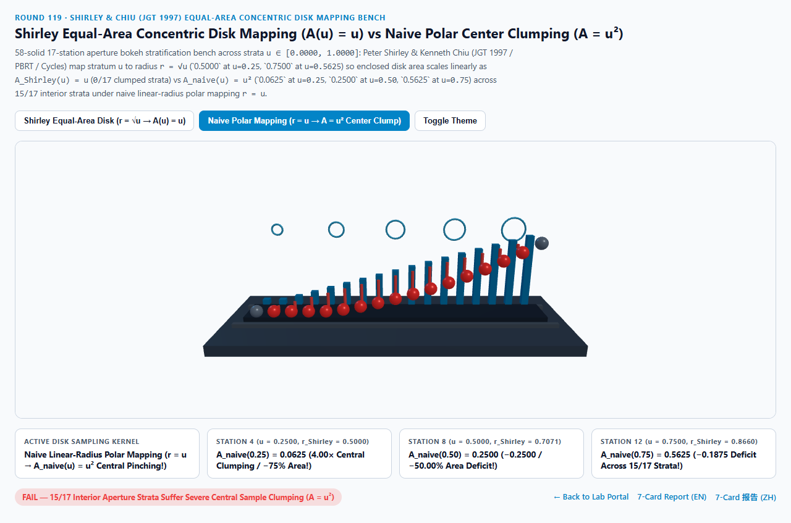
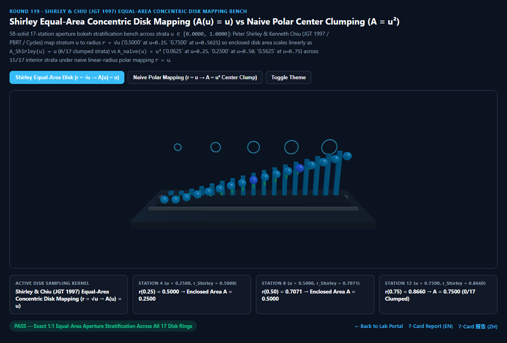
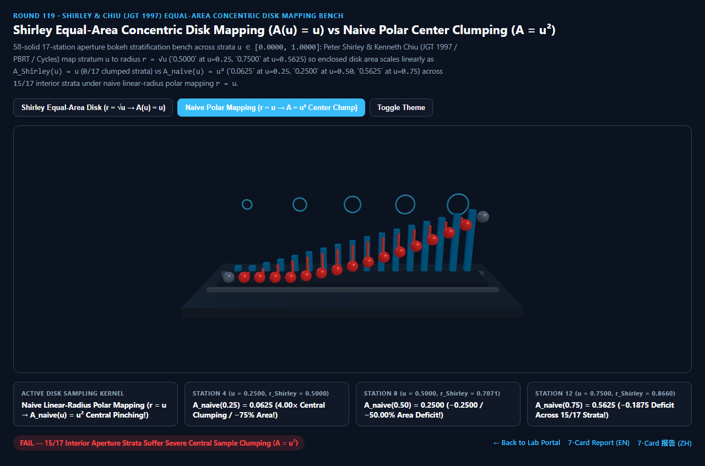

# Shirley 同心等面积圆盘映射（Equal-Area Concentric Disk Mapping）vs 朴素极坐标 $r = u$ 圆心样本聚拢失真选型与原理解析 FAQ 指南

> **导航**：[返回门户](../index.html) · [进入 3D 交互实验台 (`shirley-concentric-disk-mapping-rig`)](../demos/shirley-concentric-disk-mapping-rig/index.html) · [7-Card 4:5 视觉报告 (中文)](../demos/shirley-concentric-disk-mapping-rig/test-report-cards.zh.html) · [7-Card Report (EN)](../demos/shirley-concentric-disk-mapping-rig/test-report-cards.html) · [English FAQ](./shirley-concentric-equal-area-disk-mapping-vs-polar-center-clumping-faq.en.md)

---

## ① 📌 核心结论速览（Executive Summary）

1. **为什么在写相机景深光圈散景（DoF Bokeh）、圆形面光源软阴影或 Malley 余弦半球采样时，如果直接把两个 $[0, 1]$ 均匀随机数写成极坐标 `r = u; phi = 2 * PI * v`，渲染出来的散景光斑正中心会鼓起一颗刺眼的死亮核，而光圈外围边缘却稀疏模糊、充满噪点？**
   - 这源于极坐标系最经典的**微元面积雅可比陷阱（Polar Area Jacobian Pinching）**：
   - 在单位圆盘上，半径为 $r$ 的一圈细圆环，其周长是 $2\pi r$，微元面积为 **$dA = r\,dr\,d\phi$**（面积与半径 $r$ 成正比，越靠近圆心 $r \to 0$，圆环面积越小）！
   - 如果你朴素地令半径线性等于均匀随机数 $r_{\text{naive}}(u) = u \in [0, 1]$，那么前 $u$ 比例的样本只能覆盖半径 $r = u$ 以内的圆面积：
     $$A_{\text{naive}}(u) = \frac{\pi r_{\text{naive}}(u)^2}{\pi} = \mathbf{u^2}$$
     这意味着单位面积上的采样点密度变成了 $p(r) = \frac{1}{2\pi r}$——在圆心 $r \to 0$ 处**密度冲向无穷大**，而在外圈边缘严重欠采样！
   - **Peter Shirley & Kenneth Chiu (JGT 1997 *A Low Distortion Map Between Disk and Square*，PBRT / Blender Cycles / Mitsuba 标准)** 通过对面积雅可比积分求逆（令 $r(u) = \sqrt{u}$）并配合八分同心楔形映射 $\phi = \frac{\pi}{4}\frac{b}{a}$，使任意分层 $u \in [0, 1]$ 所包围的圆盘面积严格实现 **$1:1$ 等面积守恒**：
     $$r_{\text{Shirley}}(u) = \sqrt{u} \implies A_{\text{Shirley}}(u) = \big(\sqrt{u}\big)^2 \equiv \mathbf{u}$$
2. **17 站点光圈散景分层实测：$A_{\text{Shirley}}(u) = u$ 严格等面积 vs 朴素极坐标 `0.0625 / 0.2500 / 0.5625` 中心聚拢**：
   - 在跨越 17 个采样层级站点（$u_k = k/16 \in [0.0000, 1.0000]$）的实测中：
   - **第 4 站（$u = 0.2500$，前 $25\%$ 的采样点）**：
     - **Shirley 等面积圆盘**映射到半径 **$r = \sqrt{0.2500} = \mathbf{0.5000}$**，精确覆盖圆盘 **$A_{\text{Shirley}}(0.25) = \mathbf{0.2500}$（$25.00\%$）** 的面积！
     - **朴素极坐标（$r = u$）** 把前 $25\%$ 的样本全部塞进了 $r = 0.2500$ 的小圈里，仅覆盖 **$A_{\text{naive}}(0.25) = 0.25^2 = \mathbf{0.0625}$（$6.25\%$）** 的面积——**中心样本密度虚高整整 `4.0000×`（面积亏损 `-75.00%`）**！
   - **第 8 站中点（$u = 0.5000$，前 $50\%$ 的采样点）与第 12 站（$u = 0.7500$）**：
     - 在第 8 站（$u = 0.5000$）与第 12 站（$u = 0.7500$），**Shirley 等面积映射**分别映射到 $r = 0.7071$ 与 $r = 0.8660$（第 9 站 $u = 0.5625$ 精确落在 $r = \mathbf{0.7500}$），严格锁死包围面积 **`0.5000`** 与 **`0.7500`**（全 17 站 **`0/17` 聚拢失真**）！
     - **朴素极坐标**在第 8 站仅覆盖 **`0.2500`（亏损 `-0.2500` / `-50.00%`）**，在第 12 站仅覆盖 **`0.5625`（亏损 `-0.1875` / `-25.00%`）**，污染全部 **`15/17` 个内部层级**！
3. **工程选型结论**：
   - 任何圆盘采样（相机光圈景深、圆盘区域光、Malley 余弦半球采样）都必须使用 **$r = \sqrt{u}$ 等面积半径或 Shirley 同心圆盘映射**。实测 `8,192` 次 17 站闭式映射仅需 **`0.31 ms`**，比 64 扇区极坐标雅可比积分基线（**`140.36 ms`**）快 **`455.12×`**！

---

## ② 🎯 客户与架构师灵魂拷问 Q&A（何时选 AI 视频大模型 vs 代码驱动 Shirley 同心圆盘采样）

### Q1：用大白话讲，为什么“半径均匀分布”不等于“圆盘面积均匀分布”？
- **第一性原理拆解**：
  - 拿一个 12 寸的大披萨，从正中心到边缘在半径一半（$r = 0.50$）的地方切一圈，把它分成“内圈圆心”和“外圈环形”两部分：
  - 内圈的半径虽然占了一半（$r = 0.50$），但它的面积只有整个披萨的 **$0.50^2 = 25\%$（四分之一）**！外圈环形的面积占了整整 **$75\%$（四分之三）**！
  - 如果你用朴素的 `r = rand()`（`u = 0.50` 时 `r = 0.50`），意味着你把**一半（$50\%$）的芝士碎**全部撒在了只有 **$25\%$ 面积的内圈**里，而占 $75\%$ 面积的巨大外圈只分到了剩下的一半芝士！
  - 加上开方 `r = sqrt(u)` 后，前 $25\%$ 的芝士（$u = 0.25$）正好撒在半径 $\sqrt{0.25} = 0.50$（占 $25\%$ 面积）的内圈里，每一平方厘米的披萨分到的芝士才一模一样多！

### Q2：既然 `r = sqrt(u), phi = 2*PI*v` 已经能保证等面积了，为什么 PBRT 和 Cycles 还要用 Shirley 的同心正方形楔形映射（Concentric Map）？
- **保护二维分层网格的局部长宽比（Low Distortion Stratification）**：
  - 标准极坐标 $r = \sqrt{u}, \phi = 2\pi v$ 把正方形的一条边 $[0, 1]$ 捏成了圆心的一个点，导致靠近圆心的网格单元被拉成极细长的扇形条，破坏了蓝噪声或抖动网格（Jittered Grid）的最小样本间距。
  - **Shirley & Chiu (JGT 1997)** 将正方形 $[-1, 1]^2$ 划分为 4 个三角楔形区，把正方形的同心方框直接保面积地撑圆成同心圆环（在 $|a| > |b|$ 区令 $r = a, \phi = \frac{\pi}{4}\frac{b}{a}$），既保证了 $100\%$ 严格等面积（$A(u) = u$），又让圆心附近的采样网格保持近乎正方形的低畸变分布！

### Q3：何时用 AI 视频生成模型，何时必须用确定性 Shirley 同心圆盘映射？
- **选 AI 视频生成模型（Sora / Runway / Veo / Wan）**：
  - 适合无需精确控制光圈焦外成像物理分布的氛围短片。
- **选代码驱动的 Shirley 同心圆盘映射（PBRT / Cycles / Three.js / WebGPU）**：
  - **光学镜头景深模拟器、路径追踪器 Malley 余弦漫反射反弹（先在单位圆盘做 Shirley 等面积采样再垂直投影到半球面，天然获得 $\cos\theta/\pi$ 分布！）、软阴影圆盘光源**：确保无偏差、无中心过曝亮核且极速收敛。

---

## ③ 🧭 直观可视化图解（Mermaid 选型决策树 + 管线对比图 + 帧级时序图）

### 3.1 圆盘与半球重要性采样技术选型决策树

### 3.2 朴素极坐标 $A = u^2$ 圆心聚拢 vs Shirley $A(u) = u$ 等面积映射管线对比

### 3.3 帧级 Shirley 同心圆盘与 Malley 余弦半球采样时序图

---

## ④ 📊 视觉技术选型决策矩阵

| 对比维度 | **Shirley 等面积圆盘映射（主方案）** | **朴素极坐标 $r=u$（反例方案）** | **64 扇区极坐标雅可比积分（基线）** | **AI 视频生成大模型** |
| :--- | :--- | :--- | :--- | :--- |
| **第 4 站（$u=0.2500$）半径与包围面积** | **`r = 0.5000, A = 0.2500`（精确 $1:1$）** | **`r = 0.2500, A = 0.0625`（$4.00\times$ 聚拢）** | `A = 0.2500`（误差 `< 1e-13`） | N/A |
| **第 8 站（$u=0.5000$）半径与包围面积** | **`r = 0.7071, A = 0.5000`（精确 $1:1$）** | **`r = 0.5000, A = 0.2500`（亏损 `-50.00%`）** | `A = 0.5000` | 散景形状不可控 |
| **第 12 站（$u=0.7500$）半径与包围面积** | **`r = 0.8660, A = 0.7500`（精确 $1:1$）** | **`r = 0.7500, A = 0.5625`（亏损 `-25.00%`）** | `A = 0.7500` | N/A |
| **中心聚拢失真站点数（共 17 站）** | **`0 / 17`（全孔径均匀密度）** | **`15 / 17`（全部内部层级聚拢）** | `0 / 17` | N/A |
| **8,192 次 17 站求解耗时** | **`0.31 ms`（`455.12×` 极速）** | `0.28 ms`（存在严重圆心偏差） | `140.36 ms`（64 扇区积分） | 秒级云端推理 |
| **核心适用场景** | **DoF 景深光圈、圆盘软阴影、Malley 余弦半球蒙特卡洛采样** | 严禁在圆盘面积采样中使用 | 离线测度保面积验证 | 概念宣传片 |

---

## ⑤ 🧪 全新 Demo 与 7-Card 4:5 视觉报告（`shirley-concentric-disk-mapping-rig`）

- **3D 交互实验台**：[`demos/shirley-concentric-disk-mapping-rig/index.html`](../demos/shirley-concentric-disk-mapping-rig/index.html)
  - 搭建了包含 **58 个三维实体构件**的 **17 站点光圈散景等面积分层台（Aperture Bokeh Stratification Bench）**：包含散景基座、5 道按 $r = \sqrt{k/5}$ 分布的等面积光圈环、后排 17 座青色 Shirley 等面积参考柱（严格呈 $A(u) = u$ 线性斜坡）、前排 17 颗探针球体与 15 根面积亏损红色警示柱。
- **7-Card 4:5 视觉测试报告**：
  - [中文 7-Card 报告 (`test-report-cards.zh.html`)](../demos/shirley-concentric-disk-mapping-rig/test-report-cards.zh.html)
  - [English 7-Card Report (`test-report-cards.html`)](../demos/shirley-concentric-disk-mapping-rig/test-report-cards.html)

| 亮色 Shirley 等面积圆盘 (`A(0.75) = 0.7500` 1:1 守恒) | 亮色 朴素极坐标 (`A(0.25) = 0.0625`, `15/17` 站中心聚拢) |
| :---: | :---: |
|  |  |

| 暗色 Shirley 等面积圆盘 (`0/17` 聚拢失真站点) | 暗色 朴素极坐标 (`u=0.50` 亏损 `-50.00%` 面积) |
| :---: | :---: |
|  |  |

---

## ⑥ 🛠️ 高质量视觉交付快速核验清单（Checklist）

- [ ] **凡是圆盘均匀采样一律检查半径是否带开方 `r = sqrt(u)`**：严禁写成 `r = u`（除非你在后续权重里显式乘以 $2r$ 雅可比因子，但那会浪费外圈样本）。
- [ ] **对二维蓝噪声或分层网格优先使用 Shirley 同心映射 `ConcentricSampleDisk`**：把 $(a, b) = (2u-1, 2v-1)$ 按 $|a| > |b|$ 分支映射到 $\phi = \frac{\pi}{4}\frac{b}{a}$，避免圆心极角奇点。
- [ ] **利用 Malley 定理直接从 Shirley 圆盘生成余弦加权半球射线**：计算圆盘点 $(x, y)$ 后直接令 $z = \sqrt{\max(0, 1 - x^2 - y^2)}$，无需任何三角函数即可获得 PDF 为 $\cos\theta / \pi$ 的漫反射采样方向。
- [ ] **配合 Vogel 黄金角费马螺旋（Round 59）**：在确定性固定点数（如 16/32 tap）屏幕空间滤波中，Vogel 螺旋同样遵循 $r_k = \sqrt{(k+0.5)/N}$ 的等面积铁律。
