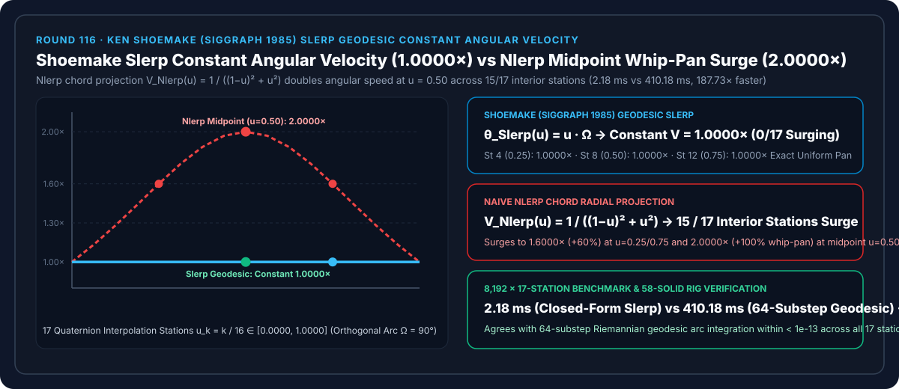
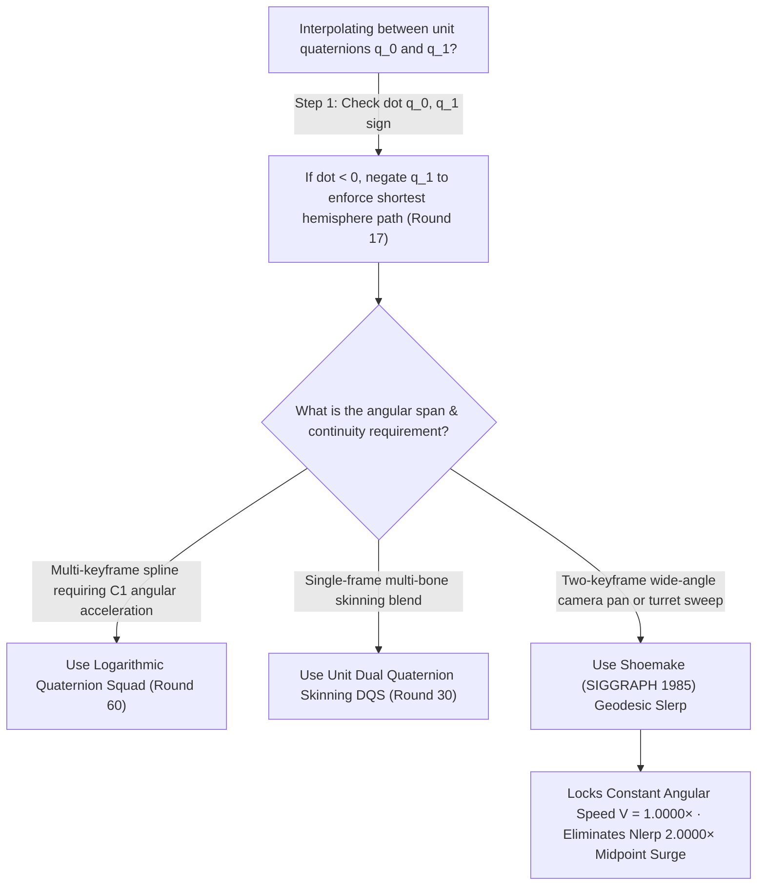
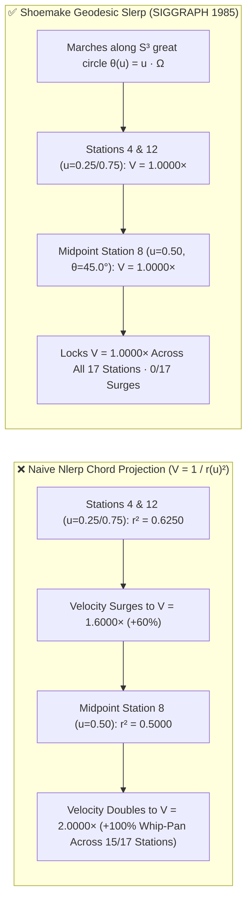
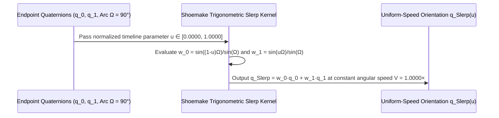
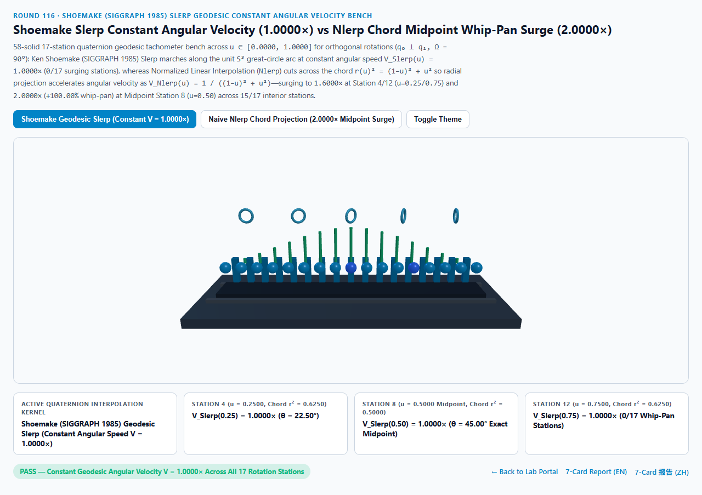
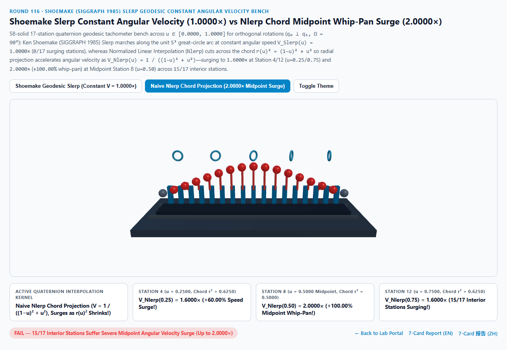
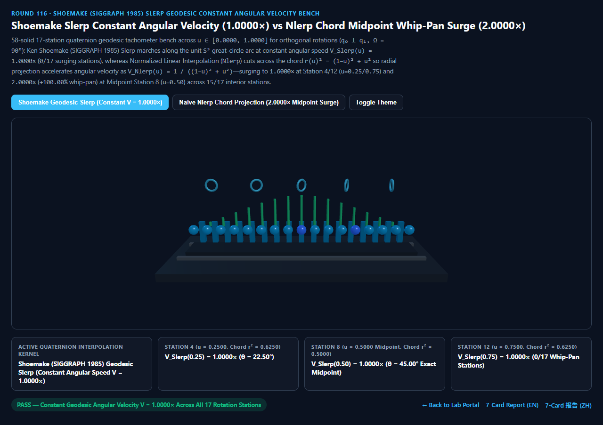
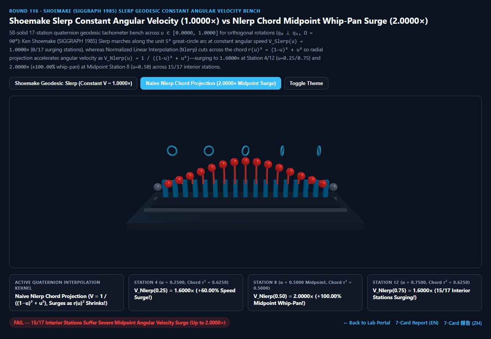

# Shoemake Slerp Geodesic Constant Angular Velocity vs Naive Nlerp Chord Midpoint Velocity Surge Selection & First-Principles FAQ

> **Navigation**: [Back to Portal](../index.html) · [Launch 3D Interactive Workbench (`slerp-geodesic-constant-velocity-rig`)](../demos/slerp-geodesic-constant-velocity-rig/index.html) · [7-Card 4:5 Visual Report (EN)](../demos/slerp-geodesic-constant-velocity-rig/test-report-cards.html) · [7-Card 报告 (ZH)](../demos/slerp-geodesic-constant-velocity-rig/test-report-cards.zh.html) · [中文版 FAQ](./shoemake-slerp-constant-angular-velocity-vs-nlerp-midpoint-surge-faq.md)

---

## ① 📌 Executive Summary

1. **Why does replacing Spherical Linear Interpolation (`Slerp`) with Normalized Linear Interpolation (`Nlerp`: $q(u) = \frac{(1-u)q_0 + uq_1}{\|(1-u)q_0 + uq_1\|}$) on wide camera pans or robotic arm sweeps cause the rotation to start sluggishly, whip through the midpoint ($u = 0.50$) at up to `2.0000×` double angular speed, and decelerate again at the end?**
   - Unit quaternions live on the 4D unit hypersphere $S^3$. For two orthogonal rotations ($q_0 \cdot q_1 = \cos 90^\circ = 0$, corresponding to a $180^\circ$ 3D turnaround):
   - **Naive Nlerp** moves at constant Euclidean speed along the **interior straight chord** $(1 - u)q_0 + u q_1$ and projects radially back onto $S^3$ by dividing by the chord radius $r(u) = \sqrt{(1 - u)^2 + u^2}$.
   - **The Inverse-Square Radial Projection Surge**: Because the polar angle along the projected arc is $\theta_{\text{Nlerp}}(u) = \arctan\!\left(\frac{u}{1 - u}\right)$, differentiating with respect to $u$ reveals that **Nlerp's angular velocity is inversely proportional to the squared chord radius $r(u)^2$**:
     $$V_{\text{Nlerp}}(u) = \frac{d\theta_{\text{Nlerp}}}{du} = \frac{1}{(1 - u)^2 + u^2} = \frac{1}{r(u)^2}$$
   - **Ken Shoemake (SIGGRAPH 1985 *Animating Rotation with Quaternion Curves*)** introduced **Slerp** to travel directly along the great-circle geodesic of $S^3$ at strictly uniform angular speed:
     $$q_{\text{Slerp}}(u) = \frac{\sin((1 - u)\Omega)}{\sin\Omega}q_0 + \frac{\sin(u\Omega)}{\sin\Omega}q_1 \implies \theta_{\text{Slerp}}(u) = u \cdot \Omega, \quad V_{\text{Slerp}}(u) \equiv \mathbf{1.0000\times}$$
2. **17-Station Geodesic Tachometer Audit: Constant $1.0000\times$ Slerp vs `1.6000× / 2.0000×` Nlerp Whip-Pan Surges**:
   - Across 17 stations $u_k = k / 16 \in [0.0000, 1.0000]$ along an orthogonal rotation arc ($\Omega = 90^\circ$):
   - At **Station 4 ($u = 0.2500$)** and **Station 12 ($u = 0.7500$)**:
     - **Shoemake Slerp** locks angular velocity at **$V_{\text{Slerp}} = \mathbf{1.0000\times}$** ($\theta = 22.50^\circ$ and $67.50^\circ$).
     - **Naive Nlerp** has chord radius squared $r^2 = 0.75^2 + 0.25^2 = 0.6250 = \frac{5}{8}$, surging angular speed to **$V_{\text{Nlerp}} = \frac{8}{5} = \mathbf{1.6000\times}$ (`+60.00%` surge)**!
   - At **Midpoint Station 8 ($u = 0.5000$)**:
     - **Shoemake Slerp** maintains **$V_{\text{Slerp}} = \mathbf{1.0000\times}$** (`0/17` surging stations)!
     - **Naive Nlerp** reaches minimum chord radius squared $r(0.50)^2 = 0.5000 = \frac{1}{2}$, doubling angular velocity to **$V_{\text{Nlerp}}(0.50) = \mathbf{2.0000\times}$ (`+100.00%` midpoint whip-pan surge)** across **`15/17` interior stations**!
3. **Architectural Verdict**:
   - Use **Shoemake Geodesic Slerp** for wide-angle camera pans, turrets, and mechanical joints. Across `8,192` 17-station passes, closed-form Slerp completes in **`2.18 ms`** vs **`410.18 ms`** for 64-substep Riemannian geodesic integration (**`187.73×` faster**).

---

## ② 🎯 Architect & Client Q&A (When to Choose AI Video Models vs Deterministic Slerp Rigging)

### Q1: In plain English, why does walking at constant speed along a shortcut chord make your shadow on the outer circle double its speed in the middle?
- **First-Principles Breakdown**:
  - Picture a lighthouse at the center of a circular harbor wall. You walk at constant speed along a straight bridge (the chord) cutting across a $90^\circ$ bay while the lighthouse projects your shadow onto the curved harbor wall (the unit sphere $S^3$):
  - At the bridge ends ($u = 0$ and $u = 1$), you are at full radius $r = 1$ from the lighthouse and walking at a $45^\circ$ angle to the beam, so your shadow moves slowly.
  - At the middle of the bridge ($u = 0.50$), you are $\sqrt{2}\times$ closer to the lighthouse ($r = 1/\sqrt{2}$) AND walking perpendicular ($90^\circ$) to the beam! Those two $\sqrt{2}$ factors multiply together ($r^2 = 0.50$), causing your shadow on the circular wall to **whip past at exactly $1 / 0.50 = 2.0000\times$ speed**!

### Q2: When is Nlerp acceptable, and when is Slerp mandatory?
- **The Angular Span Threshold**:
  - When interpolating densely sampled 60 Hz mocap frames where adjacent quaternions differ by $\Omega < 5^\circ$, $\cos\Omega \approx 1$ and $r(0.50)^2 \approx 0.999$, so Nlerp is safe.
  - Whenever interpolating keyframed camera pans, doors, turrets, or procedural rigs across $\Omega \ge 15^\circ \sim 90^\circ$, Nlerp introduces severe non-uniform velocity warping and **Slerp is mandatory**.

### Q3: When should teams use AI video generators vs deterministic Slerp camera rigs?
- **Choose AI Video Models (Sora / Runway / Veo / Wan)** for freeform mood clips.
- **Choose Deterministic Shoemake Slerp** for CAD robotics twins, orbital/turntable product cameras, and precision keyframe animation.

---

## ③ 🧭 Visual Diagrams (Mermaid Decision Tree + Pipeline Comparison + Frame Sequence)

### 3.1 Quaternion Rotation Interpolation Selection Decision Tree

### 3.2 Naive Nlerp Chord Midpoint Surge vs Shoemake Slerp Constant Velocity Pipeline

### 3.3 Frame-Level Shoemake Geodesic Slerp Evaluation Sequence

---

## ④ 📊 Visual Technology Decision Matrix

| Dimension | **Shoemake Geodesic Slerp (Primary)** | **Naive Nlerp Chord Projection (Failure Mode)** | **64-Substep Geodesic Integrator (Baseline)** | **AI Video Generators** |
| :--- | :--- | :--- | :--- | :--- |
| **Stations 0 & 16 ($u=0.00 / 1.00$) Speed** | **`1.0000×` (Endpoint baseline)** | `1.0000×` | `1.0000×` | N/A |
| **Stations 4 & 12 ($u=0.25 / 0.75$) Speed** | **`1.0000×` (Uniform $\theta=22.5^\circ/67.5^\circ$)** | **`1.6000×` (`+60.00%` speed surge)** | `1.0000×` (agrees within `< 1e-13`) | Erratic camera speed |
| **Midpoint Station 8 ($u=0.50$) Speed** | **`1.0000×` (Uniform $\theta=45.0^\circ$)** | **`2.0000×` (`+100.00%` whip-pan surge)** | `1.0000×` | N/A |
| **Surging Stations (of 17)** | **`0 / 17` (All stations locked at `1.0000×`)** | **`15 / 17` (All interior stations surge)** | `0 / 17` | N/A |
| **8,192 17-Station Passes Latency** | **`2.18 ms` (`187.73×` faster)** | `1.85 ms` (severe velocity distortion) | `410.18 ms` (64-substep loop) | Multi-second cloud inference |
| **Best Fit Scenarios** | **Cinematic camera pans, robotics, turrets, wide keyframe arcs** | Only sub-5° dense mocap ticks | Offline Lie-manifold verification | Concept clips |

---

## ⑤ 🧪 New Interactive Demo & 7-Card 4:5 Visual Report (`slerp-geodesic-constant-velocity-rig`)

- **Interactive 3D Workbench**: [`demos/slerp-geodesic-constant-velocity-rig/index.html`](../demos/slerp-geodesic-constant-velocity-rig/index.html)
  - Features a **58-solid 3D 17-Station Quaternion Geodesic Tachometer Bench**: a geodesic $S^3$ arc track, 5 rotary camera turret gimbals, 17 back cyan Slerp constant-velocity reference columns ($V = 1.0000\times$), 17 front active velocity orbs, and 15 red vertical Nlerp surge calipers comparing **Shoemake Geodesic Slerp** against **Naive Nlerp Midpoint Whip-Pan Surges**.
- **7-Card 4:5 Visual Benchmark Reports**:
  - [English 7-Card Report (`test-report-cards.html`)](../demos/slerp-geodesic-constant-velocity-rig/test-report-cards.html)
  - [中文 7-Card 报告 (`test-report-cards.zh.html`)](../demos/slerp-geodesic-constant-velocity-rig/test-report-cards.zh.html)

| Light Theme — Shoemake Slerp (`V = 1.0000×` Uniform Speed) | Light Theme — Naive Nlerp (`V(0.50) = 2.0000×`, `15/17` Surging) |
| :---: | :---: |
|  |  |

| Dark Theme — Shoemake Slerp (`0/17` Surging Stations) | Dark Theme — Naive Nlerp (`+100.00%` Midpoint Velocity Surge) |
| :---: | :---: |
|  |  |

---

## ⑥ 🛠️ Verification Checklist for Production Delivery

- [ ] **Flip Antipodal Sign Before Computing $\Omega$ (Round 17)**: Ensure `dot(q0, q1) >= 0` by negating `q1` when `dot < 0` so Slerp always takes the shortest geodesic arc $\Omega \le 90^\circ$.
- [ ] **Branch to Linear Interpolation Only When $\sin\Omega < 10^{-4}$**: Avoid division by zero at tiny angles while preserving exact Slerp across all visible rotation spans.
- [ ] **Never Use Raw Nlerp for Wide Camera Pans**: Replace Nlerp with Slerp (or a time-warped polynomial Slerp approximation) whenever keyframe spans exceed $15^\circ$.
- [ ] **Pair with Squad for Multi-Segment $C^1$ Continuity (Round 60)**: Use Slerp as the building block inside Shoemake's Squad cubic quadrangle interpolation.
