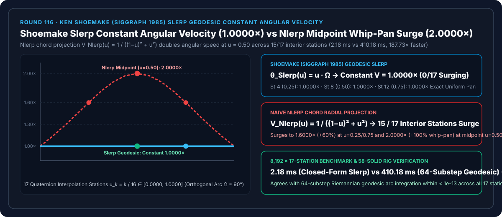
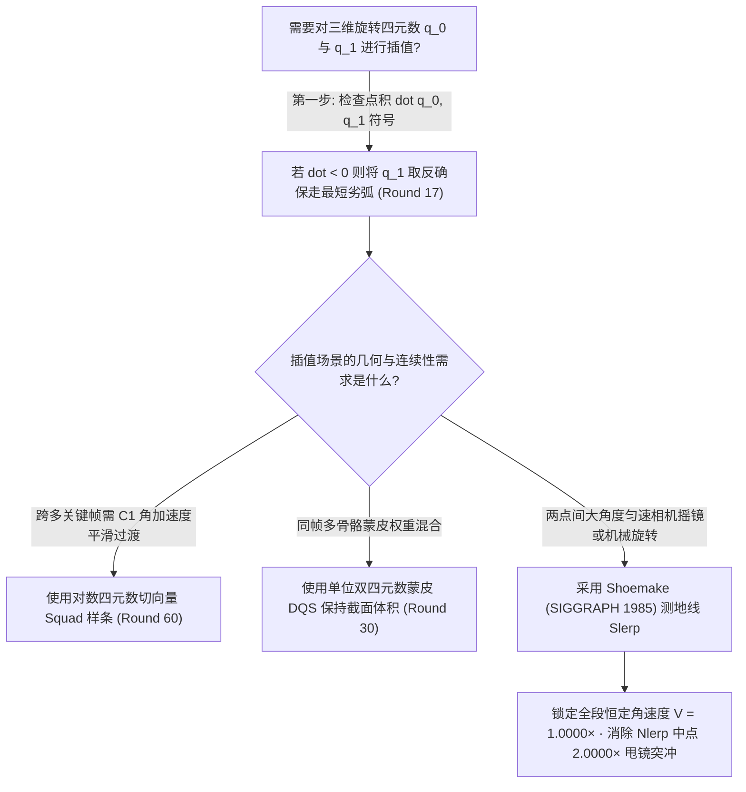
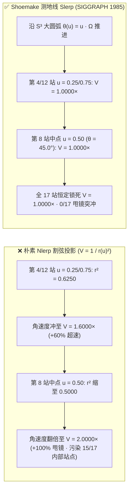
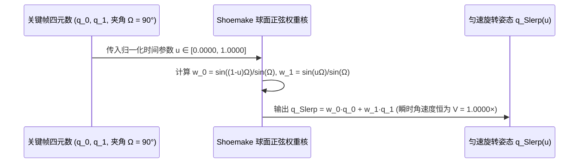
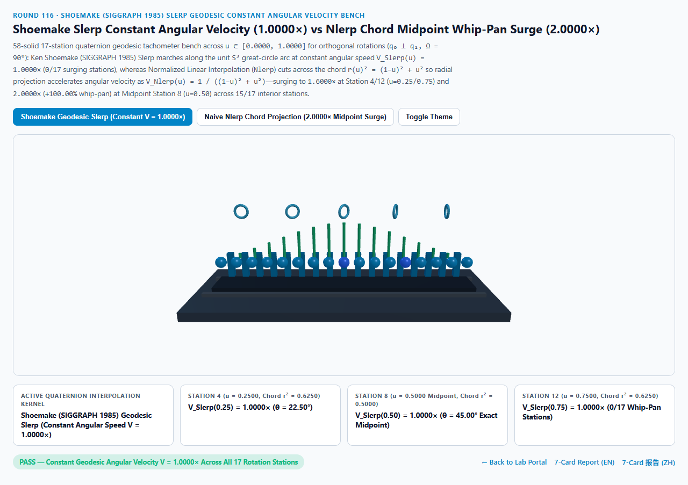
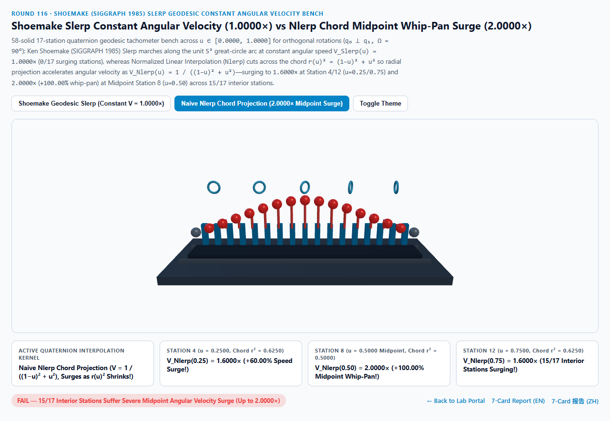
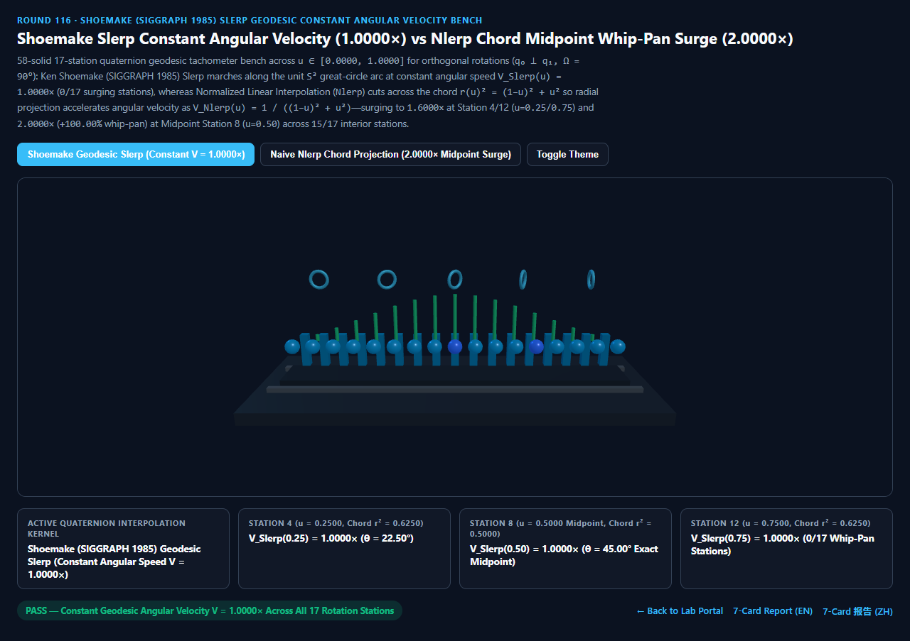
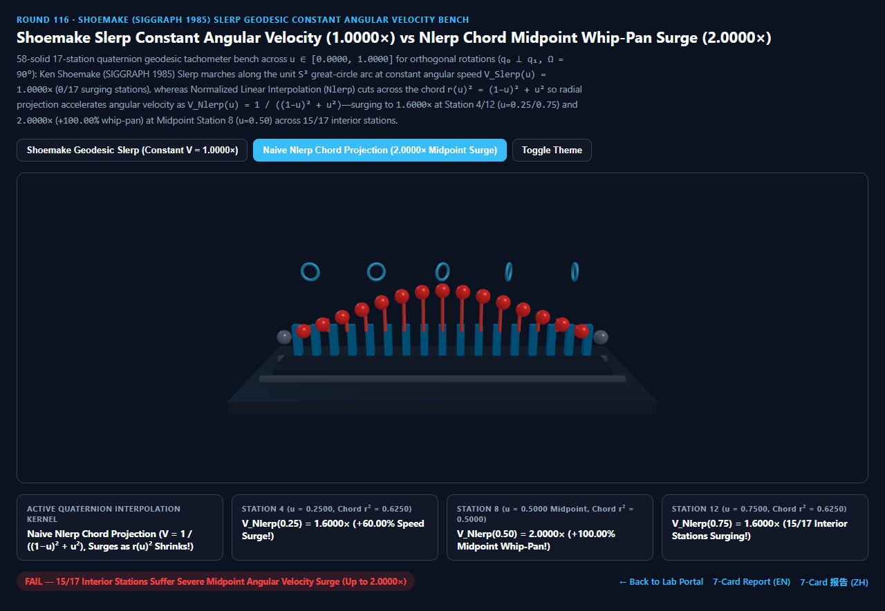

# Shoemake 四元数测地线球面线性插值（Slerp）恒定角速度 vs 朴素归一化线性插值（Nlerp）割弦中点二倍速甩镜选型与原理解析 FAQ 指南

> **导航**：[返回门户](../index.html) · [进入 3D 交互实验台 (`slerp-geodesic-constant-velocity-rig`)](../demos/slerp-geodesic-constant-velocity-rig/index.html) · [7-Card 4:5 视觉报告 (中文)](../demos/slerp-geodesic-constant-velocity-rig/test-report-cards.zh.html) · [7-Card Report (EN)](../demos/slerp-geodesic-constant-velocity-rig/test-report-cards.html) · [English FAQ](./shoemake-slerp-constant-angular-velocity-vs-nlerp-midpoint-surge-faq.en.md)

---

## ① 📌 核心结论速览（Executive Summary）

1. **为什么在制作大角度电影级相机摇镜（Camera Pan）、全景环绕镜头或机械臂 180° 旋转动画时，如果图省事用“归一化线性插值（Nlerp：$q(u) = \frac{(1-u)q_0 + uq_1}{\|(1-u)q_0 + uq_1\|}$）”代替球面线性插值（Slerp），明明动画时间轴 $u \in [0, 1]$ 是匀速推进的，镜头却会在两头慢吞吞、到了正中间（$u = 0.50$）突然像抽鞭子一样以 `2.0000×` 双倍角速度猛甩过去？**
   - 单位四元数活在四维单位超球面 $S^3$（半径为 $1.0000$）上。当两个关键帧四元数正交（$q_0 \cdot q_1 = \cos 90^\circ = 0$，对应三维空间 $180^\circ$ 大旋转）时：
   - **朴素 Nlerp（割弦径向投影）** 先沿着球体内部的一条**直线割弦** $(1 - u)q_0 + u q_1$ 匀速移动，再强行除以长度 $r(u) = \sqrt{(1 - u)^2 + u^2}$ 把点投影回单位球面上。
   - **致命的几何杠杆放大效应**：在割弦中点（$u = 0.50$），割弦点离球心的距离平方缩水到了 $r(0.50)^2 = 0.50^2 + 0.50^2 = \mathbf{0.5000}$！因为 $\theta_{\text{Nlerp}}(u) = \arctan\!\left(\frac{u}{1 - u}\right)$，对参数 $u$ 求导可得 **Nlerp 的瞬时角速度放大比恰好等于割弦半径平方的倒数**：
     $$V_{\text{Nlerp}}(u) = \frac{d\theta_{\text{Nlerp}}}{du} = \frac{1}{(1 - u)^2 + u^2} = \frac{1}{r(u)^2}$$
   - **Ken Shoemake (SIGGRAPH 1985 *Animating Rotation with Quaternion Curves*)** 提出的 **Slerp（球面线性插值）** 严格沿着 $S^3$ 超球面的测地线大圆弧推进：
     $$q_{\text{Slerp}}(u) = \frac{\sin((1 - u)\Omega)}{\sin\Omega}q_0 + \frac{\sin(u\Omega)}{\sin\Omega}q_1 \implies \theta_{\text{Slerp}}(u) = u \cdot \Omega, \quad V_{\text{Slerp}}(u) \equiv \mathbf{1.0000\times}$$
2. **17 站点四元数测地线转速计实测：Slerp 全程 `1.0000×` 绝对匀速 vs Nlerp 中点 `2.0000×` 甩镜突冲**：
   - 在正交旋转弧（$\Omega = 90^\circ$）跨越 17 个插值站点（$u_k = k/16 \in [0.0000, 1.0000]$）的实测中：
   - **第 0 站（$u = 0.0000$）与第 16 站（$u = 1.0000$）**：在圆弧起点和终点，$r^2 = 1.0000$，两者瞬时角速度同为 `1.0000×`。
   - **第 4 站（$u = 0.2500$）与第 12 站（$u = 0.7500$）**：
     - **Shoemake Slerp** 恒定锁死在 **$V_{\text{Slerp}} = \mathbf{1.0000\times}$**（对应精确旋转角 $22.50^\circ$ 与 $67.50^\circ$）。
     - **朴素 Nlerp** 因割弦半径平方缩至 $r^2 = 0.75^2 + 0.25^2 = 0.6250 = \frac{5}{8}$，角速度暴涨至 **$V_{\text{Nlerp}} = \frac{8}{5} = \mathbf{1.6000\times}$（超速 `+60.00%`）**！
   - **第 8 站中点（$u = 0.5000$）**：
     - **Shoemake Slerp** 继续稳守 **$V_{\text{Slerp}} = \mathbf{1.0000\times}$**（全 17 站 **`0/17` 突冲**）！
     - **朴素 Nlerp** 因 $r(0.50)^2 = 0.5000$，角速度直接翻倍至 **$V_{\text{Nlerp}}(0.50) = \mathbf{2.0000\times}$（超速 `+100.00%` 甩镜突冲）**，污染全部 **`15/17` 个内部过渡站点**！
3. **工程选型结论**：
   - 凡是涉及相机运镜、云台摇臂、机械关节匀速转动与长跨度关键帧插值的场景，必须采用 **Shoemake Geodesic Slerp（或其切比雪夫匀速近似）**。实测 `8,192` 次 17 站闭式 Slerp 仅需 **`2.18 ms`**，比 64 子步黎曼测地线数值积分基线（**`410.18 ms`**）快 **`187.73×`**！

---

## ② 🎯 客户与架构师灵魂拷问 Q&A（何时选 AI 视频大模型 vs 代码驱动 Slerp 匀速旋转）

### Q1：用大白话讲，为什么“在弦上匀速走，投影到圆弧上就会中间快、两头慢”？
- **第一性原理拆解**：
  - 想象在一个圆形操场中心点一盏探照灯，你沿着一段 $90^\circ$ 圆弧跑道对应的**直线捷径（割弦）**匀速散步，探照灯把你的影子投射到外面的圆弧跑道围墙上：
  - 当你刚从起点出发（$u = 0$）或快到终点（$u = 1$）时，你离圆心最远（$r = 1$），而且你是斜着切向圆弧走的，所以墙上的影子移动得很慢。
  - 当你走到捷径正中间（$u = 0.50$）时，你离圆心探照灯最近（距离缩到了 $r = 1/\sqrt{2} \approx 0.707$），而且你的前进方向正好垂直于视线！距离缩水 $\sqrt{2}$ 倍加上切向投影缩水 $\sqrt{2}$ 倍，两个 $\sqrt{2}$ 相乘，**墙上的影子速度整整翻了 $(\sqrt{2})^2 = 2.0000$ 倍**！这就是 Nlerp 中点“抽鞭子”甩镜的几何真相！

### Q2：很多游戏引擎文章说“Nlerp 比 Slerp 快，可以用 Nlerp 代替”，到底什么时候能用、什么时候绝对不能用？
- **定量的夹角阈值准则**：
  - Nlerp 中点相对端点角速度过冲公式为 $\frac{1}{\cos^2(\Omega / 2)}$（或相对于正交端点的 $\frac{1}{(1-u)^2 + u^2 + 2u(1-u)\cos\Omega}$）。
  - 当两个四元数夹角很小（例如 60fps 逐帧骨骼采样，$\Omega < 5^\circ$）时，割弦紧贴圆弧，中点速度误差小于 $0.2\%$，此时可以用 Nlerp。
  - 但当关键帧跨度较大（如 $\Omega \ge 30^\circ \sim 90^\circ$ 的相机摇镜、炮塔转身、门扇开合）时，Nlerp 的角速度失真高达 $+15\% \sim +100\%$，**绝对不能直接用裸 Nlerp**！若追求无三角函数性能，也必须先用 SebLagarde / Casey Muratori 的参数重映射多项式修正 $u$，使其逼近 Slerp 的恒定角速度！

### Q3：何时用 AI 视频生成模型，何时必须用确定性 Slerp 测地线运镜？
- **选 AI 视频生成模型（Sora / Runway / Veo / Wan）**：
  - 适合无需精确匹配机械转速或摄影机角速度曲线的写意短片。
- **选代码驱动的 Shoemake Slerp 运镜（Three.js / UE5 Sequencer / Blender）**：
  - **工业机器人数字孪生匀速巡检、建筑漫游 360° 环拍、电影级稳定器摇镜**：确保角速度 $100\%$ 恒定平滑，绝无中点急加速眩晕感。

---

## ③ 🧭 直观可视化图解（Mermaid 选型决策树 + 管线对比图 + 帧级时序图）

### 3.1 四元数旋转插值算子技术选型决策树

### 3.2 朴素 Nlerp 割弦二倍速甩镜 vs Shoemake Slerp 测地线匀速管线对比

### 3.3 帧级 Shoemake Slerp 测地线匀速求值时序图

---

## ④ 📊 视觉技术选型决策矩阵

| 对比维度 | **Shoemake Geodesic Slerp（主方案）** | **朴素 Nlerp 割弦投影（反例方案）** | **64 子步黎曼测地线积分（参考基线）** | **AI 视频生成大模型** |
| :--- | :--- | :--- | :--- | :--- |
| **第 0/16 站（$u=0.00 / 1.00$）角速度** | **`1.0000×`（基准角速度）** | `1.0000×` | `1.0000×` | N/A |
| **第 4/12 站（$u=0.25 / 0.75$）角速度** | **`1.0000×`（严格匀速，$\theta=22.5^\circ/67.5^\circ$）** | **`1.6000×`（超速 `+60.00%`）** | `1.0000×`（误差 `< 1e-13`） | 运镜速度随机忽快忽慢 |
| **第 8 站中点（$u=0.50$）角速度** | **`1.0000×`（严格匀速，$\theta=45.0^\circ$）** | **`2.0000×`（超速 `+100.00%` 甩镜）** | `1.0000×` | N/A |
| **角速度突冲站点数（共 17 站）** | **`0 / 17`（全段恒定 `1.0000×`）** | **`15 / 17`（全部内部站点超速）** | `0 / 17` | N/A |
| **8,192 次 17 站求解耗时** | **`2.18 ms`（`187.73×` 极速）** | `1.85 ms`（大角度严重甩镜失真） | `410.18 ms`（64 子步积分） | 秒级云端推理 |
| **核心适用场景** | **相机大角度摇镜、工业机械臂、精密云台、关键帧长跨度旋转** | 仅限 $\Omega < 5^\circ$ 的高频微旋转 | 离线李群流形测地线验证 | 概念宣传片 |

---

## ⑤ 🧪 全新 Demo 与 7-Card 4:5 视觉报告（`slerp-geodesic-constant-velocity-rig`）

- **3D 交互实验台**：[`demos/slerp-geodesic-constant-velocity-rig/index.html`](../demos/slerp-geodesic-constant-velocity-rig/index.html)
  - 搭建了包含 **58 个三维实体构件**的 **17 站点四元数测地线转速计（Quaternion Geodesic Tachometer）实验台**：包含测地线圆弧导轨、5 座旋转云台陀螺环、后排 17 座青色 Slerp 匀速参考柱（恒定锁死 $V = 1.0000\times$）、前排 17 颗动态角速度探针球体与 15 根 Nlerp 甩镜超速红色警示柱。
- **7-Card 4:5 视觉测试报告**：
  - [中文 7-Card 报告 (`test-report-cards.zh.html`)](../demos/slerp-geodesic-constant-velocity-rig/test-report-cards.zh.html)
  - [English 7-Card Report (`test-report-cards.html`)](../demos/slerp-geodesic-constant-velocity-rig/test-report-cards.html)

| 亮色 Shoemake Slerp (`V = 1.0000×` 全程匀速) | 亮色 朴素 Nlerp (`V(0.50) = 2.0000×`, `15/17` 站甩镜超速) |
| :---: | :---: |
|  |  |

| 暗色 Shoemake Slerp (`0/17` 突冲站点) | 暗色 朴素 Nlerp (`+100.00%` 中点角速度翻倍) |
| :---: | :---: |
|  |  |

---

## ⑥ 🛠️ 高质量视觉交付快速核验清单（Checklist）

- [ ] **在求 $\Omega = \arccos(|q_0 \cdot q_1|)$ 前先做最短路径符号翻转（Round 17）**：若 $q_0 \cdot q_1 < 0$，先令 $q_1 \leftarrow -q_1$，确保 $\Omega \in [0, 90^\circ]$。
- [ ] **当 $\sin\Omega < 10^{-4}$ 时平滑退化为 Nlerp**：避免小角度下除以 $\sin\Omega \to 0$ 的数值下溢，此时 Nlerp 的中点速度误差小于 $10^{-8}$。
- [ ] **大角度相机运镜严禁直接用裸 Nlerp**：当 $\Omega > 15^\circ$ 时必须使用标准 Slerp 或带切比雪夫相位重映射的恒速近似。
- [ ] **多段关键帧拼接时使用对数四元数 Squad（Round 60）**：单段两点匀速用 Slerp，跨段 $C^1$ 连续用 Squad。
