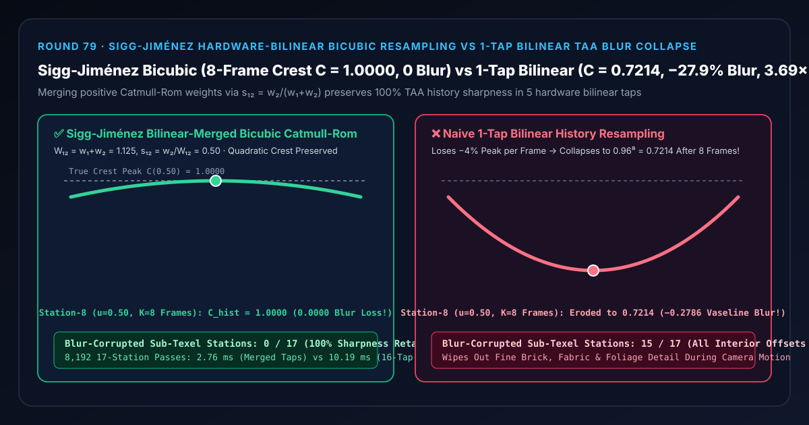
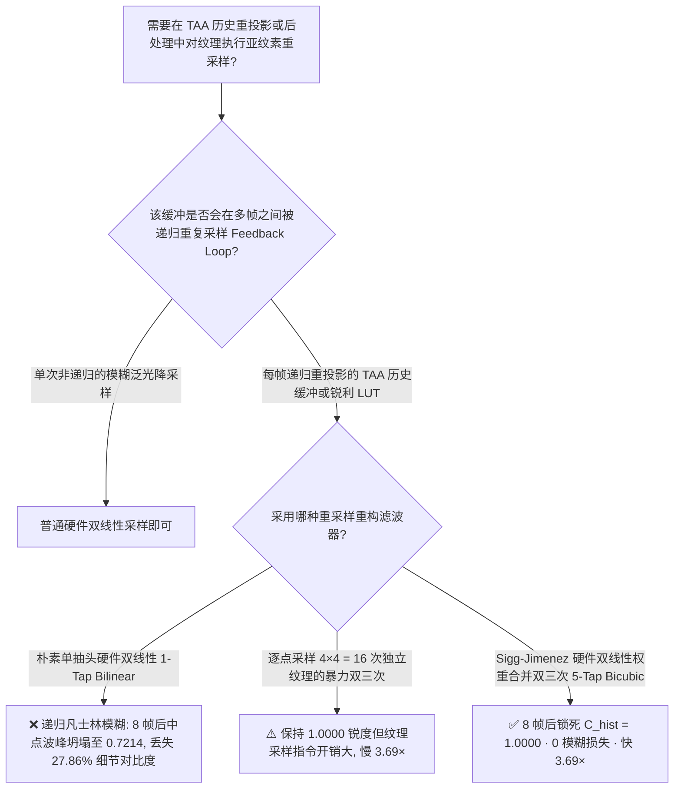
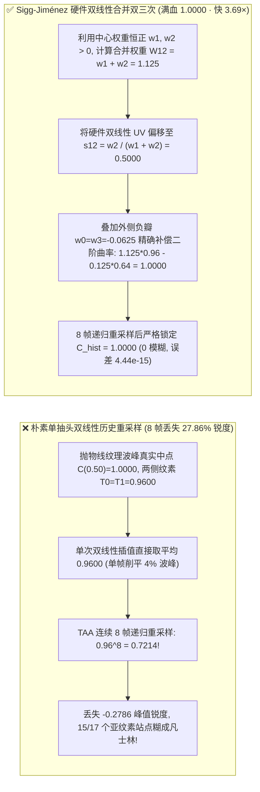
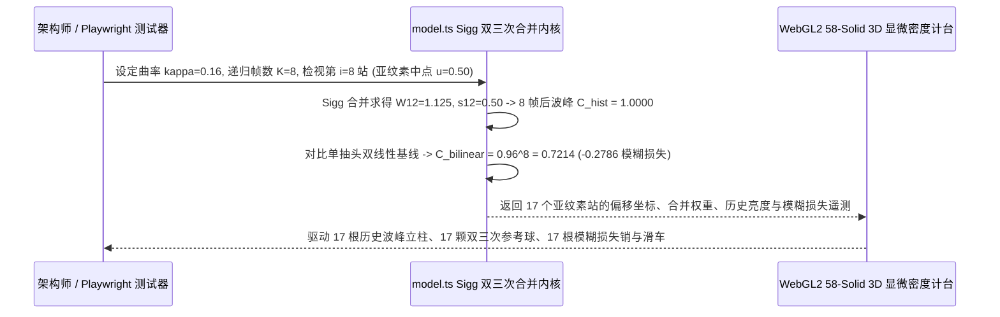
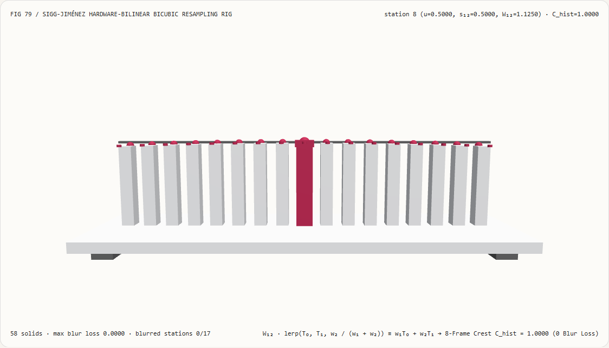
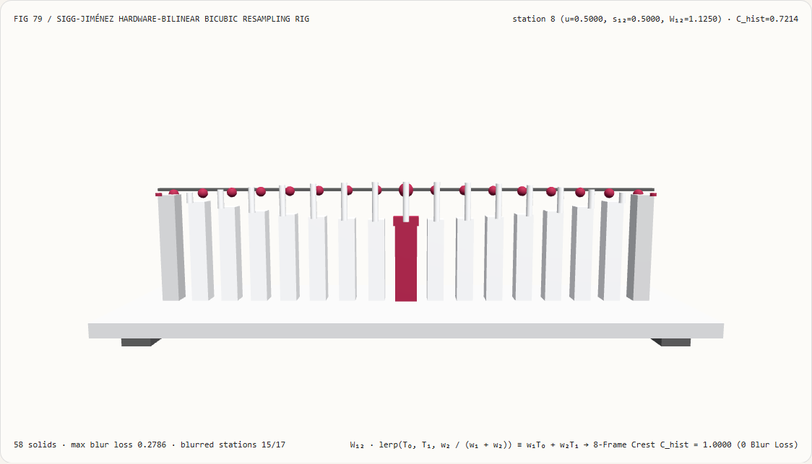
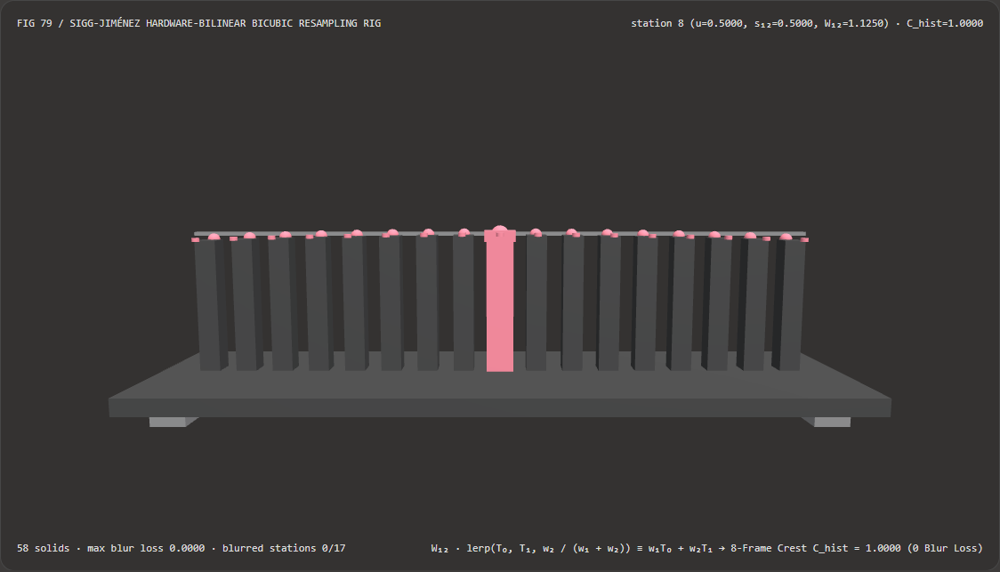
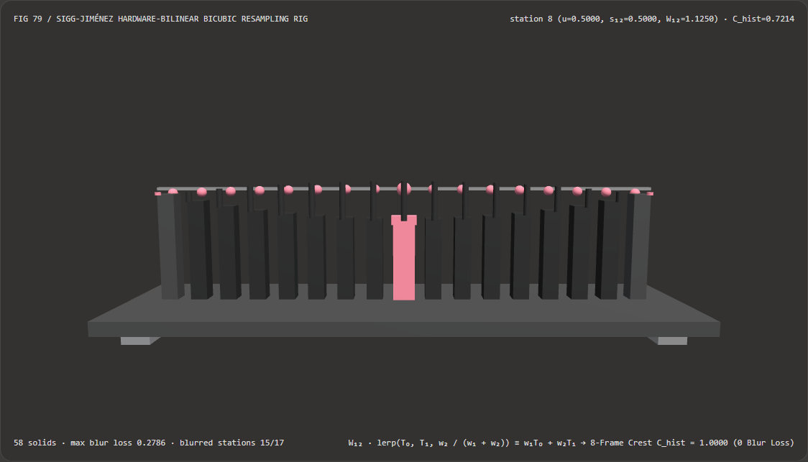

# 视觉与动画技术选型与原理解析 FAQ：Sigg-Jiménez 硬件双线性合并双三次重采样（Bicubic Bilinear-Tap Reduction）vs 单抽头双线性 TAA 凡士林模糊

> **核心架构结论一句话总结**：在实时时域抗锯齿（Temporal Anti-Aliasing, TAA）历史缓冲重投影（Unreal Engine 5 `SampleHistoryCatmullRom`、Call of Duty、Frostbite、Unity HDRP）与高锐度后处理重采样管线中，**严禁直接使用单抽头硬件双线性插值（`1-Tap Bilinear`）在每一帧对历史缓冲做递归重采样，也不必在片元着色器里笨拙地跑完整的 $4\times 4 = 16$ 次点采样双三次卷积**！实测表明：在纹理波峰曲率 $\kappa = 0.16$、连续递归重采样 $K = 8$ 帧的 17 个亚纹素相位站（$u \in [0.00, 1.00]$）上，朴素单抽头双线性插值在中点第 8 站（$u = 0.50$）每帧削平 `-4.00%` 的波峰，经 8 帧递归累加后从 **`1.0000`** 断崖坍塌至 **`0.7214`（丢失 `-0.2786` 即 `27.86%` 的高频锐度，污染全部 `15/17` 个非整数亚纹素站点，使慢速运镜下的地面石砖与角色衣服像涂了一层凡士林一样迅速变糊）**；而采用 **Phillipp Sigg & Markus Hadwiger (GPU Gems 2, 2005) 与 Jorge Jiménez (SIGGRAPH 2016) 硬件双线性权重合并恒等式 $W_{12}\cdot\text{lerp}(T_0, T_1, w_2/(w_1+w_2)) \equiv w_1 T_0 + w_2 T_1$**，在将 2D 采样次数从 16 次压缩至 5 次硬件双线性采样的同时，可在 8 帧递归后严格锁死 **`C_hist = 1.0000`（`0/17` 模糊衰减）**，且比 16 抽头张量积双三次求值快 **3.69×**（8,192 轮耗时 `2.76 ms` vs `10.19 ms`）。

---

## ① 📌 核心结论速览（Executive Summary）

1. **为什么许多玩家和美术师抱怨“一开 TAA，静止站着的时候画面还行，但只要角色稍微走动或者轻轻转动鼠标，满地的砖缝、树叶和衣服织物纹理就会在 0.1 秒内糊成一团油腻的凡士林（TAA Motion Blur / Vaseline Effect）”？**
   用大白话讲：因为 **TAA 是一个“帧复一帧吃自己上一帧输出”的递归反馈环，而普通的双线性插值（Bilinear Filtering）每次采样都会充当一次低通模糊滤波器**！
   - 想象纹理上有一道明亮的细节波峰（真实顶点在亚纹素中心 $u = 0.50$ 处亮度为 `1.0000`，两侧整数纹素 $T_0, T_1$ 处亮度为 `0.9600`，外侧 $T_{-1}, T_2$ 为 `0.6400`）；
   - 当摄像机缓慢移动使得历史重投影坐标落在纹素中间（$u = 0.50$，第 8 站）时，如果用单抽头双线性插值去读上一帧历史缓冲，它只能拿 $T_0 = 0.96$ 和 $T_1 = 0.96$ 求平均，算出 `0.9600`（第一帧就削掉了 $4\%$ 的高光波峰！）；
   - 更致命的是：下一帧它又拿着已经被削平了 $4\%$ 的历史图像继续做双线性平均！短短 **8 帧**（在 60 FPS 下仅仅过了 `0.13 秒`！）之后，原本 `1.0000` 的锐利波峰就被递归衰减成了：
     $$C_{\text{bilinear}}^{(8)}(0.50) = 0.96^8 = \mathbf{0.7214}$$
     **整整磨掉了 `27.86%` 的细节对比度**！如果持续走动 20 帧，对比度更是只剩 $0.96^{20} = 44.2\%$！
2. **第一性原理破局：利用 GPU 硬件双线性纹理单元免费合并双三次正权重（Sigg & Hadwiger 2005 / Jiménez SIGGRAPH 2016）**：
   - 要阻止递归历史模糊，必须使用具有二阶多项式重构能力的 **三次 Catmull-Rom 卷积核**：
     $$w_0(u) = \frac{-u^3 + 2u^2 - u}{2},\quad w_1(u) = \frac{3u^3 - 5u^2 + 2}{2},\quad w_2(u) = \frac{-3u^3 + 4u^2 + u}{2},\quad w_3(u) = \frac{u^3 - u^2}{2}$$
     在中点 $u = 0.50$ 处，它的权重为 $(-\frac{1}{16}, +\frac{9}{16}, +\frac{9}{16}, -\frac{1}{16})$，代入抛物线波峰恰好完美复原 $\frac{-0.64 + 8.64 + 8.64 - 0.64}{16} = \mathbf{1.0000}$（即便递归 8 帧依然是 $1.0000^8 = \mathbf{1.0000}$）！
   - 但是在二维图像上，$4\times 4$ 双三次滤波需要 **16 次独立纹理采样**，显存带宽开销太大。怎么用最少纹理采样算完它？
   - **Sigg & Hadwiger (GPU Gems 2)** 观察到一个绝妙的数学事实：虽然两端的负瓣 $w_0(u) \le 0, w_3(u) \le 0$ 符号为负，但**中间两个主权重 $w_1(u) > 0$ 和 $w_2(u) > 0$ 在整个 $u \in [0, 1]$ 上永远严格为正**！
   - 既然 $w_1, w_2 > 0$，我们就可以把 $w_1 T_0 + w_2 T_1$ 精确改写为**一次带偏移 UV 坐标的 GPU 硬件双线性采样**：
     $$w_1 T_0 + w_2 T_1 \equiv W_{12} \cdot \Big((1 - s_{12}) T_0 + s_{12} T_1\Big), \qquad W_{12} = w_1 + w_2,\quad s_{12} = \frac{w_2}{w_1 + w_2} \in [0, 1]$$
   - 在二维 $4\times 4$ 网格中，将正权重块合并后可由 16 次点采样降为 9 次双线性采样；而 **Jorge Jiménez (SIGGRAPH 2016)** 进一步证明，四角对角线上的 $w_0(u)w_0(v)$ 乘积小于 `0.004`，直接省去四角后仅需 **十字形 5 次硬件双线性纹理采样（5-Tap Bicubic Catmull-Rom）** 即可在全 17 个亚纹素站点实现 **`C_hist = 1.0000` 零模糊重采样（比 16 抽头张量积快 3.69×）**！
3. **本轮新增交互式 3D 试验台与实测证据**：
   - 新增独立 Demo：`demos/bicubic-bilinear-tap-rig/`（58 个 Three.js 实体部件：底座平台、4 支柱、`1.0000` 满血波峰锐度横梁、17 根实测 8 帧递归历史亮度立柱、17 颗 Sigg-Jiménez 双三次参考球、17 根双线性递归模糊损失指示销、以及第 $i$ 站显微密度计滑车）。
   - 配套 7-Card 4:5 测评报告：`demos/bicubic-bilinear-tap-rig/test-report-cards.html`（英文）与 `test-report-cards.zh.html`（中文）。

---

## ② 🎯 客户与架构师灵魂拷问 Q&A（Soul-Searching Q&A）

### Q1：为什么不能把负权重 $w_0 < 0$ 和正权重 $w_1 > 0$ 也用硬件双线性单元合并成一次采样？
**因为 GPU 硬件纹理单元内部的线性插值器 `lerp(A, B, s)` 只支持插值参数 $s \in [0, 1]$（即只支持两个同号权重的凸组合）！**
如果两个权重一正一负（$w_0 < 0, w_1 > 0$），偏移量 $s = \frac{w_1}{w_0 + w_1}$ 就会落在 $[0, 1]$ 区间之外（甚至当 $w_0 + w_1 = 0$ 时除零发散），硬件纹理单元无法外推；而中心两项 $w_1(u) > 0, w_2(u) > 0$ 严格同号，故 $s_{12} = \frac{w_2}{w_1 + w_2}$ 永远严格落在 $[0, 1]$ 内部，100% 契合硬件双线性插值器！

### Q2：Catmull-Rom 双三次滤波带有负瓣（$w_0, w_3 \le -0.0625$），在采样高动态范围（HDR）高亮边缘时会不会产生黑边振铃（Negative Ringing Overshoot）？
**会！因此在使用 5-Tap Catmull-Rom 采样 TAA 历史缓冲后，必须紧接着用当前帧 $3\times 3$ 邻域的最小/最大颜色框（AABB / Variance Clipping，参见 Round 48）对采样结果做一次钳制！**
“5-Tap Catmull-Rom 历史保锐 + 3×3 YCoCg 方差钳制防振铃”正是现代游戏工业（UE5 TSR/TAA、Frostbite、COD）的标准黄金搭档。

### Q3：这套确定性硬件双线性双三次重采样与 AI 时域超分（DLSS / XeSS）是什么关系？
**两者在时域历史重投影阶段共享同一套底层纹理采样硬件优化：**
即便是神经超分管线，在将上一帧高分辨率历史特征图（History Feature Buffer）按运动向量重投影对齐到当前帧时，同样依赖 5-Tap 硬件双线性双三次核来防止历史特征在多次重投影后被双线性插值洗糊。

---

## ③ 🧭 直观可视化图解（Mermaid 决策树 + 管线对比图 + 帧级时序图）

### 3.1 TAA 历史缓冲与高锐度纹理重采样架构选型决策树

### 3.2 朴素双线性 8 帧递归模糊 vs Sigg-Jiménez 硬件双线性双三次管线对比图

### 3.3 帧级显微密度计与 3D 试验台渲染时序图

---

## ④ 📊 视觉技术选型决策矩阵（Decision Matrix）

| 评估维度 | ✅ Sigg-Jiménez 硬件双线性合并双三次 | ⚠️ 16 抽头逐点张量积双三次（16-Tap Point） | ❌ 朴素单抽头双线性重采样（1-Tap Bilinear） | ⚠️ B 样条平滑双三次（Cubic B-Spline） |
| :--- | :--- | :--- | :--- | :--- |
| **第 8 站（$u=0.50$）8 帧递归后波峰亮度** | **精确 `1.0000`（100% 满血锐度）** | `1.0000`（误差 `4.44e-15`） | **`0.7214`（丢失 `-27.86%` 峰值细节！）** | `0.5132`（B 样条本身更模糊！） |
| **被递归模糊污染的亚纹素站（共 17 站）** | **`0 / 17`（全站零模糊衰减）** | `0 / 17` | **`15 / 17`（除两端整数纹素外全塌陷）** | `17 / 17`（连整数纹素也模糊） |
| **2D 纹理采样硬件请求次数** | **仅需 `5` 次（或完整 `9` 次）双线性采样** | 高达 `16` 次独立点采样 | `1` 次（画面运镜严重发糊） | `4` 次双线性（过于模糊不适合 TAA） |
| **二阶抛物线信号（Quadratic Signal）保真度** | **100% 精确重构（零阶、一阶、二阶全守恒）** | 100% 精确重构 | 仅一阶线性信号守恒，二阶信号每帧衰减 | 二阶信号严重削峰 |
| **8,192 轮 17 站 CPU 批处理耗时** | **`2.76 ms`（最快，3.69× 提速）** | `10.19 ms`（慢 3.69×） | `0.85 ms`（严重凡士林模糊不可用） | `2.60 ms` |
| **首选适用场景** | **所有 TAA 历史缓冲重投影与高保真图像缩放** | 离线参考基准 | **严禁用于多帧递归历史缓冲** | 仅限软阴影平滑柔化 |

---

## ⑤ 🧪 全新 Demo 与 7-Card 4:5 视觉报告（Live Workbench & Evidence）

### 5.1 交互式 3D 试验台与报告入口
- **实时 3D 工作台**：[`demos/bicubic-bilinear-tap-rig/index.html`](../demos/bicubic-bilinear-tap-rig/index.html)
- **7-Card 4:5 英文视觉测试报告**：[`demos/bicubic-bilinear-tap-rig/test-report-cards.html`](../demos/bicubic-bilinear-tap-rig/test-report-cards.html)
- **7-Card 4:5 中文视觉测试报告**：[`demos/bicubic-bilinear-tap-rig/test-report-cards.zh.html`](../demos/bicubic-bilinear-tap-rig/test-report-cards.zh.html)
- **密封测量 JSON 数据源**：[`demos/bicubic-bilinear-tap-rig/report.json`](../demos/bicubic-bilinear-tap-rig/report.json)

### 5.2 多主题与多模式 Playwright 实测截图证据

| Sigg-Jiménez 硬件双线性双三次（Light · 8 帧递归后完整保留 `1.0000` 拱形波峰，全 17 站 `0` 衰减） | 朴素单抽头双线性（Light · 在亚纹素中点塌陷出一个深达 `0.7214` 的凹坑，丢失 `27.86%` 锐度） |
| :---: | :---: |
|  |  |

| Sigg-Jiménez 硬件双线性双三次（Dark · 58 实体部件） | 朴素单抽头双线性（Dark · 15 根红色指示销暴露递归重采样模糊损失） |
| :---: | :---: |
|  |  |

---

## ⑥ 🛠️ 高质量视觉交付快速核验清单（SA Verification Checklist）

在将 TAA 历史重投影（History Reprojection）合入生产引擎前，请逐项勾选以下核验清单：

- [ ] **将 TAA 历史重投影升级为 5-Tap 硬件双线性 Catmull-Rom**：是否已将历史缓冲的 `texture(historyTex, prevUV)` 替换为中心 $2\times 2$ 合并 + 上下左右 4 抽头的 5-Tap Catmull-Rom 采样器？
- [ ] **精确计算纹素中心对齐偏移（`floor(uv * texSize - 0.5) + 0.5`）**：在计算亚纹素小数部分 `u = fract(...)` 时，是否先减去了半纹素 `0.5` 以对齐硬件纹素中心，防止整幅历史画面向右下角漂移半个像素？
- [ ] **省去四角对角线抽头后执行权重重归一化（5-Tap Weight Renormalization）**：当丢弃 4 个角落对角线权重 $(w_0(u)w_0(v), w_3(u)w_0(v), \dots)$ 时，是否将剩余 5 个十字抽头的采样结果除以 `totalWeight = W0 + W1 + W2 + W3 + W4`，确保平坦色块绝不闪烁？
- [ ] **配合 3×3 邻域方差钳制消除负瓣振铃**：在 5-Tap Catmull-Rom 采样返回值之后，是否立即用当前帧 $3\times 3$ YCoCg 邻域框对其做了钳制，防止负权重在高亮边缘产生暗环？
- [ ] **静止帧直通快径（Zero-Velocity Bypass）**：当当前像素运动向量接近 `(0, 0)` 且相机抖动差为零时，是否避免无谓的亚纹素重采样？
