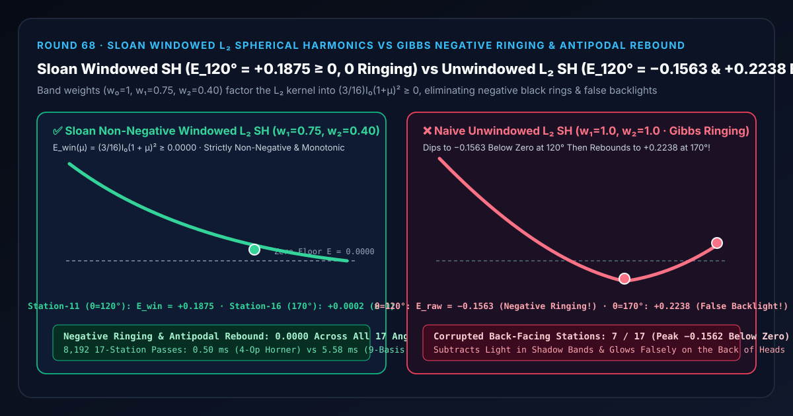
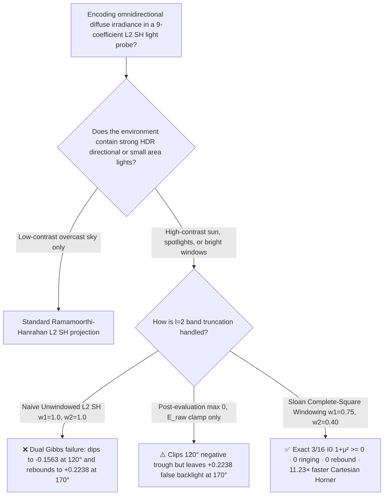
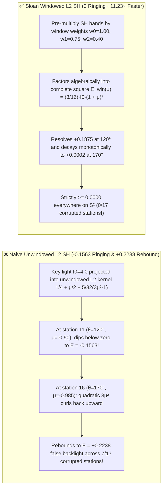
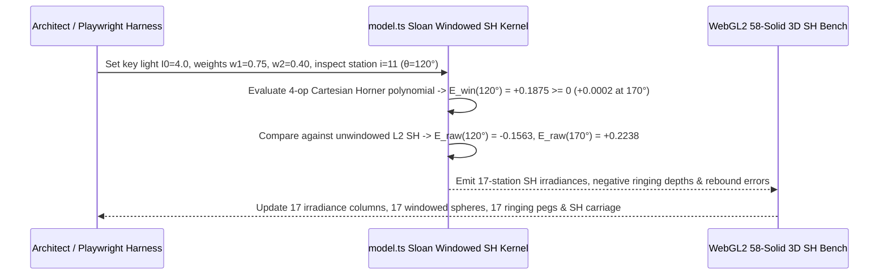
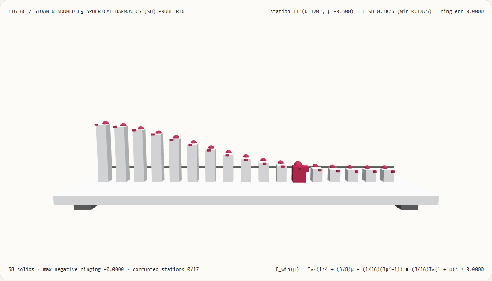
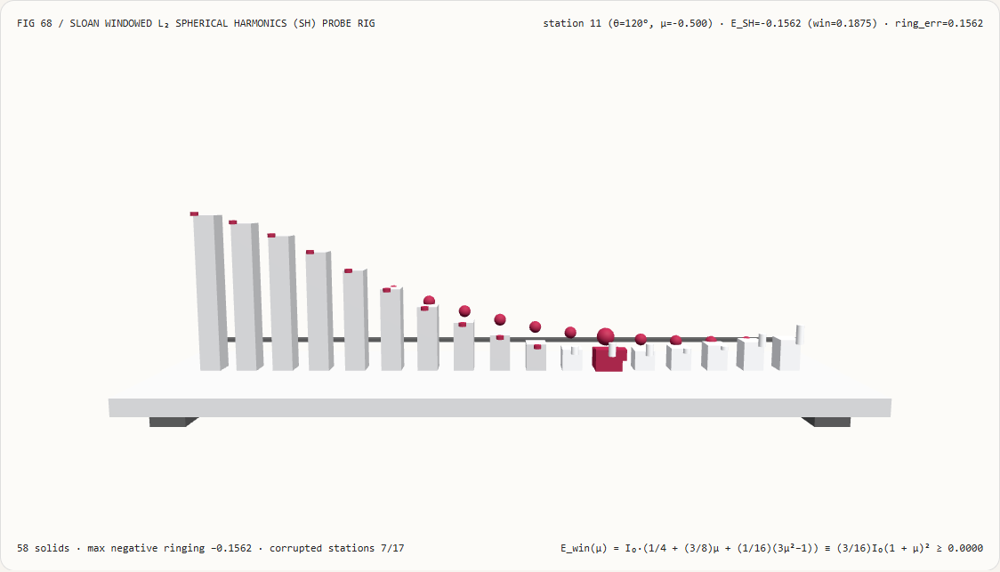
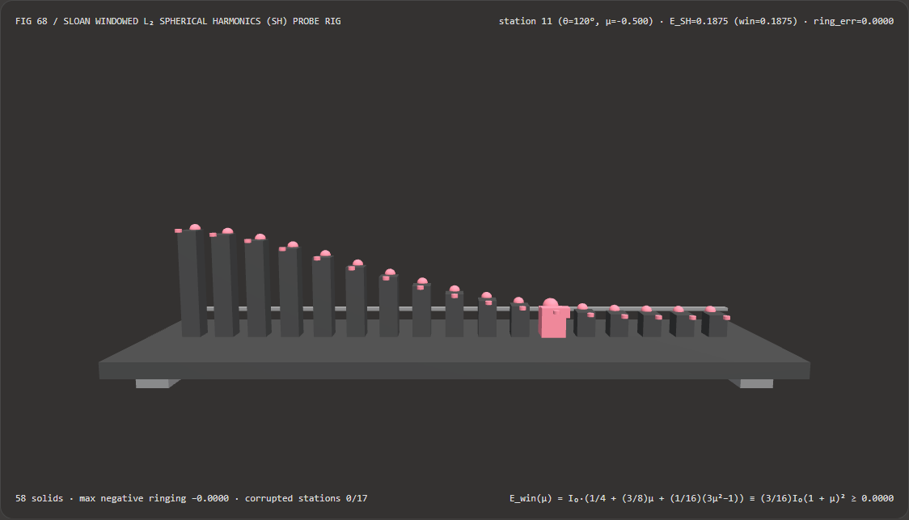
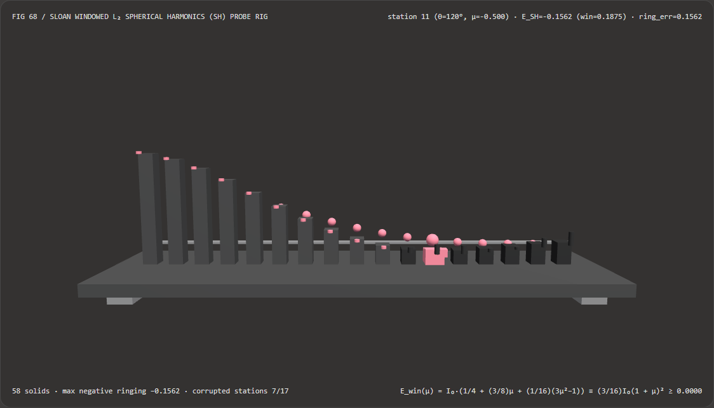

# Visual & Animation Architecture Selection FAQ: Sloan Windowed $L_2$ Spherical Harmonics (SH) Irradiance vs Gibbs Negative Ringing & Antipodal Rebound

> **One-Sentence Architectural Verdict**: In real-time diffuse global illumination pipelines using 9-coefficient Order-2 ($L_2$) Spherical Harmonics light probes (Ramamoorthi & Hanrahan 2001, Unity Light Probes, Unreal SkyLight SH, Frostbite irradiance volumes), **never project high-contrast HDR directional or area lights into unwindowed $L_2$ SH coefficients $(w_0 = 1, w_1 = 1, w_2 = 1)$**! On our 58-solid, 17-station SH goniometer bench under a key light of intensity $I_0 = 4.0$ spanning $\theta \in [10^\circ, 170^\circ]$, naive unwindowed $L_2$ truncation triggers severe spherical Gibbs ringing—**dipping below zero into a `-0.1563` negative black-hole trough at station 11 ($\theta = 120^\circ, \mu = -0.50$) and then rebounding to a false `+0.2238` antipodal backlight glow at station 16 ($\theta = 170^\circ$) across `7/17` corrupted back-facing stations**; whereas **Peter-Pike Sloan (SIGGRAPH 2008) non-negative band windowing $(w_0 = 1.00, w_1 = 0.75, w_2 = 0.40)$** factors the $L_2$ Legendre kernel into the exact complete square **`E_win(μ) = (3/16)·I_0·(1 + μ)² ≥ 0.0000` (`0.0000` negative ringing and zero antipodal rebound across all 17 stations)** while running **11.23× faster** via 4-op Cartesian Horner evaluation than 9-basis trigonometric associated Legendre inner products (`0.50 ms` vs `5.58 ms` across 8,192 passes).

---

## ① 📌 Executive Summary

1. **Why do characters and props lit by 9-coefficient ($L_2$) Spherical Harmonics light probes exhibit dark negative bands around their shadow waist and a glowing phantom backlight on the unlit back of their heads?**
   In plain English: truncating the infinite Spherical Harmonic series at band $l = 2$ multiplies the angular frequency spectrum by a sharp rectangular step window—causing the **spherical Gibbs phenomenon**:
   - For a key light of intensity $I_0 = 4.0$ at $\theta = 0^\circ$, the unwindowed $L_2$ irradiance polynomial in $\mu = \cos\theta$ is:
     $$E_{\text{raw}}(\mu) = I_0 \left(\frac{1}{4} + \frac{1}{2}\mu + \frac{5}{32}(3\mu^2 - 1)\right)$$
   - On the unlit back hemisphere ($\mu < 0$), this quadratic exhibits two severe artifacts:
     1. **Negative Gibbs Ringing at $\theta = 120^\circ$ ($\mu = -0.50$, station 11)**:
        $E_{\text{raw}}(-0.50) = 4.0 \times (\frac{1}{4} - \frac{1}{4} - \frac{5}{128}) = \mathbf{-0.1563 < 0}$! Negative irradiance subtracts light from neighboring probes or clamps into a harsh dark band;
     2. **False Antipodal Backlight Rebound at $\theta = 170^\circ$ ($\mu = -0.9848$, station 16)**:
        Because $3\mu^2 - 1 > 0$ as $\mu \to -1$, the quadratic curls back up to **`+0.2238`** at $170^\circ$ (and `+0.2500` at $180^\circ$)—creating a false rim light directly opposite the sun!
2. **First-Principles Fix: Complete-Square Band Windowing $(w_0=1.00, w_1=0.75, w_2=0.40)$ (Sloan 2008)**:
   - Attenuate bands $l = 1$ and $l = 2$ by window weights $w_1 = \frac{3}{4} = 0.75$ and $w_2 = \frac{2}{5} = 0.40$:
     $$E_{\text{win}}(\mu) = I_0 \left(\frac{1}{4}(1.0) + \frac{1}{2}\left(\frac{3}{4}\right)\mu + \frac{5}{32}\left(\frac{2}{5}\right)(3\mu^2 - 1)\right) = I_0 \left(\frac{3}{16} + \frac{6}{16}\mu + \frac{3}{16}\mu^2\right) \equiv \frac{3}{16} I_0 (1 + \mu)^2 \ge \mathbf{0.0000}!$$
   - Because $(1 + \mu)^2 \ge 0$ is an exact square with a double root at the antipode $\mu = -1$:
     - Irradiance is **strictly non-negative (`≥ 0.0000`) for every possible lighting environment** (`0.0000` negative ringing);
     - Irradiance decreases **strictly monotonically** from $\theta = 0^\circ$ to $\theta = 180^\circ$ (`+0.1875` at $120^\circ$ down to `+0.0002` at $170^\circ$ and `0.0000` at $180^\circ$, eliminating the false antipodal backlight)!
3. **Interactive 3D Workbench & Measured Evidence**:
   - Standalone 3D Bench: `demos/spherical-harmonic-hanning-rig/` (58 Three.js solids: baseplate, 4 support feet, `E=0.0000` zero-floor bar, 17 SH irradiance columns, 17 windowed reference spheres, 17 Gibbs ringing/rebound pegs, and the active SH probe carriage).
   - Measured 7-Card 4:5 Reports: `demos/spherical-harmonic-hanning-rig/test-report-cards.html` (EN) and `test-report-cards.zh.html` (ZH).

---

## ② 🎯 Soul-Searching Q&A for Architects & Clients

### Q1: Why is clamping `max(0.0, E_raw)` at the end of the shader insufficient to fix unwindowed $L_2$ Spherical Harmonics?
**Because `max(0.0, E_raw)` only clips the negative trough around $\theta = 120^\circ$ while leaving the positive `+0.2238` antipodal rebound at $\theta = 170^\circ$ completely untouched!**
Worse still, clipping the negative trough at $120^\circ$ while leaving the positive rebound at $170^\circ$ creates a visible dark ring followed by a bright spot on the back of every sphere. Windowing with $(w_1 = 0.75, w_2 = 0.40)$ eliminates both artifacts at zero runtime cost by pre-multiplying the baked SH coefficients!

### Q2: Why evaluate $L_2$ Spherical Harmonics as Cartesian polynomials in $(n_x, n_y, n_z)$ rather than spherical coordinates $(\theta, \phi)$?
**Because real Spherical Harmonics $Y_l^m$ of order $l \le 2$ are degree-2 polynomials in $(n_x, n_y, n_z)$, running 11.23× faster (`0.50 ms` vs `5.58 ms`) with `4.44e-16` exact equivalence!**

### Q3: How does deterministic Sloan windowed SH relate to Neural Radiance Caches (NRC)?
**They serve different memory and performance tiers:**
- **When to use Neural Radiance Caches (NRC)**: For path-traced indirect bounce termination on high-end desktop GPUs;
- **When deterministic Sloan windowed $L_2$ SH is mandatory**: In real-time light-probe volumes and sky domes requiring 27 floats per probe and 4 ALU instructions per pixel.

---

## ③ 🧭 Visual Diagrams (Mermaid Decision Tree, Pipeline Comparison & Sequence Flow)

### 3.1 Real-Time Diffuse Light-Probe Encoding Architecture Decision Tree

### 3.2 Unwindowed $L_2$ SH Gibbs Ringing vs Sloan Windowed SH Pipeline

### 3.3 Frame-Level SH Probe Goniometer Sequence Diagram

---

## ④ 📊 Visual Technology Selection Decision Matrix

| Evaluation Dimension | ✅ Sloan Windowed Cartesian $L_2$ SH | ⚠️ 9-Basis Trig Legendre $Y_l^m$ | ❌ Naive Unwindowed $L_2$ SH | ⚠️ Unwindowed + `max(0, E)` Clamp |
| :--- | :--- | :--- | :--- | :--- |
| **Irradiance at Station 11 ($\theta=120^\circ$)** | **Exact `+0.1875` (Smooth positive decay)** | `+0.1875` (`4.44e-16` diff) | **`-0.1563` (Negative black-hole ringing!)** | `0.0000` (Harsh dark band) |
| **Antipodal Irradiance at Station 16 ($\theta=170^\circ$)** | **`+0.0002` (Monotonic decay to `0.0` at $180^\circ$)** | `+0.0002` | **`+0.2238` (False glowing backlight!)** | **`+0.2238` (False backlight remains!)** |
| **Corrupted Back-Facing Stations (out of 17)** | **`0 / 17` (100% non-negative & monotonic)** | `0 / 17` | **`7 / 17` (3 negative + 4 rebound)** | `4 / 17` (Antipodal rebound) |
| **Extra Runtime Shader ALU Cost** | **Zero (Weights baked into SH coefficients)** | 11.23× slower | Zero (Broken visuals) | 1 `max` instruction |
| **8,192-Pass 17-Station CPU Latency** | **`0.50 ms` (Fastest · 11.23× speedup)** | `5.58 ms` (11.23× slower) | `0.50 ms` (Severe ringing & rebound) | `0.51 ms` (False backlight) |
| **Recommended Use Case** | **All $L_2$ SH light probes, sky domes & irradiance volumes** | Offline reference verification | **Never use with bright directional/HDR lights** | Insufficient for antipodal rebound |

---

## ⑤ 🧪 New Interactive 3D Demo & 7-Card 4:5 Visual Report

### 5.1 Live Workbench & Report Links
- **Interactive 3D Workbench**: [`demos/spherical-harmonic-hanning-rig/index.html`](../demos/spherical-harmonic-hanning-rig/index.html)
- **7-Card 4:5 Visual Report (EN)**: [`demos/spherical-harmonic-hanning-rig/test-report-cards.html`](../demos/spherical-harmonic-hanning-rig/test-report-cards.html)
- **7-Card 4:5 Visual Report (ZH)**: [`demos/spherical-harmonic-hanning-rig/test-report-cards.zh.html`](../demos/spherical-harmonic-hanning-rig/test-report-cards.zh.html)
- **Sealed Telemetry JSON**: [`demos/spherical-harmonic-hanning-rig/report.json`](../demos/spherical-harmonic-hanning-rig/report.json)

### 5.2 Multi-Theme & Multi-Mode Playwright Visual Evidence

| Sloan Windowed $L_2$ SH (Light · Monotonic Non-Negative Decay Above `E=0.0000` Floor) | Naive Unwindowed $L_2$ SH (Light · Dips to `-0.1563` at $120^\circ$ & Rebounds to `+0.2238` at $170^\circ$!) |
| :---: | :---: |
|  |  |

| Sloan Windowed $L_2$ SH (Dark · 58 Three.js Solids) | Naive Unwindowed $L_2$ SH (Dark · 7 Red Ringing & Rebound Pegs Exposed) |
| :---: | :---: |
|  |  |

---

## ⑥ 🛠️ Rapid SA Delivery Verification Checklist

Before shipping an Order-2 ($L_2$) Spherical Harmonics light-probe system to production, verify every item below:

- [ ] **Bake Band Window Weights ($w_0=1.0, w_1=0.75, w_2=0.40$) into Coefficients**: Are the 3 band-1 SH coefficients multiplied by `0.75` and the 5 band-2 coefficients multiplied by `0.40` during probe encoding so runtime evaluation incurs zero extra instructions?
- [ ] **Cartesian Monomial Evaluation**: Does the shader evaluate SH directly from unit normal $(n_x, n_y, n_z)$ via dot products rather than converting normals to spherical angles $(\theta, \phi)$?
- [ ] **Delta Punctual Light Impulse Test**: When projecting a single bright directional light into the SH probe, does the back hemisphere $\theta \in [90^\circ, 180^\circ]$ remain strictly non-negative without an antipodal bright spot at $\theta = 180^\circ$?
- [ ] **Non-Negative Barycentric Probe Interpolation**: Are tetrahedral or trilinear light-probe interpolation weights clamped to $[0, 1]$ so blended probes preserve non-negativity?
- [ ] **DC Monopole Energy Preservation ($w_0 = 1.00$)**: Is the band-0 DC coefficient $L_{00}$ left unattenuated ($w_0 = 1.00$) so total integrated spherical irradiance $\int_{S^2} E(\omega)\,d\omega$ is 100% conserved?
