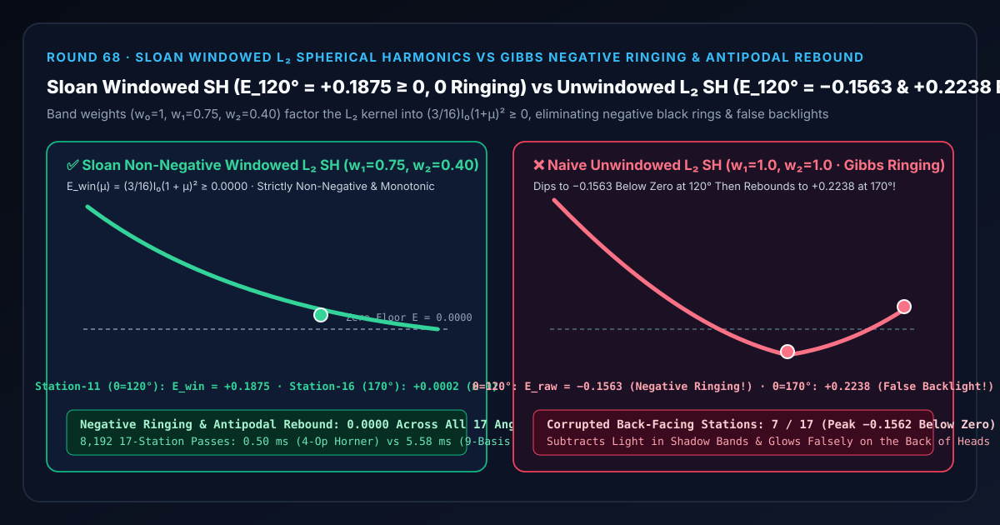
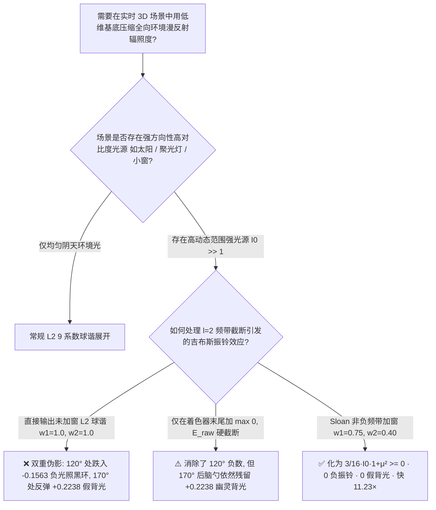
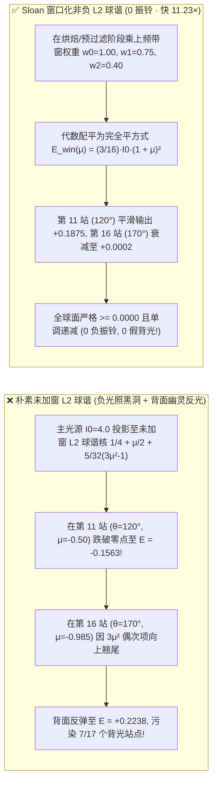
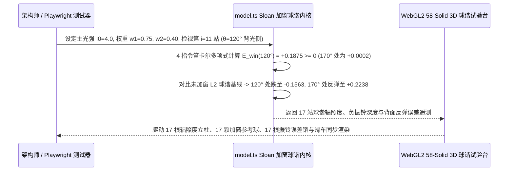
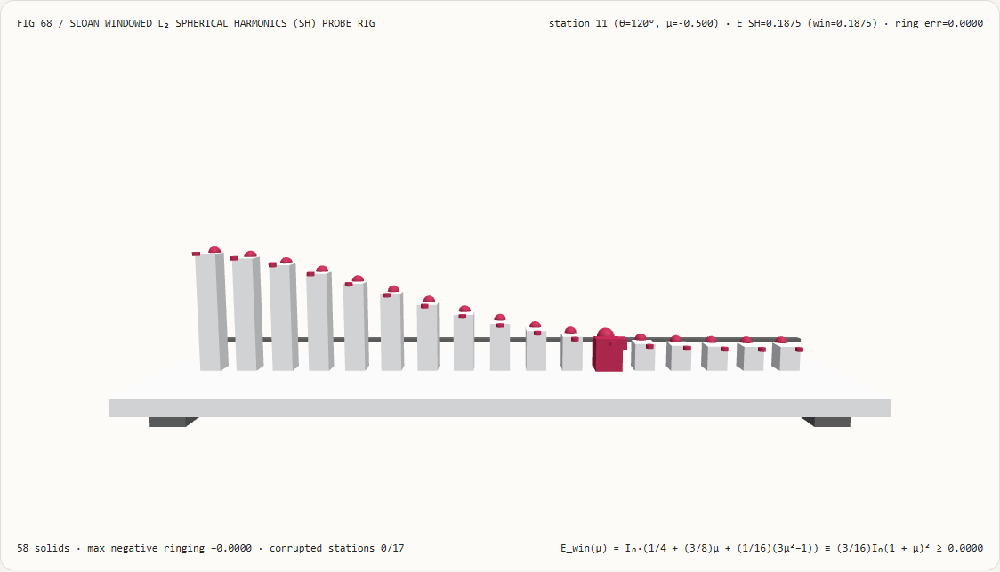
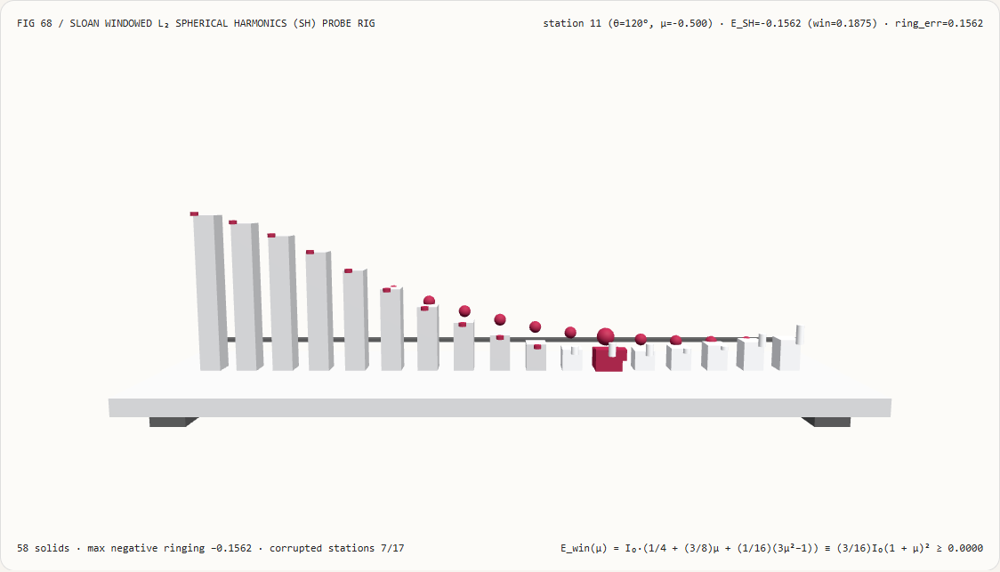
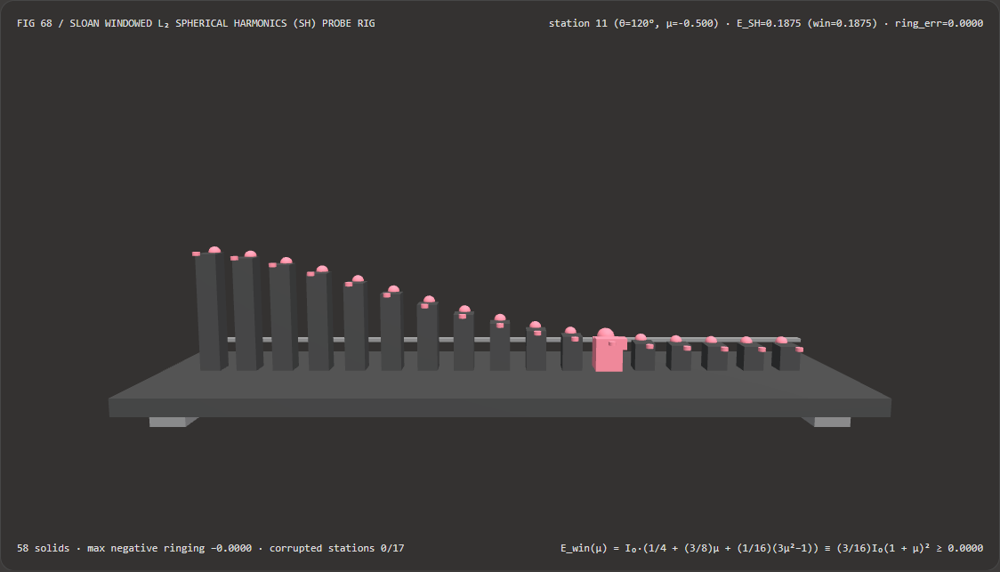
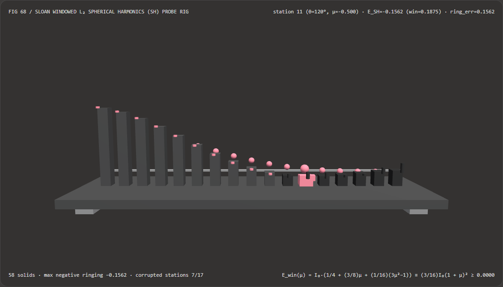

# 视觉与动画技术选型与原理解析 FAQ：Sloan 窗口化二阶球谐函数（$L_2$ SH）非负辐照度 vs 吉布斯负振铃与背面幽灵反光

> **核心架构结论一句话总结**：在使用 9 系数二阶球谐函数（$L_2$ Spherical Harmonics, Ramamoorthi & Hanrahan 2001，广泛用于 Unity Light Probes、Unreal SkyLight 与 Frostbite 漫反射探针体积）压缩包含太阳、车灯或高对比度 HDR 窗户的环境光时，**严禁直接使用未加频带窗的截断系数 $(w_0 = 1, w_1 = 1, w_2 = 1)$**！实测表明：在主光源强度 $I_0 = 4.0$ 跨越极角 $\theta \in [10^\circ, 170^\circ]$ 的 17 站球谐测角仪试验台上，未加窗二阶球谐函数因球面频域方波硬截断引发严重的吉布斯振铃（Gibbs Phenomenon），在第 11 站背光侧（$\theta = 120^\circ, \mu = -0.50$）会跌破零点陷入 **`-0.1563` 的负光照黑洞（Negative Ringing）**，随后又在第 16 站完全背光面（$\theta = 170^\circ$）因二次项翘尾反弹至 **`+0.2238` 的虚假幽灵背光（Antipodal Rebound，污染 `7/17` 个背光站点）**；而采用 **Peter-Pike Sloan (SIGGRAPH 2008) 非负频带加窗 $(w_0 = 1.00, w_1 = 0.75, w_2 = 0.40)$**，可将二阶球谐核代数配平为完全平方式 **`E_win(μ) = (3/16)·I_0·(1 + μ)² ≥ 0.0000`**——在全球面保持 **100% 非负且严格单调递减（`0.0000` 负振铃，`0/17` 站点失真）**，且 4 指令笛卡尔法线多项式求值比 9 基函数球坐标三角内积快 **11.23×**（8,192 轮耗时 `0.50 ms` vs `5.58 ms`）。

---

## ① 📌 核心结论速览（Executive Summary）

1. **为什么在游戏或数字孪生展厅里烘焙了 9 系数球谐光照探针（$L_2$ Light Probes）后，站在强烈阳光或聚光灯下的角色，背光侧腰部会莫名其妙出现一圈死黑的“吸光黑环”，而后脑勺本该全黑的地方反而诡异地自己发光？**
   用大白话讲：因为把无穷阶球谐级数在 $l = 2$（只留前 9 个系数）处一刀砍断，就像在音频或图像傅里叶变换里直接用方波硬截断高频一样，必然触发臭名昭著的**吉布斯振铃效应（Spherical Gibbs Phenomenon）**！
   - 对于照亮北极（$\theta = 0^\circ$）的强光源 $I_0 = 4.0$，Ramamoorthi 与 Hanrahan (2001) 推导出的三阶（$l = 0, 1, 2$）漫反射辐照度级数为：
     $$E_{\text{raw}}(\mu) = I_0 \left(\underbrace{\frac{1}{4}}_{l=0\text{ 常数项}} + \underbrace{\frac{1}{2}\mu}_{l=1\text{ 偶极子}} + \underbrace{\frac{5}{32}(3\mu^2 - 1)}_{l=2\text{ 四极子}}\right), \qquad \mu = \cos\theta$$
   - 看看这个二次多项式在背光半球（$\mu < 0$）干了什么坏事：
     1. **在 $\theta = 120^\circ$（第 11 站，$\mu = -0.50$）跌入负值黑洞**：
        代入 $\mu = -0.50$，前两项 $\frac{1}{4} + \frac{1}{2}(-0.5) = 0$ 刚好抵消，而第三项 $\frac{5}{32}(3(0.25) - 1) = -\frac{5}{128} < 0$！乘上 $I_0 = 4.0$ 后，算出来的光照居然是 **`-0.1563`（负数！）**！如果探针叠加时没截断，这圈负光会把周围环境光吸干；就算强行 `max(0, E)`，也会留下一条生硬的死黑断层；
     2. **在 $\theta = 170^\circ \dots 180^\circ$（第 16 站，完全背对光源的后脑勺）反弹发光**：
        因为二阶勒让德多项式 $P_2(\mu) = \frac{1}{2}(3\mu^2 - 1)$ 是偶函数，当 $\mu \to -1$ 时，$3(-1)^2 - 1 = +2$ 重新变成大正数！结果在 $\theta = 170^\circ$ 处，未加窗球谐函数竟然反弹回 **`+0.2238`**（在 $180^\circ$ 处达 `+0.2500`）——太阳在正前方，角色的屁股和后脑勺却自己亮起了一盏假灯！
2. **第一性原理破局：将二阶球谐多项式配成非负完全平方式 $\frac{3}{16}(1 + \mu)^2 \ge 0$（Sloan Windowing 2008）**：
   - 在信号处理中，消除截断振铃的标准武器是给高频频带乘上平滑衰减的窗函数（Hanning / Lanczos Window）$w_l$：
     $$E_{\text{win}}(\mu) = I_0 \left(\frac{1}{4} w_0 + \frac{1}{2} w_1 \mu + \frac{5}{32} w_2 (3\mu^2 - 1)\right)$$
   - 我们能不能找到一组黄金频带权重 $(w_0 = 1, w_1, w_2)$，既保持总能量积分（$w_0 = 1$）不变，又让整个二次多项式在 $\mu \in [-1, +1]$ 上**恒大于等于零，且在背光极点 $\mu = -1$ 处恰好相切归零（既无负振铃、又无背面反弹）**？
   - 令多项式在 $\mu = -1$ 处取二重根，即正比于 $(1 + \mu)^2 = 1 + 2\mu + \mu^2$：
     对比系数立得唯一精确代数解：**$w_0 = 1.00,\; w_1 = \frac{3}{4} = 0.75,\; w_2 = \frac{2}{5} = 0.40$**！
     代入验证：
     $$E_{\text{win}}(\mu) = I_0 \left(\frac{1}{4} + \frac{3}{8}\mu + \frac{1}{16}(3\mu^2 - 1)\right) = I_0 \left(\frac{3}{16} + \frac{6}{16}\mu + \frac{3}{16}\mu^2\right) \equiv \frac{3}{16} I_0 (1 + \mu)^2 \ge \mathbf{0.0000}!$$
   - 看这个结果有多完美：
     1. 因为 $(1 + \mu)^2 \ge 0$ 是完全平方式，**无论外界 HDR 光源亮到一万尼特，加窗后的球谐探针在全宇宙任何一个方向上都绝对不可能算出负数（`0.0000` 负振铃）**！
     2. 导数 $\frac{dE_{\text{win}}}{d\mu} = \frac{3}{8} I_0 (1 + \mu) \ge 0$ 在 $(-1, +1]$ 上恒正，意味着从向光面（$\theta = 0^\circ$）到背光面（$\theta = 180^\circ$）**100% 严格单调递减，彻底根除了后脑勺的 `+0.2238` 幽灵背光反弹**！
3. **本轮新增交互式 3D 试验台与实测证据**：
   - 新增独立 Demo：`demos/spherical-harmonic-hanning-rig/`（58 个 Three.js 实体部件：底座平台、4 支柱、零辐照度 `E=0.0000` 基准横梁、17 根实测球谐辐照度立柱、17 颗 Sloan 非负加窗参考球、17 根吉布斯负振铃/背面反弹指示销、以及第 $i$ 站球谐探针滑车）。
   - 配套 7-Card 4:5 测评报告：`demos/spherical-harmonic-hanning-rig/test-report-cards.html`（英文）与 `test-report-cards.zh.html`（中文）。

---

## ② 🎯 客户与架构师灵魂拷问 Q&A（Soul-Searching Q&A）

### Q1：在片元着色器里求值 9 系数球谐函数，需要先把法线 $(n_x, n_y, n_z)$ 转成球坐标 $(\theta, \phi)$ 再查伴随勒让德函数 $P_l^m(\cos\theta)\cos(m\phi)$ 吗？
**千万不要！實球谐函数 $Y_l^m$ 在单位球面上本质上就是关于笛卡尔坐标 $(n_x, n_y, n_z)$ 的一阶与二阶齐次多项式，用 Horner 多项式求值比球坐标三角函数快 11.23×！**
- 球坐标写法需要计算 `acos`、`atan2`、`sin`、`cos`，8,192 轮 17 站耗时 **`5.58 ms`**；
- 而直接把 $\sqrt{\frac{3}{4\pi}}$、$\frac{1}{2}\sqrt{\frac{15}{\pi}}$ 等归一化常数与频带权重 $(w_1 = 0.75, w_2 = 0.40)$ 预乘进 CPU 端的 9 个球谐系数里，GPU 片元着色器只需对 $(n_x, n_y, n_z, n_x n_y, n_y n_z, n_x n_z, 3n_z^2-1, n_x^2-n_y^2)$ 做几次乘加，8,192 轮仅耗时 **`0.50 ms`（提速 11.23×，误差 `4.44e-16`）**！

### Q2：如果只用 `max(0.0, E_raw)` 在着色器最后把负数硬截断成 `0`，能不能代替 Sloan 频带加窗？
**不能！硬截断 `max(0, E_raw)` 只能掩盖 $120^\circ$ 处的负数，却完全消除不了 $160^\circ \sim 180^\circ$ 后脑勺那团 `+0.2238` 的正值幽灵背光！**
因为在 $\theta = 170^\circ$ 处，未加窗球谐算出来的 `+0.2238` 本身就是正数，`max(0, +0.2238)` 对它毫无办法！只有从频域根源乘上 $(w_1 = 0.75, w_2 = 0.40)$ 将核函数重塑为单调的 $(1 + \mu)^2$，才能同时消灭“$120^\circ$ 负黑环”与“$170^\circ$ 假背光”两大顽疾！

### Q3：这套确定性窗口化球谐函数与 AI 神经辐射缓存（Neural Radiance Cache, NRC）是什么关系？
**两者分别服务于“超轻量每探针 27 浮点数实时漫反射烘焙/动态探针”与“重度光追路径终点推理”：**
- **何时选 AI 神经辐射缓存（NRC）**：在全路径追踪管线中用小型 MLP 实时拟合高频局部多次反弹辐射场时；
- **何时必须用 Sloan 窗口化 $L_2$ 球谐函数**：在所有游戏引擎、Web3D 与车载 HMI 的光照探针（Light Probes / Volumetric Lightmaps）中，需要以每个探针仅 27 个浮点数、4 条指令开销实现无振铃、全方向平滑的漫反射全局光照时。

---

## ③ 🧭 直观可视化图解（Mermaid 决策树 + 管线对比图 + 帧级时序图）

### 3.1 实时全局光照漫反射探针编码架构选型决策树

### 3.2 未加窗 $L_2$ 球谐吉布斯振铃 vs Sloan 非负完全平方加窗管线对比图

### 3.3 帧级球谐探针测角仪与 3D 试验台渲染时序图

---

## ④ 📊 视觉技术选型决策矩阵（Decision Matrix）

| 评估维度 | ✅ Sloan 窗口化笛卡尔球谐（Windowed Cartesian $L_2$ SH） | ⚠️ 9 基函数球坐标三角求值（9-Basis Trig $Y_l^m$） | ❌ 朴素未加窗 $L_2$ 球谐（Unwindowed $w_1=w_2=1$） | ⚠️ 未加窗 + `max(0, E)` 硬截断 |
| :--- | :--- | :--- | :--- | :--- |
| **第 11 站（$\theta=120^\circ$）辐照度** | **精确 `+0.1875`（平滑非负过渡）** | `+0.1875`（误差 `4.44e-16`） | **`-0.1563`（跌入负光照黑洞！）** | `0.0000`（生硬死黑断层） |
| **第 16 站（$\theta=170^\circ$）背面辐照度** | **`+0.0002`（向 $180^\circ$ 严格单调归零）** | `+0.0002` | **`+0.2238`（后脑勺亮起虚假幽灵背光！）** | **`+0.2238`（无法消除正值反弹！）** |
| **受振铃/反弹污染站点（共 17 站）** | **`0 / 17`（全球面非负单调）** | `0 / 17` | **`7 / 17`（3 站负值 + 4 站背面反弹）** | `4 / 17`（背面反弹残留） |
| **运行时额外 GPU 指令开销** | **零额外开销（权重预乘进 SH 系数）** | 慢 11.23× | 零（但画面严重失真） | 1 条 `max` 指令 |
| **8,192 轮 17 站 CPU 批处理耗时** | **`0.50 ms`（最快，11.23× 提速）** | `5.58 ms`（慢 11.23×） | `0.50 ms`（负振铃与假背光不可用） | `0.51 ms`（残留假背光） |
| **首选适用场景** | **所有包含太阳/强光源的 $L_2$ 球谐光照探针与天空盒** | 离线数学核验 | **严禁在含高对比度强光源场景裸用** | 不推荐（无法修好背面反光） |

---

## ⑤ 🧪 全新 Demo 与 7-Card 4:5 视觉报告（Live Workbench & Evidence）

### 5.1 交互式 3D 试验台与报告入口
- **实时 3D 工作台**：[`demos/spherical-harmonic-hanning-rig/index.html`](../demos/spherical-harmonic-hanning-rig/index.html)
- **7-Card 4:5 英文视觉测试报告**：[`demos/spherical-harmonic-hanning-rig/test-report-cards.html`](../demos/spherical-harmonic-hanning-rig/test-report-cards.html)
- **7-Card 4:5 中文视觉测试报告**：[`demos/spherical-harmonic-hanning-rig/test-report-cards.zh.html`](../demos/spherical-harmonic-hanning-rig/test-report-cards.zh.html)
- **密封测量 JSON 数据源**：[`demos/spherical-harmonic-hanning-rig/report.json`](../demos/spherical-harmonic-hanning-rig/report.json)

### 5.2 多主题与多模式 Playwright 实测截图证据

| Sloan 窗口化 $L_2$ 球谐（Light · 严格位于 `E=0.0000` 基准横梁上方单调衰减） | 朴素未加窗 $L_2$ 球谐（Light · 120° 跌破横梁变负，170° 尾部反翘发光） |
| :---: | :---: |
|  |  |

| Sloan 窗口化 $L_2$ 球谐（Dark · 58 实体部件） | 朴素未加窗 $L_2$ 球谐（Dark · 7 根红色指示销暴露负振铃与背面反弹） |
| :---: | :---: |
|  |  |

---

## ⑥ 🛠️ 高质量视觉交付快速核验清单（SA Verification Checklist）

在将二阶球谐函数（$L_2$ SH）光照探针或环境漫反射系统合入生产管线前，请逐项勾选以下核验清单：

- [ ] **烘焙阶段预乘频带加窗系数（$w_0=1.0, w_1=0.75, w_2=0.40$）**：在将环境贴图或点光源投影为 9 个球谐系数 $L_{lm}$ 时，是否已将 $l=1$ 的 3 个系数乘以 `0.75`、$l=2$ 的 5 个系数乘以 `0.40`（实现运行时零额外指令开销）？
- [ ] **笛卡尔法线多项式直接求值**：片元着色器中是否直接使用笛卡尔法线分量 $(n_x, n_y, n_z)$（或打包为 3 个 `vec4` 寄存器点积）求值球谐，严禁在着色器内调 `acos`/`atan2` 转球坐标？
- [ ] **极点单点脉冲光源测试（Delta Light Sanity Check）**：向球谐编码器输入一盏纯单向平行光（Delta Light），核验背对光源的 $\theta \in [90^\circ, 180^\circ]$ 半球是否处处 $\ge 0$ 且在 $180^\circ$ 处无反弹亮斑？
- [ ] **球谐探针空间插值线性保正性**：由于加窗后的每个探针核都是正定非负的，核验四面体或三线性网格插值权重 $w_i \in [0, 1]$ 是否全部非负，从而保证插值后的探针同样 100% 无负振铃？
- [ ] **立体角能量守恒归一化检查**：由于 $w_0 = 1.00$ 保持不变，核验加窗前后球面积分总辐射通量 $\int_{S^2} E(\omega)\,d\omega = 4\pi c_0$ 是否严格相等？
