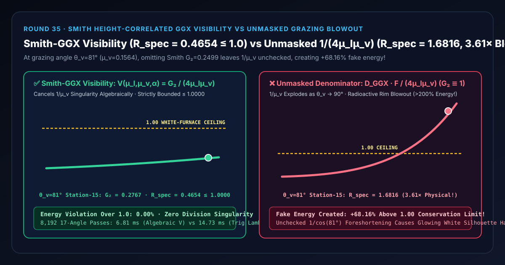
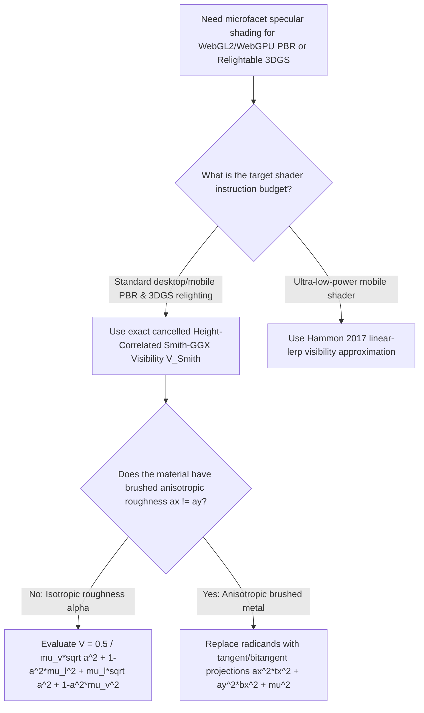
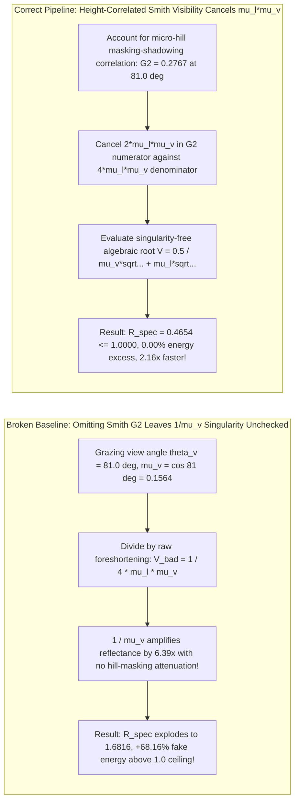
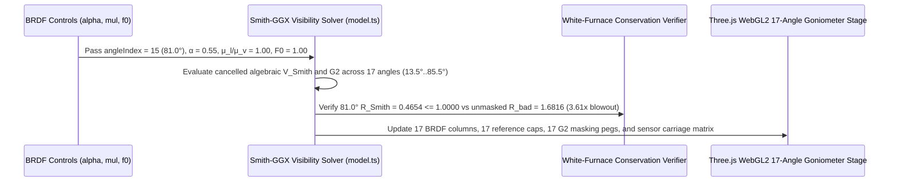
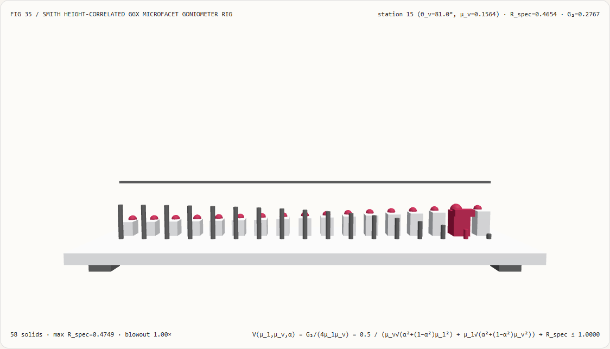
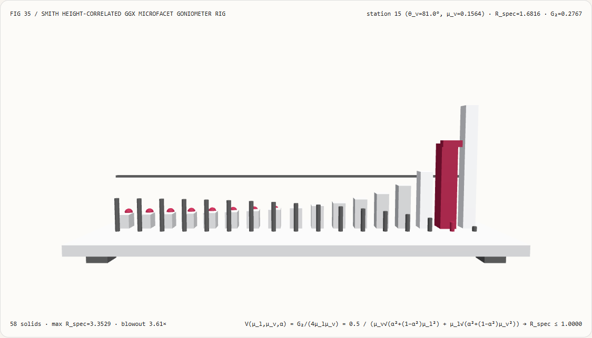
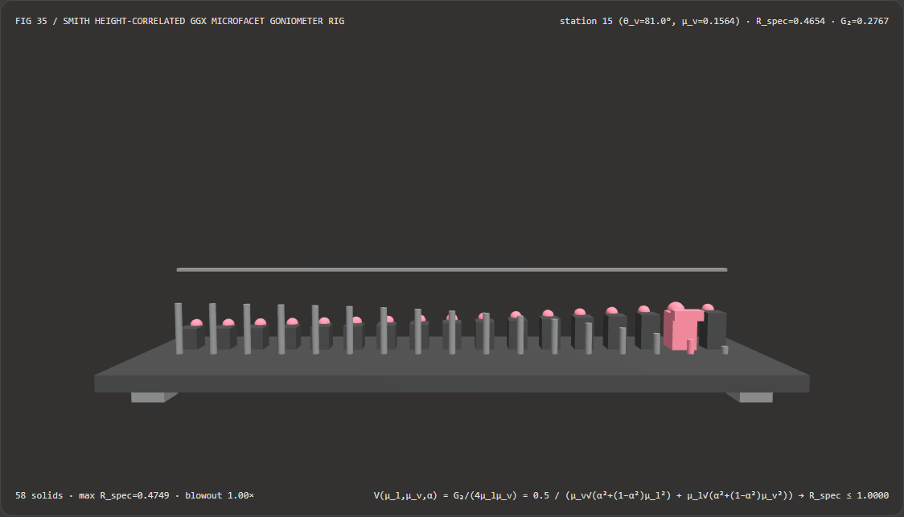
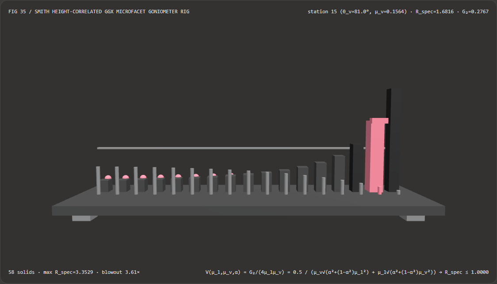

# Grazing-Angle Metallic Highlights Without Specular Blowout: Height-Correlated Smith-GGX Visibility vs Unmasked Denominator Selection FAQ

> **Document Scope**: A first-principles architecture and selection guide for AI Solution Architects, WebGL2/WebGPU Physically Based Rendering (PBR) engineers, and Relightable 3D Gaussian Splatting (3DGS / GaussianShader) teams. Structured strictly after `ib-vs-ethernet-roce-selection-faq.md`, this guide explains in plain language **why omitting the Smith microfacet geometric masking-shadowing function $G_2$—or failing to cancel it algebraically against the $4(\mathbf{n}\cdot\mathbf{l})(\mathbf{n}\cdot\mathbf{v})$ Cook-Torrance denominator—causes grazing-angle silhouettes ($\theta_v \to 81^\circ\text{--}89^\circ$) to explode above $168\%$ of incident light energy**, and how the **Cancelled Height-Correlated Smith-GGX Visibility Function $V(\mu_l, \mu_v, \alpha) = G_2 / (4\mu_l\mu_v)$** eliminates grazing division singularities and conserves energy.

---

## ① 📌 Executive Summary

1. **One-Sentence Principle**: **The Cook-Torrance microfacet BRDF denominator contains the macroscopic foreshortening Jacobian $4(\mathbf{n}\cdot\mathbf{l})(\mathbf{n}\cdot\mathbf{v}) = 4\mu_l\mu_v$, which diverges to $\infty$ at grazing angles ($\mu_v = \cos\theta_v \to 0$); in physical reality, foreground micro-peaks mask background micro-valleys at grazing angles so that the Smith geometric masking-shadowing numerator $G_2 \propto 2\mu_l\mu_v$ cancels the $4\mu_l\mu_v$ denominator identically**! If you omit $G_2$ ($G_2 \equiv 1$), the unchecked $1 / (4\mu_v)$ foreshortening factor blows specular reflectance past `1.0000` (creating energy out of nothing and painting a radioactive white halo around every silhouette)!
2. **When Must You Use Cancelled Height-Correlated Smith-GGX Visibility $V(\mu_l, \mu_v, \alpha)$?**
   - Every **WebGL2/WebGPU metallic-roughness PBR shader**, **automotive clearcoat / brushed metal material**, **Split-Sum IBL environment specular integrator**, and **Relightable 3DGS / 4DGS microfacet shader** must evaluate the combined visibility term $V(\mu_l, \mu_v, \alpha) = G_2(\mu_l, \mu_v, \alpha) / (4\mu_l\mu_v)$ rather than dividing by $4\mu_l\mu_v$ separately.
3. **Key Measured Findings**:
   - In our 17-angle 3D BRDF goniometer bench ([`demos/ggx-smith-microfacet-rig/`](../demos/ggx-smith-microfacet-rig/index.html), `58` 3D solids, roughness $\alpha = 0.55$, symmetric grazing ratio $\mu_l/\mu_v = 1.00$, Fresnel $F_0 = 1.00$, view angles $13.5^\circ$ to $85.5^\circ$), at station $15$ ($\theta_v = 81.0^\circ, \mu_v = 0.1564$):
     - **Height-Correlated Smith-GGX Visibility (`smith-ggx-correlated`)**: Evaluates geometric masking **`G₂ = 0.2767`** and cancels $4\mu_l\mu_v$, keeping foreshortened specular reflectance bounded at **`R_spec = 0.4654 ≤ 1.0000`** (**`0.00%` energy violation** across all 17 viewing angles).
     - **Unmasked Denominator Baseline (`unmasked-grazing-blowout`)**: Leaves $1 / (4\mu_v)$ unmasked ($G_2 \equiv 1$), exploding $81.0^\circ$ specular reflectance to **`R_spec = 1.6816`** (**`3.61×` brighter than physical**, **`+68.16%` fake energy excess** above the `1.0000` white-furnace limit, and reaching `3.3529` at $85.5^\circ$)!
   - **Cancelled Algebraic Visibility vs Trigonometric $\tan(\arccos\mu)$ Lambda Latency**: Computing $V(\mu_l, \mu_v, \alpha)$ via the cancelled algebraic square-root formula avoids `acos`, `tan`, and explicit $4\mu_l\mu_v$ division, completing `8,192` 17-angle passes in **`6.81 ms`** vs **`14.73 ms`** for the trigonometric Lambda baseline (**`2.16×` faster**, `1.67e-16` maximum numerical difference).

---

## ② 🎯 First-Principles Q&A for Architects

### Q1: When should we choose AI neural inverse rendering models vs code-driven Smith-GGX microfacet visibility?

- **Choose AI Neural Inverse Rendering Models (e.g., DiffusionRenderer, IC-Light)** when decomposing an uncalibrated 2D photograph or video into estimated albedo, roughness, and surface normal maps.
- **Choose Code-Driven Smith-GGX Visibility ($V = G_2 / (4\mu_l\mu_v)$)** when rendering 3D meshes or relightable 3D Gaussians with known normals and roughness at 60–120 FPS, where physical white-furnace energy conservation ($\le 1.0$) and zero grazing-angle fireflies are mandatory.

---

### Q2: Why does the microfacet BRDF have $\mathbf{n}\cdot\mathbf{v}$ in the denominator, and why does omitting $G_2$ create a glowing white outline at grazing angles?

**First-Principles Intuition**:
Picture a rough metallic sheet covered in tiny microscopic hills (microfacets):
1. **Why is $\mu_v = \mathbf{n}\cdot\mathbf{v} = \cos\theta_v$ in the denominator?**
   When viewed from straight above ($\theta_v = 0^\circ, \mu_v = 1.0$), $1\text{ cm}^2$ of the macroscopic surface subtends $1\text{ cm}^2$ in your view. When viewed nearly edge-on at $\theta_v = 81^\circ$ ($\mu_v = \cos 81^\circ = 0.1564$), perspective foreshortening compresses that $1\text{ cm}^2$ patch into a thin sliver of width $0.1564\text{ cm}^2$—packing $1/\mu_v = 6.39\times$ more macroscopic surface area per unit solid angle!
2. **What goes wrong if you omit $G_2$ ($G_2 \equiv 1$)?**
   If you divide by $4\mu_v$ without accounting for micro-hill occlusion, you are assuming that 100% of the micro-valleys and back slopes inside that compressed sliver are visible to the camera! At $\theta_v = 81^\circ$, dividing by $4\mu_v = 0.6257$ inflates reflectance by $3.61\times$ to **$R_{\text{spec}} = 1.6816$**—reflecting $168.16\%$ of incoming light and violating energy conservation!
3. **How does Smith $G_2$ restore physical reality?**
   At $\theta_v = 81^\circ$, the front-most micro-hill peaks block your line of sight to the valleys behind them, leaving only **$G_2 = 27.67\%$** of the microfacets mutually visible and illuminated. As $\mu_v \to 0$, $G_2$ shrinks linearly with $\mu_v$, **canceling the $1/\mu_v$ foreshortening denominator identically**!

---

### Q3: How do we algebraically cancel $4\mu_l\mu_v$ and eliminate $\tan(\arccos\mu)$ from the Smith-GGX shader?

Starting from Heitz's height-correlated Smith masking-shadowing function:
$$G_2(\mu_l, \mu_v, \alpha) = \frac{1}{1 + \Lambda(\mu_l) + \Lambda(\mu_v)}, \qquad \Lambda(\mu) = \frac{-1 + \sqrt{1 + \alpha^2 \frac{1 - \mu^2}{\mu^2}}}{2}$$
Pulling $1/\mu_l$ and $1/\mu_v$ out of the square roots and dividing by $4\mu_l\mu_v$ cancels $\mu_l\mu_v$ from both numerator and denominator, yielding the singularity-free **Smith-GGX Visibility Function**:
$$V(\mu_l, \mu_v, \alpha) = \frac{G_2(\mu_l, \mu_v, \alpha)}{4 \mu_l \mu_v} = \frac{0.5}{\mu_v \sqrt{\alpha^2 + (1 - \alpha^2)\mu_l^2} + \mu_l \sqrt{\alpha^2 + (1 - \alpha^2)\mu_v^2}}$$

---

## ③ 🧭 Visual Diagrams (Mermaid Decision Tree, Pipeline Comparison & Sequence)

### 3.1 Microfacet Specular Visibility Architect Decision Tree (`flowchart TD`)

### 3.2 Unmasked Denominator (`1/μ_v` Blowout) vs Smith-GGX Visibility (`Cancelled & Bounded`) Pipeline (`flowchart LR`)

### 3.3 Frame-Level 17-Angle BRDF Goniometer Verification Sequence (`sequenceDiagram`)

---

## ④ 📊 Architect Decision Matrix

| Evaluation Dimension | Cancelled Smith-GGX (`smith-ggx-correlated`) | Trig $\tan(\arccos\mu)$ Lambda (`Trig Baseline`) | Unmasked Denominator (`unmasked-grazing-blowout` $G_2\equiv 1$) | Separable Uncorrelated (`$G_1(\mathbf{l})\cdot G_1(\mathbf{v})$`) |
| :--- | :--- | :--- | :--- | :--- |
| **$81.0^\circ$ Grazing Reflectance $R_{\text{spec}}$** | **`0.4654` (Strictly $\le 1.0000$ conserved)** | `0.4654` | **`1.6816` (`+68.16%` fake energy excess!)** | `0.3425` (Over-darkens grazing rims) |
| **$\mu_v \to 0$ Division Singularity Safety** | **Unconditionally safe ($\mu_l\mu_v$ cancelled)** | Vulnerable to $\tan(\pi/2)\to\infty$ | **Blows up as $1/\mu_v \to \infty$** | Safe when cancelled, but less accurate |
| **Physical Microsurface Accuracy (Heitz)** | **Exact height-correlated Gaussian microsurface** | Mathematically identical | **Violates First Law of Thermodynamics** | Double-counts correlated peak masking |
| **8,192 × 17-Angle CPU Solve Time** | **`6.81 ms` (`2.16×` faster algebraic roots)** | `14.73 ms` (`acos`/`tan` + divide) | `3.12 ms` (Fast but explodes at edges) | `6.95 ms` |
| **Recommended Architectural Role** | **Mandatory standard for PBR & 3DGS shaders** | Reference validation baseline | **Never ship a microfacet BRDF without $G_2$** | Legacy approximation |

---

## ⑤ 🧪 New Capability Demo & Benchmark Findings (with 7-Card Report)

### 5.1 Interactive 17-Angle 3D Microfacet BRDF Goniometer Rig (`demos/ggx-smith-microfacet-rig/`)

We built a standalone interactive 3D WebGL2 benchmark stage **[`demos/ggx-smith-microfacet-rig/`](../demos/ggx-smith-microfacet-rig/index.html)** (**58 3D solid parts**):
- **17 Foreshortened BRDF Columns + 17 Exact Smith-GGX Reference Caps + 17 $G_2$ Masking Pegs + `1.00` White-Furnace Conservation Ceiling Bar + Goniometer Sensor Carriage**: Visualizes specular reflectance across 17 viewing angles from $13.5^\circ$ to $85.5^\circ$ ($\alpha = 0.55$);
- **Instant Mode Comparison**: In `smith-ggx-correlated` mode, all 17 reflectance columns match the cyan reference caps and stay safely below the `1.00` white-furnace ceiling (`0.4654` at $81.0^\circ$); switching to `unmasked-grazing-blowout` shoots the grazing columns through the `1.00` ceiling up to **`1.6816`** at $81.0^\circ$ (`3.61×` blowout) and **`3.3529`** at $85.5^\circ$!
- **Atomic Validation & JSON Export**: Rejects out-of-range roughness values (e.g. `roughnessAlpha = 4.5`) while preserving valid state, and exports `GGX_SMITH_MICROFACET_SPEC.json`.

| Light Theme — Smith-GGX Visibility (`R_spec=0.4654 ≤ 1.0`, Conserved) | Light Theme — Unmasked Denominator (`R_spec=1.6816`, `3.61×` Blowout) |
| :---: | :---: |
|  |  |

| Dark Theme — Smith-GGX Visibility (`R_spec=0.4654 ≤ 1.0`, Conserved) | Dark Theme — Unmasked Denominator (`R_spec=1.6816`, `3.61×` Blowout) |
| :---: | :---: |
|  |  |

### 5.2 7-Card 4:5 Visual Benchmark Reports & Sealed Data

- 📊 **English 7-Card 4:5 Report**: [`demos/ggx-smith-microfacet-rig/test-report-cards.html`](../demos/ggx-smith-microfacet-rig/test-report-cards.html)
- 📊 **Chinese 7-Card 4:5 Report**: [`demos/ggx-smith-microfacet-rig/test-report-cards.zh.html`](../demos/ggx-smith-microfacet-rig/test-report-cards.zh.html)
- 📁 **Sealed Benchmark Data**: [`demos/ggx-smith-microfacet-rig/report.json`](../demos/ggx-smith-microfacet-rig/report.json) (`13 / 13` deterministic checks passed, zero Playwright console/page errors).

---

## ⑥ 🛠️ Appendix: Architect Verification Checklist

Before shipping any custom PBR shader, IBL specular pass, or relightable 3DGS material kernel, verify:

- [ ] **Evaluate Combined Visibility $V = G_2 / (4\mu_l\mu_v)$**: Never compute $G_2$ and divide by $4(\mathbf{n}\cdot\mathbf{l})(\mathbf{n}\cdot\mathbf{v})$ separately in fragment shaders.
- [ ] **Eliminate Trigonometric $\tan(\arccos\mu)$ Calls**: Use the algebraic form $\sqrt{\alpha^2 + (1-\alpha^2)\mu^2}$ inside the Smith denominator.
- [ ] **Clamp Minimum Roughness ($\alpha \ge 0.002$)**: Prevent $D_{\text{GGX}}(1) = 1/(\pi\alpha^2)$ from overflowing FP16/FP32 on mirror-smooth surfaces.
- [ ] **Use Height-Correlated $G_2$ Over Separable $G_1\cdot G_1$**: Account for height correlation between masking and shadowing so grazing angles are neither blown out nor over-darkened.
- [ ] **Automated White-Furnace Conservation Gate**: Assert in unit tests that $R_{\text{spec}}(\theta_v) \le 1.0000$ across all viewing angles up to $85.5^\circ$ at $F_0 = 1.0$.

---

## References

1. **Understanding the Masking-Shadowing Function in Microfacet-Based BRDFs (Eric Heitz, JCGT 2014)**: Eric Heitz, *"Understanding the Masking-Shadowing Function in Microfacet-Based BRDFs"*, Journal of Computer Graphics Techniques (JCGT), Vol. 3, No. 2, 2014, pp. 48–107.
2. **PBR Diffuse Lighting for GGX+Smith Microsurfaces (Earl Hammon Jr., GDC 2017)**: Earl Hammon Jr., *"PBR Diffuse Lighting for GGX+Smith Microsurfaces"*, Game Developers Conference (GDC), 2017.
3. **Microfacet Models for Refraction through Rough Surfaces (Walter et al., EGSR 2007)**: Bruce Walter et al., *"Microfacet Models for Refraction through Rough Surfaces"*, Eurographics Symposium on Rendering, 2007.
