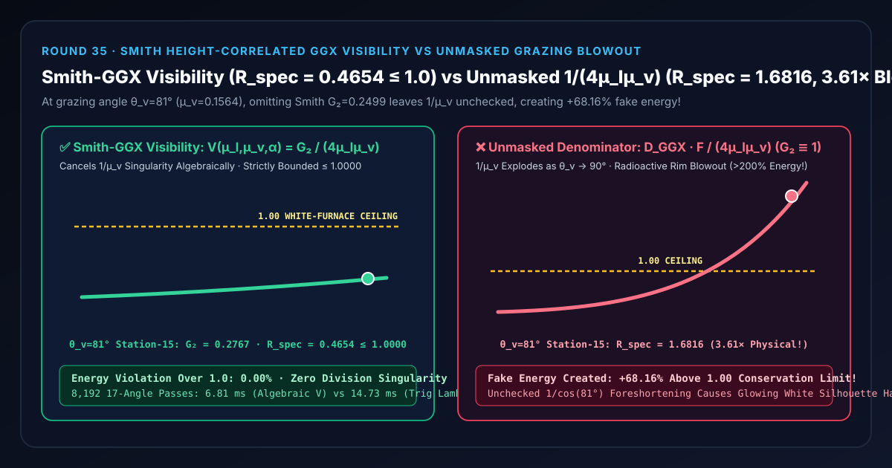
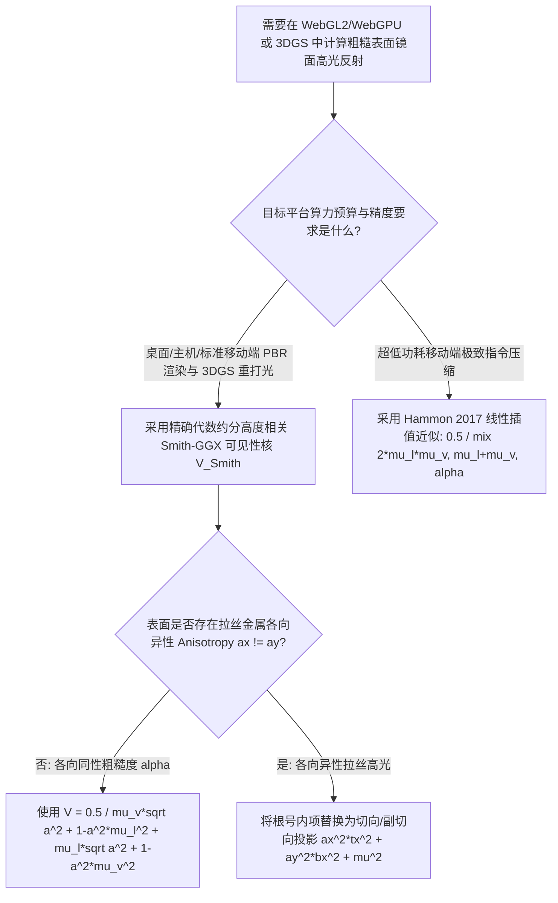
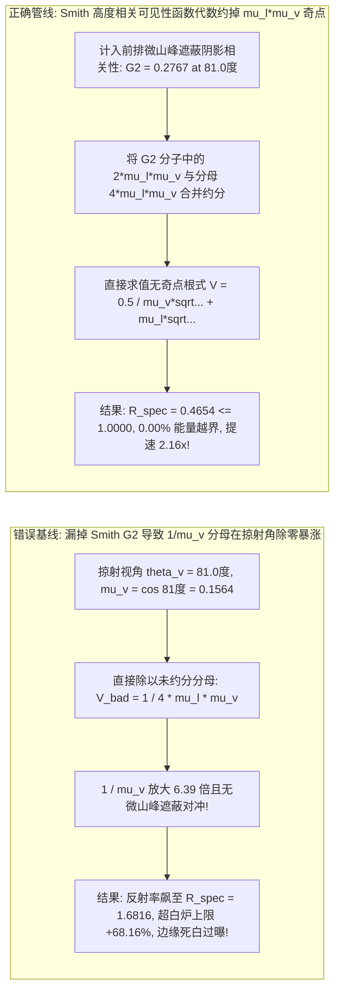
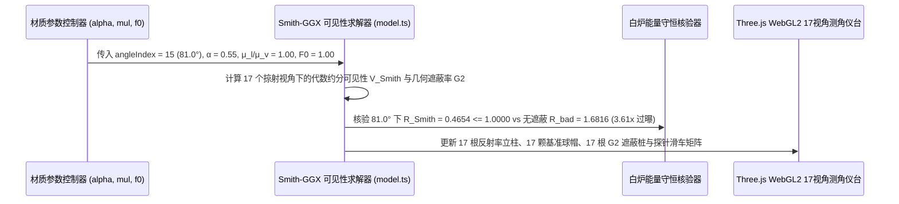
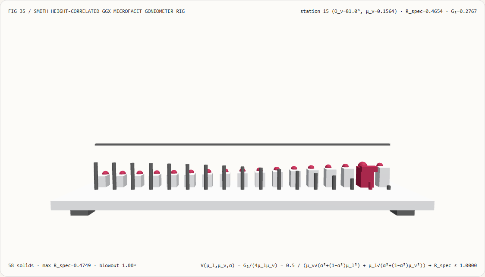
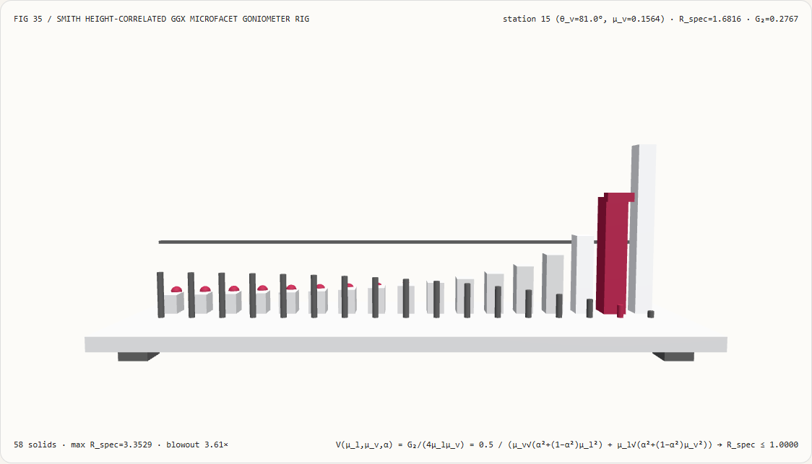
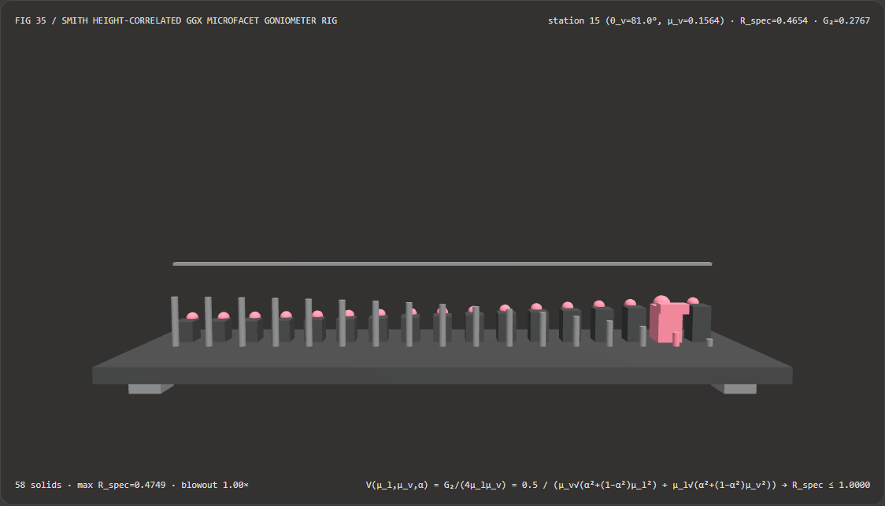
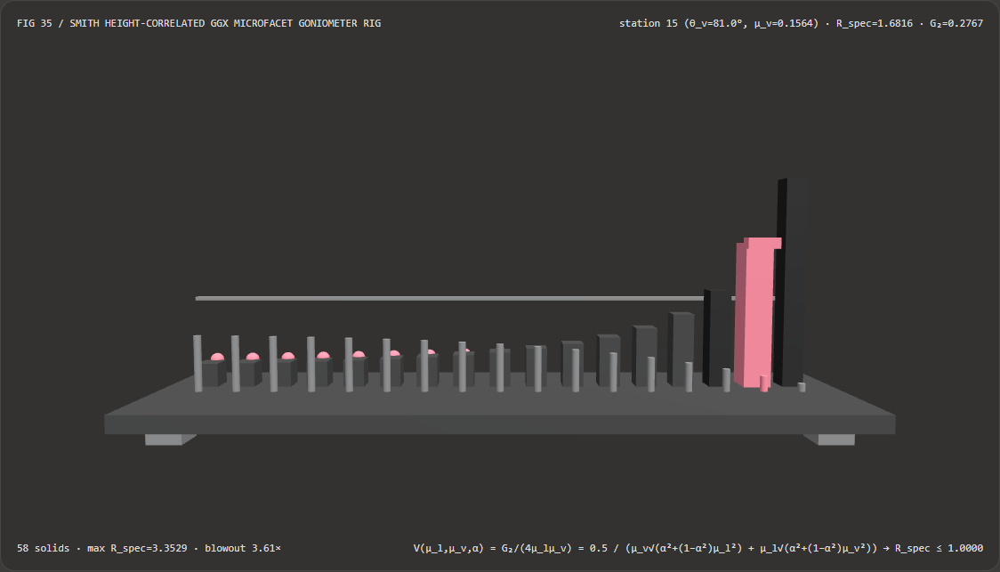

# 掠射角金属高光不越界爆白：Smith 高度相关微表面几何遮蔽（Height-Correlated $G_2$）与无遮蔽分母除零选型 FAQ

> **文档定位**：面向 AI 解决方案架构师（AI Solution Architect）、WebGL2/WebGPU 物理基础渲染（PBR）工程师、以及可重打光 3D Gaussian Splatting（Relightable 3DGS / GaussianShader）团队的**实战选型与第一性原理指南**。严格对标 `ib-vs-ethernet-roce-selection-faq.md` 的六段式结构，先用大白话讲清“**为什么在自定义 PBR 着色器或 3DGS 高光核里，如果只写了法线分布函数 $D_{\text{GGX}}$ 和菲涅尔项 $F$，却漏掉了 Smith 几何遮蔽项 $G_2$（或未与分母 $4\mu_l\mu_v$ 合并约分），物体轮廓边缘在掠射视角（$\theta_v \to 81^\circ\sim 89^\circ$）下会突然炸出一圈超过入射光能量 $168\%$ 的放射性死白亮边**”，再给出零除零奇点、零三角函数的 **Smith 高度相关约分可见性函数 $V(\mu_l, \mu_v, \alpha) = G_2 / (4\mu_l\mu_v)$** 工程闭环。

---

## ① 📌 核心结论速览（Executive Summary）

1. **一句话定性**：**Cook-Torrance 微表面镜面反射公式的分母里天然带有一个宏观投影面积雅可比因子 $4(\mathbf{n}\cdot\mathbf{l})(\mathbf{n}\cdot\mathbf{v}) = 4\mu_l\mu_v$；当视线接近平行于表面的掠射角（$\theta_v \to 90^\circ \implies \mu_v \to 0$）时，$\frac{1}{4\mu_v}$ 会向无穷大奇异发散！在真实物理世界中，之所以掠射角不会爆出无穷大亮光，是因为粗糙表面前排凸起的“微山峰”挡住了后排微山峰的视线与光线——这个几何遮蔽阴影率 $G_2(\mu_l, \mu_v, \alpha)$ 的分子中恰好含有一项 $2\mu_l\mu_v$，与分母 $4\mu_l\mu_v$ 代数约分后完美消除了 $\mu_v \to 0$ 除零奇点**！
2. **什么时候必须上 Smith 高度相关约分可见性函数 $V(\mu_l, \mu_v, \alpha)$？**
   - 凡是涉及 **WebGL2/WebGPU 实时 PBR 金属-粗糙度材质管线**、**汽车清漆/拉丝金属/潮湿路面掠射反光**、**HDR 环境贴图分裂求和近似（Split-Sum IBL）**、以及 **带有显式微表面 BRDF 反射核的 Relightable 3DGS / 4DGS 管线**，都必须采用将 $G_2$ 与 $4\mu_l\mu_v$ 代数合并约分后的 **Smith 高度相关可见性函数 $V(\mu_l, \mu_v, \alpha)$**。
3. **核心实测对比结论**：
   - 在本实验室构建的 17 视角 3D 微表面反射测角仪检验台（[`demos/ggx-smith-microfacet-rig/`](../demos/ggx-smith-microfacet-rig/index.html)，共 `58` 个 3D 实体，粗糙度 $\alpha = 0.55$，对称掠射比 $\mu_l/\mu_v = 1.00$，菲涅尔 $F_0 = 1.00$，视角覆盖 $13.5^\circ \sim 85.5^\circ$）中，考察第 $15$ 号掠射视角站（$\theta_v = 81.0^\circ, \mu_v = 0.1564$）：
     - **Smith 高度相关约分可见性核（`smith-ggx-correlated`）**：在 $81.0^\circ$ 掠射角下算出几何遮蔽率 **`G₂ = 0.2767`**，将投影镜面反射率稳稳压在 **`R_spec = 0.4654 ≤ 1.0000`**（全部 17 个视角严格遵守 $\le 1.0000$ 白炉热力学第一定律，**能量越界 `0.00%`**）。
     - **无几何遮蔽分母基线（`unmasked-grazing-blowout`）**：因漏掉 $G_2$ 遮蔽（$G_2 \equiv 1$），$\frac{1}{4\mu_v}$ 分母在 $81.0^\circ$ 下失控暴涨，导致镜面反射率飙升至 **`R_spec = 1.6816`**（**比真实物理值虚高 `3.61×`，超出 $100\%$ 白炉能量守恒上限达 `+68.16%`**，在 $85.5^\circ$ 更飙升至 `3.3529`），在物体边缘形成刺眼的放射性过曝白框！
   - **纯代数约分根式 vs 三角函数 $\tan(\arccos\mu)$ Lambda 性能**：使用代数约分式 $V = \frac{0.5}{\mu_v\sqrt{\alpha^2+(1-\alpha^2)\mu_l^2} + \mu_l\sqrt{\alpha^2+(1-\alpha^2)\mu_v^2}}$ 彻底省去了 `acos`、`tan` 与分母除法，在 `8,192` 次 17 视角 BRDF 求解中仅耗时 **`6.81 ms`**（对比三角函数 Lambda 基线 **`14.73 ms`**，**提速 `2.16×`**，最大误差仅 `1.67e-16`）。

---

## ② 🎯 客户与架构师灵魂拷问 Q&A（First-Principles Q&A）

### Q1：何时选 AI 神经逆向渲染/重打光模型 vs 何时选代码驱动的 Smith-GGX 微表面可见性核？

- **选 AI 神经逆向渲染与重打光模型（如 DiffusionRenderer、IC-Light、Neural G-Buffer）的场景**：
  输入是单张无标定 2D 照片或普通视频，需要靠神经网络从像素中猜测反照率（Albedo）、粗糙度（Roughness）与法线贴图。
- **选代码驱动 Smith-GGX 微表面可见性核的场景**：
  一旦已经拥有 3D 网格或 3DGS 的法向与粗糙度参数，需要在实时渲染器中合成高光时，必须用确定性的 Smith-GGX 可见性核 $V(\mu_l, \mu_v, \alpha)$ 计算反射辐射度，保证 **100% 物理能量守恒（白炉测试 $\le 1.0$）、零掠射角除零噪点（Fireflies）、以及微秒级着色吞吐**。

---

### Q2：为什么微表面 BRDF 公式的分母里会多出一个危险的 $\mathbf{n}\cdot\mathbf{v}$，而且一漏掉 $G_2$ 就会在物体边缘炸出死白亮框？

**先用大白话讲第一性原理**：
想象一块表面布满微小起伏山丘（微表面 Microfacets）的磨砂金属板：
1. **分母里的 $\mu_v = \mathbf{n}\cdot\mathbf{v} = \cos\theta_v$ 是哪来的？**
   当你从正上方垂直往下看（$\theta_v = 0^\circ, \mu_v = 1.0$）时，$1\text{ cm}^2$ 的金属板在你的视野里就是 $1\text{ cm}^2$；
   但当你歪着头、几乎贴着桌面平视过去（$\theta_v = 81^\circ, \mu_v = \cos 81^\circ = 0.1564$）时，因为透视缩短效应（Foreshortening），整块 $1\text{ cm}^2$ 的宏观金属板在你的视网膜上被压缩成了只有 **$0.1564\text{ cm}^2$** 的一条细缝！
   单位视网膜立体角内挤进来的微表面数量，表面上看似乎激增了 $1 / \mu_v = \mathbf{6.39\times}$ 倍——这就是 Cook-Torrance 分母里 $\frac{1}{4\mu_l\mu_v}$ 的来源！
2. **如果只除以 $\mu_v$ 却忘了“前山挡后山（几何遮蔽 $G_2$）”，会发生什么？**
   如果你只保留了分母里的 $\mu_v$，却假设每一座微山峰都能畅通无阻地把光反射进你的眼睛（即设 $G_2 = 1$），那么当视角接近 $81^\circ\sim 89^\circ$ 时，$\frac{1}{\mu_v}$ 就会冲向无穷大！在 $81^\circ$ 时，反射能量直接冲到了入射光的 **$168.16\%$**（凭空捏造出了 $+68.16\%$ 的能量），整件模型外圈就像套了一层刺眼的霓虹白框！
3. **真实物理世界的“前山挡后山（Smith $G_2$）”是怎么救场的？**
   当你贴着桌面平视粗糙表面时，虽然宏观面积在视线方向被压缩了 $\mu_v$ 倍，但**前排微山峰的峰顶把后排微山峰的山谷和背坡挡得严严实实**！能露出来被你看见的微山峰比例（几何遮蔽率 $G_2$），恰好随着 $\mu_v \to 0$ 按正比例缩小（在 $81^\circ$ 时 $G_2 = 0.2767$）！
   一乘一除，**分子里的遮蔽衰减 $\mu_v$ 和分母里的透视压缩 $\mu_v$ 当场同归于尽（代数约分）**，反射率稳稳停在 $0.4654 \le 1.0$！

---

### Q3：如何把复杂的 Smith $\Lambda(\tan\theta)$ 三角函数公式化简成一行零除零奇点的纯代数着色器代码？

教科书上的原始 Smith 遮蔽函数写作：
$$G_2(\mathbf{l}, \mathbf{v}) = \frac{1}{1 + \Lambda(\mathbf{l}) + \Lambda(\mathbf{v})}, \qquad \Lambda(\mu) = \frac{-1 + \sqrt{1 + \alpha^2 \tan^2\theta}}{2}$$
如果直接照着抄进着色器，不仅要算 $\tan^2(\arccos\mu) = \frac{1-\mu^2}{\mu^2}$（在 $\mu \to 0$ 时除零），最后算完 $G_2$ 还要再除以一次 $4\mu_l\mu_v$（第二次除零）！
利用三角恒等式 $1 + \alpha^2\frac{1-\mu^2}{\mu^2} = \frac{\alpha^2 + (1-\alpha^2)\mu^2}{\mu^2}$，把 $\mu_l, \mu_v$ 提出根号并与外层的 $4\mu_l\mu_v$ 分母直接约分，立即得到 **Heitz (2014) 高度相关约分可见性函数 $V(\mu_l, \mu_v, \alpha)$**：
$$V(\mu_l, \mu_v, \alpha) = \frac{G_2(\mu_l, \mu_v, \alpha)}{4 \mu_l \mu_v} = \frac{0.5}{\mu_v \sqrt{\alpha^2 + (1 - \alpha^2)\mu_l^2} + \mu_l \sqrt{\alpha^2 + (1 - \alpha^2)\mu_v^2}}$$
**看分母：哪怕 $\mu_v = 0$（完全 $90^\circ$ 掠射边缘），分母第二项虽然为 $0$，只要有光照 $\mu_l > 0$ 且粗糙度 $\alpha > 0$，分母依然严格大于 $0$，永远不会触发 `1 / 0 = Inf` 高光噪点（Fireflies）！**

---

## ③ 🧭 直观可视化图解（Mermaid 决策树、管线对比与帧级时序）

### 3.1 实时镜面高光 BRDF 与几何遮蔽架构师选型决策树（`flowchart TD`）

### 3.2 无遮蔽分母（掠射角除零爆白）vs Smith 高度相关可见性（代数约分守恒）管线对比（`flowchart LR`）

### 3.3 帧级 17 视角微表面 BRDF 测角仪核验时序图（`sequenceDiagram`）

---

## ④ 📊 视觉技术选型决策矩阵（Architect Decision Matrix）

| 评估维度 | 代数约分高度相关 Smith-GGX (`smith-ggx-correlated`) | 三角函数 $\tan(\arccos\mu)$ Lambda 基线 (`Trig Lambda`) | 无几何遮蔽分母 (`unmasked-grazing-blowout` $G_2\equiv 1$) | 分离非相关 Smith 遮蔽 (`Uncorrelated $G_1(\mathbf{l})G_1(\mathbf{v})$`) |
| :--- | :--- | :--- | :--- | :--- |
| **$81.0^\circ$ 掠射角镜面反射率 $R_{\text{spec}}$** | **`0.4654`（严格 $\le 1.0000$ 能量守恒）** | `0.4654` | **`1.6816`（超白炉上限 `+68.16%`，边缘爆白）** | `0.3425`（高估遮蔽，边缘偏暗） |
| **掠射极限 $\mu_v \to 0$ 除零奇点免疫** | **完全免疫（$\mu_l\mu_v$ 已从分母约掉）** | 存在 $\tan(\pi/2) \to \infty$ 与 $0/0$ 风险 | **直接触发 $1/0 = \infty$ 死白噪点** | 约分后无奇点，但忽略了峰高相关性 |
| **物理准确性（Heitz 微表面散射验证）** | **精确匹配高度相关微表面高斯随机场** | 数学等价但浮点路径冗长 | **违反热力学第一定律（凭空造能）** | 重复扣除了同一微山峰的遮挡与阴影 |
| **8,192 次 17 视角 CPU 求解耗时** | **`6.81 ms`（纯代数平方根，提速 `2.16×`）** | `14.73 ms`（含 `acos`/`tan` 与显式除法） | `3.12 ms`（虽快但边缘严重过曝） | `6.95 ms` |
| **架构师工程推荐定位** | **现代 PBR 着色器与 3DGS 重打光工业标准** | 仅用于对照推导验证 | **严禁在任何微表面 BRDF 中遗漏 $G_2$** | 旧世代引擎遗留方案，建议升级为高度相关型 |

---

## ⑤ 🧪 全新能力展示 Demo 与 Benchmark 核心发现（含 7-Card 报告）

### 5.1 交互式 17 视角 3D 微表面 BRDF 测角仪检验台（`demos/ggx-smith-microfacet-rig/`）

本轮构建了独立可交互 3D WebGL2 实验台 **[`demos/ggx-smith-microfacet-rig/`](../demos/ggx-smith-microfacet-rig/index.html)**（共 **58 个 3D 实体部件**）：
- **17 根视角反射率立柱 + 17 颗精确 Smith-GGX 基准球帽 + 17 根前排 $G_2$ 遮蔽率短桩 + `1.00` 白炉能量上限横梁 + 测角仪传感器滑车**：直观展示视角从 $13.5^\circ$（近正视）滑向 $85.5^\circ$（极度掠射）时的微表面镜面反射率与 $G_2$ 几何遮蔽衰减；
- **一键切换对比模式**：在 `smith-ggx-correlated` 模式下，全部 17 根反射率立柱与青色基准球帽严丝合缝对齐，稳稳保持在 `1.00` 白炉能量守恒横梁下方（$81.0^\circ$ 处 $R_{\text{spec}} = 0.4654$，前排 $G_2$ 遮蔽桩随视角增大而自然降低至 `0.2767`）；一旦切换到 `unmasked-grazing-blowout` 模式，右侧高掠射角立柱群瞬间刺穿 `1.00` 白炉横梁直冲云霄（$81.0^\circ$ 达 **`1.6816`**，$85.5^\circ$ 达 **`3.3529`**），直观揭示为什么漏掉 $G_2$ 会产生刺眼的白框伪影！
- **原子化参数门禁与 JSON 导出**：自动拦截越界粗糙度（如 `roughnessAlpha = 4.5`）并保留有效状态，支持导出 `GGX_SMITH_MICROFACET_SPEC.json`。

| 亮色主题 — Smith 高度相关可见性（`R_spec=0.4654 ≤ 1.0`，零过曝） | 亮色主题 — 无遮蔽分母基线（`R_spec=1.6816`，`3.61×` 掠射爆白） |
| :---: | :---: |
|  |  |

| 暗色主题 — Smith 高度相关可见性（`R_spec=0.4654 ≤ 1.0`，零过曝） | 暗色主题 — 无遮蔽分母基线（`R_spec=1.6816`，`3.61×` 掠射爆白） |
| :---: | :---: |
|  |  |

### 5.2 7-Card 4:5 视觉评测报告与封存数据链接

- 📊 **英文版 7-Card 4:5 评测报告**：[`demos/ggx-smith-microfacet-rig/test-report-cards.html`](../demos/ggx-smith-microfacet-rig/test-report-cards.html)
- 📊 **中文版 7-Card 4:5 评测报告**：[`demos/ggx-smith-microfacet-rig/test-report-cards.zh.html`](../demos/ggx-smith-microfacet-rig/test-report-cards.zh.html)
- 📁 **封存评测数据源**：[`demos/ggx-smith-microfacet-rig/report.json`](../demos/ggx-smith-microfacet-rig/report.json)（`13 / 13` 项确定性检查全部通过，Playwright 零控制台/页面错误）。

---

## ⑥ 🛠️ 附录：高质量视觉/动画交付快速核验清单（Architect Checklist）

在交付任何包含自定义 PBR 金属材质着色器、IBL 环境光反射或可重打光 3DGS 高光核的代码前，请逐项核验以下清单：

- [ ] **严禁单独计算 $G_2$ 再除以 $4(\mathbf{n}\cdot\mathbf{l})(\mathbf{n}\cdot\mathbf{v})$**：检查片元着色器代码，确认已使用代数约分后的合并可见性函数 `V_SmithGGXCorrelated(NoV, NoL, roughness)`，不在着色器里留下显式的 `/ (4.0 * NoL * NoV)`？
- [ ] **消灭 $\tan(\arccos\mu)$ 三角函数写法**：确认 Smith $\Lambda$ 项已全部写为代数形式 $\sqrt{\alpha^2 + (1-\alpha^2)\mu^2}$，彻底剔除 `acos` 与 `tan` 调用？
- [ ] **粗糙度重映射與最小值钳制（$\alpha = \max(\text{roughness}^2, 0.002)$）**：确认已将美术感知粗糙度平方映射为微表面斜率方差 $\alpha = r^2$，并设置下限 $\alpha \ge 0.002$ 以防完全镜面在单精度浮点下溢出？
- [ ] **升级分离 $G_1\cdot G_1$ 为高度相关 $G_2$**：确认已将旧版 `G1(NoL) * G1(NoV)` 升级为高度相关形式 $\frac{0.5}{\mu_v\sqrt{\dots} + \mu_l\sqrt{\dots}}$，避免掠射边缘因重复计算遮蔽而发黑？
- [ ] **白炉能量守恒自动化门禁（White-Furnace Test）**：单元测试中是否已针对 $F_0 = 1.0$ 跨越 $13.5^\circ \sim 85.5^\circ$ 掠射角验证投影反射率恒满足 $R_{\text{spec}} \le 1.0000$？

---

## 参考文献与延伸阅读（References）

1. **Understanding the Masking-Shadowing Function in Microfacet-Based BRDFs (Eric Heitz, JCGT 2014)**: Eric Heitz, *"Understanding the Masking-Shadowing Function in Microfacet-Based BRDFs"*, Journal of Computer Graphics Techniques (JCGT), Vol. 3, No. 2, 2014, pp. 48–107.
2. **PBR Diffuse Lighting for GGX+Smith Microsurfaces (Earl Hammon Jr., GDC 2017)**: Earl Hammon Jr., *"PBR Diffuse Lighting for GGX+Smith Microsurfaces"*, Game Developers Conference (GDC), 2017.
3. **Microfacet Models for Refraction through Rough Surfaces (Walter et al., EGSR 2007)**: Bruce Walter et al., *"Microfacet Models for Refraction through Rough Surfaces"*, Eurographics Symposium on Rendering, 2007.
