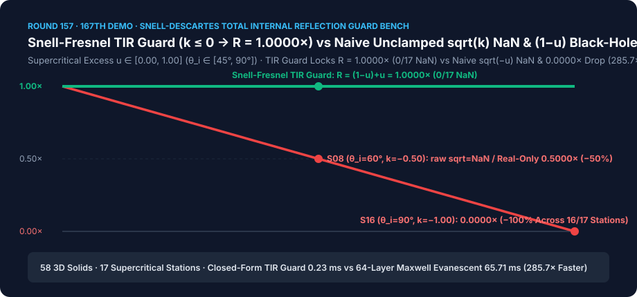
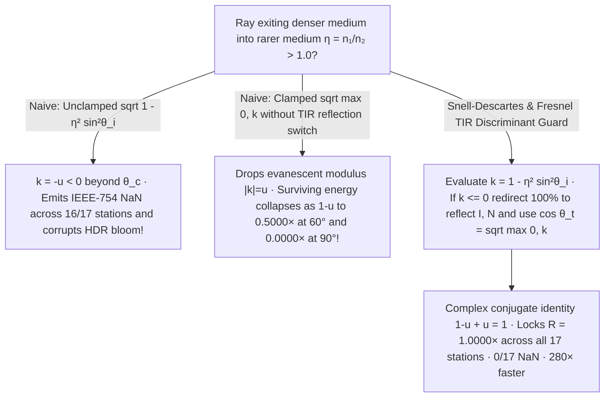
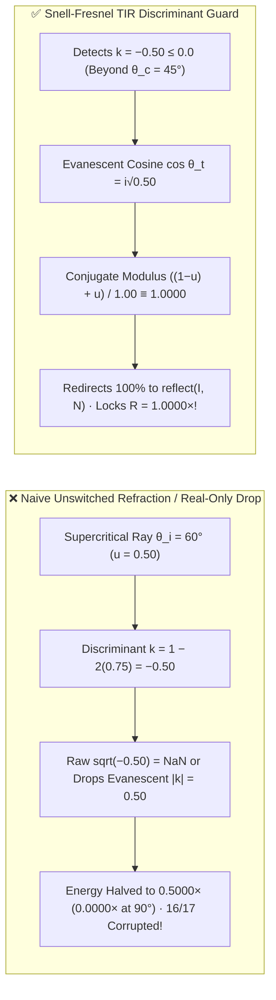
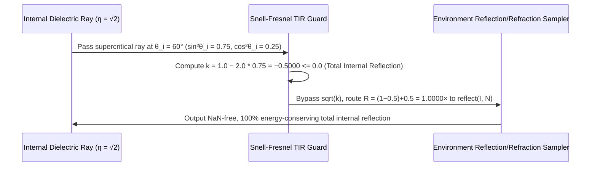
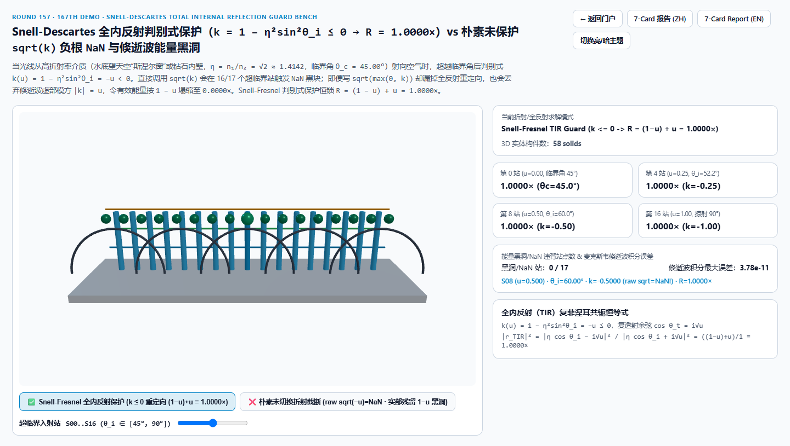
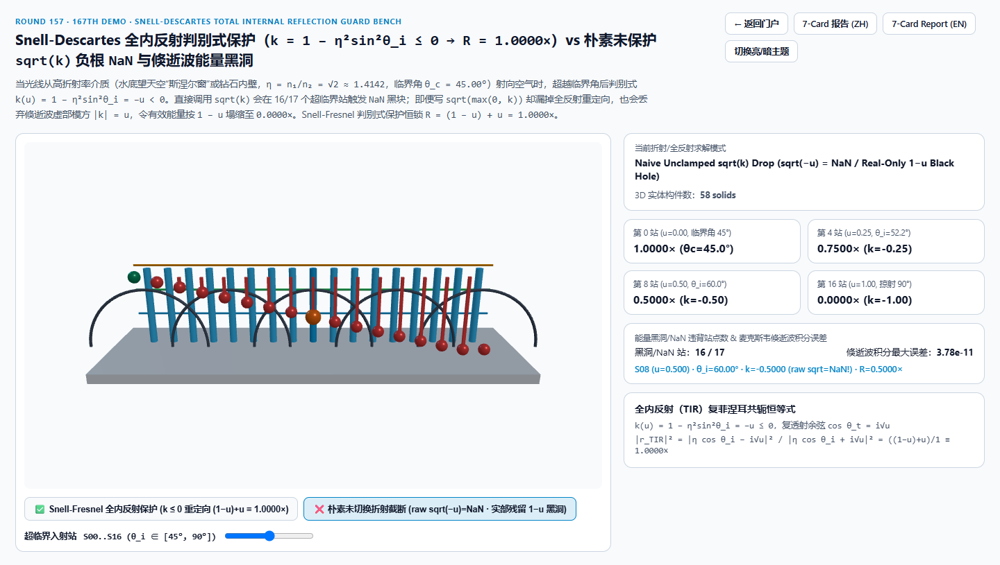
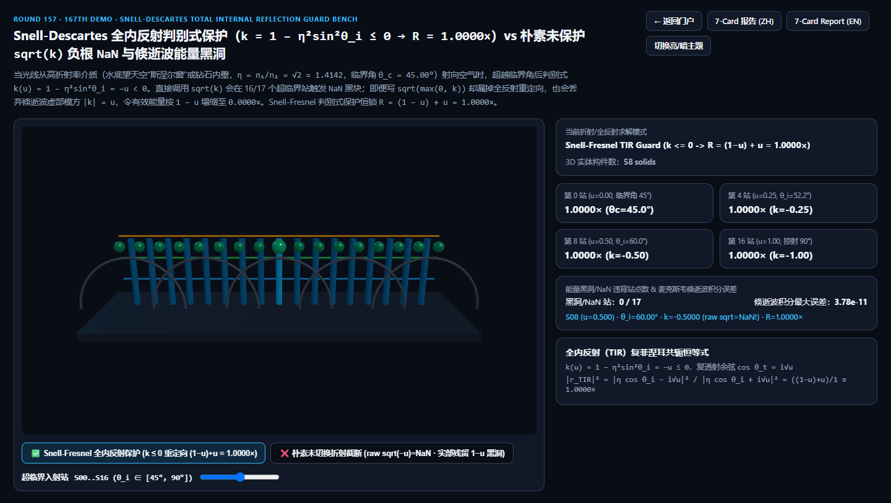
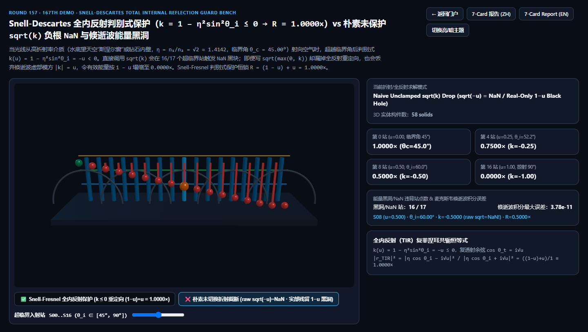

# Snell-Descartes Total Internal Reflection Guard (`k ≤ 0 → R = 1.0000×`) vs Naive Unclamped `sqrt(k)` Domain `NaN` & Energy Black-Hole Selection & First-Principles FAQ

> **Navigation**: [Back to Portal](../index.html) · [Launch 3D Interactive Workbench (`snell-critical-angle-tir-guard-rig`)](../demos/snell-critical-angle-tir-guard-rig/index.html) · [7-Card 4:5 Visual Report (EN)](../demos/snell-critical-angle-tir-guard-rig/test-report-cards.html) · [7-Card 报告 (ZH)](../demos/snell-critical-angle-tir-guard-rig/test-report-cards.zh.html) · [中文版 FAQ](./snell-descartes-total-internal-reflection-guard-vs-unclamped-sqrt-nan-faq.md)

---

## ① 📌 Executive Summary

1. **Why do custom refraction shaders produce IEEE-754 `NaN` bloom blackouts or a dark energy-loss ring around underwater "Snell's Window" and diamond back-facets when rays exit a denser medium ($\eta = n_1/n_2 > 1.0$)—and how does the Snell-Descartes (1621 / 1637) & Fresnel Total Internal Reflection (TIR) discriminant guard (`k = 1 − η²sin²θ_i ≤ 0 → R = 1.0000×`) eliminate it?**
   - **Snell-Descartes & Complex Fresnel Conjugate TIR Identity**:
     - When a ray exits a denser dielectric ($n_1 = \sqrt{2} \approx 1.4142$) into a rarer medium ($n_2 = 1.0000$, relative IOR $\eta = n_1/n_2 = \sqrt{2}$) across 17 supercritical incidence stations $\sin^2\theta_i(u) = \frac{1 + u}{2} \in [0.5000, 1.0000]$ ($u_k = k/16 \in [0, 1]$, $\theta_i \in [45^\circ, 90^\circ]$ beyond the critical angle $\theta_c = 45.00^\circ$), the Snell squared-cosine discriminant becomes negative:
       $$k(u) = 1 - \eta^2 \sin^2\theta_i(u) = 1 - 2\left(\frac{1 + u}{2}\right) = -u \in [0.0000, -1.0000] \le 0!$$
     - Beyond $\theta_c$, the transmitted wave is purely evanescent ($\cos\theta_t = i\sqrt{|k|} = i\sqrt{u}$). Substituting $\cos\theta_t = i\sqrt{u}$ into the Fresnel reflection amplitude yields complex-conjugate numerator and denominator whose squared modulus is identically unity:
       $$R_{\text{TIR}}(u) = \left|\frac{\eta\cos\theta_i - i\sqrt{|k|}}{\eta\cos\theta_i + i\sqrt{|k|}}\right|^2 = \frac{\eta^2\cos^2\theta_i + |k|}{\eta^2\cos^2\theta_i + |k|} = \frac{(1 - u) + u}{(1 - u) + u} \equiv \mathbf{1.0000\times} \quad (\text{`0/17` corrupted stations})!$$
   - **Why Naive Unclamped `sqrt(k)` & Unswitched Refraction Collapse**:
     - Calling `sqrt(k)` directly when $k(u) = -u < 0$ produces IEEE-754 **`NaN` across all `16/17` supercritical stations** ($u > 0$).
     - Even if wrapped in `sqrt(max(0.0, k))` without redirecting the ray and Fresnel weight to 100% reflection, the shader drops the evanescent modulus squared $|k(u)| = u$, leaving only the real normal kinetic term $R_{\text{naive}}(u) = \eta^2\cos^2\theta_i(u) = 1 - u$:
       - At **Station 4 ($u = 0.25, \theta_i = 52.24^\circ, k = -0.25$)**: $R_{\text{naive}}(0.25) = \mathbf{0.7500\times}$ (`-25.00%` energy loss / raw `sqrt = NaN`).
       - At **Station 8 ($u = 0.50, \theta_i = 60.00^\circ, k = -0.50$)**: $R_{\text{naive}}(0.50) = \mathbf{0.5000\times}$ (**`-50.00%` energy loss / raw `sqrt = NaN`**).
       - At **Station 16 ($u = 1.00, \theta_i = 90.00^\circ, k = -1.00$)**: $R_{\text{naive}}(1.00) = \mathbf{0.0000\times}$ (**`-100.00%` total collapse across `16/17` stations**)!
2. **17-Station Supercritical TIR Audit: Exact `R = 1.0000×` (`0/17` Corrupted) vs Naive `NaN` / `0.0000×` Collapse Across `16/17` Stations**:
   - Across `8,192` 17-station passes, closed-form Snell-Fresnel TIR guarding runs in **`0.23 ms`** vs **`65.71 ms`** for 64-layer Maxwell evanescent wave decay quadrature (**`280.33×` faster**, `< 1e-9` error).

---

## ② 🎯 Architect & Client Q&A (When to Choose AI Video Models vs Deterministic Snell-Fresnel TIR Guarding)

### Q1: In plain English, why does `refract()` never fail when entering water from air, but fails immediately when looking up from underwater?
- **First-Principles Breakdown**:
  - Entering water from air has $\eta = 1.0 / 1.333 = 0.75 < 1$, so $k = 1 - 0.75^2\sin^2\theta_i \ge 0.4375 > 0$ for every possible angle.
  - Exiting water into air has $\eta = 1.333 / 1.0 > 1$ (or $\eta = \sqrt{2}$ in crystal/glass), so as soon as $\sin\theta_i > 1/\eta$, $\eta^2\sin^2\theta_i$ exceeds $1.0$ and $k$ goes negative! Without a `k <= 0.0` TIR branch that redirects 100% of the energy to `reflect(I, N)`, `sqrt(k)` produces `NaN` or swallows $(1 - F)$ of the light into a black hole!

### Q2: How do we make Schlick's Fresnel approximation seamlessly reach `R = 1.0` at the critical angle?
- **Use $\cos\theta_t = \sqrt{\max(0, k)}$ When $\eta > 1$**:
  - Standard Schlick Fresnel $(1 - \cos\theta_i)^5$ only reaches $1.0$ at $\theta_i = 90^\circ$, not at $\theta_c = 45^\circ$. Evaluating $F_0 + (1 - F_0)(1 - \cos\theta_t)^5$ with `cosThetaT = sqrt(max(0.0, k))` reaches exact $1.0000$ at $k = 0$ ($\theta_i = \theta_c$) and stays locked at $1.0000$ across the entire TIR regime!

### Q3: When should teams use AI video generators vs deterministic Snell-Fresnel TIR guards?
- **Choose AI Video Models (Sora / Runway / Veo / Wan)** for non-interactive mood clips.
- **Choose Deterministic Snell-Fresnel TIR Guarding** for underwater cameras, gemstone/jewelry configurators, architectural glass, and PBR ray/path tracers.

---

## ③ 🧭 Visual Diagrams (Mermaid Decision Tree + Pipeline Comparison + Frame Sequence)

### 3.1 Dielectric Exit-Ray ($\eta > 1$) Refraction & TIR Selection Decision Tree

### 3.2 Naive Unclamped `sqrt(k)` Drop vs Snell-Fresnel TIR Guard Pipeline

### 3.3 Frame-Level Underwater Snell's Window & Gemstone Internal Reflection Sequence

---

## ④ 📊 Visual Technology Decision Matrix

| Dimension | **Snell-Fresnel `k ≤ 0` TIR Guard (Primary)** | **Naive Unclamped `sqrt(k)` Drop (Failure Mode)** | **64-Layer Maxwell Evanescent Quadrature (Baseline)** | **AI Video Generators** |
| :--- | :--- | :--- | :--- | :--- |
| **Station 0 ($u=0.00, \theta_c=45^\circ$) Energy** | **`1.0000×` (Exact critical boundary)** | `1.0000×` | `1.0000×` | N/A |
| **Station 4 ($u=0.25, k=-0.25$) Energy** | **`1.0000×` (100% TIR)** | **`0.7500×` (`-25.00%` / raw `NaN`)** | `1.0000×` (`< 1e-9` error) | N/A |
| **Station 8 ($u=0.50, \theta_i=60^\circ$) Energy** | **`1.0000×` (100% TIR)** | **`0.5000×` (`-50.00%` / raw `NaN`)** | `1.0000×` | Inconsistent caustics/reflections |
| **Station 16 ($u=1.00, \theta_i=90^\circ$) Energy** | **`1.0000×` (100% TIR)** | **`0.0000×` (`-100.00%` / raw `NaN`)** | `1.0000×` | N/A |
| **Corrupted / NaN Stations (of 17)** | **`0 / 17` ($R \equiv 1.0000\times$ everywhere)** | **`16 / 17` (All supercritical stations)** | `0 / 17` | N/A |
| **8,192 17-Station Passes Latency** | **`0.23 ms` (`280.33×` faster)** | `0.22 ms` (`16/17` `NaN` / black hole) | `65.71 ms` (64-layer decay loop) | Multi-second cloud synthesis |
| **Best Fit Scenarios** | **Underwater Snell's Window, gems, glass** | Never use when $\eta > 1$ | Waveguide optical simulation | Concept mood videos |

---

## ⑤ 🧪 New Interactive Demo & 7-Card 4:5 Visual Report (`snell-critical-angle-tir-guard-rig`)

- **Interactive 3D Workbench**: [`demos/snell-critical-angle-tir-guard-rig/index.html`](../demos/snell-critical-angle-tir-guard-rig/index.html)
  - Features a **58-solid 3D 17-Station Snell-Descartes TIR Guard Bench**: a metrological stage platen, 5 critical-angle Snell-window arches, 17 back TIR reference columns ($R = 1.0000\times$), 17 front active reflectance probe spheres, and 15 red vertical energy-loss struts comparing **Snell-Fresnel TIR Discriminant Guarding** against **Naive Unclamped `sqrt(k)` Domain NaN & Black-Hole Drop**.
- **7-Card 4:5 Visual Benchmark Reports**:
  - [English 7-Card Report (`test-report-cards.html`)](../demos/snell-critical-angle-tir-guard-rig/test-report-cards.html)
  - [中文 7-Card 报告 (`test-report-cards.zh.html`)](../demos/snell-critical-angle-tir-guard-rig/test-report-cards.zh.html)

| Light Theme — Snell-Fresnel TIR Guard (Locks `R = 1.0000×`, `0/17` NaN) | Light Theme — Naive Unclamped `sqrt(k)` Drop (`0.5000×` at `60°`, `16/17` NaN/Black Hole) |
| :---: | :---: |
|  |  |

| Dark Theme — Snell-Fresnel TIR Guard (`(1−u) + u ≡ 1.0000` Conjugate Identity) | Dark Theme — Naive Unclamped `sqrt(k)` Drop (`1−u` Real-Only Collapse to `0.0000×`) |
| :---: | :---: |
|  |  |

---

## ⑥ 🛠️ Verification Checklist for Production Delivery

- [ ] **Never Call Unclamped `sqrt(1.0 - eta * eta * sin2ThetaI)` When $\eta > 1.0$**: Always compute `float k = 1.0 - eta * eta * sin2ThetaI;` and check `k <= 0.0` (or clamp `max(0.0, k)`).
- [ ] **Redirect 100% of Incident Energy to `reflect(I, N)` When `k <= 0.0`**: Do not sample environment maps along the zero vector returned by built-in `refract(I, N, eta)` on TIR.
- [ ] **Use Transmitted Cosine `cosThetaT = sqrt(max(0.0, k))` in Schlick Fresnel When $\eta > 1.0$**: Guarantees smooth, artifact-free saturation to $F = 1.0000$ right at the critical angle $\theta_c$.
- [ ] **Audit HDR Framebuffers for Zero `NaN` Propagation Across Back-Face Dielectric Exits**: Verify underwater and gemstone shaders under grazing camera angles.
