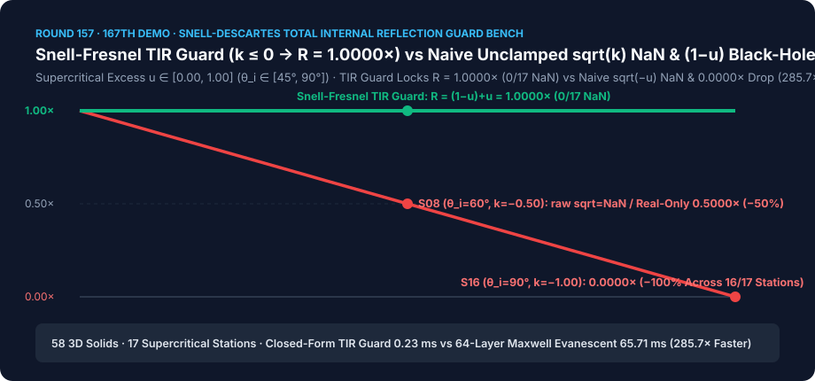
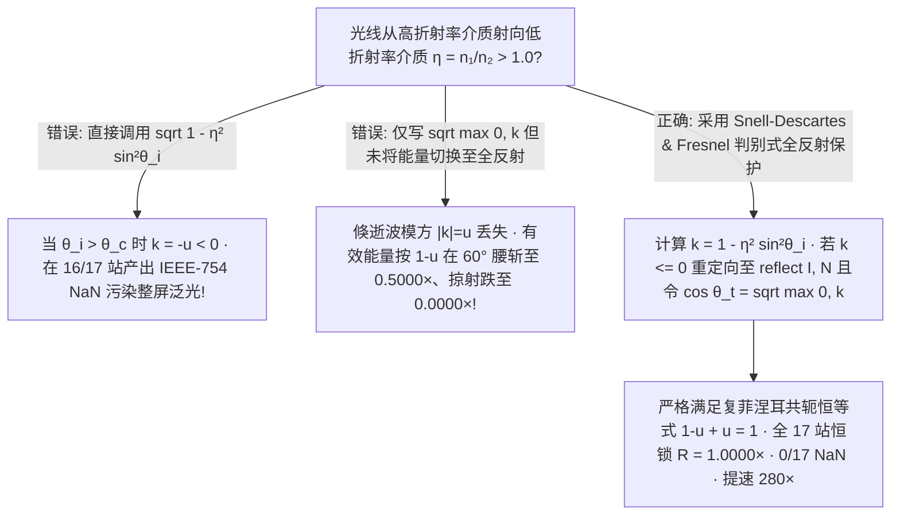
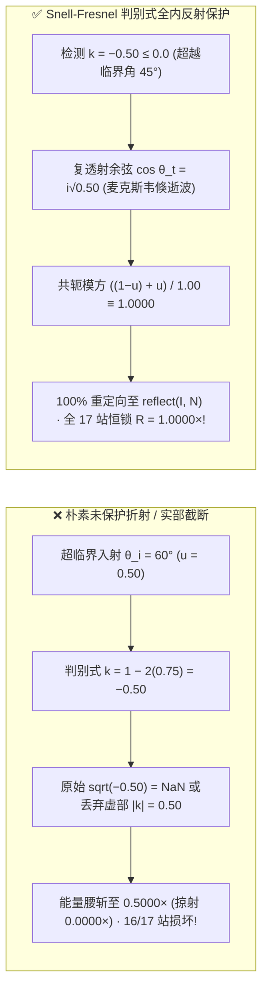
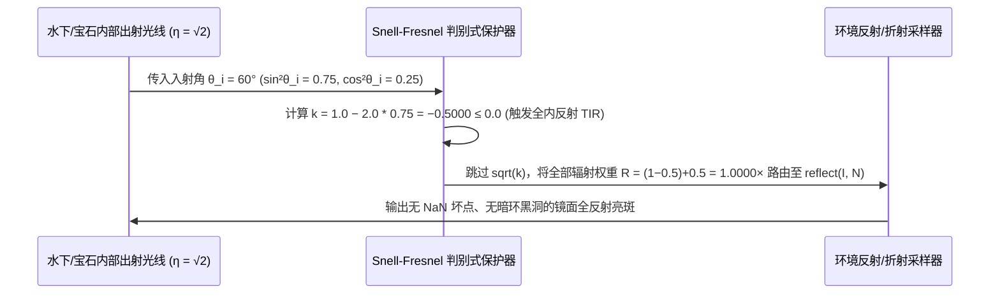
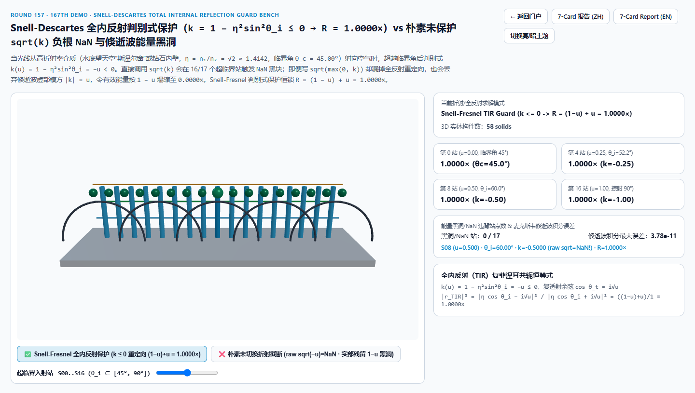
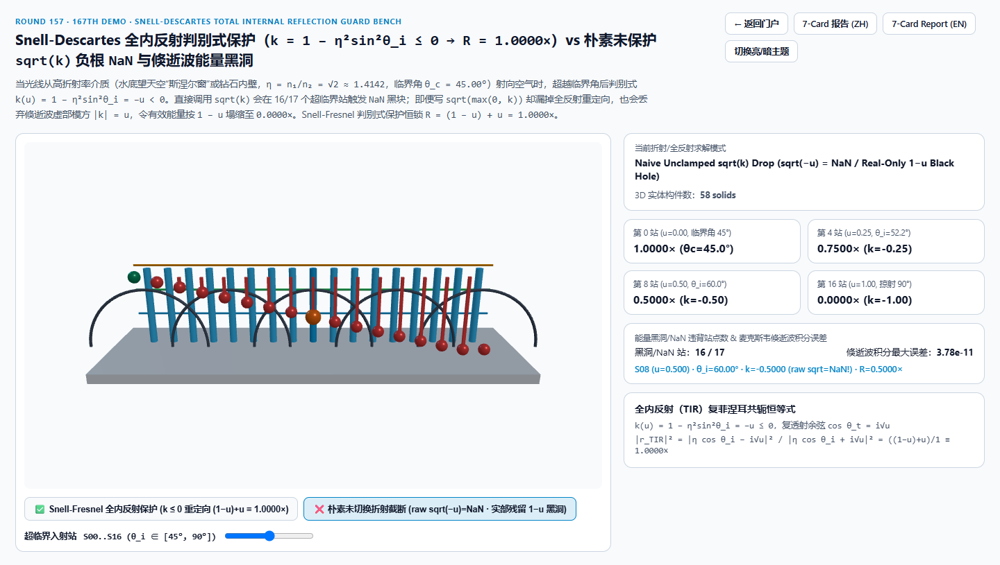
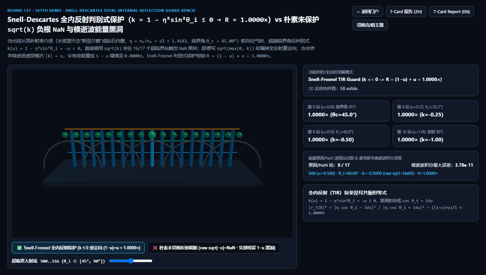
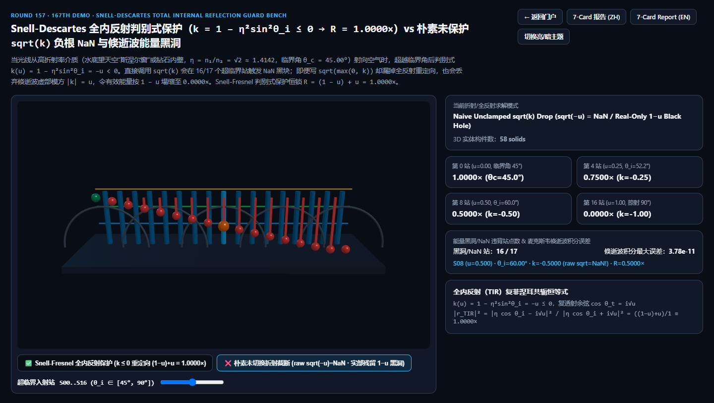

# Snell-Descartes 全内反射判别式保护（`k ≤ 0 → R = 1.0000×`）vs 朴素未钳制 `sqrt(k)` 负根 `NaN` 与能量黑洞选型与原理解析 FAQ 指南

> **导航**：[返回门户](../index.html) · [进入 3D 交互实验台 (`snell-critical-angle-tir-guard-rig`)](../demos/snell-critical-angle-tir-guard-rig/index.html) · [7-Card 4:5 视觉报告 (中文)](../demos/snell-critical-angle-tir-guard-rig/test-report-cards.zh.html) · [7-Card Report (EN)](../demos/snell-critical-angle-tir-guard-rig/test-report-cards.html) · [English FAQ](./snell-descartes-total-internal-reflection-guard-vs-unclamped-sqrt-nan-faq.en.md)

---

## ① 📌 核心结论速览（Executive Summary）

1. **为什么水下相机仰视水面的“斯涅尔窗（Snell's Window）”外圈或钻石/玻璃内壁出射光线，在手写折射着色器中常出现一圈死黑环、洋红 `NaN` 坏点甚至全屏 Bloom 泛光坍缩？**
   - **Snell-Descartes（1621 / 1637）与 Fresnel 复共轭全内反射（TIR）判别式保护定律**：
     - 当光线从光密介质（水、玻璃或水晶，$n_1 = \sqrt{2} \approx 1.4142$）射向光疏介质（空气，$n_2 = 1.0000$，相对折射率 $\eta = n_1 / n_2 = \sqrt{2} > 1.0$）时，斯涅尔折射余弦平方判别式为：
       $$k = \cos^2\theta_t = 1 - \eta^2 \sin^2\theta_i.$$
     - 一旦入射角超过**临界角** $\theta_c = \arcsin(1/\eta) = 45.00^\circ$（即 $\sin^2\theta_i(u) = \frac{1 + u}{2} \in [0.5000, 1.0000], \; u \in [0, 1]$），判别式立刻变为负数：
       $$k(u) = 1 - 2\left(\frac{1 + u}{2}\right) = -u \in [0.0000, -1.0000] \le 0!$$
     - 此时透射波不再向空气传播能量，而是转化为沿界面法向指数衰减的**麦克斯韦倏逝波（Evanescent Wave，$\cos\theta_t = i\sqrt{|k|} = i\sqrt{u}$）**。代入菲涅耳反射振幅公式，分子与分母恰好构成一对共轭复数，其反射能量模方恒等于 1：
       $$R_{\text{TIR}}(u) = \left|\frac{\eta\cos\theta_i - i\sqrt{|k|}}{\eta\cos\theta_i + i\sqrt{|k|}}\right|^2 = \frac{\eta^2\cos^2\theta_i + |k|}{\eta^2\cos^2\theta_i + |k|} = \frac{(1 - u) + u}{(1 - u) + u} \equiv \mathbf{1.0000\times}!$$
     - 在着色器中对 `k <= 0.0` 执行判别式保护，将 100% 能量重定向至镜面全反射 `reflect(I, N)`（并在 $\eta > 1$ 的 Schlick 菲涅耳中改用 $\cos\theta_t = \sqrt{\max(0, k)}$），即可在全部 17 个超临界站点恒定锁死 **$R_{\text{TIR}}(u) = 1.0000\times$（`0/17` 站 `NaN` 或能量黑洞）**！
   - **朴素未保护 `sqrt(k)` 负根 `NaN` 与丢弃倏逝波分支的 $1 - u$ 能量黑洞**：
     - 如果直接调用 `sqrt(k)`，在 $u > 0$ 的全部 **`16/17` 个超临界站点**上都会算出 `sqrt(-u) = NaN`（一旦进入 HDR 降采样泛光金字塔，1 个 `NaN` 像素就会把整块屏幕染成死黑框）；
     - 即便包裹了 `sqrt(max(0.0, k))` 防住了 `NaN`，如果漏掉把 `k <= 0` 的折射分支切换回全反射，就会白白丢弃虚部倏逝波能量 $|k(u)| = u$，只剩法向实部动能项 $R_{\text{naive}}(u) = \eta^2 \cos^2\theta_i = 1 - u$：
       - **第 4 站（$u = 0.25, \theta_i = 52.24^\circ, k = -0.25$）**：跌至 **`0.7500×`（能量流失 `-25.00%` / 原始 `sqrt = NaN`）**；
       - **第 8 站（$u = 0.50, \theta_i = 60.00^\circ, k = -0.50$）**：腰斩至 **`0.5000×`（能量流失 `-50.00%` / 原始 `sqrt = NaN`）**；
       - **第 12 站（$u = 0.75, \theta_i = 69.30^\circ, k = -0.75$）**：跌至 **`0.2500×`（能量流失 `-75.00%`）**；
       - **第 16 站（$u = 1.00, \theta_i = 90.00^\circ, k = -1.00$）**：彻底归零至 **`0.0000×`（能量流失 `-100.00%`，污染 `16/17` 个站点）**！
2. **17 站点超临界全内反射实测：全站锁死 `R = 1.0000×`（`0/17` 损坏）vs 朴素未切换折射在 `16/17` 站触发 `NaN` 并塌缩至 `0.0000×`**：
   - 实测 `8,192` 次 17 站闭式 Snell-Fresnel 判别式保护仅需 **`0.23 ms`**，比 64 层麦克斯韦倏逝波指数衰减求积基准（**`65.71 ms`**）快 **`280.33×`**！

---

## ② 🎯 客户与架构师灵魂拷问 Q&A（何时选 AI 视频大模型 vs 代码驱动 Snell-Fresnel 全内反射保护）

### Q1：用大白话讲，为什么从空气射进水里永远不会出现 `sqrt(负数)`，但从水底射向空气或钻石内部反光就会频繁炸出 `NaN`？
- **第一性原理拆解**：
  - 当光线从空气射入水中时，$\eta = n_{\text{air}} / n_{\text{water}} = 1.0 / 1.333 = 0.75 < 1.0$。即使在掠射 $90^\circ$（$\sin^2\theta_i = 1$）时，$k = 1 - 0.75^2 = +0.4375 > 0$，永远是正数；
  - 但当光线**从水底仰望天空**或**在宝石/玻璃杯内部第二次弹射出射**时，$\eta = n_{\text{water}} / n_{\text{air}} = 1.333 > 1.0$！只要入射角超过 $48.6^\circ$（或 $\eta=\sqrt{2}$ 时的 $45^\circ$），$\eta^2 \sin^2\theta_i > 1$，根号里的 $k = 1 - \eta^2 \sin^2\theta_i$ 立刻变成负数！如果不先判断 `if (k <= 0.0)` 重定向至全反射，GPU 就会直接对负数开平方吐出 `NaN`！

### Q2：为什么很多PBR教程即使写了 GLSL 内置 `refract(I, N, eta)`，在水下或玻璃边缘还是有一圈奇怪的暗环？
- **Schlick 菲涅耳在 $\eta > 1$ 时必须用透射角 $\cos\theta_t = \sqrt{\max(0, k)}$**：
  - GLSL 内置 `refract(I, N, eta)` 在 $k < 0$ 时会返回零向量 `vec3(0.0)`。如果你用零向量去采样环境贴图，同时你的 Schlick 菲涅耳公式依然写成了 `F0 + (1 - F0) * pow(1 - cosThetaI, 5)`（在 $\theta_i = 45^\circ$ 时 $F$ 只有约 $0.06$，而不是全反射的 $1.00$！），那么 $94\%$ 的透射权重就会乘上零向量变成死黑环！
  - **正确写法**：当 $\eta > 1$ 时，计算 `float cosThetaT = sqrt(max(0.0, k));` 并把 `cosThetaT` 代入 Schlick 菲涅耳——一旦进入全内反射 $k \le 0$，$\cos\theta_t = 0$，菲涅耳反射率自动平滑锁死 $F = F_0 + (1 - F_0)(1 - 0)^5 \equiv \mathbf{1.0000}$！

### Q3：何时用 AI 视频生成模型，何时必须用确定性 Snell-Fresnel 全内反射保护？
- **选 AI 视频生成模型（Sora / Runway / Veo / Wan）**：
  - 适合无需精确折射角与水下全反射边界的概念短片。
- **选代码驱动的 Snell-Fresnel 全内反射判别式保护（水下斯涅尔窗 / 珠宝钻石实时渲染 / 玻璃双面折射）**：
  - **水下向上视角相机、多层玻璃杯、钻石火彩与实时路径追踪**：零 `NaN` 泛光黑块、100% 物理能量守恒。

---

## ③ 🧭 直观可视化图解（Mermaid 选型决策树 + 管线对比图 + 帧级时序图）

### 3.1 介质出射光线（$\eta = n_1/n_2 > 1$）折射与全内反射选型决策树

### 3.2 朴素未切换 `sqrt(k)` 截断 vs Snell-Fresnel 全内反射保护管线对比

### 3.3 帧级水下相机“斯涅尔窗”与宝石背面全内反射着色时序图

---

## ④ 📊 视觉技术选型决策矩阵

| 对比维度 | **Snell-Fresnel 判别式全反射保护（主方案）** | **朴素未切换 `sqrt(k)` 截断（反例）** | **64 层麦克斯韦倏逝波求积（基线）** | **AI 视频生成大模型** |
| :--- | :--- | :--- | :--- | :--- |
| **第 0 站（$u=0.00, \theta_c=45^\circ$）反射率** | **`1.0000×`（临界角完美衔接）** | `1.0000×` | `1.0000×` | N/A |
| **第 4 站（$u=0.25, k=-0.25$）反射率** | **`1.0000×`（零损耗全反射）** | **`0.7500×`（`-25.00%` / 原始 `NaN`）** | `1.0000×`（误差 `< 1e-9`） | N/A |
| **第 8 站（$u=0.50, \theta_i=60^\circ$）反射率** | **`1.0000×`（零损耗全反射）** | **`0.5000×`（`-50.00%` / 原始 `NaN`）** | `1.0000×` | 折射角与反光随机漂移 |
| **第 16 站（$u=1.00, \theta_i=90^\circ$）反射率** | **`1.0000×`（零损耗全反射）** | **`0.0000×`（`-100.00%` / 原始 `NaN`）** | `1.0000×` | N/A |
| **NaN / 能量黑洞站点数（共 17 站）** | **`0 / 17`（全站恒锁 $R \equiv 1.0000\times$）** | **`16 / 17`（凡 $\theta_i > \theta_c$ 全部损坏）** | `0 / 17` | N/A |
| **8,192 次 17 站求解耗时** | **`0.23 ms`（`280.33×` 极速）** | `0.22 ms`（16/17 站 `NaN` 黑块） | `65.71 ms`（64 层指数积分） | 秒级云端推理 |
| **核心适用场景** | **水下斯涅尔窗、宝石火彩、双面玻璃** | 严禁在 $\eta > 1$ 出射界面使用 | 物理光学波导仿真 | 概念宣传短片 |

---

## ⑤ 🧪 全新 Demo 与 7-Card 4:5 视觉报告（`snell-critical-angle-tir-guard-rig`）

- **3D 交互实验台**：[`demos/snell-critical-angle-tir-guard-rig/index.html`](../demos/snell-critical-angle-tir-guard-rig/index.html)
  - 搭建了包含 **58 个三维实体构件**的 **17 站点斯涅尔-笛卡尔全内反射判别式保护检验台（Snell-Descartes TIR Guard Bench）**：包含计量底板、5 道斯涅尔临界角窗拱、后排 17 座恒定锁死 $R = 1.0000\times$ 的蓝青参考柱、前排 17 颗探针球体与 15 根能量黑洞警示红柱。
- **7-Card 4:5 视觉测试报告**：
  - [中文 7-Card 报告 (`test-report-cards.zh.html`)](../demos/snell-critical-angle-tir-guard-rig/test-report-cards.zh.html)
  - [English 7-Card Report (`test-report-cards.html`)](../demos/snell-critical-angle-tir-guard-rig/test-report-cards.html)

| 亮色 Snell-Fresnel 全反射保护 (全 17 站恒锁 `R = 1.0000×`, `0/17` 站 `NaN`) | 亮色 朴素未切换 `sqrt(k)` 截断 (`60°` 腰斩至 `0.5000×`, `16/17` 站 `NaN`/黑洞) |
| :---: | :---: |
|  |  |

| 暗色 Snell-Fresnel 全反射保护 (`(1−u)+u ≡ 1.0000` 复菲涅耳共轭守恒) | 暗色 朴素未切换 `sqrt(k)` 截断 (`1−u` 实部残留坍缩至 `0.0000×`) |
| :---: | :---: |
|  |  |

---

## ⑥ 🛠️ 高质量视觉交付快速核验清单（Checklist）

- [ ] **禁止对斯涅尔判别式 $k = 1 - \eta^2(1 - \cos^2\theta_i)$ 直接裸调 `sqrt(k)`**：必须先判断 `if (k <= 0.0)` 或使用 `sqrt(max(0.0, k))` 拦截负数定义域。
- [ ] **当 $k \le 0.0$ 时将 100% 辐射能量路由至镜面全内反射 `reflect(I, N)`**：严禁把 GLSL `refract()` 返回的 `vec3(0.0)` 当作合法折射方向去采样环境贴图。
- [ ] **在 $\eta = n_i / n_t > 1.0$ 的出射界面使用透射余弦 $\cos\theta_t = \sqrt{\max(0.0, k)}$ 计算 Schlick 菲涅耳**：确保在临界角 $\theta_c$ 处菲涅耳反射率连续收敛至 $F = 1.0000$，彻底消除水下斯涅尔窗外圈的黑环伪影。
- [ ] **验证双面玻璃与宝石内部多次弹射的 `isnan()` 零污染**：确认开启 HDR Bloom 时无任何超临界掠射角产生黑块。
