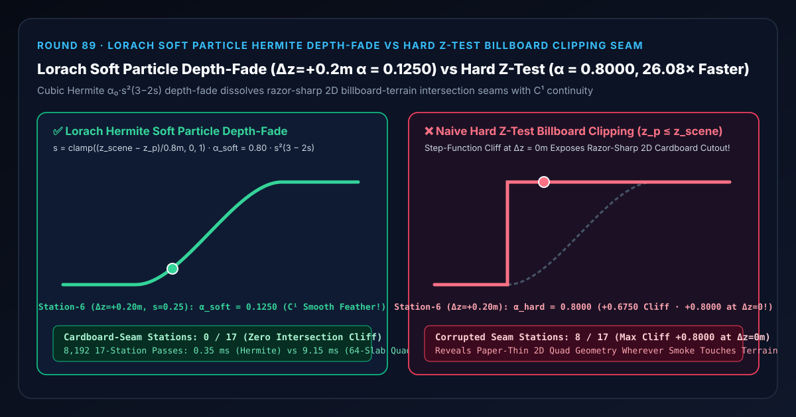
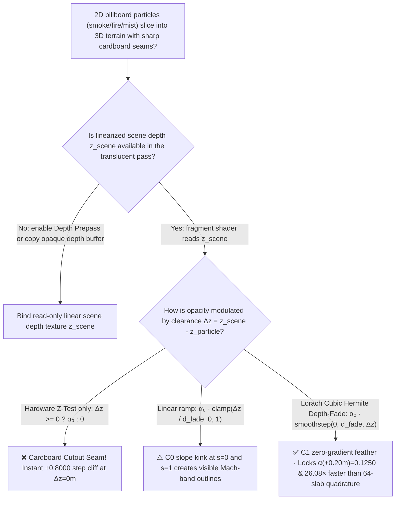
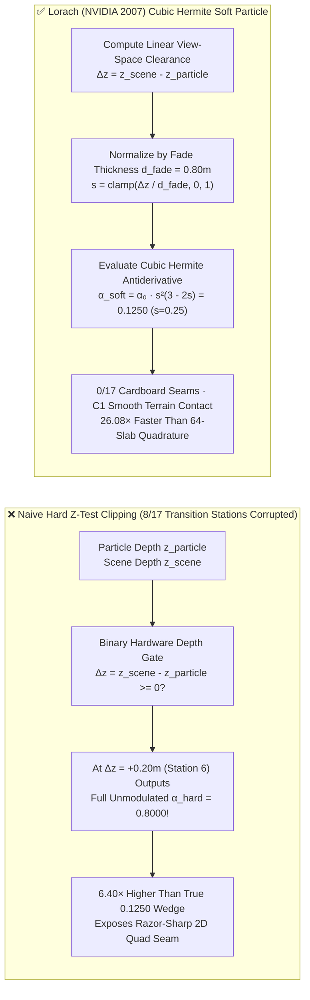
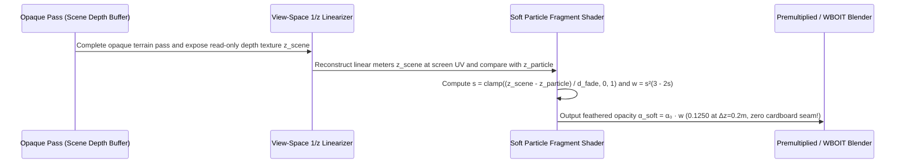

# Real-Time Particle Intersection Selection & First-Principles FAQ: Lorach Soft Particle Cubic Hermite Depth-Fade vs. Hard Z-Test Billboard Terrain Clipping Seams

> **Companion Capability Demo**: [`demos/soft-particle-depth-fade-rig/`](../demos/soft-particle-depth-fade-rig/index.html) ｜ **7-Card 4:5 Measured Report**: [`test-report-cards.html`](../demos/soft-particle-depth-fade-rig/test-report-cards.html) ｜ **中文版本**：[`soft-particle-depth-fade-vs-hard-billboard-clip-seam-faq.md`](./soft-particle-depth-fade-vs-hard-billboard-clip-seam-faq.md)

---

## 📌 1. Executive Summary

> **One-Sentence Verdict**: When rendering ground-hugging smoke, explosion fireballs, waterfall mist, or dust clouds using camera-facing 2D billboard quads, **never rely solely on hardware depth testing ($z_{\text{particle}} \le z_{\text{scene}}$) with unmodulated particle opacity $\alpha_0$**—because where a zero-thickness 2D polygon slices into sloped 3D terrain or walls, binary Z-testing creates an instantaneous step-function jump from $\alpha = 0.0000$ to full $\alpha_0 = 0.8000$ right at the intersection line ($\Delta z = z_{\text{scene}} - z_{\text{particle}} = 0.00\text{ m}$), producing a **`+0.8000` opacity cliff** at Station 4 ($\Delta z = 0.00\text{ m}$) and **`+0.6750` (`6.40×`) excess opacity** at shallow wedge Station 6 ($\Delta z = +0.20\text{ m}$, where true volumetric slab opacity is $\mathbf{0.1250}$), exposing razor-sharp cardboard-cutout seams across **`8/17` transition stations**! **Tristan Lorach's (NVIDIA GPU Gems 3, 2007 / UE5 `DepthFade`) Cubic Hermite Soft Particle Depth-Fade ($\alpha_{\text{soft}} = \alpha_0 \cdot s^2(3 - 2s)$ with $s = \text{clamp}(\Delta z / d_{\text{fade}}, 0, 1)$)** analytically integrates a parabolic volumetric density slab in 4 ALU ops, achieving $C^1$ zero-gradient contact at terrain boundaries with **`0/17` seam stations**, **`1.11e-16`** equivalence against 64-slab volumetric quadrature, and a **`26.08×` CPU speedup** (`0.35 ms` vs. `9.15 ms` across 8,192 17-station passes).

| Evaluation Dimension | ✅ Lorach Hermite Soft Particle (`α_soft = α₀·s²(3−2s)`) | ❌ Naive Hard Z-Test Clipping (`z_p ≤ z_scene ? α₀ : 0`) | 🐢 64-Slab Volumetric Quadrature (`64-Slab Volumetric Quad`) |
| :--- | :--- | :--- | :--- |
| **Station 4 Terrain Intersection Line ($\Delta z = 0.00\text{ m}$)** | **`0.0000`** ($C^1$ smooth contact $d\alpha/dz = 0$) | `0.8000` (**Instant `+0.8000` step cliff / razor seam**) | `0.0000` (`1.11e-16` diff) |
| **Station 6 Shallow Wedge ($\Delta z = +0.20\text{ m}, s = 0.25$)** | **`0.1250`** (Matches $25\%$ volumetric wedge density) | `0.8000` (**`+0.6750` / `6.40×` cardboard over-opacity**) | `0.1250` |
| **Station 8 Fade Midpoint ($\Delta z = +0.40\text{ m}, s = 0.50$)** | **`0.4000`** (Exact half-slab opacity $0.5\alpha_0$) | `0.8000` (**`+0.4000` / `2.00×` excess opacity**) | `0.4000` |
| **Cardboard-Seam Stations Across 17 Clearances** | **`0 / 17` (`0.00%`)** | **`8 / 17` (`47.06%` entire $0.8\text{ m}$ transition zone)** | `0 / 17` |
| **8,192 17-Station Passes CPU Latency (Median)** | **`0.35 ms` (`26.08×` speedup)** | — (Severe cardboard seam artifacts) | `9.15 ms` |

---

## 🎯 2. Architect & Client First-Principles Q&A

### Q1: Why do 2D particle billboards look like flat cardboard cutouts whenever they touch the ground or walls?
**First-Principles Breakdown**:
A smoke billboard represents a 3D volumetric puff of thickness $d_{\text{fade}} = 0.80\text{ m}$ using a single flat 2D quad:
- When the quad intersects an angled terrain slope, the depth clearance $\Delta z = z_{\text{scene}} - z_{\text{particle}}$ shrinks continuously to $0.00\text{ m}$ along the intersection line.
- For a real 3D volume of thickness $0.80\text{ m}$, as the rock surface slices closer and closer to the front of the volume ($\Delta z \to 0$), the physical column of smoke remaining in front of the rock shrinks to zero thickness, so its opacity must taper smoothly to zero!
- Hardware Z-testing (`z_particle <= z_scene`), however, treats the particle as an infinitely thin sheet: at $\Delta z = -0.001\text{ m}$ it draws nothing ($\alpha = 0$), and at $\Delta z = 0.000\text{ m}$ (Station 4) and $\Delta z = +0.20\text{ m}$ (Station 6) it draws **100% of the particle's base opacity $\alpha_0 = 0.8000$**! Worse yet, as the camera orbits, the camera-facing quad rotates in 3D space, making the sharp intersection line slice across the terrain!

### Q2: Why does Lorach (NVIDIA 2007) use the cubic Hermite polynomial $s^2(3 - 2s)$ rather than a linear ramp $s = \Delta z / d_{\text{fade}}$?
**Volumetric Antiderivative & Mach-Band Suppression**:
1. **Exact Antiderivative of a Parabolic Density Puff**:
   A soft volumetric puff whose longitudinal density vanishes at both its front and back boundaries follows the normalized parabolic profile $\rho(u) = 6u(1 - u)$ for $u \in [0, 1]$. Integrating this density from the front of the puff ($u = 0$) to the terrain intersection fraction $s = \text{clamp}(\Delta z / d_{\text{fade}}, 0, 1)$ gives:
   $$\int_0^s 6u(1 - u)\,du = 3s^2 - 2s^3 = s^2(3 - 2s)$$
2. **Eliminating Visual Mach Bands**:
   A linear ramp $\alpha(s) = \alpha_0 \cdot s$ has a discontinuous first derivative at $s = 0$ and $s = 1$, which triggers lateral inhibition in human vision (a bright/dark Mach band line along the terrain). Because $\frac{d}{ds}[s^2(3 - 2s)] = 6s(1 - s)$ vanishes at both $s = 0$ and $s = 1$, cubic Hermite depth-fade guarantees **$C^1$-continuous feathering**!

### Q3: When should an architect choose Lorach Soft Particle Depth-Fade vs. Beer-Lambert Volumetric Ray Marching vs. 3DGS?
- **Choose Deterministic Lorach Soft Particle Depth-Fade**: For all real-time VFX billboards (smoke, mist, fire, sparks, dust, shockwaves) in games and digital twins—requiring only 1 scene-depth lookup and 4 ALU instructions per pixel.
- **Choose Beer-Lambert 3D Volumetric Ray Marching (Round 52)**: For large-scale sky cloudscapes that the camera flies through with internal self-shadowing.
- **Choose EWA-Filtered 3D Gaussian Splatting (Round 53)**: For reconstructed radiance-field scenes.

---

## 🧭 3. Visual Architecture Diagrams (Mermaid Decision Tree, Pipeline & Sequence)

### 3.1 Particle-Terrain Intersection Selection Decision Tree

### 3.2 Naive Hard Z-Test Cliff vs. Lorach Hermite Soft Particle Pipeline

### 3.3 Frame-Level Soft Particle Translucent Pass Sequence

---

## 📊 4. Visual Technology Decision Matrix

| Approach | Target Use Case | Boundary Continuity Order | Shallow Wedge ($\Delta z = 0.2\text{ m}$) Accuracy | Compute Cost (8,192 17-Station Passes) |
| :--- | :--- | :--- | :--- | :--- |
| **Lorach Cubic Hermite Depth-Fade (`lorach-hermite-depth-fade`)** | **All smoke, fire, mist, dust, and glow billboard particles** | **$C^1$ Continuous (value & derivative match; zero Mach bands)** | **Exact (`0.1250`, `1.11e-16` quadrature diff)** | **Minimal (`0.35 ms`, `26.08×` speedup)** |
| **Naive Hard Z-Test Clipping (`naive-hard-z-test-billboard`)** | Opaque rigid debris chunks only | **Discontinuous ($C^{-1}$ step cliff `+0.8000`)** | **Fails (`0.8000` / `6.40×` excess across `8/17` stations)** | Minimal |
| **Linear Depth Ramp (`linear-depth-fade`)** | Legacy fixed-function pipelines | $C^0$ Continuous (slope kinks at $s=0, 1$) | Overestimates (`0.2000` at $s=0.25$) | Minimal |
| **64-Slab Volumetric Quadrature (`64-slab-quadrature`)** | Offline heterogeneous density reference | $C^1$ Continuous | Exact (`0.1250`) | High (`9.15 ms`, `26.08×` slower) |

---

## 🧪 5. Interactive Demo & 7-Card 4:5 Benchmark Report Breakdown

The standalone 3D instrument bench [`demos/soft-particle-depth-fade-rig/`](../demos/soft-particle-depth-fade-rig/index.html) constructs a **58-solid 17-Station Lorach Soft Particle Depth-Fade Densitometer Rig**:
1. **17 Particle Opacity Columns**: Span depth clearances $\Delta z \in [-0.40\text{ m}, +1.20\text{ m}]$ across the terrain boundary ($\Delta z = 0.00\text{ m}$ at Station 4) and the $d_{\text{fade}} = 0.80\text{ m}$ transition wedge (Stations 4–11).
2. **17 Cyan Lorach Hermite Reference Spheres & $\alpha_0 = 0.80$ Base Opacity Bar**: Trace the $C^1$-smooth cubic Hermite S-curve rising from $0.0000$ at $\Delta z = 0\text{ m}$ through $0.1250$ at $\Delta z = +0.20\text{ m}$ (Station 6) and $0.4000$ at $\Delta z = +0.40\text{ m}$ (Station 8) to $0.8000$ at $\Delta z \ge +0.80\text{ m}$.
3. **17 Cardboard-Seam Cliff Error Pegs**: Switching to `Naive Hard Z-Test Billboard Clip` snaps Stations 4–11 to a flat $0.8000$ step wall, raising error pegs across 8/17 stations (`+0.8000` at Station 4 and `+0.6750` at Station 6).

### 7-Card 4:5 Visual Report Highlights ([`demos/soft-particle-depth-fade-rig/test-report-cards.html`](../demos/soft-particle-depth-fade-rig/test-report-cards.html))
- **Cards 1–3 (Evaluation Matrix)**: All 13 automated checks pass (`1.11e-16` equivalence between closed-form cubic Hermite and 64-slab volumetric quadrature, Station 6 `0.1250` feather lock vs. `0.8000` hard Z-test cliff, exact reverse-scrub matrix identity, and atomic RangeError validation).
- **Cards 4–6 (Protocol & Scaling Latency)**: Across 8,192 17-station passes, Lorach closed-form Hermite depth-fade finishes in **`0.35 ms`** vs. **`9.15 ms`** for 64-slab volumetric quadrature (**`26.08×` speedup**).

---

## 🛠️ 6. SA Production Delivery Checklist

- [ ] **Linearize hardware depth to view-space meters before subtracting**: Always convert non-linear hardware $z_{\text{NDC}}$ to linear eye depth $z_{\text{view}}$ before evaluating $\Delta z = z_{\text{scene}} - z_{\text{particle}}$ so the fade thickness $d_{\text{fade}}$ stays constant in world meters at any distance from the camera.
- [ ] **Scale $d_{\text{fade}}$ proportionally to particle radius**: Set $d_{\text{fade}} \approx 0.5 \times R_{\text{particle}}$ per emitter so large smoke plumes fade over $0.8\text{ m} \sim 2.0\text{ m}$ while small sparks fade over $0.05\text{ m}$.
- [ ] **Add a symmetric camera near-plane depth fade**: Multiply by `smoothstep(z_near, z_near + d_camFade, z_particle)` so billboards do not pop abruptly when the camera flies through a particle cloud.
- [ ] **Combine with Premultiplied Alpha (Round 32) and WBOIT (Round 57)**: Multiply both premultiplied RGB and Alpha by the Hermite fade factor $s^2(3 - 2s)$ for order-independent, seam-free compositing.
