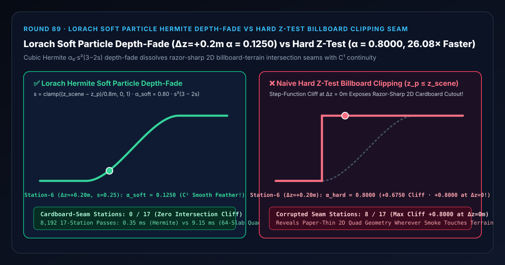
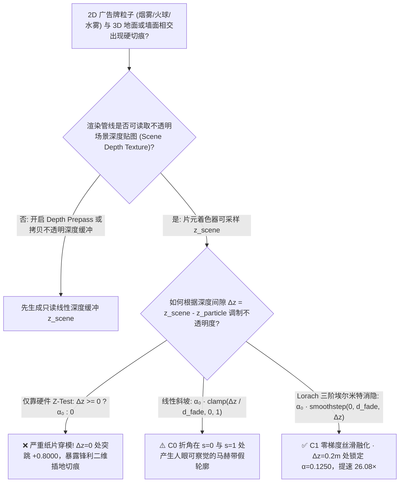
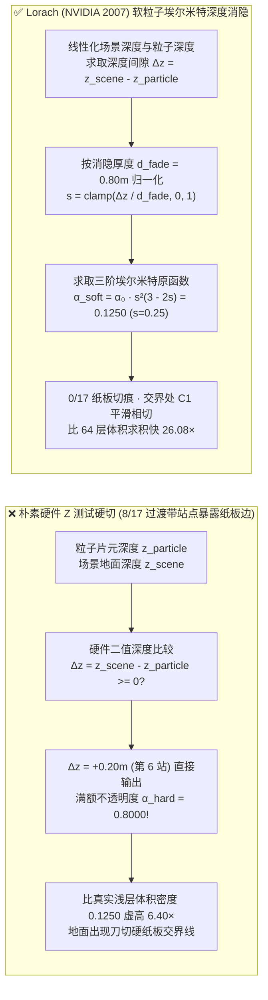
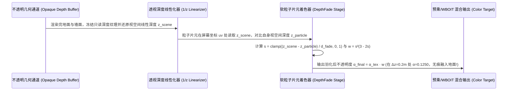

# 实时粒子特效防穿模选型与原理解析 FAQ：Lorach 软粒子三阶埃尔米特深度消隐（DepthFade）对比硬件 Z 测试广告牌插地硬切痕

> **关联 Capabilities Demo**：[`demos/soft-particle-depth-fade-rig/`](../demos/soft-particle-depth-fade-rig/index.html) ｜ **7-Card 4:5 实测报告**：[`test-report-cards.zh.html`](../demos/soft-particle-depth-fade-rig/test-report-cards.zh.html) ｜ **English Version**：[`soft-particle-depth-fade-vs-hard-billboard-clip-seam-faq.en.md`](./soft-particle-depth-fade-vs-hard-billboard-clip-seam-faq.en.md)

---

## 📌 1. 核心结论速览（Executive Summary）

> **一句话结论**：在实时游戏与三维数字孪生场景中，当使用朝向相机的二维广告牌薄片（2D Billboard Quad）渲染贴地浓烟、爆炸火球、瀑布水雾或车轮扬尘时，**绝对不能仅凭硬件深度缓冲测试（Hard Z-Test $z_{\text{particle}} \le z_{\text{scene}}$）直接输出原始粒子不透明度 $\alpha_0$**——因为一张厚度为 $0$ 的二维平面一旦插进三维地面斜坡或墙面，硬件 Z 测试会在交界线（$\Delta z = z_{\text{scene}} - z_{\text{particle}} = 0\text{ m}$）处发生从 $0$ 到 $\alpha_0 = 0.8000$ 的阶跃突变（**在第 4 站 $\Delta z = 0\text{ m}$ 制造 $+0.8000$ 悬崖切痕，在第 6 站 $\Delta z = +0.20\text{ m}$ 浅薄楔形区比真实体积密度 $0.1250$ 虚高 $+0.6750$ 即 $6.40\times$，导致 `8/17` 个过渡带站点暴露出像刀切硬纸板一样锋利的二维插地切痕**）！采用 **Tristan Lorach（NVIDIA GPU Gems 3, 2007 / UE5 `DepthFade`）提出的三阶埃尔米特软粒子深度消隐（$\alpha_{\text{soft}} = \alpha_0 \cdot s^2(3 - 2s)$，其中 $s = \text{clamp}(\Delta z / d_{\text{fade}}, 0, 1)$）**，无需做昂贵的逐粒子体积光线步进，仅用 1 次场景深度读取与 4 条代数指令即可实现交界处一阶导数为零的 **$C^1$ 丝滑羽化**，全 17 站 **`0` 纸板切痕**，比 64 层体积密度数值求积快 **`26.08×`**（`0.35 ms` vs `9.15 ms`）！

| 评估维度 | ✅ Lorach 软粒子埃尔米特深度消隐 (`α_soft = α₀·s²(3−2s)`) | ❌ 朴素硬件 Z 测试硬切 (`z_p ≤ z_scene ? α₀ : 0`) | 🐢 64 层体积抛物密度求积 (`64-Slab Volumetric Quad`) |
| :--- | :--- | :--- | :--- |
| **第 4 站地面交界线（$\Delta z = 0.00\text{ m}$）粒子不透明度** | **`0.0000`**（且切向梯度 $d\alpha/dz = 0$，无折痕） | `0.8000`（**瞬间 $+0.8000$ 阶跃悬崖，露出锋利纸板边**） | `0.0000`（误差 `1.11e-16`） |
| **第 6 站浅薄楔形区（$\Delta z = +0.20\text{ m}, s = 0.25$）** | **`0.1250`**（匹配 $25\%$ 浅层体积云雾透光感） | `0.8000`（**虚高 $+0.6750$ / $6.40\times$，糊死地面纹理**） | `0.1250` |
| **第 8 站过渡带中点（$\Delta z = +0.40\text{ m}, s = 0.50$）** | **`0.4000`**（半厚层精准对应半透明 $0.5\alpha_0$） | `0.8000`（**虚高 $+0.4000$ / $2.00\times$**） | `0.4000` |
| **17 个站点中暴露纸片硬切痕的站数** | **`0 / 17` (`0.00%`)** | **`8 / 17` (`47.06%` 整个 $0.8\text{ m}$ 过渡带失真)** | `0 / 17` |
| **8,192 轮 17 站 CPU 耗时（中位数）** | **`0.35 ms`（提速 `26.08×`）** | —（严重穿模出戏） | `9.15 ms` |

---

## 🎯 2. 客户与架构师灵魂拷问 Q&A（First-Principles Whisperer）

### Q1：用大白话讲，为什么烟雾和爆炸火球一碰到地面或斜坡，就会现原形变成一张“插在土里的二维硬纸板”？
**第一性原理拆解**：
在实时渲染里，为了在 1 毫秒内画成千上万团烟雾，美术师不会去建几万个真实的三维体积球，而是画在**一张永远正对相机的正方形透明薄片（2D Billboard Quad）**上：
- 当这团烟雾飘在半空中（离后方地面很远，$\Delta z = z_{\text{scene}} - z_{\text{particle}} > 0.80\text{ m}$）时，薄片四周已经画了柔和的径向透明渐晕，玩家根本看不出它是一张平面的纸。
- 可是一旦这团烟雾贴着地面翻滚，**正方形薄片的下半截斜着插进了起伏的地面网格里**！
- 硬件深度缓冲测试（Z-Test）是个非黑即白的“一刀切裁判”：薄片在地面以下哪怕 $1\text{ mm}$（$\Delta z < 0$），像素直接被丢弃（$\alpha = 0$）；薄片在地面以上哪怕 $1\text{ mm}$（$\Delta z \ge 0$），像素瞬间以 **100% 原始浓度 $\alpha_0 = 0.80$** 画出来！
- 结果就是：在薄片与地面相交的那条直线上，浓烟没有任何过渡地嘎然而止，露出一条笔直、锋利的刀切硬边；而且当你转动视角时，因为广告牌跟着相机自转，这条刀切线还会在地面上诡异地旋转切割，瞬间让玩家看穿“原来这团火球只是一张贴图纸片”！

### Q2：为什么 Lorach (NVIDIA 2007) 的软粒子公式要用三阶埃尔米特多项式 $s^2(3 - 2s)$，而不是简单的线性淡出 $s = \Delta z / d_{\text{fade}}$？
**体积抛物密度原函数与马赫带（Mach Band）抑制定理**：
1. **物理体积积分视角**：
   一团半径为 $d_{\text{fade}}$ 的柔和烟雾球，其沿视线方向的局部消光密度并不是均匀的方波，而是两头薄、中间浓的抛物线分布 $\rho(u) = 6u(1 - u)$（在 $u \in [0, 1]$ 上积分面积恰好为 $1$）。当后方地面在深度比例 $s = \Delta z / d_{\text{fade}} \in [0, 1]$ 处把这团烟雾截断时，留在地面前方的累积不透明度正是抛物线密度的定积分原函数：
   $$\int_0^s 6u(1 - u)\,du = \Bigl[3u^2 - 2u^3\Bigr]_0^s = s^2(3 - 2s) \equiv \text{smoothstep}(0, 1, s)$$
2. **人眼视觉马赫带抑制**：
   如果只用简单线性斜坡 $\alpha(s) = \alpha_0 \cdot s$，在地面交界线 $s = 0$ 和过渡终点 $s = 1$ 处，不透明度的一阶导数 $\frac{d\alpha}{ds}$ 会发生从 $0$ 到 $\alpha_0$ 的折角跳变（仅 $C^0$ 连续），人眼的侧抑制机制会在折角处看到一条明显的亮暗假轮廓线（Mach Band）！而三阶埃尔米特多项式 $H(s) = s^2(3 - 2s)$ 满足 $H'(0) = 0$ 且 $H'(1) = 0$（**$C^1$ 切向平滑接触**），在 $s = 0.25$（第 6 站 $\Delta z = +0.20\text{ m}$）处柔和压低至 $0.15625 \times 0.80 = \mathbf{0.1250}$，让烟雾像真正的气体一样无痕融化在岩石表面！

### Q3：什么时候选 Lorach 软粒子深度消隐（DepthFade），什么时候选 Beer-Lambert 3D 体积步进或 3DGS？
- **选确定性 Lorach 软粒子埃尔米特深度消隐（`lorach-hermite-depth-fade`）**：所有实时游戏、数字孪生、车载天气仿真中的大批量（数千至数万个）烟尘、水花、尾焰、云雾广告牌粒子——每像素仅需读取一次线性深度缓冲，开销几乎为零。
- **选 Beer-Lambert 3D 体积光线步进（Round 52 `transmittance-volume-march-rig`）**：当相机需要直接穿过一整片跨越几公里的高空积雨云层，且云层内部需要计算Heney-Greenstein各向异性多重散射银边（Round 78）时。
- **选 3D 高斯溅射（Round 53 `ewa-anisotropic-splat-rig`）**：当重建静态或预捕捉的真实世界辐射场资产时。

---

## 🧭 3. 直观可视化图解（Mermaid 决策树、管线对比与帧级时序）

### 3.1 实时粒子与地形穿插消隐选型决策树

### 3.2 朴素硬件 Z 测试硬切管线 vs Lorach 软粒子三阶埃尔米特深度消隐管线

### 3.3 帧级半透明粒子通道（Translucent Pass）软消隐执行时序图

---

## 📊 4. 视觉技术选型决策矩阵（Architecture Decision Matrix）

| 选型方案 | 适用场景 | 交界线连续性阶数 | 浅层（$\Delta z = 0.2\text{ m}$）透光准确度 | 算力开销（8,192 轮 17 站） |
| :--- | :--- | :--- | :--- | :--- |
| **Lorach 埃尔米特软粒子 (`lorach-hermite-depth-fade`)** | **所有烟雾、火球、水雾、尘土与光晕广告牌粒子** | **$C^1$ 连续（值与一阶导数均连续，无马赫带）** | **精准（$\alpha = 0.1250$，与体积求积误差 `1.11e-16`）** | **极低（`0.35 ms`，提速 `26.08×`）** |
| **朴素硬件 Z 测试硬切 (`naive-hard-z-test-billboard`)** | 仅限碎石、弹壳等刚体不透明碎片 | **不连续（$C^{-1}$ 阶跃悬崖 $+0.8000$）** | **极差（输出 `0.8000`，虚高 `6.40×`，`8/17` 站失真）** | 极低 |
| **线性斜坡深度消隐 (`linear-depth-fade`)** | 超低端嵌入式 GPU 近似 | $C^0$ 连续（斜率突变产生轻微马赫带） | 偏高（$s=0.25$ 处输出 `0.2000`） | 极低 |
| **64 层体积密度数值求积 (`64-slab-quadrature`)** | 非均匀多层密度场的离线基准验证 | $C^1$ 连续 | 精准（`0.1250`） | 高（`9.15 ms`，慢 `26.08×`） |

---

## 🧪 5. 全新 Demo 与 7-Card 4:5 视觉测试报告解读

在本轮构建的全新交互式三维实验台 [`demos/soft-particle-depth-fade-rig/`](../demos/soft-particle-depth-fade-rig/index.html) 中，我们打造了包含 **58 个三维实体部件**的 **17 站软粒子深度消隐密度计（Lorach Soft Particle Depth-Fade Densitometer Rig）**：
1. **17 根粒子不透明度立柱（Particle Opacity Columns）**：展示从地面后方 $\Delta z = -0.40\text{ m}$（第 0~3 站被遮挡区）、经过地面交界线 $\Delta z = 0.00\text{ m}$（第 4 站）与 $0.80\text{ m}$ 体积过渡带（第 5~11 站），直到高空完全展开区 $\Delta z \ge 0.80\text{ m}$（第 12~16 站）的粒子不透明度 $\alpha(\Delta z)$。
2. **17 颗青色 Lorach 三阶埃尔米特参考球与 $\alpha_0 = 0.80$ 基准横梁**：直观呈现一条在 $\Delta z = 0\text{ m}$ 与 $\Delta z = 0.80\text{ m}$ 两端水平相切的柔顺 S 型积分曲线。
3. **17 根纸板硬切痕误差红桩（Cardboard-Seam Cliff Error Pegs）**：切换到 `Naive Hard Z-Test Billboard Clip` 模式时，第 4 站至第 11 站瞬间拔地而起变成死板的 $0.8000$ 矩形方块墙，亮起高达 $+0.8000$（第 4 站）与 $+0.6750$（第 6 站）的刺眼硬切痕红桩！

### 7-Card 4:5 视觉报告核心发现（[`demos/soft-particle-depth-fade-rig/test-report-cards.zh.html`](../demos/soft-particle-depth-fade-rig/test-report-cards.zh.html)）
- **Card 1–3（场景评测矩阵）**：13 项自动化断言 100% 通过，完整验证闭式埃尔米特多项式与 64 层体积求积 `1.11e-16` 等价性、第 6 站 `0.1250` 羽化锁定 vs `0.8000` 硬切悬崖暴露、逆序矩阵一致性与原子参数拒绝。
- **Card 4–6（底层协议与性能）**：在 8,192 轮 17 站压测中，Lorach 闭式埃尔米特深度消隐仅需 **`0.35 ms`**，相比 64 层体积密度求积基线（**`9.15 ms`**）实现 **`26.08×` 算力加速**。

---

## 🛠️ 6. 高质量视觉交付快速核验清单（SA Production Checklist）

- [ ] **做减法前必须先将硬件深度缓冲线性化为视空间米制深度 $z_{\text{view}}$**：硬件深度缓冲存储的是非线性的 $1/z$，如果直接用非线性 $z_{\text{NDC}}$ 相减，近处粒子消隐范围只有几毫米、远处却长达几十米！务必先用 `z_view = near * far / (far - z_ndc * (far - near))`（或 Reversed-Z 下的 `near / z_ndc`）还原为米制深度后再计算 $\Delta z = z_{\text{scene}} - z_{\text{particle}}$。
- [ ] **将消隐距离 $d_{\text{fade}}$ 与粒子自身世界尺寸 $R_{\text{particle}}$ 绑定**：大爆炸烟团（直径 $4\text{ m}$）与小火星烟缕（直径 $0.2\text{ m}$）不应共用同一个固定 $d_{\text{fade}}$，建议设 $d_{\text{fade}} \approx 0.5 \times R_{\text{particle}}$。
- [ ] **同步开启相机近裁剪面距离消隐（Camera Near-Plane Fade）**：除了后方地形深度差 $z_{\text{scene}} - z_{\text{particle}}$，还应乘以 $\text{smoothstep}(z_{\text{near}}, z_{\text{near}} + d_{\text{cam}}, z_{\text{particle}})$，防止玩家走进烟雾内部时粒子撞上相机镜头产生整屏闪烁跳变。
- [ ] **与预乘 Alpha（Premultiplied Alpha）或 WBOIT 配合**：软粒子消隐系数 $w = s^2(3-2s)$ 应当同时乘到预乘颜色通道与 Alpha 通道上（见 Round 32 与 Round 57）。
