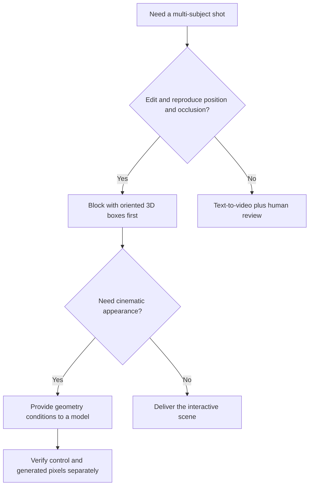
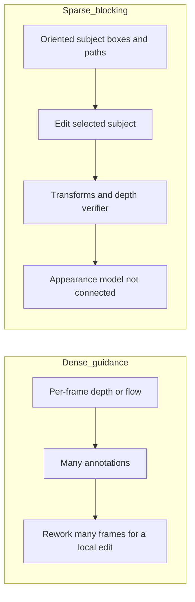
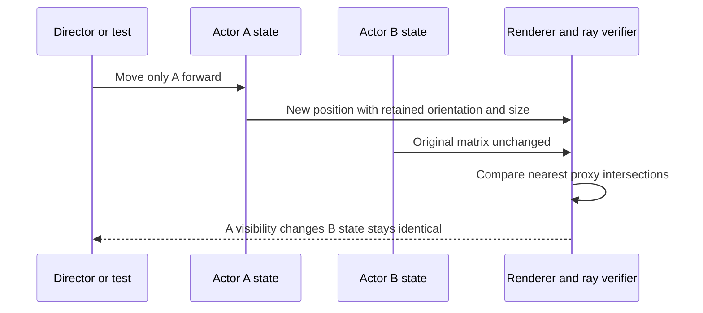

# Edit one subject without rewriting the shot: a sparse 3D blocking FAQ

**Three minutes for the decision; ten minutes for local-edit practice.**

[中文](sparse-spatial-blocking-faq.md) · [Interactive demo](https://turbo998.github.io/animation/demos/spatial-blocking-stage/) · [Measured seven cards](../demos/spatial-blocking-stage/test-report-cards.html)

## ① 📌 Executive Summary

- **A 2D rectangle says where something sits on screen; a 3D box also carries size, orientation and depth.** Correctly passing in front of or behind a pillar should not depend only on a model's guess.
- **Local edits need explicit invariants.** Changing A's depth or orientation leaves B's matrix identical in this code layer. That is not a guarantee that an untested neural video model preserves B.
- **A new original 62-solid warehouse miniature with 11 local checks.** Two actors, trajectories, a pillar, oriented proxies and exportable contracts—not refinements of legacy demos.
- **Daily tracking retains date boundaries.** LooseControlVideo's preprint is dated June 17, 2026; Adobe's ECCV 2026 coverage verifies the sparse oriented-box direction. Retrieved November 9, 2026. No verified daily popularity denominator, same-day release claim, or executed Wan/LCV weights.

## ② 🎯 Customer and architect Q&A

### Q1 When should I choose AI video versus interactive code?

Video models are useful for natural performances, materials and environments. Code offers a direct interface for repeatedly editing “A passes behind the pillar while B retains its original path.” A new text prompt alone may resample unrequested background or subject details.

Use a layered approach when appropriate: code authors space, trajectories and occlusion; a model supplies appearance. **Control correctness and generated-output correctness are separate evaluations.** This guide measures the former, not generated video quality or neural identity retention.

### Q2 Under which explicit constraints does code win?

Requirements such as “only change A,” “state which object occludes which,” “seek a timestamp,” and “export repeatable coordinates” are directly inspectable in code. Rich artistic shots without exact internal state may favor generation. This is not an aesthetic leaderboard.

For a logistics presales demo, customers can adjust two miniature courier paths and inspect camera visibility before deciding whether to produce an AI-enhanced promotional film. The prototype is not a real AGV controller and does not establish safe production motion.

### Q3 How does the pipeline work, and why is older guidance labor-intensive or unreliable?

A 2D box gives a rough screen location but does not say whether the object is behind a pillar or which way its long side points. Per-frame depth, optical flow and dense point tracks provide more information but require substantial authoring and rework.

Blocking means placing the scene before shooting it. A few oriented 3D boxes record **center, dimensions and orientation** for each actor, then a timeline describes movement. It resembles moving props in a miniature set rather than repainting pixels frame by frame.

The demo maps time and the selected actor's edits to two boxes, rigid scene transforms, rendering and ray verification. A's edit parameters do not enter B's function, so B remains invariant. Export preserves both subjects' state, not merely a vague instruction to move the left vehicle forward.

Depth determines occlusion. A ray from the camera toward an actor's center tests whether its proxy or the pillar is encountered first, then compares an analytic implementation with independent Three.js raycasting against those same proxy shapes. **This is not pixel-level occlusion accuracy.** Robots have wheels and empty spaces; their coarse boxes do not.

LCV supplies sparse boxes as conditions to a Wan 2.2 model trained with DNOCS annotations for size, orientation and depth-ordered occlusion. This demo illustrates the authoring principle; it does not implement that complete encoding, training or inference pipeline.

### Q4 How can I reproduce the workflow in ten minutes?

1. Run `npm run dev`, open `/demos/spatial-blocking-stage/`, and pause at the three-second crossing.
2. Inspect A's center-proxy ray meeting the pillar first. Move A forward by three illustrative units and observe the visibility change.
3. Rotate A locally; its oriented guide and solid robot rotate together while B stays unchanged.
4. Select B to edit it, or reset both. Reduced motion starts paused.
5. Export `SPATIAL_BLOCKING.json`; inspect dimensions, orientation, matrices and edit parameters.
6. Run `npx vitest run tests\spatial-blocking.test.ts`. After building and serving the preview on 4335, run `node scripts\benchmark-blocking.mjs`.

Units are illustrative scene units. Business simulation needs its own unit convention, collision model and real-device constraints; never forward these demo parameters directly to a robot.

## ③ 🧭 Visual explanations

## ④ 📊 Architect Decision Matrix

| Requirement | 2D boxes | Sparse 3D boxes | Dense depth / flow | Text-only video |
| --- | --- | --- | --- | --- |
| Screen-layout sketch | Simple | Projectable | Expensive | Expresses intent |
| Explicit depth and orientation | Insufficient | Directly expressible here | Rich but heavier to edit | Not guaranteed |
| Edit one subject only | Additional state constraints | Invariants testable in code | Often multi-frame rework | Other content may change |
| Natural deformation and appearance | Needs a generation layer | Coarse guide, not full physics | Denser conditions | Often useful, with review |
| Real-device safety | Insufficient | Not certified here | Not automatic certification | Pixels are not certification |

**Capacity example:** two subjects with one oriented box per sampled frame require a small set of structured authoring states, rather than a per-pixel depth image. Exact byte savings depend on encoding and precision; no compression or VRAM-saving ratio is invented.

## ⑤ 🧪 New demo and measured findings, including seven cards

The [sealed report](../demos/spatial-blocking-stage/report.json) records eleven local acceptance checks, forty-five time/depth/orientation states and ninety proxy rays comparing independent analytic and Three.js implementations; zero disagreements were observed. Separate unit tests cover 125 inputs. These numbers describe **proxy geometry**, not neural LCV output.

At the three-second crossing, moving A forward changes the nearest hit from the pillar to A, while B's matrix remains identical. The finding comes from exported states and ray comparisons, not a visual guess.

Timing compares existing robot entities with per-frame entity reconstruction, both retaining the same geometry cache. All seven repetitions are preserved. It excludes display latency and says nothing about video-model inference speed.

[English cards](../demos/spatial-blocking-stage/test-report-cards.html) · [中文七卡](../demos/spatial-blocking-stage/test-report-cards.zh.html). Scene: `synthetic`; code checks: `measured`; video inference, pixel-level occlusion, neural identity and real robot safety: `not_measured`.

## ⑥ 🛠️ Architect Checklist

- [ ] Give subjects stable IDs and explicit dimensions, orientation, depth and time units.
- [ ] Define invariants for every unedited subject.
- [ ] Share transforms between proxies and solid subjects.
- [ ] Check front/back occlusion, not only 2D center ordering.
- [ ] Separate proxy rays, actual silhouettes and generated pixels.
- [ ] Preserve reduced motion, offscreen pause, keyboard control and export.
- [ ] Keep unconnected inference `not_measured`; do not borrow paper bars.
- [ ] Never treat miniature authoring parameters as safe robot commands.
- [ ] Verify licenses, data rights and conditioning interfaces before model integration.
- [ ] Publish bilingual guide, original demo, SVG and sealed seven-card evidence.

**Primary sources:** [LCV arXiv, June 17, 2026](https://arxiv.org/abs/2606.19495) · [Official project](https://shariqfarooq123.github.io/LooseControlVideo/) · [Adobe ECCV 2026 coverage](https://research.adobe.com/news/eccv-2026/). Retrieved November 9, 2026; no source video, imagery or code reproduced and no claimed daily ranking.
