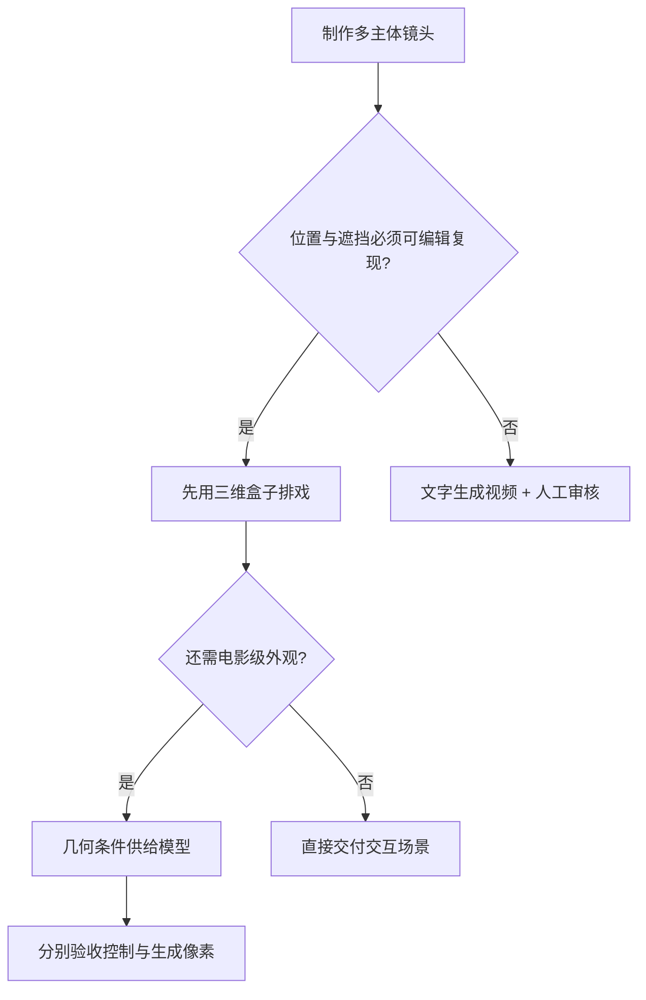
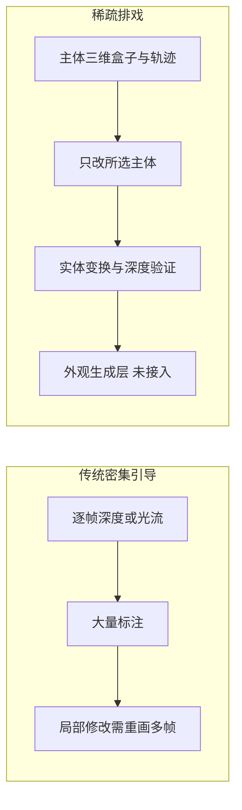
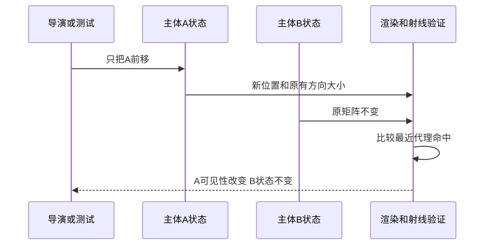

# 只改一个主体，不改坏整段镜头：稀疏三维排戏选型与原理 FAQ

**3 分钟看结论与矩阵；10 分钟按 Q4 复刻局部编辑。**

[English](sparse-spatial-blocking-faq.en.md) · [交互 Demo](https://turbo998.github.io/animation/demos/spatial-blocking-stage/) · [中文七卡](../demos/spatial-blocking-stage/test-report-cards.zh.html)

## ① 📌 核心结论速览（Executive Summary）

- **二维框只说“画面占哪里”，三维框还说“谁在前、怎么转、多大”。** 想让两辆车正确经过柱体前后，深度不能只靠生成模型猜。
- **局部编辑应有明确不变量。** 本例只改 A 的深度或朝向，B 的矩阵保持完全不变；这是代码控制层能直接检查的承诺，不是神经视频一定不会漂移的保证。
- **全新 62 实体微缩仓储场景，11 项代码验收。** 双主体轨迹、遮挡柱、三维代理框和导出契约都是原创，不是再微调旧演示。
- **每日能力追踪有日期边界。** LooseControlVideo 首稿为 2026-06-17，Adobe ECCV 2026 报道确认其稀疏有方向三维盒子控制方向。检索日期 2026-11-09；没有可靠当日日热度分母，不声称今日发布或热度第一。这里未运行 Wan 2.2 / LCV 权重。

## ② 🎯 客户与架构师灵魂拷问 Q&A

### Q1 何时选 AI 视频大模型 vs 何时选代码驱动交互式动画？

要自然人物、材质与环境，视频模型有优势；要反复编辑“A 从柱子后经过，B 保持原轨迹”，代码提供更直接的控制与验收接口。只有一段生成视频时，改一句提示可能连未要求改变的背景与另一个主体都重采样。

可采用两层方案：代码编排空间、轨迹和遮挡，生成模型补像素外观。**控制正确与生成正确必须分开评测。** 本专题验证前者，没有生成视频质量或身份一致性的实测。

### Q2 什么场景下代码驱动动画严格更优？

如果交付契约要求“只改 A，B 状态逐项不变”“明确谁遮挡谁”“可跳到指定时刻”“导出可复现的坐标”，代码层能确定地满足这些约束。对于无需精确内部状态的艺术镜头，模型可提供更丰富外观；两者不是审美排名。

客户方案：仓储或物流售前演示，先让客户交互调整两台小车的行进路线，观察柱体遮挡与镜头可见性，再决定是否使用 AI 做宣传片。它不是实际 AGV 控制系统，也未验证碰撞安全或生产机器人行为。

### Q3 底层管线如何工作？为什么旧方法费劲、容易假？

给一个二维框，模型知道某个东西大致在屏幕左边，却不知道它在柱子前还是后、盒子长边朝哪。逐帧画深度图、光流或密集点轨迹能提供更多信息，但创作者要标很多帧，修改成本高。

“排戏”就是导演先摆位置：用少量三维盒子给每个主体记录**中心位置、大小与方向**，再在时间轴上描述运动。它更像在微缩摄影棚里挪道具，不是逐像素修画。

本 Demo 的路径是：时间 + 所选主体的编辑 → 两个有方向的盒子 → 小车刚体变换 → 渲染与射线核验。改 A 的参数没有进入 B 的函数，未编辑主体因此不受影响。导出保留两个主体的状态，不能只存“让左边的车往前一点”。

遮挡由真实深度决定。我们从相机朝主体中心发一条射线，计算先碰到代理盒子还是柱体；再与 Three.js 对相同代理几何的独立射线检查比较。**这不是逐像素遮挡准确率。** 小车有轮子与空隙，而代理框是粗形状；不把框级判断冒充视频像素级指标。

LooseControlVideo 的研究把这些稀疏盒子作为生成条件，使用 Wan 2.2 与包含大小、方向、深度遮挡信息的 DNOCS 标注。本例只复现作者控制层的思路，没有构建其完整编码器或训练/推理管线。

### Q4 10 分钟如何复刻？

1. `npm run dev` 后打开 `/demos/spatial-blocking-stage/`，暂停在 3 秒“交错时刻”。
2. 看 A 的中心代理射线先碰到柱体；选 A 并前移 3 个示意单位，A 的可见性改变。
3. 旋转 A 的本地朝向，观察代理框和实体小车一起旋转；B 不变。
4. 切换 B 再调整，或点击“复位编辑”恢复两台车的原状态。减少动态模式默认暂停。
5. 导出 `SPATIAL_BLOCKING.json`，检查盒子大小、方向、矩阵与编辑参数。
6. 执行 `npx vitest run tests\spatial-blocking.test.ts`。构建并启动 4335 预览后，执行 `node scripts\benchmark-blocking.mjs`，保存实测 JSON。

所有单位是示意场景单位。若接入业务仿真，要另外统一坐标单位、碰撞模型与真实设备约束，不可直接将本例参数发给机器人。

## ③ 🧭 直观可视化图解

## ④ 📊 Architect Decision Matrix

| 需求 | 二维框 | 稀疏三维盒子 | 密集深度/光流 | 纯文字视频生成 |
| --- | --- | --- | --- | --- |
| 屏幕布局草图 | 简单 | 可投影 | 成本高 | 只表达意图 |
| 明确深度与朝向 | 信息不足 | 本例直接表达 | 可表达，编辑较重 | 不保证 |
| 只改一个主体 | 需额外状态约束 | 代码层可验不变量 | 常需重做多帧 | 可能连带变化 |
| 自然形变和外观 | 需生成层 | 粗引导，非完整物理 | 能提供更密条件 | 通常适合，但需审核 |
| 真实设备安全 | 不足 | 本例不足 | 非自动认证 | 像素不能认证 |

**容量算例：** 两个主体、每主体每帧一个有方向盒子，与逐像素深度图相比，作者需要编辑的是少量结构化状态。具体字节量取决于编码和精度；这里不虚构压缩率或显存节省比例。

## ⑤ 🧪 全新 Demo 与 Benchmark 核心发现（含 7-Card）

[封存数据](../demos/spatial-blocking-stage/report.json)记录 11 项本机代码验收、45 组时间/深度/朝向组合对应的 90 条代理射线，以及独立解析法与 Three.js 的比较；所测不一致次数为 0。单元测试另外覆盖 125 组输入。它们的对象是**代理几何**，不是 LCV 神经模型的生成质量。

局部编辑的核心发现：在 3 秒交错时刻，A 前移后最近命中从柱体改为 A，而 B 的矩阵逐项完全相同。这个结论由真实场景导出和对照状态得出，不是从图片猜测。

性能图比较复用小车实体与每帧重建实体对象的 JS 提交耗时，两个路径都使用相同几何缓存。7 次重复的原始样本全部保留；不包含显示器延迟，也不代表所有视频模型更快。

[中文七卡](../demos/spatial-blocking-stage/test-report-cards.zh.html) · [English cards](../demos/spatial-blocking-stage/test-report-cards.html)。场景为 `synthetic`，代码测试为 `measured`；视频推理、像素级遮挡、主体身份与真实机器人安全为 `not_measured`。

## ⑥ 🛠️ Architect Checklist

- [ ] 主体有稳定 ID，大小、朝向、深度与时间单位明确。
- [ ] 编辑所选主体时，未编辑主体有明确不变量。
- [ ] 代理框与实体共用变换，不能画两套不一致状态。
- [ ] 验证前后遮挡，而不只看二维中心点顺序。
- [ ] 区分框级射线、真实轮廓与生成像素评测。
- [ ] 减少动态、离屏冻结、键盘和导出可用。
- [ ] 模型未接入标为 `not_measured`，不得挪用论文条形图数字。
- [ ] 不把微缩演示参数直接当生产机器人命令。
- [ ] 视频模型接入前核验许可、数据权利与条件编码接口。
- [ ] 双语指南、原创 Demo、SVG 与原始七卡证据可访问。

**来源：** [LCV arXiv，2026-06-17](https://arxiv.org/abs/2606.19495) · [官方项目说明](https://shariqfarooq123.github.io/LooseControlVideo/) · [Adobe ECCV 2026 机构报道](https://research.adobe.com/news/eccv-2026/)。检索于 2026-11-09；不转载项目视频、图像或代码，不声称每日热度排名。
