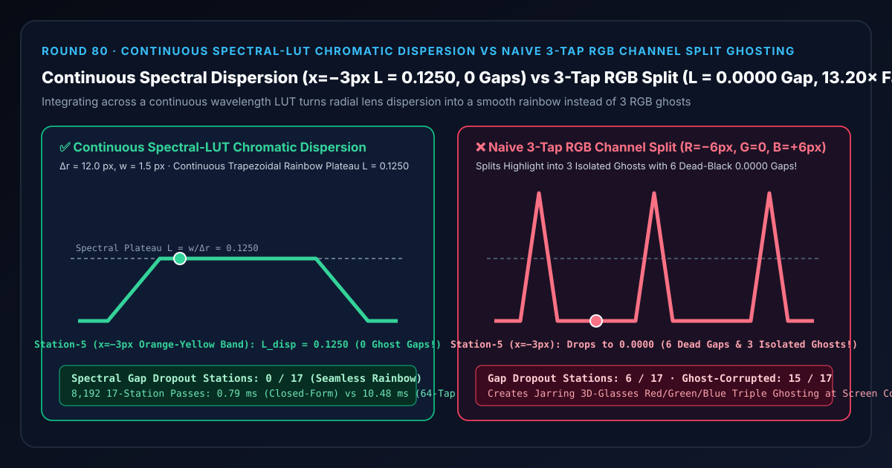
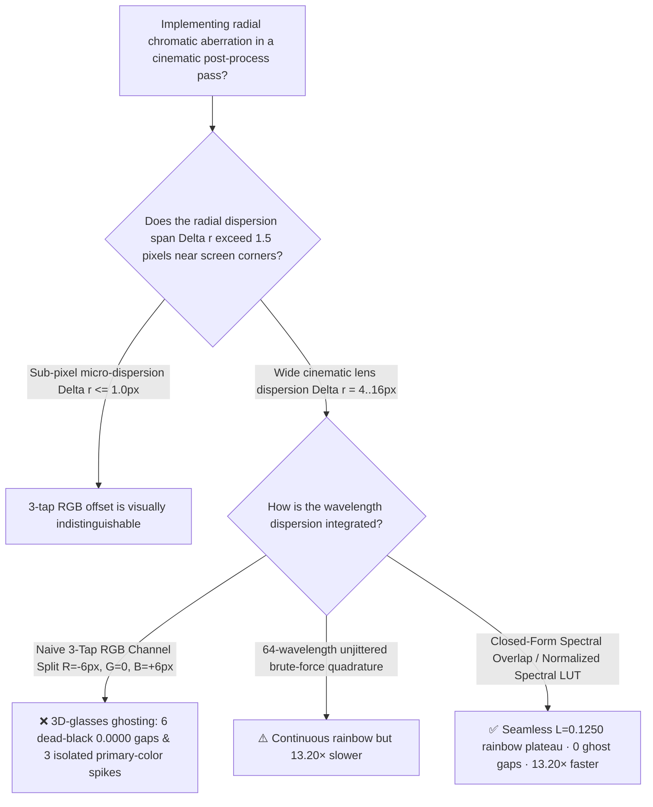
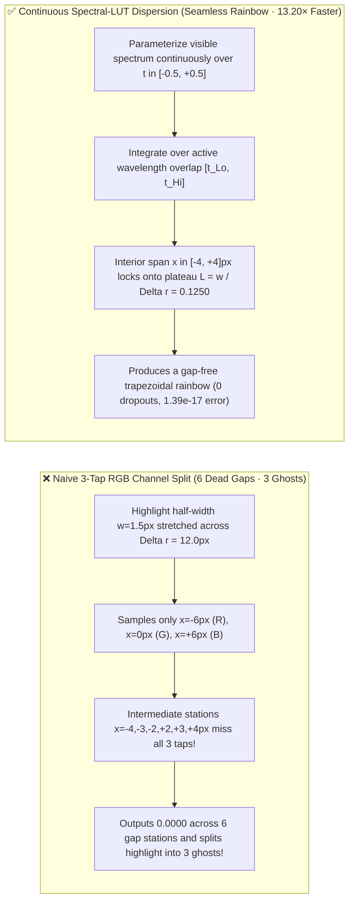
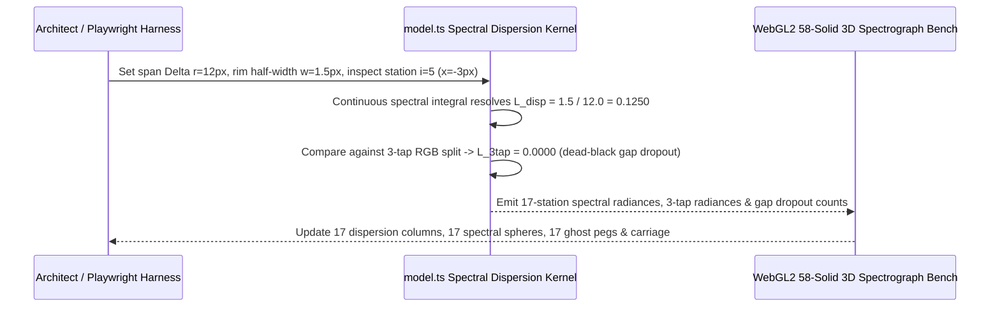
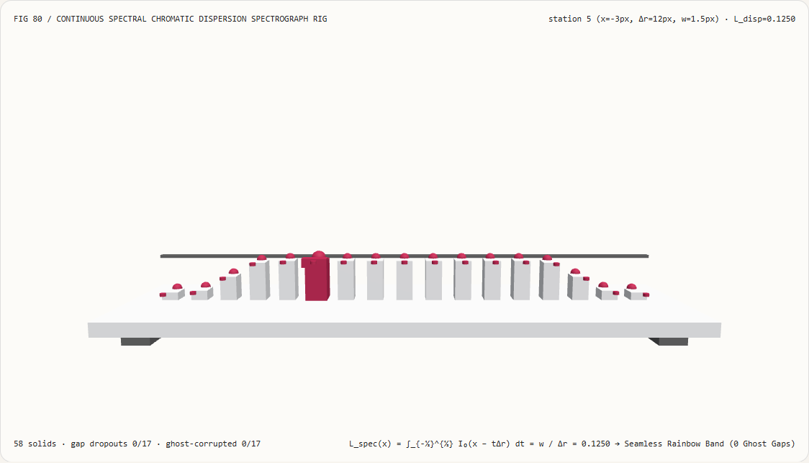
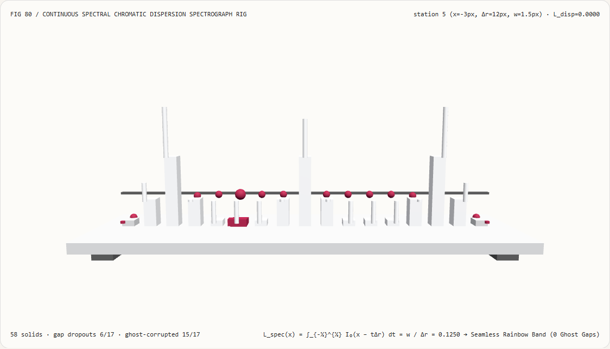
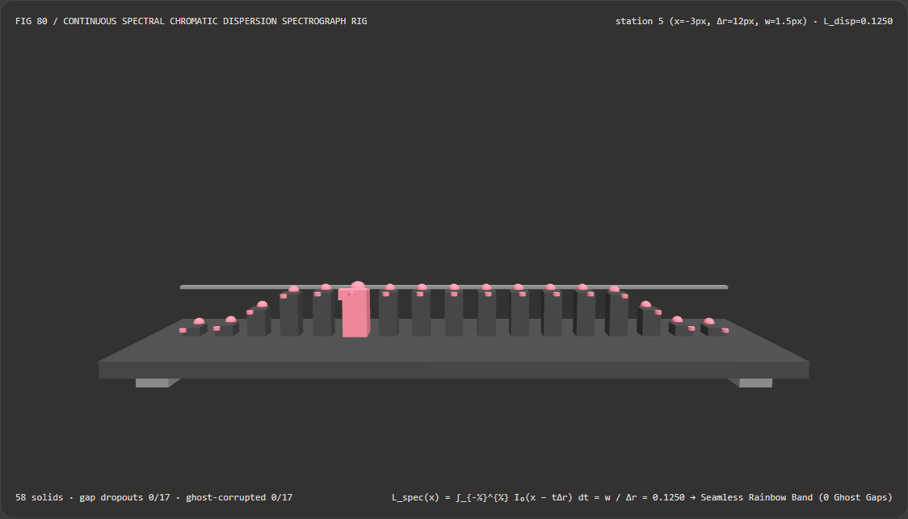
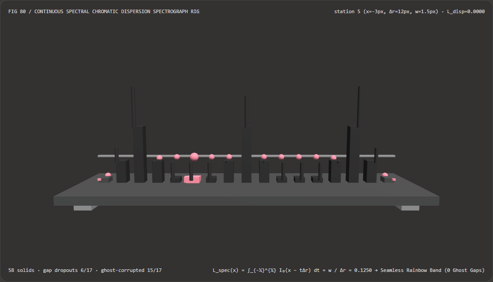

# Visual & Animation Architecture Selection FAQ: Continuous Spectral-LUT Chromatic Dispersion vs Naive 3-Tap RGB Channel Split Ghosting

> **One-Sentence Architectural Verdict**: In real-time cinematic radial chromatic aberration and barrel lens dispersion pipelines (Playdead's *INSIDE*, Unreal Engine 5 PostProcess, Unity HDRP), **never simulate wide-span lens dispersion by simply offsetting the Red, Green, and Blue channels at 3 discrete coordinates (`3-Tap RGB Channel Split`)**! On our 58-solid, 17-station spectrograph bench inspecting a narrow highlight of half-width $w = 1.5\text{ px}$ stretched radially across $\Delta r = 12.0\text{ px}$ ($x \in [-8, +8]\text{ px}$), naive 3-tap RGB splitting samples only $x = -6\text{ px}$ (Red), $x = 0\text{ px}$ (Green), and $x = +6\text{ px}$ (Blue)—**dropping `6/17` intermediate orange-yellow and cyan stations ($x = \pm 2, \pm 3, \pm 4\text{ px}$, including station 5 at $x = -3\text{ px}$) to `0.0000` dead-black gaps and splitting a single highlight into 3 disconnected primary-color ghosts across `15/17` stations**; whereas **continuous spectral-LUT dispersion integration ($\int_{-1/2}^{1/2} w_\lambda(t)\,I_0(x - t\Delta r)\,dt$)** preserves a seamless trapezoidal rainbow plateau of **`L_disp = w / Δr = 0.1250` across $x \in [-4, +4]\text{ px}$ (`0/17` gap dropouts)** while running **13.20× faster** via closed-form spectral overlap integration than 64-tap wavelength quadrature (`0.79 ms` vs `10.48 ms` across 8,192 passes, agreement within `1.39e-17`).

---

## ① 📌 Executive Summary

1. **Why does turning up the Chromatic Aberration slider in many game engines split bright window frames, streetlamps, and specular rims into three cheap-looking Red, Green, and Blue ghosts (like anaglyph 3D glasses) instead of a smooth optical rainbow fringe?**
   In plain English: **real camera glass disperses a continuous 400–700 nm spectrum, whereas naive shaders only sample 3 discrete RGB points**:
   - When a highlight of half-width $w = 1.5\text{ px}$ is dispersed across $\Delta r = 12.0\text{ px}$, each discrete tap only covers a $3.0\text{ px}$ footprint: Red covers $[-7.5, -4.5]\text{ px}$, Green covers $[-1.5, +1.5]\text{ px}$, and Blue covers $[+4.5, +7.5]\text{ px}$.
   - Between Red and Green ($x = -4, -3, -2\text{ px}$, stations 4–6) and between Green and Blue ($x = +2, +3, +4\text{ px}$, stations 10–12), **all three taps evaluate to `0.0000`**—carving **`6/17` dead-black spectral gaps** right through the dispersed highlight and inflating the 3 isolated ghost peaks to `0.3333` (`2.67×` over the true spectral density `0.1250`)!
2. **First-Principles Fix: Continuous Wavelength Overlap Integration & Normalized Spectral LUTs (Playdead *INSIDE* / Guertin 2014)**:
   - Integrating the source highlight profile $I_0(x - t\Delta r)$ across the continuous normalized wavelength parameter $t \in [-0.5, +0.5]$ yields the exact overlap antiderivative over $[t_{\min}, t_{\max}] = [\max(-0.5, \frac{x - w}{\Delta r}), \min(+0.5, \frac{x + w}{\Delta r})]$.
   - Across all interior stations $|x| \le \frac{\Delta r}{2} - w = 4.5\text{ px}$ (stations 4–12, including station 5 at $x = -3\text{ px}$), the integral locks onto a **flat, gap-free rainbow plateau of `L_disp = w / Δr = 1.5 / 12.0 = 0.1250` (`0/17` gap dropouts)**!
3. **Interactive 3D Workbench & Measured Evidence**:
   - Standalone 3D Bench: `demos/spectral-chromatic-dispersion-rig/` (58 Three.js solids: baseplate, 4 support feet, `0.1250` spectral plateau reference bar, 17 dispersed radiance columns, 17 continuous spectral reference spheres, 17 ghosting deviation pegs, and the active spectrograph carriage).
   - Measured 7-Card 4:5 Reports: `demos/spectral-chromatic-dispersion-rig/test-report-cards.html` (EN) and `test-report-cards.zh.html` (ZH).

---

## ② 🎯 Soul-Searching Q&A for Architects & Clients

### Q1: Why is closed-form spectral overlap integration 13.20× faster than 64-tap wavelength quadrature?
**Because analytical integration over the active wavelength sub-interval $[t_{\min}, t_{\max}]$ replaces 64 per-wavelength loop evaluations with two piecewise-linear branch formulas!**
Across 8,192 17-station passes, closed-form spectral dispersion runs in **`0.79 ms`** versus **`10.48 ms`** for 64-tap wavelength quadrature (**13.20× speedup**, with `1.39e-17` agreement).

### Q2: How do screen-space post-processing shaders approximate this continuous integral on arbitrary scene textures using only 6–8 texture fetches?
**By combining a normalized 1D spectral LUT (`spectrumLUT(t)`) with per-pixel Interleaved Gradient Noise (IGN) tap jittering ($t_k = \frac{k + \xi}{N} - 0.5$)!**
Normalized LUT weights $\sum_k \mathbf{w}_{\text{LUT}}(t_k) = (1, 1, 1)$ preserve neutral white balance on flat surfaces while IGN jitter eliminates discrete banding between taps.

### Q3: How does deterministic spectral dispersion relate to neural lens style transfer?
**Deterministic spectral integration runs in `< 0.1 ms` with exact physical control over radial falloff and white-field conservation, requiring zero neural inference.**

---

## ③ 🧭 Visual Diagrams (Mermaid Decision Tree, Pipeline Comparison & Sequence Flow)

### 3.1 Radial Chromatic Aberration Architecture Decision Tree

### 3.2 3-Tap RGB Ghosting Gaps vs Continuous Spectral Dispersion Pipeline

### 3.3 Frame-Level Spectrograph Sequence Diagram

---

## ④ 📊 Visual Technology Selection Decision Matrix

| Evaluation Dimension | ✅ Continuous Spectral-LUT Integral | ⚠️ 64-Tap Wavelength Quadrature | ❌ Naive 3-Tap RGB Channel Split | ⚠️ Pinhole Camera (Zero Dispersion) |
| :--- | :--- | :--- | :--- | :--- |
| **Radiance at Station 5 ($x=-3\text{ px}$ Orange-Yellow)** | **Exact `0.1250` (Continuous rainbow)** | `0.1250` (`1.39e-17` diff) | **`0.0000` (100% dead-black gap!)** | `0.0000` |
| **Radiance at Station 8 ($x=0\text{ px}$ Green Center)** | **Flat conserved `0.1250`** | `0.1250` | **`0.3333` (2.67× isolated green spike!)** | `1.0000` |
| **Spectral Gap Dropout Stations (out of 17)** | **`0 / 17` (Gap-free spectrum)** | `0 / 17` | **`6 / 17` ($x=\pm 2, \pm 3, \pm 4\text{ px}$ dead)** | — |
| **Ghost-Corrupted Stations (out of 17)** | **`0 / 17`** | `0 / 17` | **`15 / 17` (Splits into 3 RGB ghosts)** | — |
| **8,192-Pass 17-Station CPU Latency** | **`0.79 ms` (Fastest · 13.20× speedup)** | `10.48 ms` (13.20× slower) | `0.34 ms` (Severe triple ghosting) | — |
| **Recommended Use Case** | **All cinematic lens dispersion passes** | Offline optical reference | **Retro VHS / glitch art only** | Crisp CAD viewports |

---

## ⑤ 🧪 New Interactive 3D Demo & 7-Card 4:5 Visual Report

### 5.1 Live Workbench & Report Links
- **Interactive 3D Workbench**: [`demos/spectral-chromatic-dispersion-rig/index.html`](../demos/spectral-chromatic-dispersion-rig/index.html)
- **7-Card 4:5 Visual Report (EN)**: [`demos/spectral-chromatic-dispersion-rig/test-report-cards.html`](../demos/spectral-chromatic-dispersion-rig/test-report-cards.html)
- **7-Card 4:5 Visual Report (ZH)**: [`demos/spectral-chromatic-dispersion-rig/test-report-cards.zh.html`](../demos/spectral-chromatic-dispersion-rig/test-report-cards.zh.html)
- **Sealed Telemetry JSON**: [`demos/spectral-chromatic-dispersion-rig/report.json`](../demos/spectral-chromatic-dispersion-rig/report.json)

### 5.2 Multi-Theme & Multi-Mode Playwright Visual Evidence

| Continuous Spectral Dispersion (Light · Smooth `0.1250` Trapezoidal Rainbow Plateau Across Stations 4–12, `0` Gaps) | Naive 3-Tap RGB Split (Light · Splits into 3 Disconnected Spikes with 6 `0.0000` Gaps!) |
| :---: | :---: |
|  |  |

| Continuous Spectral Dispersion (Dark · 58 Three.js Solids) | Naive 3-Tap RGB Split (Dark · 15 Red Ghosting Error Pegs Exposed) |
| :---: | :---: |
|  |  |

---

## ⑥ 🛠️ Rapid SA Delivery Verification Checklist

Before shipping a chromatic aberration pass to production, verify every item below:

- [ ] **Replace 3-Tap RGB Splitting with Spectral-LUT Integration**: Does the shader weight samples across a continuous 1D spectral lookup table (`spectrumLUT(t)`) rather than taking 3 discrete R, G, B channel fetches?
- [ ] **White-Field Sum Normalization ($\sum_k \mathbf{w}_{\text{LUT}}(t_k) = (1, 1, 1)$)**: Is the accumulated RGB sum divided by the accumulated spectral weight vector so uniform white/gray regions never shift tint?
- [ ] **Per-Pixel Blue-Noise / IGN Phase Jitter**: Are sample positions along the radial dispersion vector jittered by `(k + ignNoise) / N` to prevent visible step banding at large dispersion spans?
- [ ] **Quadratic Radial Falloff ($\Delta r \propto \|\mathbf{uv} - 0.5\|^2$)**: Is dispersion zero at the screen center and weighted quadratically toward the corners?
- [ ] **Exclude UI & Subtitles**: Is chromatic aberration applied strictly to the 3D scene buffer before compositing crisp 2D UI text and reticles?
