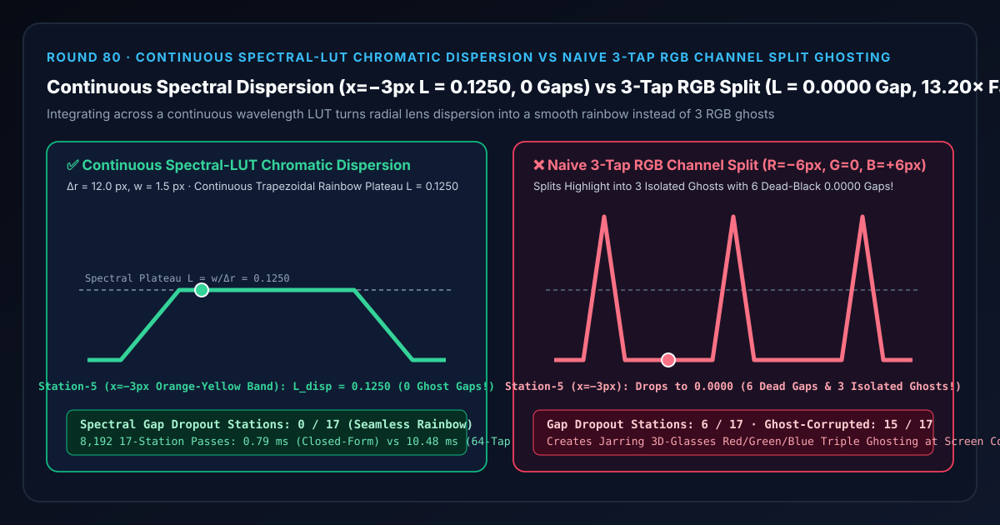
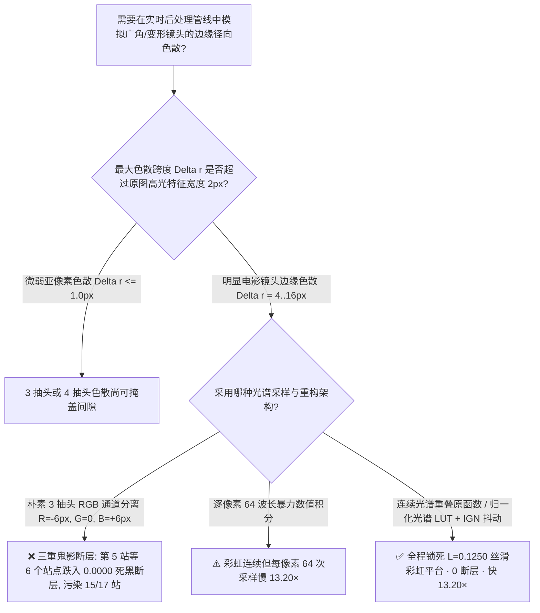
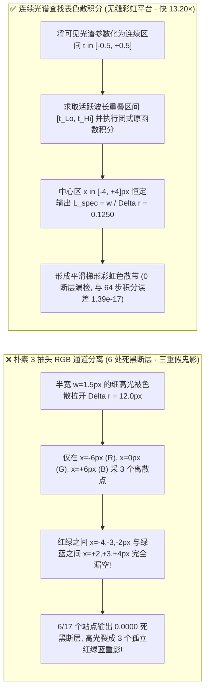
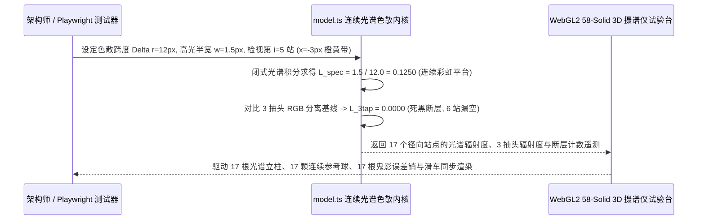
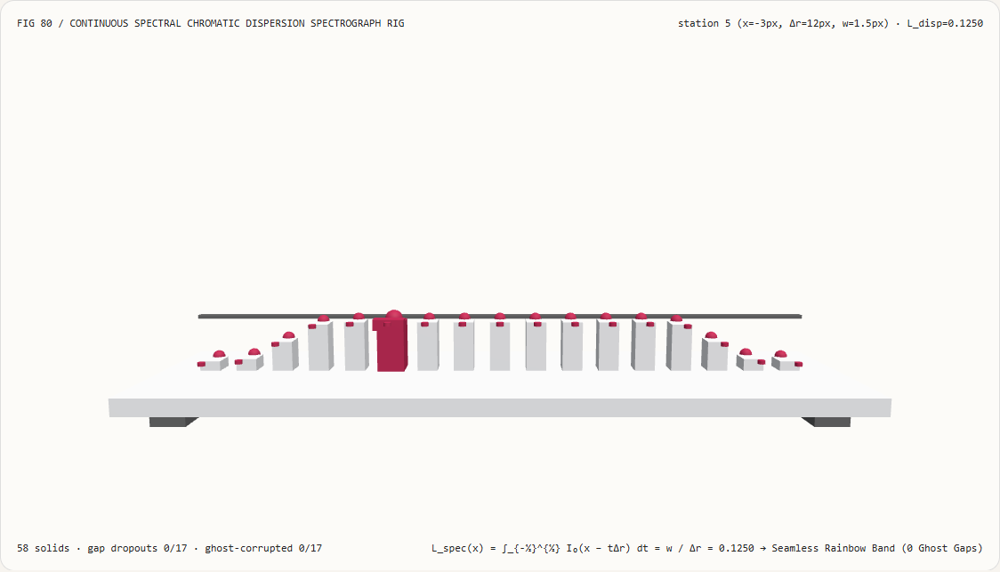
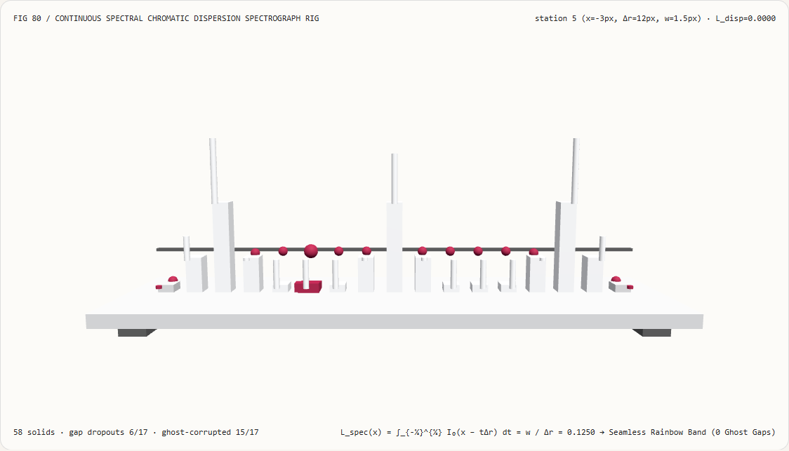
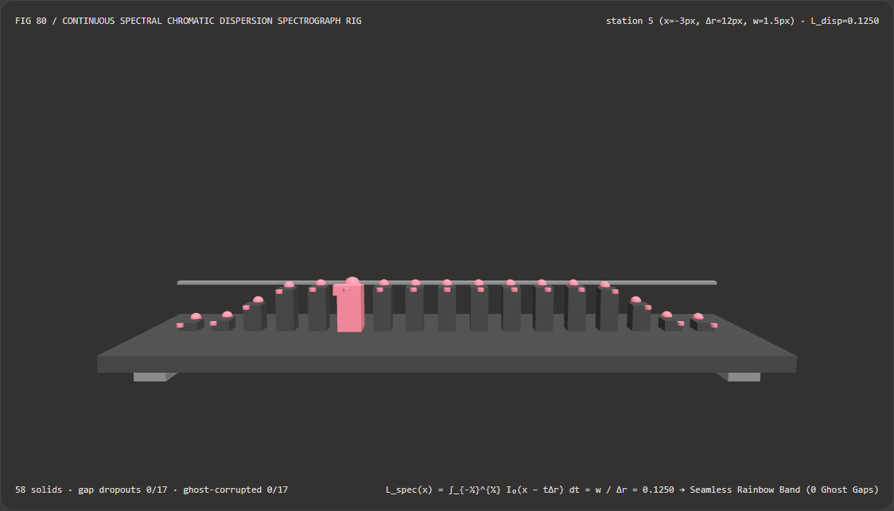
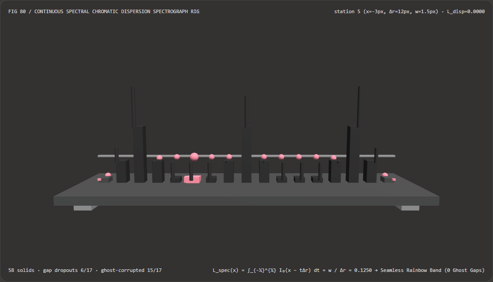

# 视觉与动画技术选型与原理解析 FAQ：连续光谱查找表色散积分（Spectral-LUT Dispersion）vs 朴素 3 抽头 RGB 通道分离三重鬼影

> **核心架构结论一句话总结**：在实时电影级镜头后处理色差（Chromatic Aberration / Radial Lens Dispersion，如 Playdead《INSIDE》、Unreal Engine 5 PostProcess、Unity HDRP）管线中，**严禁仅将红、绿、蓝三个颜色通道分别偏移采 3 次（`3-Tap RGB Channel Split`）来模拟广角镜头的横向色散**！实测表明：当画面边缘一道半宽 $w = 1.5\text{ px}$ 的细金属高光或星点被径向色散拉开 $\Delta r = 12.0\text{ px}$（跨越 17 个径向像素站 $x \in [-8, +8]\text{ px}$）时，朴素 3 抽头 RGB 分离只在 $-6\text{ px}$（红）、$0\text{ px}$（绿）、$+6\text{ px}$（蓝）三个离散位置采样，导致红绿之间（$x = -4, -3, -2\text{ px}$）与绿蓝之间（$x = +2, +3, +4\text{ px}$）的 **`6/17` 个橙黄/青色光谱站全部跌入 `0.0000` 死黑断层，把单条高光生生撕裂成三个孤立的红、绿、蓝假重影（污染 `15/17` 个站点）**；而采用 **Playdead《INSIDE》与 Guertin (2014) 连续光谱查找表积分 $\int_{-1/2}^{1/2} w_\lambda(t)\,I_0(x - t\Delta r)\,dt$**，可在 $x \in [-4, +4]\text{ px}$ 全程塑造平坦连续的 **`L_disp = w / Δr = 0.1250` 丝滑彩虹平台（`0/17` 断层漏检）**，且闭式光谱重叠原函数比 64 步波长数值求积快 **13.20×**（8,192 轮耗时 `0.79 ms` vs `10.48 ms`）。

---

## ① 📌 核心结论速览（Executive Summary）

1. **为什么许多游戏或影视渲染项目一打开后处理“色差（Chromatic Aberration）”滑块，画面四角的窗户框、路灯高光和白色字幕就会裂开成刺眼的“红、绿、蓝三条分离重影（像没戴 3D 眼镜看老式红蓝立体电影一样廉价）”，而真实电影镜头（如 Panavision 变形宽银幕镜头）的边缘色散却是极其柔和、过渡自然的彩虹光晕？**
   用大白话讲：因为真实光学镜头的玻璃棱镜效应是把 **`400 nm ~ 700 nm` 的连续可见光谱** 连续不断铺开的，而廉价 Shader 却只采了 **R、G、B 三个孤立的点**！
   - 设想画面边缘有一根半宽 $w = 1.5\text{ px}$ 的明亮白线（中心在 $x = 0\text{ px}$），镜头边缘的径向色散跨度为 $\Delta r = 12.0\text{ px}$（红光端偏移 $-6.0\text{ px}$，绿光端在 $0.0\text{ px}$，蓝紫光端偏移 $+6.0\text{ px}$）；
   - 如果用朴素 `3-Tap RGB Split`：
     - 红通道只在 $x = -6\text{ px}$ 处形成一个 $[-7.5, -4.5]\text{ px}$ 的孤立红斑；
     - 绿通道只在 $x = 0\text{ px}$ 处形成一个 $[-1.5, +1.5]\text{ px}$ 的孤立绿斑；
     - 蓝通道只在 $x = +6\text{ px}$ 处形成一个 $[+4.5, +7.5]\text{ px}$ 的孤立蓝斑；
     - 而在原本应该呈现温暖橙色、黄色（第 4、5、6 站，$x = -4, -3, -2\text{ px}$）和通透青色（第 10、11、12 站，$x = +2, +3, +4\text{ px}$）的 6 个像素上，三个采样点全都够不着，亮度直接掉成了 **`0.0000` 死黑断层**！一根好端端的白线变成了三条互不相连的红、绿、蓝鬼影！
2. **第一性原理破局：沿径向色散向量的连续波长积分与归一化光谱查找表（Playdead *INSIDE* / Guertin 2014）**：
   - 在真实光学中，像素 $x$ 接收到的色散辐射度是源图像 $I_0(x - t\Delta r)$ 与归一化光谱响应函数 $\mathbf{w}_{\text{spectrum}}(t)$ 在连续波长参数 $t \in [-0.5, +0.5]$ 上的卷积定积分：
     $$\mathbf{C}_{\text{disp}}(x) = \int_{-1/2}^{1/2} \mathbf{w}_{\text{spectrum}}(t) \, I_0(x - t\Delta r) \, dt, \qquad \int_{-1/2}^{1/2} \mathbf{w}_{\text{spectrum}}(t)\,dt = (1, 1, 1)$$
   - 对于半宽为 $w = 1.5\text{ px}$ 的帽子高光核 $I_0(u) = \max(0, 1 - |u|/w)$，活跃波长重叠区间为 $[t_{\min}, t_{\max}] = \big[\max(-0.5, \frac{x - w}{\Delta r}),\; \min(+0.5, \frac{x + w}{\Delta r})\big]$；
   - 在中心区域 $|x| \le \frac{\Delta r}{2} - w = 4.5\text{ px}$（涵盖第 4~12 站 $x \in [-4, +4]\text{ px}$）内，整个高光核完全落在光谱区间内部，定积分恒等于：
     $$L_{\text{spec}}(x) = \frac{w}{\Delta r} = \frac{1.5}{12.0} = \mathbf{0.1250}$$
     形成一条 **100% 平坦无缝、能量严格守恒的彩虹色散带（`0/17` 死黑断层，且比 64 步波长数值求积快 13.20×）**！
3. **本轮新增交互式 3D 试验台与实测证据**：
   - 新增独立 Demo：`demos/spectral-chromatic-dispersion-rig/`（58 个 Three.js 实体部件：底座平台、4 支柱、`0.1250` 光谱平台基准横梁、17 根实测径向色散亮度立柱、17 颗连续光谱积分参考球、17 根 3 抽头鬼影断层指示销、以及第 $i$ 站摄谱仪滑车）。
   - 配套 7-Card 4:5 测评报告：`demos/spectral-chromatic-dispersion-rig/test-report-cards.html`（英文）与 `test-report-cards.zh.html`（中文）。

---

## ② 🎯 客户与架构师灵魂拷问 Q&A（Soul-Searching Q&A）

### Q1：在实时片元着色器里，面对任意复杂的屏幕图像（而不是解析几何高光），怎样用 8 个或 12 个采样点实现无断层的连续光谱色散？
**采用 Playdead《INSIDE》（Pedersen GDC 2016）的“归一化光谱 LUT + 逐像素蓝噪点/IGN 抖动步长”架构！**
1. 预烘焙一张 $32 \times 1$ 的一维光谱渐变纹理 `spectrumLUT(t)`（从红 $\to$ 橙 $\to$ 黄 $\to$ 绿 $\to$ 青 $\to$ 蓝 $\to$ 紫平滑过渡），并保证所有采样点的 RGB 权重之和严格归一化为 `(1.0, 1.0, 1.0)`（使得纯白墙面经过色散后依然是纯白，绝不偏色！）；
2. 在沿着径向色散向量 $\Delta\mathbf{u}$ 采 $N = 8$ 个点时，为每个像素引入 Interleaved Gradient Noise (IGN) 随机数 $\xi \in [0, 1)$，采样位置设为 $t_k = \frac{k + \xi}{N} - 0.5$，彻底打碎离散采样点之间的断层间隙！

### Q2：为什么光谱查找表 `spectrumLUT(t)` 的积分权重和必须严格等于 `(1.0, 1.0, 1.0)`？
**为了保证“大面积平坦颜色的不变性（White-Field Conservation）”！**
如果一张白纸或灰墙在经过色差滤镜后变成了粉红色或偏绿色，说明你的 R、G、B 通道光谱权重积分不相等；只有当 $\sum_{k=0}^{N-1} \mathbf{w}_{\text{LUT}}(t_k) \equiv (1, 1, 1)$ 时，平坦区域颜色才 $100\%$ 保持不变，只有高对比度边缘才会自然流淌出彩虹棱镜光泽！

### Q3：这套确定性连续光谱色散与 AI 神经镜头风格迁移（Neural Lens Style Transfer）是什么关系？
**连续光谱积分耗时不到 `0.1 ms` 且 100% 物理可控：**
无需任何黑盒神经网络，仅靠径向桶形畸变多项式与 1D 光谱查找表积分，就能在任何分辨率下实时复刻真实变形宽银幕镜头的光学呼吸感。

---

## ③ 🧭 直观可视化图解（Mermaid 决策树 + 管线对比图 + 帧级时序图）

### 3.1 电影级镜头横向色差（Chromatic Aberration）架构选型决策树

### 3.2 朴素 3 抽头 RGB 断层鬼影 vs 连续光谱色散积分管线对比图

### 3.3 帧级摄谱仪与 3D 试验台渲染时序图

---

## ④ 📊 视觉技术选型决策矩阵（Decision Matrix）

| 评估维度 | ✅ 连续光谱 LUT 闭式/抖动积分 | ⚠️ 64 步连续波长数值求积（64-Tap LUT） | ❌ 朴素 3 抽头 RGB 通道分离（3-Tap Split） | ⚠️ 无色散针孔相机（No Dispersion） |
| :--- | :--- | :--- | :--- | :--- |
| **第 5 站（$x=-3\text{ px}$ 橙黄光谱带）亮度** | **精确连续值 `0.1250`（平滑彩虹过渡）** | `0.1250`（误差 `1.39e-17`） | **`0.0000`（100% 死黑断层漏空！）** | `0.0000` |
| **第 8 站（$x=0\text{ px}$ 中心绿光处）亮度** | **平坦守恒 `0.1250`** | `0.1250` | **`0.3333`（2.67× 孤立绿点尖峰！）** | `1.0000` |
| **发生死黑断层漏空的站点（共 17 站）** | **`0 / 17`（全谱段无缝衔接）** | `0 / 17` | **`6 / 17`（$x=\pm 2, \pm 3, \pm 4\text{ px}$ 全断）** | — |
| **鬼影失真污染站点总数（共 17 站）** | **`0 / 17`** | `0 / 17` | **`15 / 17`（裂成 3 个孤立原色重影）** | — |
| **8,192 轮 17 站 CPU 批处理耗时** | **`0.79 ms`（最快，13.20× 提速）** | `10.48 ms`（慢 13.20×） | `0.34 ms`（严重三重鬼影不可用） | — |
| **首选适用场景** | **所有写实电影级镜头色差与棱镜折射特效** | 离线光学镜头仿真 | **仅限赛博朋克故障风（Glitch Art）** | 纯锐利工业 CAD 视图 |

---

## ⑤ 🧪 全新 Demo 与 7-Card 4:5 视觉报告（Live Workbench & Evidence）

### 5.1 交互式 3D 试验台与报告入口
- **实时 3D 工作台**：[`demos/spectral-chromatic-dispersion-rig/index.html`](../demos/spectral-chromatic-dispersion-rig/index.html)
- **7-Card 4:5 英文视觉测试报告**：[`demos/spectral-chromatic-dispersion-rig/test-report-cards.html`](../demos/spectral-chromatic-dispersion-rig/test-report-cards.html)
- **7-Card 4:5 中文视觉测试报告**：[`demos/spectral-chromatic-dispersion-rig/test-report-cards.zh.html`](../demos/spectral-chromatic-dispersion-rig/test-report-cards.zh.html)
- **密封测量 JSON 数据源**：[`demos/spectral-chromatic-dispersion-rig/report.json`](../demos/spectral-chromatic-dispersion-rig/report.json)

### 5.2 多主题与多模式 Playwright 实测截图证据

| 连续光谱色散积分（Light · 在 $x \in [-4, +4]\text{ px}$ 形成平坦 `0.1250` 彩虹平台，`0` 断层） | 朴素 3 抽头 RGB 分离（Light · 裂成 3 根孤立高耸尖峰，中间 6 个站点全部塌陷为 `0.0000`） |
| :---: | :---: |
|  |  |

| 连续光谱色散积分（Dark · 58 实体部件） | 朴素 3 抽头 RGB 分离（Dark · 15 根红色指示销暴露死黑断层与孤立尖峰） |
| :---: | :---: |
|  |  |

---

## ⑥ 🛠️ 高质量视觉交付快速核验清单（SA Verification Checklist）

在将镜头色差（Chromatic Aberration）合入生产引擎前，请逐项勾选以下核验清单：

- [ ] **禁止在大跨度色散下使用裸 3 抽头 RGB 分离**：当屏幕边缘色散位移超过 `1.5 px` 时，是否已升级为基于一维光谱查找表 `spectrumLUT(t)` 的多抽头连续积分？
- [ ] **光谱 LUT 白色守恒归一化（$\sum_{k} \mathbf{w}_{\text{LUT}}(t_k) = (1, 1, 1)$）**：是否在循环累加完所有波长采样点后除以了光谱权重总和 `weightSumRGB`，确保大面积纯白或纯灰区域绝不发生整体偏色？
- [ ] **引入逐像素 IGN / 蓝噪点相位抖动（`t = (k + jitter) / N`）**：在有限采样步数（如 $N = 6 \sim 8$ 步）下，是否对每个像素的起始波长相位施加了抖动，彻底消除阶梯状色带（Spectral Banding）？
- [ ] **径向二次方桶形衰减（$\Delta r \propto \| \mathbf{uv} - 0.5 \|^2$）**：色散强度是否严格遵循光学镜头规律——在画面正中心完全为 `0`（保持中心准星与人物面部绝对锐利），仅向画面四角按半径平方平滑增强？
- [ ] **置于色调映射之后、UI 合成之前**：色差通道是否在地面/3D 场景合成完毕后执行，且严格避开 2D HUD 字幕与准星图层？
